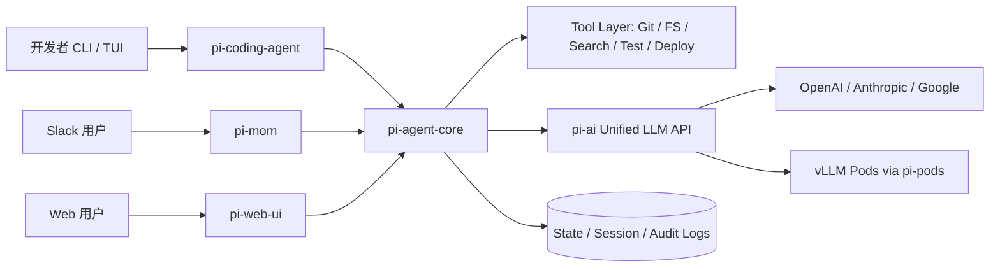

# pi-mono智能体全栈架构解析

[← 返回总览](../README.md) · [按日期浏览](../by-date/index.md)

来源：`omnisun://digest/1774604600596` · 创建：2026-03-27  
评级：**B**（65.5 分） · 类别：AI工程与智能体架构 / LLM应用开发 / 开发工具链  
标签：`AI Agent` `Monorepo` `LLM API` `Coding Agent` `TUI/Web UI`

**切换：** [正文](#tab-body) · [摘要（1）](#tab-1) · [追问（1）](#tab-2)

> **一句话点评**：适合作为工程参考文档浏览，不适合作为高质量深度分析文章精读。
>
> **摘要**：文章本质上是对 pi-mono 仓库多个 README 的聚合，介绍统一 LLM API、Agent Core、Coding Agent、TUI、Web UI 与 GPU pods 管理等模块，适合做功能盘点和接口查询，但结构冗长、证据与案例支撑不足。

## 分析要点

- **核心高价值点**：最有价值的是把统一多模型调用、Agent 状态机、终端/网页 UI 和自托管推理部署串成一套可复用的全栈工具链。
- **留存建议**：短期参考并归档，适合作为选型与实现细节查询资料（内容覆盖统一LLM API、Agent运行时、CLI、TUI、Web UI与部署模块，适合后续查阅具体接口和架构设计。）
- **不足**：文本主要是README与仓库目录拼接，噪声较多，缺少作者整理后的重点提炼与横向比较。

**知识要点**

- 统一 LLM API 支持多提供商、多模型切换、工具调用、流式事件与跨提供商上下文传递
- Agent Core 明确了消息流、事件流、工具执行钩子与并行/串行工具执行策略
- Coding Agent 通过扩展、技能、模板和主题实现高度可定制的终端智能体工作流
- TUI 与 Web UI 分别提供终端和浏览器侧的交互组件与会话存储能力
- Pods 模块展示了基于 vLLM 的远程 GPU 模型部署与 OpenAI 兼容接口封装方式

**行动项**

- 若你在做智能体工程，可优先阅读 \`packages/ai\` 与 \`packages/agent\` 的 README，提炼统一事件模型和工具调用流程
- 将其作为选型参考，对比 LangChain、Mastra、OpenAI SDK 等现有方案的扩展性与复杂度
- 如果需要终端式编码代理，可重点关注 \`packages/coding-agent\` 的扩展机制和会话管理设计

<a id="tab-body"></a>

## 正文

### badlogic/pi-mono: AI agent toolkit: coding agent CLI, unified LLM API, TUI &amp; web UI libraries, Slack bot, vLLM pods

https://github.com/badlogic/pi-mono/tree/main

[Open in github.dev](https://github.dev/) [Open in a new github.dev tab](https://github.dev/) Open in codespace

Name Name

Last commit message

Last commit date

fix(coding-agent): respect agentDir for sdk session paths [#2457](https://github.com/badlogic/pi-mono/issues/2457)

6c8ac01 ·

3,319 Commits

.github

.github

chore: approve contributor zmberber

.husky

.husky

fix(ai,coding-agent): make pi-ai browser-safe and move OAuth runtime …

.pi

.pi

chore: add wrap-it prompt template

packages

packages

fix(coding-agent): respect agentDir for sdk session paths [#2457](https://github.com/badlogic/pi-mono/issues/2457)

scripts

scripts

fix(coding-agent,ai): restore Bun binary lazy provider loading [#…](https://github.com/badlogic/pi-mono/issues/2314)

.gitattributes

.gitattributes

chore: add repository.gitattributes for line ending normalization

.gitignore

.gitignore

fix(coding-agent): normalize raw git URLs in extension source matching

AGENTS.md

AGENTS.md

feat(ai): lazy-load provider modules for faster startup [#2297](https://github.com/badlogic/pi-mono/issues/2297)

CONTRIBUTING.md

CONTRIBUTING.md

Fix Discord link

LICENSE

LICENSE

Initial monorepo setup with npm workspaces and dual TypeScript config…

[](https://shittycodingagent.ai)

[pi.dev](https://pi.dev) domain graciously donated by

[Exy mascot exe.dev](https://exe.dev)

#### Pi Monorepo

> **Looking for the pi coding agent?** See **packages/coding-agent** for installation and usage.

Tools for building AI agents and managing LLM deployments.

#### Packages

Package Description

**@mariozechner/pi-ai** Unified multi-provider LLM API (OpenAI, Anthropic, Google, etc.)

**@mariozechner/pi-agent-core** Agent runtime with tool calling and state management

**@mariozechner/pi-coding-agent** Interactive coding agent CLI

**@mariozechner/pi-mom** Slack bot that delegates messages to the pi coding agent

**@mariozechner/pi-tui** Terminal UI library with differential rendering

**@mariozechner/pi-web-ui** Web components for AI chat interfaces

**@mariozechner/pi-pods** CLI for managing vLLM deployments on GPU pods

#### Contributing

See CONTRIBUTING.md for contribution guidelines and AGENTS.md for project-specific rules (for both humans and agents).

#### Development

```
npm install          # Install all dependencies
npm run build        # Build all packages
npm run check        # Lint, format, and type check
./test.sh            # Run tests (skips LLM-dependent tests without API keys)
./pi-test.sh         # Run pi from sources (must be run from repo root)
```

> **Note:**`npm run check` requires `npm run build` to be run first. The web-ui package uses `tsc` which needs compiled `.d.ts` files from dependencies.

#### License

MIT

#### Releases 177

\+ 176 releases

#### Packages

No packages published

#### Languages

- TypeScript 96.6%
- JavaScript 2.3%
- Other 1.1%

---

### pi-mono/packages/ai at main · badlogic/pi-mono

https://github.com/badlogic/pi-mono/tree/main/packages/ai

[Open in github.dev](https://github.dev/) [Open in a new github.dev tab](https://github.dev/) Open in codespace

Add \[Unreleased\] section for next cycle

ec1cf54 ·

Name Name

Last commit message

Last commit date

..

scripts

scripts

src

src

fix(ai): detect Ollama overflow errors [#2626](https://github.com/badlogic/pi-mono/issues/2626)

test

test

fix(ai): detect Ollama overflow errors [#2626](https://github.com/badlogic/pi-mono/issues/2626)

CHANGELOG.md

CHANGELOG.md

Add \[Unreleased\] section for next cycle

README.md

README.md

feat(ai): lazy-load provider modules for faster startup [#2297](https://github.com/badlogic/pi-mono/issues/2297)

bedrock-provider.d.ts

bedrock-provider.d.ts

fix(binary): preload Bedrock provider module for Bun bundle

bedrock-provider.js

bedrock-provider.js

fix(binary): preload Bedrock provider module for Bun bundle

package.json

package.json

Release v0.63.1

tsconfig.build.json

tsconfig.build.json

Fix streaming for z-ai in anthropic provider, add preliminary support…

vitest.config.ts

vitest.config.ts

feat(ai): Migrate tests to Vitest and add provider test coverage

#### README.md

#### @mariozechner/pi-ai

Unified LLM API with automatic model discovery, provider configuration, token and cost tracking, and simple context persistence and hand-off to other models mid-session.

**Note**: This library only includes models that support tool calling (function calling), as this is essential for agentic workflows.

- Supported Providers
- Installation
- Quick Start
- Tools
  - Defining Tools
  - Handling Tool Calls
  - Streaming Tool Calls with Partial JSON
  - Validating Tool Arguments
  - Complete Event Reference
- Image Input
- Thinking/Reasoning
  - Unified Interface
  - Provider-Specific Options
  - Streaming Thinking Content
- Stop Reasons
- Error Handling
  - Aborting Requests
  - Continuing After Abort
- APIs, Models, and Providers
  - Providers and Models
  - Querying Providers and Models
  - Custom Models
  - OpenAI Compatibility Settings
  - Type Safety
- Cross-Provider Handoffs
- Context Serialization
- Browser Usage
  - Browser Compatibility Notes
  - Environment Variables
  - Checking Environment Variables
- OAuth Providers
  - Vertex AI
  - CLI Login
  - Programmatic OAuth
  - Login Flow Example
  - Using OAuth Tokens
  - Provider Notes
- License

#### Supported Providers

- **OpenAI**
- **Azure OpenAI (Responses)**
- **OpenAI Codex** (ChatGPT Plus/Pro subscription, requires OAuth, see below)
- **Anthropic**
- **Google**
- **Vertex AI** (Gemini via Vertex AI)
- **Mistral**
- **Groq**
- **Cerebras**
- **xAI**
- **OpenRouter**
- **Vercel AI Gateway**
- **MiniMax**
- **GitHub Copilot** (requires OAuth, see below)
- **Google Gemini CLI** (requires OAuth, see below)
- **Antigravity** (requires OAuth, see below)
- **Amazon Bedrock**
- **OpenCode Zen**
- **OpenCode Go**
- **Kimi For Coding** (Moonshot AI, uses Anthropic-compatible API)
- **Any OpenAI-compatible API**: Ollama, vLLM, LM Studio, etc.

#### Installation

```
npm install @mariozechner/pi-ai
```

TypeBox exports are re-exported from `@mariozechner/pi-ai`: `Type`, `Static`, and `TSchema`.

#### Quick Start

```
import { Type, getModel, stream, complete, Context, Tool, StringEnum } from '@mariozechner/pi-ai';

// Fully typed with auto-complete support for both providers and models
const model = getModel('openai', 'gpt-4o-mini');

// Define tools with TypeBox schemas for type safety and validation
const tools: Tool[] = [{
  name: 'get_time',
  description: 'Get the current time',
  parameters: Type.Object({
    timezone: Type.Optional(Type.String({ description: 'Optional timezone (e.g., America/New_York)' }))
  })
}];

// Build a conversation context (easily serializable and transferable between models)
const context: Context = {
  systemPrompt: 'You are a helpful assistant.',
  messages: [{ role: 'user', content: 'What time is it?' }],
  tools
};

// Option 1: Streaming with all event types
const s = stream(model, context);

for await (const event of s) {
  switch (event.type) {
    case 'start':
      console.log(`Starting with ${event.partial.model}`);
      break;
    case 'text_start':
      console.log('\n[Text started]');
      break;
    case 'text_delta':
      process.stdout.write(event.delta);
      break;
    case 'text_end':
      console.log('\n[Text ended]');
      break;
    case 'thinking_start':
      console.log('[Model is thinking...]');
      break;
    case 'thinking_delta':
      process.stdout.write(event.delta);
      break;
    case 'thinking_end':
      console.log('[Thinking complete]');
      break;
    case 'toolcall_start':
      console.log(`\n[Tool call started: index ${event.contentIndex}]`);
      break;
    case 'toolcall_delta':
      // Partial tool arguments are being streamed
      const partialCall = event.partial.content[event.contentIndex];
      if (partialCall.type === 'toolCall') {
        console.log(`[Streaming args for ${partialCall.name}]`);
      }
      break;
    case 'toolcall_end':
      console.log(`\nTool called: ${event.toolCall.name}`);
      console.log(`Arguments: ${JSON.stringify(event.toolCall.arguments)}`);
      break;
    case 'done':
      console.log(`\nFinished: ${event.reason}`);
      break;
    case 'error':
      console.error(`Error: ${event.error}`);
      break;
  }
}

// Get the final message after streaming, add it to the context
const finalMessage = await s.result();
context.messages.push(finalMessage);

// Handle tool calls if any
const toolCalls = finalMessage.content.filter(b => b.type === 'toolCall');
for (const call of toolCalls) {
  // Execute the tool
  const result = call.name === 'get_time'
    ? new Date().toLocaleString('en-US', {
        timeZone: call.arguments.timezone || 'UTC',
        dateStyle: 'full',
        timeStyle: 'long'
      })
    : 'Unknown tool';

  // Add tool result to context (supports text and images)
  context.messages.push({
    role: 'toolResult',
    toolCallId: call.id,
    toolName: call.name,
    content: [{ type: 'text', text: result }],
    isError: false,
    timestamp: Date.now()
  });
}

// Continue if there were tool calls
if (toolCalls.length > 0) {
  const continuation = await complete(model, context);
  context.messages.push(continuation);
  console.log('After tool execution:', continuation.content);
}

console.log(`Total tokens: ${finalMessage.usage.input} in, ${finalMessage.usage.output} out`);
console.log(`Cost: $${finalMessage.usage.cost.total.toFixed(4)}`);

// Option 2: Get complete response without streaming
const response = await complete(model, context);

for (const block of response.content) {
  if (block.type === 'text') {
    console.log(block.text);
  } else if (block.type === 'toolCall') {
    console.log(`Tool: ${block.name}(${JSON.stringify(block.arguments)})`);
  }
}
```

#### Tools

Tools enable LLMs to interact with external systems. This library uses TypeBox schemas for type-safe tool definitions with automatic validation using AJV. TypeBox schemas can be serialized and deserialized as plain JSON, making them ideal for distributed systems.

##### Defining Tools

```
import { Type, Tool, StringEnum } from '@mariozechner/pi-ai';

// Define tool parameters with TypeBox
const weatherTool: Tool = {
  name: 'get_weather',
  description: 'Get current weather for a location',
  parameters: Type.Object({
    location: Type.String({ description: 'City name or coordinates' }),
    units: StringEnum(['celsius', 'fahrenheit'], { default: 'celsius' })
  })
};

// Note: For Google API compatibility, use StringEnum helper instead of Type.Enum
// Type.Enum generates anyOf/const patterns that Google doesn't support

const bookMeetingTool: Tool = {
  name: 'book_meeting',
  description: 'Schedule a meeting',
  parameters: Type.Object({
    title: Type.String({ minLength: 1 }),
    startTime: Type.String({ format: 'date-time' }),
    endTime: Type.String({ format: 'date-time' }),
    attendees: Type.Array(Type.String({ format: 'email' }), { minItems: 1 })
  })
};
```

Tool results use content blocks and can include both text and images:

```
import { readFileSync } from 'fs';

const context: Context = {
  messages: [{ role: 'user', content: 'What is the weather in London?' }],
  tools: [weatherTool]
};

const response = await complete(model, context);

// Check for tool calls in the response
for (const block of response.content) {
  if (block.type === 'toolCall') {
    // Execute your tool with the arguments
    // See "Validating Tool Arguments" section for validation
    const result = await executeWeatherApi(block.arguments);

    // Add tool result with text content
    context.messages.push({
      role: 'toolResult',
      toolCallId: block.id,
      toolName: block.name,
      content: [{ type: 'text', text: JSON.stringify(result) }],
      isError: false,
      timestamp: Date.now()
    });
  }
}

// Tool results can also include images (for vision-capable models)
const imageBuffer = readFileSync('chart.png');
context.messages.push({
  role: 'toolResult',
  toolCallId: 'tool_xyz',
  toolName: 'generate_chart',
  content: [
    { type: 'text', text: 'Generated chart showing temperature trends' },
    { type: 'image', data: imageBuffer.toString('base64'), mimeType: 'image/png' }
  ],
  isError: false,
  timestamp: Date.now()
});
```

During streaming, tool call arguments are progressively parsed as they arrive. This enables real-time UI updates before the complete arguments are available:

```
const s = stream(model, context);

for await (const event of s) {
  if (event.type === 'toolcall_delta') {
    const toolCall = event.partial.content[event.contentIndex];

    // toolCall.arguments contains partially parsed JSON during streaming
    // This allows for progressive UI updates
    if (toolCall.type === 'toolCall' && toolCall.arguments) {
      // BE DEFENSIVE: arguments may be incomplete
      // Example: Show file path being written even before content is complete
      if (toolCall.name === 'write_file' && toolCall.arguments.path) {
        console.log(`Writing to: ${toolCall.arguments.path}`);

        // Content might be partial or missing
        if (toolCall.arguments.content) {
          console.log(`Content preview: ${toolCall.arguments.content.substring(0, 100)}...`);
        }
      }
    }
  }

  if (event.type === 'toolcall_end') {
    // Here toolCall.arguments is complete (but not yet validated)
    const toolCall = event.toolCall;
    console.log(`Tool completed: ${toolCall.name}`, toolCall.arguments);
  }
}
```

**Important notes about partial tool arguments:**

- During `toolcall_delta` events, `arguments` contains the best-effort parse of partial JSON
- Fields may be missing or incomplete - always check for existence before use
- String values may be truncated mid-word
- Arrays may be incomplete
- Nested objects may be partially populated
- At minimum, `arguments` will be an empty object `{}`, never `undefined`
- The Google provider does not support function call streaming. Instead, you will receive a single `toolcall_delta` event with the full arguments.

When using `agentLoop`, tool arguments are automatically validated against your TypeBox schemas before execution. If validation fails, the error is returned to the model as a tool result, allowing it to retry.

When implementing your own tool execution loop with `stream()` or `complete()`, use `validateToolCall` to validate arguments before passing them to your tools:

```
import { stream, validateToolCall, Tool } from '@mariozechner/pi-ai';

const tools: Tool[] = [weatherTool, calculatorTool];
const s = stream(model, { messages, tools });

for await (const event of s) {
  if (event.type === 'toolcall_end') {
    const toolCall = event.toolCall;

    try {
      // Validate arguments against the tool's schema (throws on invalid args)
      const validatedArgs = validateToolCall(tools, toolCall);
      const result = await executeMyTool(toolCall.name, validatedArgs);
      // ... add tool result to context
    } catch (error) {
      // Validation failed - return error as tool result so model can retry
      context.messages.push({
        role: 'toolResult',
        toolCallId: toolCall.id,
        toolName: toolCall.name,
        content: [{ type: 'text', text: error.message }],
        isError: true,
        timestamp: Date.now()
      });
    }
  }
}
```

All streaming events emitted during assistant message generation:

Event Type Description Key Properties

`start` Stream begins `partial`: Initial assistant message structure

`text_start` Text block starts `contentIndex`: Position in content array

`text_delta` Text chunk received `delta`: New text, `contentIndex`: Position

`text_end` Text block complete `content`: Full text, `contentIndex`: Position

`thinking_start` Thinking block starts `contentIndex`: Position in content array

`thinking_delta` Thinking chunk received `delta`: New text, `contentIndex`: Position

`thinking_end` Thinking block complete `content`: Full thinking, `contentIndex`: Position

`toolcall_start` Tool call begins `contentIndex`: Position in content array

`toolcall_delta` Tool arguments streaming `delta`: JSON chunk, `partial.content[contentIndex].arguments`: Partial parsed args

`toolcall_end` Tool call complete `toolCall`: Complete validated tool call with `id`, `name`, `arguments`

`done` Stream complete `reason`: Stop reason ("stop", "length", "toolUse"), `message`: Final assistant message

`error` Error occurred `reason`: Error type ("error" or "aborted"), `error`: AssistantMessage with partial content

#### Image Input

Models with vision capabilities can process images. You can check if a model supports images via the `input` property. If you pass images to a non-vision model, they are silently ignored.

```
import { readFileSync } from 'fs';
import { getModel, complete } from '@mariozechner/pi-ai';

const model = getModel('openai', 'gpt-4o-mini');

// Check if model supports images
if (model.input.includes('image')) {
  console.log('Model supports vision');
}

const imageBuffer = readFileSync('image.png');
const base64Image = imageBuffer.toString('base64');

const response = await complete(model, {
  messages: [{
    role: 'user',
    content: [
      { type: 'text', text: 'What is in this image?' },
      { type: 'image', data: base64Image, mimeType: 'image/png' }
    ]
  }]
});

// Access the response
for (const block of response.content) {
  if (block.type === 'text') {
    console.log(block.text);
  }
}
```

#### Thinking/Reasoning

Many models support thinking/reasoning capabilities where they can show their internal thought process. You can check if a model supports reasoning via the `reasoning` property. If you pass reasoning options to a non-reasoning model, they are silently ignored.

```
import { getModel, streamSimple, completeSimple } from '@mariozechner/pi-ai';

// Many models across providers support thinking/reasoning
const model = getModel('anthropic', 'claude-sonnet-4-20250514');
// or getModel('openai', 'gpt-5-mini');
// or getModel('google', 'gemini-2.5-flash');
// or getModel('xai', 'grok-code-fast-1');
// or getModel('groq', 'openai/gpt-oss-20b');
// or getModel('cerebras', 'gpt-oss-120b');
// or getModel('openrouter', 'z-ai/glm-4.5v');

// Check if model supports reasoning
if (model.reasoning) {
  console.log('Model supports reasoning/thinking');
}

// Use the simplified reasoning option
const response = await completeSimple(model, {
  messages: [{ role: 'user', content: 'Solve: 2x + 5 = 13' }]
}, {
  reasoning: 'medium'  // 'minimal' | 'low' | 'medium' | 'high' | 'xhigh' (xhigh maps to high on non-OpenAI providers)
});

// Access thinking and text blocks
for (const block of response.content) {
  if (block.type === 'thinking') {
    console.log('Thinking:', block.thinking);
  } else if (block.type === 'text') {
    console.log('Response:', block.text);
  }
}
```

For fine-grained control, use the provider-specific options:

When streaming, thinking content is delivered through specific events:

```
const s = streamSimple(model, context, { reasoning: 'high' });

for await (const event of s) {
  switch (event.type) {
    case 'thinking_start':
      console.log('[Model started thinking]');
      break;
    case 'thinking_delta':
      process.stdout.write(event.delta);  // Stream thinking content
      break;
    case 'thinking_end':
      console.log('\n[Thinking complete]');
      break;
  }
}
```

#### Stop Reasons

Every `AssistantMessage` includes a `stopReason` field that indicates how the generation ended:

- `"stop"` - Normal completion, the model finished its response
- `"length"` - Output hit the maximum token limit
- `"toolUse"` - Model is calling tools and expects tool results
- `"error"` - An error occurred during generation
- `"aborted"` - Request was cancelled via abort signal

`AssistantMessage` may also include `responseId`, a provider-specific upstream response or message identifier when the underlying API exposes one. Do not assume it is always present across providers.

#### Error Handling

When a request ends with an error (including aborts and tool call validation errors), the streaming API emits an error event:

```
// In streaming
for await (const event of stream) {
  if (event.type === 'error') {
    // event.reason is either "error" or "aborted"
    // event.error is the AssistantMessage with partial content
    console.error(`Error (${event.reason}):`, event.error.errorMessage);
    console.log('Partial content:', event.error.content);
  }
}

// The final message will have the error details
const message = await stream.result();
if (message.stopReason === 'error' || message.stopReason === 'aborted') {
  console.error('Request failed:', message.errorMessage);
  // message.content contains any partial content received before the error
  // message.usage contains partial token counts and costs
}
```

##### Aborting Requests

The abort signal allows you to cancel in-progress requests. Aborted requests have `stopReason === 'aborted'`:

```
import { getModel, stream } from '@mariozechner/pi-ai';

const model = getModel('openai', 'gpt-4o-mini');
const controller = new AbortController();

// Abort after 2 seconds
setTimeout(() => controller.abort(), 2000);

const s = stream(model, {
  messages: [{ role: 'user', content: 'Write a long story' }]
}, {
  signal: controller.signal
});

for await (const event of s) {
  if (event.type === 'text_delta') {
    process.stdout.write(event.delta);
  } else if (event.type === 'error') {
    // event.reason tells you if it was "error" or "aborted"
    console.log(`${event.reason === 'aborted' ? 'Aborted' : 'Error'}:`, event.error.errorMessage);
  }
}

// Get results (may be partial if aborted)
const response = await s.result();
if (response.stopReason === 'aborted') {
  console.log('Request was aborted:', response.errorMessage);
  console.log('Partial content received:', response.content);
  console.log('Tokens used:', response.usage);
}
```

Aborted messages can be added to the conversation context and continued in subsequent requests:

```
const context = {
  messages: [
    { role: 'user', content: 'Explain quantum computing in detail' }
  ]
};

// First request gets aborted after 2 seconds
const controller1 = new AbortController();
setTimeout(() => controller1.abort(), 2000);

const partial = await complete(model, context, { signal: controller1.signal });

// Add the partial response to context
context.messages.push(partial);
context.messages.push({ role: 'user', content: 'Please continue' });

// Continue the conversation
const continuation = await complete(model, context);
```

Use the `onPayload` callback to inspect the request payload sent to the provider. This is useful for debugging request formatting issues or provider validation errors.

```
const response = await complete(model, context, {
  onPayload: (payload) => {
    console.log('Provider payload:', JSON.stringify(payload, null, 2));
  }
});
```

The callback is supported by `stream`, `complete`, `streamSimple`, and `completeSimple`.

The library uses a registry of API implementations. Built-in APIs include:

- **`anthropic-messages`**: Anthropic Messages API (`streamAnthropic`, `AnthropicOptions`)
- **`google-generative-ai`**: Google Generative AI API (`streamGoogle`, `GoogleOptions`)
- **`google-gemini-cli`**: Google Cloud Code Assist API (`streamGoogleGeminiCli`, `GoogleGeminiCliOptions`)
- **`google-vertex`**: Google Vertex AI API (`streamGoogleVertex`, `GoogleVertexOptions`)
- **`mistral-conversations`**: Mistral Conversations API (`streamMistral`, `MistralOptions`)
- **`openai-completions`**: OpenAI Chat Completions API (`streamOpenAICompletions`, `OpenAICompletionsOptions`)
- **`openai-responses`**: OpenAI Responses API (`streamOpenAIResponses`, `OpenAIResponsesOptions`)
- **`openai-codex-responses`**: OpenAI Codex Responses API (`streamOpenAICodexResponses`, `OpenAICodexResponsesOptions`)
- **`azure-openai-responses`**: Azure OpenAI Responses API (`streamAzureOpenAIResponses`, `AzureOpenAIResponsesOptions`)
- **`bedrock-converse-stream`**: Amazon Bedrock Converse API (`streamBedrock`, `BedrockOptions`)

A **provider** offers models through a specific API. For example:

- **Anthropic** models use the `anthropic-messages` API
- **Google** models use the `google-generative-ai` API
- **OpenAI** models use the `openai-responses` API
- **Mistral** models use the `mistral-conversations` API
- **xAI, Cerebras, Groq, etc.** models use the `openai-completions` API (OpenAI-compatible)

```
import { getProviders, getModels, getModel } from '@mariozechner/pi-ai';

// Get all available providers
const providers = getProviders();
console.log(providers); // ['openai', 'anthropic', 'google', 'xai', 'groq', ...]

// Get all models from a provider (fully typed)
const anthropicModels = getModels('anthropic');
for (const model of anthropicModels) {
  console.log(`${model.id}: ${model.name}`);
  console.log(`  API: ${model.api}`); // 'anthropic-messages'
  console.log(`  Context: ${model.contextWindow} tokens`);
  console.log(`  Vision: ${model.input.includes('image')}`);
  console.log(`  Reasoning: ${model.reasoning}`);
}

// Get a specific model (both provider and model ID are auto-completed in IDEs)
const model = getModel('openai', 'gpt-4o-mini');
console.log(`Using ${model.name} via ${model.api} API`);
```

##### Custom Models

You can create custom models for local inference servers or custom endpoints:

```
import { Model, stream } from '@mariozechner/pi-ai';

// Example: Ollama using OpenAI-compatible API
const ollamaModel: Model<'openai-completions'> = {
  id: 'llama-3.1-8b',
  name: 'Llama 3.1 8B (Ollama)',
  api: 'openai-completions',
  provider: 'ollama',
  baseUrl: 'http://localhost:11434/v1',
  reasoning: false,
  input: ['text'],
  cost: { input: 0, output: 0, cacheRead: 0, cacheWrite: 0 },
  contextWindow: 128000,
  maxTokens: 32000
};

// Example: LiteLLM proxy with explicit compat settings
const litellmModel: Model<'openai-completions'> = {
  id: 'gpt-4o',
  name: 'GPT-4o (via LiteLLM)',
  api: 'openai-completions',
  provider: 'litellm',
  baseUrl: 'http://localhost:4000/v1',
  reasoning: false,
  input: ['text', 'image'],
  cost: { input: 2.5, output: 10, cacheRead: 0, cacheWrite: 0 },
  contextWindow: 128000,
  maxTokens: 16384,
  compat: {
    supportsStore: false,  // LiteLLM doesn't support the store field
  }
};

// Example: Custom endpoint with headers (bypassing Cloudflare bot detection)
const proxyModel: Model<'anthropic-messages'> = {
  id: 'claude-sonnet-4',
  name: 'Claude Sonnet 4 (Proxied)',
  api: 'anthropic-messages',
  provider: 'custom-proxy',
  baseUrl: 'https://proxy.example.com/v1',
  reasoning: true,
  input: ['text', 'image'],
  cost: { input: 3, output: 15, cacheRead: 0.3, cacheWrite: 3.75 },
  contextWindow: 200000,
  maxTokens: 8192,
  headers: {
    'User-Agent': 'Mozilla/5.0 (Macintosh; Intel Mac OS X 10_15_7) AppleWebKit/537.36',
    'X-Custom-Auth': 'bearer-token-here'
  }
};

// Use the custom model
const response = await stream(ollamaModel, context, {
  apiKey: 'dummy' // Ollama doesn't need a real key
});
```

Some OpenAI-compatible servers do not understand the `developer` role used for reasoning-capable models. For those providers, set `compat.supportsDeveloperRole` to `false` so the system prompt is sent as a `system` message instead. If the server also does not support `reasoning_effort`, set `compat.supportsReasoningEffort` to `false` too.

This commonly applies to Ollama, vLLM, SGLang, and similar OpenAI-compatible servers. You can set `compat` at the provider level or per model.

```
const ollamaReasoningModel: Model<'openai-completions'> = {
  id: 'gpt-oss:20b',
  name: 'GPT-OSS 20B (Ollama)',
  api: 'openai-completions',
  provider: 'ollama',
  baseUrl: 'http://localhost:11434/v1',
  reasoning: true,
  input: ['text'],
  cost: { input: 0, output: 0, cacheRead: 0, cacheWrite: 0 },
  contextWindow: 131072,
  maxTokens: 32000,
  compat: {
    supportsDeveloperRole: false,
    supportsReasoningEffort: false,
  }
};
```

The `openai-completions` API is implemented by many providers with minor differences. By default, the library auto-detects compatibility settings based on `baseUrl` for a small set of known OpenAI-compatible providers (Cerebras, xAI, Chutes, DeepSeek, zAi, OpenCode, etc.). For custom proxies or unknown endpoints, you can override these settings via the `compat` field. For `openai-responses` models, the compat field only supports Responses-specific flags.

```
interface OpenAICompletionsCompat {
  supportsStore?: boolean;           // Whether provider supports the `store` field (default: true)
  supportsDeveloperRole?: boolean;   // Whether provider supports `developer` role vs `system` (default: true)
  supportsReasoningEffort?: boolean; // Whether provider supports `reasoning_effort` (default: true)
  supportsUsageInStreaming?: boolean; // Whether provider supports `stream_options: { include_usage: true }` (default: true)
  supportsStrictMode?: boolean;      // Whether provider supports `strict` in tool definitions (default: true)
  maxTokensField?: 'max_completion_tokens' | 'max_tokens';  // Which field name to use (default: max_completion_tokens)
  requiresToolResultName?: boolean;  // Whether tool results require the `name` field (default: false)
  requiresAssistantAfterToolResult?: boolean; // Whether tool results must be followed by an assistant message (default: false)
  requiresThinkingAsText?: boolean;  // Whether thinking blocks must be converted to text (default: false)
  thinkingFormat?: 'openai' | 'zai' | 'qwen'; // Format for reasoning param: 'openai' uses reasoning_effort, 'zai' uses thinking: { type: "enabled" }, 'qwen' uses enable_thinking: boolean (default: openai)
  openRouterRouting?: OpenRouterRouting; // OpenRouter routing preferences (default: {})
  vercelGatewayRouting?: VercelGatewayRouting; // Vercel AI Gateway routing preferences (default: {})
}

interface OpenAIResponsesCompat {
  // Reserved for future use
}
```

If `compat` is not set, the library falls back to URL-based detection. If `compat` is partially set, unspecified fields use the detected defaults. This is useful for:

- **LiteLLM proxies**: May not support `store` field
- **Custom inference servers**: May use non-standard field names
- **Self-hosted endpoints**: May have different feature support

##### Type Safety

Models are typed by their API, which keeps the model metadata accurate. Provider-specific option types are enforced when you call the provider functions directly. The generic `stream` and `complete` functions accept `StreamOptions` with additional provider fields.

```
import { streamAnthropic, type AnthropicOptions } from '@mariozechner/pi-ai';

// TypeScript knows this is an Anthropic model
const claude = getModel('anthropic', 'claude-sonnet-4-20250514');

const options: AnthropicOptions = {
  thinkingEnabled: true,
  thinkingBudgetTokens: 2048
};

await streamAnthropic(claude, context, options);
```

#### Cross-Provider Handoffs

The library supports seamless handoffs between different LLM providers within the same conversation. This allows you to switch models mid-conversation while preserving context, including thinking blocks, tool calls, and tool results.

When messages from one provider are sent to a different provider, the library automatically transforms them for compatibility:

- **User and tool result messages** are passed through unchanged
- **Assistant messages from the same provider/API** are preserved as-is
- **Assistant messages from different providers** have their thinking blocks converted to text with `<thinking>` tags
- **Tool calls and regular text** are preserved unchanged

```
import { getModel, complete, Context } from '@mariozechner/pi-ai';

// Start with Claude
const claude = getModel('anthropic', 'claude-sonnet-4-20250514');
const context: Context = {
  messages: []
};

context.messages.push({ role: 'user', content: 'What is 25 * 18?' });
const claudeResponse = await complete(claude, context, {
  thinkingEnabled: true
});
context.messages.push(claudeResponse);

// Switch to GPT-5 - it will see Claude's thinking as <thinking> tagged text
const gpt5 = getModel('openai', 'gpt-5-mini');
context.messages.push({ role: 'user', content: 'Is that calculation correct?' });
const gptResponse = await complete(gpt5, context);
context.messages.push(gptResponse);

// Switch to Gemini
const gemini = getModel('google', 'gemini-2.5-flash');
context.messages.push({ role: 'user', content: 'What was the original question?' });
const geminiResponse = await complete(gemini, context);
```

##### Provider Compatibility

All providers can handle messages from other providers, including:

- Text content
- Tool calls and tool results (including images in tool results)
- Thinking/reasoning blocks (transformed to tagged text for cross-provider compatibility)
- Aborted messages with partial content

This enables flexible workflows where you can:

- Start with a fast model for initial responses
- Switch to a more capable model for complex reasoning
- Use specialized models for specific tasks
- Maintain conversation continuity across provider outages

#### Context Serialization

The `Context` object can be easily serialized and deserialized using standard JSON methods, making it simple to persist conversations, implement chat history, or transfer contexts between services:

```
import { Context, getModel, complete } from '@mariozechner/pi-ai';

// Create and use a context
const context: Context = {
  systemPrompt: 'You are a helpful assistant.',
  messages: [
    { role: 'user', content: 'What is TypeScript?' }
  ]
};

const model = getModel('openai', 'gpt-4o-mini');
const response = await complete(model, context);
context.messages.push(response);

// Serialize the entire context
const serialized = JSON.stringify(context);
console.log('Serialized context size:', serialized.length, 'bytes');

// Save to database, localStorage, file, etc.
localStorage.setItem('conversation', serialized);

// Later: deserialize and continue the conversation
const restored: Context = JSON.parse(localStorage.getItem('conversation')!);
restored.messages.push({ role: 'user', content: 'Tell me more about its type system' });

// Continue with any model
const newModel = getModel('anthropic', 'claude-3-5-haiku-20241022');
const continuation = await complete(newModel, restored);
```

> **Note**: If the context contains images (encoded as base64 as shown in the Image Input section), those will also be serialized.

#### Browser Usage

The library supports browser environments. You must pass the API key explicitly since environment variables are not available in browsers:

```
import { getModel, complete } from '@mariozechner/pi-ai';

// API key must be passed explicitly in browser
const model = getModel('anthropic', 'claude-3-5-haiku-20241022');

const response = await complete(model, {
  messages: [{ role: 'user', content: 'Hello!' }]
}, {
  apiKey: 'your-api-key'
});
```

> **Security Warning**: Exposing API keys in frontend code is dangerous. Anyone can extract and abuse your keys. Only use this approach for internal tools or demos. For production applications, use a backend proxy that keeps your API keys secure.

- Amazon Bedrock (`bedrock-converse-stream`) is not supported in browser environments.
- OAuth login flows are not supported in browser environments. Use the `@mariozechner/pi-ai/oauth` entry point in Node.js.
- In browser builds, Bedrock can still appear in model lists. Calls to Bedrock models fail at runtime.
- Use a server-side proxy or backend service if you need Bedrock or OAuth-based auth from a web app.

In Node.js environments, you can set environment variables to avoid passing API keys:

Provider Environment Variable(s)

OpenAI `OPENAI_API_KEY`

Azure OpenAI `AZURE_OPENAI_API_KEY` + `AZURE_OPENAI_BASE_URL` or `AZURE_OPENAI_RESOURCE_NAME` (optional `AZURE_OPENAI_API_VERSION`, `AZURE_OPENAI_DEPLOYMENT_NAME_MAP` like `model=deployment,model2=deployment2`)

Anthropic `ANTHROPIC_API_KEY` or `ANTHROPIC_OAUTH_TOKEN`

Google `GEMINI_API_KEY`

Vertex AI `GOOGLE_CLOUD_API_KEY` or `GOOGLE_CLOUD_PROJECT` (or `GCLOUD_PROJECT`) + `GOOGLE_CLOUD_LOCATION` + ADC

Mistral `MISTRAL_API_KEY`

Groq `GROQ_API_KEY`

Cerebras `CEREBRAS_API_KEY`

xAI `XAI_API_KEY`

OpenRouter `OPENROUTER_API_KEY`

Vercel AI Gateway `AI_GATEWAY_API_KEY`

zAI `ZAI_API_KEY`

MiniMax `MINIMAX_API_KEY`

OpenCode Zen / OpenCode Go `OPENCODE_API_KEY`

Kimi For Coding `KIMI_API_KEY`

GitHub Copilot `COPILOT_GITHUB_TOKEN` or `GH_TOKEN` or `GITHUB_TOKEN`

When set, the library automatically uses these keys:

```
// Uses OPENAI_API_KEY from environment
const model = getModel('openai', 'gpt-4o-mini');
const response = await complete(model, context);

// Or override with explicit key
const response = await complete(model, context, {
  apiKey: 'sk-different-key'
});
```

Set `PI_AI_ANTIGRAVITY_VERSION` to override the Antigravity User-Agent version when Google updates their requirements:

```
export PI_AI_ANTIGRAVITY_VERSION="1.23.0"
```

###### Cache Retention

Set `PI_CACHE_RETENTION=long` to extend prompt cache retention:

Provider Default With `PI_CACHE_RETENTION=long`

Anthropic 5 minutes 1 hour

OpenAI in-memory 24 hours

This only affects direct API calls to `api.anthropic.com` and `api.openai.com`. Proxies and other providers are unaffected.

> **Note**: Extended cache retention may increase costs for Anthropic (cache writes are charged at a higher rate). OpenAI's 24h retention has no additional cost.

```
import { getEnvApiKey } from '@mariozechner/pi-ai';

// Check if an API key is set in environment variables
const key = getEnvApiKey('openai');  // checks OPENAI_API_KEY
```

#### OAuth Providers

Several providers require OAuth authentication instead of static API keys:

- **Anthropic** (Claude Pro/Max subscription)
- **OpenAI Codex** (ChatGPT Plus/Pro subscription, access to GPT-5.x Codex models)
- **GitHub Copilot** (Copilot subscription)
- **Google Gemini CLI** (Gemini 2.0/2.5 via Google Cloud Code Assist; free tier or paid subscription)
- **Antigravity** (Free Gemini 3, Claude, GPT-OSS via Google Cloud)

For paid Cloud Code Assist subscriptions, set `GOOGLE_CLOUD_PROJECT` or `GOOGLE_CLOUD_PROJECT_ID` to your project ID.

##### Vertex AI

Vertex AI models support either a Google Cloud API key or Application Default Credentials (ADC):

- **API key**: Set `GOOGLE_CLOUD_API_KEY` or pass `apiKey` in the call options.
- **Local development (ADC)**: Run `gcloud auth application-default login`
- **CI/Production (ADC)**: Set `GOOGLE_APPLICATION_CREDENTIALS` to point to a service account JSON key file

When using ADC, also set `GOOGLE_CLOUD_PROJECT` (or `GCLOUD_PROJECT`) and `GOOGLE_CLOUD_LOCATION`. You can also pass `project` / `location` in the call options. When using `GOOGLE_CLOUD_API_KEY`, `project` and `location` are not required.

Example:

```
import { getModel, complete } from '@mariozechner/pi-ai';

(async () => {
  const model = getModel('google-vertex', 'gemini-2.5-flash');
  const response = await complete(model, {
    messages: [{ role: 'user', content: 'Hello from Vertex AI' }]
  }, {
    apiKey: process.env.GOOGLE_CLOUD_API_KEY,
  });

  for (const block of response.content) {
    if (block.type === 'text') console.log(block.text);
  }
})().catch(console.error);
```

Official docs: [Application Default Credentials](https://cloud.google.com/docs/authentication/application-default-credentials)

##### CLI Login

The quickest way to authenticate:

Credentials are saved to `auth.json` in the current directory.

##### Programmatic OAuth

The library provides login and token refresh functions via the `@mariozechner/pi-ai/oauth` entry point. Credential storage is the caller's responsibility.

Use `getOAuthApiKey()` to get an API key, automatically refreshing if expired:

```
import { getModel, complete } from '@mariozechner/pi-ai';
import { getOAuthApiKey } from '@mariozechner/pi-ai/oauth';
import { readFileSync, writeFileSync } from 'fs';

// Load your stored credentials
const auth = JSON.parse(readFileSync('auth.json', 'utf-8'));

// Get API key (refreshes if expired)
const result = await getOAuthApiKey('github-copilot', auth);
if (!result) throw new Error('Not logged in');

// Save refreshed credentials
auth['github-copilot'] = { type: 'oauth', ...result.newCredentials };
writeFileSync('auth.json', JSON.stringify(auth, null, 2));

// Use the API key
const model = getModel('github-copilot', 'gpt-4o');
const response = await complete(model, {
  messages: [{ role: 'user', content: 'Hello!' }]
}, { apiKey: result.apiKey });
```

##### Provider Notes

**OpenAI Codex**: Requires a ChatGPT Plus or Pro subscription. Provides access to GPT-5.x Codex models with extended context windows and reasoning capabilities. The library automatically handles session-based prompt caching when `sessionId` is provided in stream options. You can set `transport` in stream options to `"sse"`, `"websocket"`, or `"auto"` for Codex Responses transport selection. When using WebSocket with a `sessionId`, connections are reused per session and expire after 5 minutes of inactivity.

**Azure OpenAI (Responses)**: Uses the Responses API only. Set `AZURE_OPENAI_API_KEY` and either `AZURE_OPENAI_BASE_URL` or `AZURE_OPENAI_RESOURCE_NAME`. Use `AZURE_OPENAI_API_VERSION` (defaults to `v1`) to override the API version if needed. Deployment names are treated as model IDs by default, override with `azureDeploymentName` or `AZURE_OPENAI_DEPLOYMENT_NAME_MAP` using comma-separated `model-id=deployment` pairs (for example `gpt-4o-mini=my-deployment,gpt-4o=prod`). Legacy deployment-based URLs are intentionally unsupported.

**GitHub Copilot**: If you get "The requested model is not supported" error, enable the model manually in VS Code: open Copilot Chat, click the model selector, select the model (warning icon), and click "Enable".

**Google Gemini CLI / Antigravity**: These use Google Cloud OAuth. The `apiKey` returned by `getOAuthApiKey()` is a JSON string containing both the token and project ID, which the library handles automatically.

#### Development

Adding a new LLM provider requires changes across multiple files. This checklist covers all necessary steps:

- Add the API identifier to `KnownApi` (for example `"bedrock-converse-stream"`)
- Create an options interface extending `StreamOptions` (for example `BedrockOptions`)
- Add the provider name to `KnownProvider` (for example `"amazon-bedrock"`)

Create a new provider file (for example `amazon-bedrock.ts`) that exports:

- `stream<Provider>()` function returning `AssistantMessageEventStream`
- `streamSimple<Provider>()` for `SimpleStreamOptions` mapping
- Provider-specific options interface
- Message conversion functions to transform `Context` to provider format
- Tool conversion if the provider supports tools
- Response parsing to emit standardized events (`text`, `tool_call`, `thinking`, `usage`, `stop`)

- Register the API with `registerApiProvider()`
- Add a package subpath export in `package.json` for the provider module (`./dist/providers/<provider>.js`)
- Add lazy loader wrappers in `src/providers/register-builtins.ts`, do not statically import provider implementation modules there
- Add any root-level `export type` re-exports in `src/index.ts` that should remain available from `@mariozechner/pi-ai`
- Add credential detection in `env-api-keys.ts` for the new provider
- Ensure `streamSimple` handles auth lookup via `getEnvApiKey()` or provider-specific auth

- Add logic to fetch and parse models from the provider's source (e.g., models.dev API)
- Map provider model data to the standardized `Model` interface
- Handle provider-specific quirks (pricing format, capability flags, model ID transformations)

Create or update test files to cover the new provider:

- `stream.test.ts` - Basic streaming and tool use
- `tokens.test.ts` - Token usage reporting
- `abort.test.ts` - Request cancellation
- `empty.test.ts` - Empty message handling
- `context-overflow.test.ts` - Context limit errors
- `image-limits.test.ts` - Image support (if applicable)
- `unicode-surrogate.test.ts` - Unicode handling
- `tool-call-without-result.test.ts` - Orphaned tool calls
- `image-tool-result.test.ts` - Images in tool results
- `total-tokens.test.ts` - Token counting accuracy
- `cross-provider-handoff.test.ts` - Cross-provider context replay

For `cross-provider-handoff.test.ts`, add at least one provider/model pair. If the provider exposes multiple model families (for example GPT and Claude), add at least one pair per family.

For providers with non-standard auth (AWS, Google Vertex), create a utility like `bedrock-utils.ts` with credential detection helpers.

Update `src/core/model-resolver.ts`:

- Add a default model ID for the provider in `DEFAULT_MODELS`

Update `src/cli/args.ts`:

- Add environment variable documentation in the help text

Update `README.md`:

- Add the provider to the providers section with setup instructions

###### 7\. Documentation

Update `packages/ai/README.md`:

- Add to the Supported Providers table
- Document any provider-specific options or authentication requirements
- Add environment variable to the Environment Variables section

###### 8\. Changelog

Add an entry to `packages/ai/CHANGELOG.md` under `## [Unreleased]`:

```
### Added
- Added support for [Provider Name] provider ([#PR](link) by [@author](link))
```

#### License

MIT

---

### pi-mono/packages/agent at main · badlogic/pi-mono

https://github.com/badlogic/pi-mono/tree/main/packages/agent

[Open in github.dev](https://github.dev/) [Open in a new github.dev tab](https://github.dev/) Open in codespace

Add \[Unreleased\] section for next cycle

ec1cf54 ·

Name Name

Last commit message

Last commit date

..

src

src

docs(agent): update steering docs for deferred tool execution [#…](https://github.com/badlogic/pi-mono/issues/2330)

test

test

fix(coding-agent): document mutable tool\_call input [#2611](https://github.com/badlogic/pi-mono/issues/2611)

CHANGELOG.md

CHANGELOG.md

Add \[Unreleased\] section for next cycle

README.md

README.md

docs(agent): update steering docs for deferred tool execution [#…](https://github.com/badlogic/pi-mono/issues/2330)

package.json

package.json

Release v0.63.1

tsconfig.build.json

tsconfig.build.json

Agent package + coding agent WIP, refactored web-ui prompts

vitest.config.ts

vitest.config.ts

Simplify compaction: remove proactive abort, use Agent.continue() for…

#### README.md

#### @mariozechner/pi-agent-core

Stateful agent with tool execution and event streaming. Built on `@mariozechner/pi-ai`.

#### Installation

```
npm install @mariozechner/pi-agent-core
```

#### Quick Start

#### Core Concepts

The agent works with `AgentMessage`, a flexible type that can include:

- Standard LLM messages (`user`, `assistant`, `toolResult`)
- Custom app-specific message types via declaration merging

LLMs only understand `user`, `assistant`, and `toolResult`. The `convertToLlm` function bridges this gap by filtering and transforming messages before each LLM call.

##### Message Flow

```
AgentMessage[] → transformContext() → AgentMessage[] → convertToLlm() → Message[] → LLM
                    (optional)                           (required)
```

1. **transformContext**: Prune old messages, inject external context
2. **convertToLlm**: Filter out UI-only messages, convert custom types to LLM format

#### Event Flow

The agent emits events for UI updates. Understanding the event sequence helps build responsive interfaces.

When you call `prompt("Hello")`:

```
prompt("Hello")
├─ agent_start
├─ turn_start
├─ message_start   { message: userMessage }      // Your prompt
├─ message_end     { message: userMessage }
├─ message_start   { message: assistantMessage } // LLM starts responding
├─ message_update  { message: partial... }       // Streaming chunks
├─ message_update  { message: partial... }
├─ message_end     { message: assistantMessage } // Complete response
├─ turn_end        { message, toolResults: [] }
└─ agent_end       { messages: [...] }
```

If the assistant calls tools, the loop continues:

```
prompt("Read config.json")
├─ agent_start
├─ turn_start
├─ message_start/end  { userMessage }
├─ message_start      { assistantMessage with toolCall }
├─ message_update...
├─ message_end        { assistantMessage }
├─ tool_execution_start  { toolCallId, toolName, args }
├─ tool_execution_update { partialResult }           // If tool streams
├─ tool_execution_end    { toolCallId, result }
├─ message_start/end  { toolResultMessage }
├─ turn_end           { message, toolResults: [toolResult] }
│
├─ turn_start                                        // Next turn
├─ message_start      { assistantMessage }           // LLM responds to tool result
├─ message_update...
├─ message_end
├─ turn_end
└─ agent_end
```

Tool execution mode is configurable:

- `parallel` (default): preflight tool calls sequentially, execute allowed tools concurrently, emit final `tool_execution_end` and `toolResult` messages in assistant source order
- `sequential`: execute tool calls one by one, matching the historical behavior

The `beforeToolCall` hook runs after `tool_execution_start` and validated argument parsing. It can block execution. The `afterToolCall` hook runs after tool execution finishes and before `tool_execution_end` and final tool result message events are emitted.

When you use the `Agent` class, assistant `message_end` processing is treated as a barrier before tool preflight begins. That means `beforeToolCall` sees agent state that already includes the assistant message that requested the tool call.

`continue()` resumes from existing context without adding a new message. Use it for retries after errors.

```
// After an error, retry from current state
await agent.continue();
```

The last message in context must be `user` or `toolResult` (not `assistant`).

##### Event Types

Event Description

`agent_start` Agent begins processing

`agent_end` Agent completes with all new messages

`turn_start` New turn begins (one LLM call + tool executions)

`turn_end` Turn completes with assistant message and tool results

`message_start` Any message begins (user, assistant, toolResult)

`message_update` **Assistant only.** Includes `assistantMessageEvent` with delta

`message_end` Message completes

`tool_execution_start` Tool begins

`tool_execution_update` Tool streams progress

`tool_execution_end` Tool completes

#### Agent Options

```
const agent = new Agent({
  // Initial state
  initialState: {
    systemPrompt: string,
    model: Model<any>,
    thinkingLevel: "off" | "minimal" | "low" | "medium" | "high" | "xhigh",
    tools: AgentTool<any>[],
    messages: AgentMessage[],
  },

  // Convert AgentMessage[] to LLM Message[] (required for custom message types)
  convertToLlm: (messages) => messages.filter(...),

  // Transform context before convertToLlm (for pruning, compaction)
  transformContext: async (messages, signal) => pruneOldMessages(messages),

  // Steering mode: "one-at-a-time" (default) or "all"
  steeringMode: "one-at-a-time",

  // Follow-up mode: "one-at-a-time" (default) or "all"
  followUpMode: "one-at-a-time",

  // Custom stream function (for proxy backends)
  streamFn: streamProxy,

  // Session ID for provider caching
  sessionId: "session-123",

  // Dynamic API key resolution (for expiring OAuth tokens)
  getApiKey: async (provider) => refreshToken(),

  // Tool execution mode: "parallel" (default) or "sequential"
  toolExecution: "parallel",

  // Preflight each tool call after args are validated. Can block execution.
  beforeToolCall: async ({ toolCall, args, context }) => {
    if (toolCall.name === "bash") {
      return { block: true, reason: "bash is disabled" };
    }
  },

  // Postprocess each tool result before final tool events are emitted.
  afterToolCall: async ({ toolCall, result, isError, context }) => {
    if (!isError) {
      return { details: { ...result.details, audited: true } };
    }
  },

  // Custom thinking budgets for token-based providers
  thinkingBudgets: {
    minimal: 128,
    low: 512,
    medium: 1024,
    high: 2048,
  },
});
```

#### Agent State

```
interface AgentState {
  systemPrompt: string;
  model: Model<any>;
  thinkingLevel: ThinkingLevel;
  tools: AgentTool<any>[];
  messages: AgentMessage[];
  isStreaming: boolean;
  streamMessage: AgentMessage | null;  // Current partial during streaming
  pendingToolCalls: Set<string>;
  error?: string;
}
```

Access via `agent.state`. During streaming, `streamMessage` contains the partial assistant message.

#### Methods

##### Prompting

```
// Text prompt
await agent.prompt("Hello");

// With images
await agent.prompt("What's in this image?", [
  { type: "image", data: base64Data, mimeType: "image/jpeg" }
]);

// AgentMessage directly
await agent.prompt({ role: "user", content: "Hello", timestamp: Date.now() });

// Continue from current context (last message must be user or toolResult)
await agent.continue();
```

##### State Management

```
agent.setSystemPrompt("New prompt");
agent.setModel(getModel("openai", "gpt-4o"));
agent.setThinkingLevel("medium");
agent.setTools([myTool]);
agent.setToolExecution("sequential");
agent.setBeforeToolCall(async ({ toolCall }) => undefined);
agent.setAfterToolCall(async ({ toolCall, result }) => undefined);
agent.replaceMessages(newMessages);
agent.appendMessage(message);
agent.clearMessages();
agent.reset();  // Clear everything
```

```
agent.sessionId = "session-123";

agent.thinkingBudgets = {
  minimal: 128,
  low: 512,
  medium: 1024,
  high: 2048,
};
```

##### Control

```
agent.abort();           // Cancel current operation
await agent.waitForIdle(); // Wait for completion
```

##### Events

Steering messages let you interrupt the agent while tools are running. Follow-up messages let you queue work after the agent would otherwise stop.

```
agent.setSteeringMode("one-at-a-time");
agent.setFollowUpMode("one-at-a-time");

// While agent is running tools
agent.steer({
  role: "user",
  content: "Stop! Do this instead.",
  timestamp: Date.now(),
});

// After the agent finishes its current work
agent.followUp({
  role: "user",
  content: "Also summarize the result.",
  timestamp: Date.now(),
});

const steeringMode = agent.getSteeringMode();
const followUpMode = agent.getFollowUpMode();

agent.clearSteeringQueue();
agent.clearFollowUpQueue();
agent.clearAllQueues();
```

Use clearSteeringQueue, clearFollowUpQueue, or clearAllQueues to drop queued messages.

When steering messages are detected after a turn completes:

1. All tool calls from the current assistant message have already finished
2. Steering messages are injected
3. The LLM responds on the next turn

Follow-up messages are checked only when there are no more tool calls and no steering messages. If any are queued, they are injected and another turn runs.

Extend `AgentMessage` via declaration merging:

```
declare module "@mariozechner/pi-agent-core" {
  interface CustomAgentMessages {
    notification: { role: "notification"; text: string; timestamp: number };
  }
}

// Now valid
const msg: AgentMessage = { role: "notification", text: "Info", timestamp: Date.now() };
```

Handle custom types in `convertToLlm`:

```
const agent = new Agent({
  convertToLlm: (messages) => messages.flatMap(m => {
    if (m.role === "notification") return []; // Filter out
    return [m];
  }),
});
```

#### Tools

Define tools using `AgentTool`:

```
import { Type } from "@sinclair/typebox";

const readFileTool: AgentTool = {
  name: "read_file",
  label: "Read File",  // For UI display
  description: "Read a file's contents",
  parameters: Type.Object({
    path: Type.String({ description: "File path" }),
  }),
  execute: async (toolCallId, params, signal, onUpdate) => {
    const content = await fs.readFile(params.path, "utf-8");

    // Optional: stream progress
    onUpdate?.({ content: [{ type: "text", text: "Reading..." }], details: {} });

    return {
      content: [{ type: "text", text: content }],
      details: { path: params.path, size: content.length },
    };
  },
};

agent.setTools([readFileTool]);
```

##### Error Handling

**Throw an error** when a tool fails. Do not return error messages as content.

```
execute: async (toolCallId, params, signal, onUpdate) => {
  if (!fs.existsSync(params.path)) {
    throw new Error(`File not found: ${params.path}`);
  }
  // Return content only on success
  return { content: [{ type: "text", text: "..." }] };
}
```

Thrown errors are caught by the agent and reported to the LLM as tool errors with `isError: true`.

#### Proxy Usage

For browser apps that proxy through a backend:

```
import { Agent, streamProxy } from "@mariozechner/pi-agent-core";

const agent = new Agent({
  streamFn: (model, context, options) =>
    streamProxy(model, context, {
      ...options,
      authToken: "...",
      proxyUrl: "https://your-server.com",
    }),
});
```

#### Low-Level API

For direct control without the Agent class:

```
import { agentLoop, agentLoopContinue } from "@mariozechner/pi-agent-core";

const context: AgentContext = {
  systemPrompt: "You are helpful.",
  messages: [],
  tools: [],
};

const config: AgentLoopConfig = {
  model: getModel("openai", "gpt-4o"),
  convertToLlm: (msgs) => msgs.filter(m => ["user", "assistant", "toolResult"].includes(m.role)),
  toolExecution: "parallel",
  beforeToolCall: async ({ toolCall, args, context }) => undefined,
  afterToolCall: async ({ toolCall, result, isError, context }) => undefined,
};

const userMessage = { role: "user", content: "Hello", timestamp: Date.now() };

for await (const event of agentLoop([userMessage], context, config)) {
  console.log(event.type);
}

// Continue from existing context
for await (const event of agentLoopContinue(context, config)) {
  console.log(event.type);
}
```

These low-level streams are observational. They preserve event order, but they do not wait for your async event handling to settle before later producer phases continue. If you need message processing to act as a barrier before tool preflight, use the `Agent` class instead of raw `agentLoop()` or `agentLoopContinue()`.

#### License

MIT

---

### pi-mono/packages/coding-agent at main · badlogic/pi-mono

https://github.com/badlogic/pi-mono/tree/main/packages/coding-agent

[Open in github.dev](https://github.dev/) [Open in a new github.dev tab](https://github.dev/) Open in codespace

Add \[Unreleased\] section for next cycle

ec1cf54 ·

Name Name

Last commit message

Last commit date

..

docs

docs

fix(coding-agent): document mutable tool\_call input [#2611](https://github.com/badlogic/pi-mono/issues/2611)

examples

examples

Release v0.63.1

scripts

scripts

fix: use portable shebang in shell scripts

src

src

chore(coding-agent): remove unused compaction import

test

test

fix(coding-agent): restore compaction summary and dedupe edit errors

.gitignore

.gitignore

Fix tool call ID normalization for cross-provider switches to Anthrop…

CHANGELOG.md

CHANGELOG.md

Add \[Unreleased\] section for next cycle

README.md

README.md

docs: enable OSS weekend

package.json

package.json

Release v0.63.1

tsconfig.build.json

tsconfig.build.json

fix(coding-agent): use lazy-loaded photon wrapper for Node.js compati…

tsconfig.examples.json

tsconfig.examples.json

Switch to more stable, oldder tsgo, switch all check scripts to tsgo

vitest.config.ts

vitest.config.ts

build(coding-agent): replaced wasm-vips with @silvia-odwyer/photon-no…

#### README.md

**Issue tracker reopens Monday, April 6, 2026.**

OSS weekend runs Friday, March 27, 2026 through Monday, April 6, 2026. New issues are auto-closed during this time. For support, join [Discord](https://discord.com/invite/3cU7Bz4UPx).

---

[](https://shittycodingagent.ai)

[pi.dev](https://pi.dev) domain graciously donated by

[Exy mascot exe.dev](https://exe.dev)

Pi is a minimal terminal coding harness. Adapt pi to your workflows, not the other way around, without having to fork and modify pi internals. Extend it with TypeScript Extensions, Skills, Prompt Templates, and Themes. Put your extensions, skills, prompt templates, and themes in Pi Packages and share them with others via npm or git.

Pi ships with powerful defaults but skips features like sub agents and plan mode. Instead, you can ask pi to build what you want or install a third party pi package that matches your workflow.

Pi runs in four modes: interactive, print or JSON, RPC for process integration, and an SDK for embedding in your own apps. See [openclaw/openclaw](https://github.com/openclaw/openclaw) for a real-world SDK integration.

- Quick Start
- Providers &amp; Models
- Interactive Mode
  - Editor
  - Commands
  - Keyboard Shortcuts
  - Message Queue
- Sessions
  - Branching
  - Compaction
- Settings
- Context Files
- Customization
  - Prompt Templates
  - Skills
  - Extensions
  - Themes
  - Pi Packages
- Programmatic Usage
- Philosophy
- CLI Reference

---

#### Quick Start

```
npm install -g @mariozechner/pi-coding-agent
```

Authenticate with an API key:

```
export ANTHROPIC_API_KEY=sk-ant-...
pi
```

Or use your existing subscription:

Then just talk to pi. By default, pi gives the model four tools: `read`, `write`, `edit`, and `bash`. The model uses these to fulfill your requests. Add capabilities via skills, prompt templates, extensions, or pi packages.

**Platform notes:**Windows \| Termux (Android) \| tmux \| Terminal setup \| Shell aliases

---

For each built-in provider, pi maintains a list of tool-capable models, updated with every release. Authenticate via subscription (`/login`) or API key, then select any model from that provider via `/model` (or Ctrl+L).

**Subscriptions:**

- Anthropic Claude Pro/Max
- OpenAI ChatGPT Plus/Pro (Codex)
- GitHub Copilot
- Google Gemini CLI
- Google Antigravity

**API keys:**

- Anthropic
- OpenAI
- Azure OpenAI
- Google Gemini
- Google Vertex
- Amazon Bedrock
- Mistral
- Groq
- Cerebras
- xAI
- OpenRouter
- Vercel AI Gateway
- ZAI
- OpenCode Zen
- OpenCode Go
- Hugging Face
- Kimi For Coding
- MiniMax

See docs/providers.md for detailed setup instructions.

**Custom providers &amp; models:** Add providers via `~/.pi/agent/models.json` if they speak a supported API (OpenAI, Anthropic, Google). For custom APIs or OAuth, use extensions. See docs/models.md and docs/custom-provider.md.

---

#### Interactive Mode

Interactive Mode

The interface from top to bottom:

- **Startup header** - Shows shortcuts (`/hotkeys` for all), loaded AGENTS.md files, prompt templates, skills, and extensions
- **Messages** - Your messages, assistant responses, tool calls and results, notifications, errors, and extension UI
- **Editor** - Where you type; border color indicates thinking level
- **Footer** - Working directory, session name, total token/cache usage, cost, context usage, current model

The editor can be temporarily replaced by other UI, like built-in `/settings` or custom UI from extensions (e.g., a Q&amp;A tool that lets the user answer model questions in a structured format). Extensions can also replace the editor, add widgets above/below it, a status line, custom footer, or overlays.

##### Editor

Feature How

File reference Type `@` to fuzzy-search project files

Path completion Tab to complete paths

Multi-line Shift+Enter (or Ctrl+Enter on Windows Terminal)

Images Ctrl+V to paste (Alt+V on Windows), or drag onto terminal

Bash commands `!command` runs and sends output to LLM, `!!command` runs without sending

Standard editing keybindings for delete word, undo, etc. See docs/keybindings.md.

##### Commands

Type `/` in the editor to trigger commands. Extensions can register custom commands, skills are available as `/skill:name`, and prompt templates expand via `/templatename`.

Command Description

`/login`, `/logout` OAuth authentication

`/model` Switch models

`/scoped-models` Enable/disable models for Ctrl+P cycling

`/settings` Thinking level, theme, message delivery, transport

`/resume` Pick from previous sessions

`/new` Start a new session

`/name <name>` Set session display name

`/session` Show session info (path, tokens, cost)

`/tree` Jump to any point in the session and continue from there

`/fork` Create a new session from the current branch

`/compact [prompt]` Manually compact context, optional custom instructions

`/copy` Copy last assistant message to clipboard

`/export [file]` Export session to HTML file

`/share` Upload as private GitHub gist with shareable HTML link

`/reload` Reload keybindings, extensions, skills, prompts, and context files (themes hot-reload automatically)

`/hotkeys` Show all keyboard shortcuts

`/changelog` Display version history

`/quit`, `/exit` Quit pi

##### Keyboard Shortcuts

See `/hotkeys` for the full list. Customize via `~/.pi/agent/keybindings.json`. See docs/keybindings.md.

**Commonly used:**

Key Action

Ctrl+C Clear editor

Ctrl+C twice Quit

Escape Cancel/abort

Escape twice Open `/tree`

Ctrl+L Open model selector

Ctrl+P / Shift+Ctrl+P Cycle scoped models forward/backward

Shift+Tab Cycle thinking level

Ctrl+O Collapse/expand tool output

Ctrl+T Collapse/expand thinking blocks

##### Message Queue

Submit messages while the agent is working:

- **Enter** queues a *steering* message, delivered after the current assistant turn finishes executing its tool calls
- **Alt+Enter** queues a *follow-up* message, delivered only after the agent finishes all work
- **Escape** aborts and restores queued messages to editor
- **Alt+Up** retrieves queued messages back to editor

On Windows Terminal, `Alt+Enter` is fullscreen by default. Remap it in docs/terminal-setup.md so pi can receive the follow-up shortcut.

Configure delivery in settings: `steeringMode` and `followUpMode` can be `"one-at-a-time"` (default, waits for response) or `"all"` (delivers all queued at once). `transport` selects provider transport preference (`"sse"`, `"websocket"`, or `"auto"`) for providers that support multiple transports.

---

#### Sessions

Sessions are stored as JSONL files with a tree structure. Each entry has an `id` and `parentId`, enabling in-place branching without creating new files. See docs/session.md for file format.

##### Management

Sessions auto-save to `~/.pi/agent/sessions/` organized by working directory.

```
pi -c                  # Continue most recent session
pi -r                  # Browse and select from past sessions
pi --no-session        # Ephemeral mode (don't save)
pi --session <path>    # Use specific session file or ID
pi --fork <path>       # Fork specific session file or ID into a new session
```

##### Branching

**`/tree`** - Navigate the session tree in-place. Select any previous point, continue from there, and switch between branches. All history preserved in a single file.

Tree View

- Search by typing, fold/unfold and jump between branches with Ctrl+←/Ctrl+→ or Alt+←/Alt+→, page with ←/→
- Filter modes (Ctrl+O): default → no-tools → user-only → labeled-only → all
- Press `l` to label entries as bookmarks

**`/fork`** - Create a new session file from the current branch. Opens a selector, copies history up to the selected point, and places that message in the editor for modification.

**`--fork <path|id>`** - Fork an existing session file or partial session UUID directly from the CLI. This copies the full source session into a new session file in the current project.

##### Compaction

Long sessions can exhaust context windows. Compaction summarizes older messages while keeping recent ones.

**Manual:**`/compact` or `/compact <custom instructions>`

**Automatic:** Enabled by default. Triggers on context overflow (recovers and retries) or when approaching the limit (proactive). Configure via `/settings` or `settings.json`.

Compaction is lossy. The full history remains in the JSONL file; use `/tree` to revisit. Customize compaction behavior via extensions. See docs/compaction.md for internals.

---

#### Settings

Use `/settings` to modify common options, or edit JSON files directly:

Location Scope

`~/.pi/agent/settings.json` Global (all projects)

`.pi/settings.json` Project (overrides global)

See docs/settings.md for all options.

---

#### Context Files

Pi loads `AGENTS.md` (or `CLAUDE.md`) at startup from:

- `~/.pi/agent/AGENTS.md` (global)
- Parent directories (walking up from cwd)
- Current directory

Use for project instructions, conventions, common commands. All matching files are concatenated.

##### System Prompt

Replace the default system prompt with `.pi/SYSTEM.md` (project) or `~/.pi/agent/SYSTEM.md` (global). Append without replacing via `APPEND_SYSTEM.md`.

---

#### Customization

##### Prompt Templates

Reusable prompts as Markdown files. Type `/name` to expand.

```
<!-- ~/.pi/agent/prompts/review.md -->
Review this code for bugs, security issues, and performance problems.
Focus on: {{focus}}
```

Place in `~/.pi/agent/prompts/`, `.pi/prompts/`, or a pi package to share with others. See docs/prompt-templates.md.

##### Skills

On-demand capability packages following the [Agent Skills standard](https://agentskills.io). Invoke via `/skill:name` or let the agent load them automatically.

```
<!-- ~/.pi/agent/skills/my-skill/SKILL.md -->
# My Skill
Use this skill when the user asks about X.

## Steps
1. Do this
2. Then that
```

Place in `~/.pi/agent/skills/`, `~/.agents/skills/`, `.pi/skills/`, or `.agents/skills/` (from `cwd` up through parent directories) or a pi package to share with others. See docs/skills.md.

##### Extensions

Doom Extension

TypeScript modules that extend pi with custom tools, commands, keyboard shortcuts, event handlers, and UI components.

**What's possible:**

- Custom tools (or replace built-in tools entirely)
- Sub-agents and plan mode
- Custom compaction and summarization
- Permission gates and path protection
- Custom editors and UI components
- Status lines, headers, footers
- Git checkpointing and auto-commit
- SSH and sandbox execution
- MCP server integration
- Make pi look like Claude Code
- Games while waiting (yes, Doom runs)
- ...anything you can dream up

Place in `~/.pi/agent/extensions/`, `.pi/extensions/`, or a pi package to share with others. See docs/extensions.md and examples/extensions/.

##### Themes

Built-in: `dark`, `light`. Themes hot-reload: modify the active theme file and pi immediately applies changes.

Place in `~/.pi/agent/themes/`, `.pi/themes/`, or a pi package to share with others. See docs/themes.md.

##### Pi Packages

Bundle and share extensions, skills, prompts, and themes via npm or git. Find packages on [npmjs.com](https://www.npmjs.com/search?q=keywords%3Api-package) or [Discord](https://discord.com/channels/1456806362351669492/1457744485428629628).

> **Security:** Pi packages run with full system access. Extensions execute arbitrary code, and skills can instruct the model to perform any action including running executables. Review source code before installing third-party packages.

```
pi install npm:@foo/pi-tools
pi install npm:@foo/pi-tools@1.2.3      # pinned version
pi install git:github.com/user/repo
pi install git:github.com/user/repo@v1  # tag or commit
pi install git:git@github.com:user/repo
pi install git:git@github.com:user/repo@v1  # tag or commit
pi install https://github.com/user/repo
pi install https://github.com/user/repo@v1      # tag or commit
pi install ssh://git@github.com/user/repo
pi install ssh://git@github.com/user/repo@v1    # tag or commit
pi remove npm:@foo/pi-tools
pi uninstall npm:@foo/pi-tools          # alias for remove
pi list
pi update                               # skips pinned packages
pi config                               # enable/disable extensions, skills, prompts, themes
```

Packages install to `~/.pi/agent/git/` (git) or global npm. Use `-l` for project-local installs (`.pi/git/`, `.pi/npm/`). If you use a Node version manager and want package installs to reuse a stable npm context, set `npmCommand` in `settings.json`, for example `["mise", "exec", "node@20", "--", "npm"]`.

Create a package by adding a `pi` key to `package.json`:

```
{
  "name": "my-pi-package",
  "keywords": ["pi-package"],
  "pi": {
    "extensions": ["./extensions"],
    "skills": ["./skills"],
    "prompts": ["./prompts"],
    "themes": ["./themes"]
  }
}
```

Without a `pi` manifest, pi auto-discovers from conventional directories (`extensions/`, `skills/`, `prompts/`, `themes/`).

See docs/packages.md.

---

#### Programmatic Usage

##### SDK

```
import { AuthStorage, createAgentSession, ModelRegistry, SessionManager } from "@mariozechner/pi-coding-agent";

const { session } = await createAgentSession({
  sessionManager: SessionManager.inMemory(),
  authStorage: AuthStorage.create(),
  modelRegistry: new ModelRegistry(authStorage),
});

await session.prompt("What files are in the current directory?");
```

See docs/sdk.md and examples/sdk/.

##### RPC Mode

For non-Node.js integrations, use RPC mode over stdin/stdout:

```
pi --mode rpc
```

RPC mode uses strict LF-delimited JSONL framing. Clients must split records on `\n` only. Do not use generic line readers like Node `readline`, which also split on Unicode separators inside JSON payloads.

See docs/rpc.md for the protocol.

---

#### Philosophy

Pi is aggressively extensible so it doesn't have to dictate your workflow. Features that other tools bake in can be built with extensions, skills, or installed from third-party pi packages. This keeps the core minimal while letting you shape pi to fit how you work.

**No MCP.** Build CLI tools with READMEs (see Skills), or build an extension that adds MCP support. [Why?](https://mariozechner.at/posts/2025-11-02-what-if-you-dont-need-mcp/)

**No sub-agents.** There's many ways to do this. Spawn pi instances via tmux, or build your own with extensions, or install a package that does it your way.

**No permission popups.** Run in a container, or build your own confirmation flow with extensions inline with your environment and security requirements.

**No plan mode.** Write plans to files, or build it with extensions, or install a package.

**No built-in to-dos.** They confuse models. Use a TODO.md file, or build your own with extensions.

**No background bash.** Use tmux. Full observability, direct interaction.

Read the [blog post](https://mariozechner.at/posts/2025-11-30-pi-coding-agent/) for the full rationale.

---

#### CLI Reference

```
pi [options] [@files...] [messages...]
```

##### Package Commands

```
pi install <source> [-l]     # Install package, -l for project-local
pi remove <source> [-l]      # Remove package
pi uninstall <source> [-l]   # Alias for remove
pi update [source]           # Update packages (skips pinned)
pi list                      # List installed packages
pi config                    # Enable/disable package resources
```

##### Modes

Flag Description

(default) Interactive mode

`-p`, `--print` Print response and exit

`--mode json` Output all events as JSON lines (see docs/json.md)

`--mode rpc` RPC mode for process integration (see docs/rpc.md)

`--export <in> [out]` Export session to HTML

In print mode, pi also reads piped stdin and merges it into the initial prompt:

```
cat README.md | pi -p "Summarize this text"
```

##### Model Options

Option Description

`--provider <name>` Provider (anthropic, openai, google, etc.)

`--model <pattern>` Model pattern or ID (supports `provider/id` and optional `:<thinking>`)

`--api-key <key>` API key (overrides env vars)

`--thinking <level>` `off`, `minimal`, `low`, `medium`, `high`, `xhigh`

`--models <patterns>` Comma-separated patterns for Ctrl+P cycling

`--list-models [search]` List available models

##### Session Options

Option Description

`-c`, `--continue` Continue most recent session

`-r`, `--resume` Browse and select session

`--session <path>` Use specific session file or partial UUID

`--fork <path>` Fork specific session file or partial UUID into a new session

`--session-dir <dir>` Custom session storage directory

`--no-session` Ephemeral mode (don't save)

##### Tool Options

Option Description

`--tools <list>` Enable specific built-in tools (default: `read,bash,edit,write`)

`--no-tools` Disable all built-in tools (extension tools still work)

Available built-in tools: `read`, `bash`, `edit`, `write`, `grep`, `find`, `ls`

##### Resource Options

Option Description

`-e`, `--extension <source>` Load extension from path, npm, or git (repeatable)

`--no-extensions` Disable extension discovery

`--skill <path>` Load skill (repeatable)

`--no-skills` Disable skill discovery

`--prompt-template <path>` Load prompt template (repeatable)

`--no-prompt-templates` Disable prompt template discovery

`--theme <path>` Load theme (repeatable)

`--no-themes` Disable theme discovery

Combine `--no-*` with explicit flags to load exactly what you need, ignoring settings.json (e.g., `--no-extensions -e ./my-ext.ts`).

##### Other Options

Option Description

`--system-prompt <text>` Replace default prompt (context files and skills still appended)

`--append-system-prompt <text>` Append to system prompt

`--verbose` Force verbose startup

`-h`, `--help` Show help

`-v`, `--version` Show version

##### File Arguments

Prefix files with `@` to include in the message:

```
pi @prompt.md "Answer this"
pi -p @screenshot.png "What's in this image?"
pi @code.ts @test.ts "Review these files"
```

##### Examples

```
# Interactive with initial prompt
pi "List all .ts files in src/"

# Non-interactive
pi -p "Summarize this codebase"

# Non-interactive with piped stdin
cat README.md | pi -p "Summarize this text"

# Different model
pi --provider openai --model gpt-4o "Help me refactor"

# Model with provider prefix (no --provider needed)
pi --model openai/gpt-4o "Help me refactor"

# Model with thinking level shorthand
pi --model sonnet:high "Solve this complex problem"

# Limit model cycling
pi --models "claude-*,gpt-4o"

# Read-only mode
pi --tools read,grep,find,ls -p "Review the code"

# High thinking level
pi --thinking high "Solve this complex problem"
```

##### Environment Variables

Variable Description

`PI_CODING_AGENT_DIR` Override config directory (default: `~/.pi/agent`)

`PI_PACKAGE_DIR` Override package directory (useful for Nix/Guix where store paths tokenize poorly)

`PI_SKIP_VERSION_CHECK` Skip version check at startup

`PI_CACHE_RETENTION` Set to `long` for extended prompt cache (Anthropic: 1h, OpenAI: 24h)

`VISUAL`, `EDITOR` External editor for Ctrl+G

---

See CONTRIBUTING.md for guidelines and docs/development.md for setup, forking, and debugging.

---

#### License

MIT

#### See Also

- [@mariozechner/pi-ai](https://www.npmjs.com/package/@mariozechner/pi-ai): Core LLM toolkit
- [@mariozechner/pi-agent](https://www.npmjs.com/package/@mariozechner/pi-agent): Agent framework
- [@mariozechner/pi-tui](https://www.npmjs.com/package/@mariozechner/pi-tui): Terminal UI components

---

### pi-mono/packages/tui at main · badlogic/pi-mono

https://github.com/badlogic/pi-mono/tree/main/packages/tui

[Open in github.dev](https://github.dev/) [Open in a new github.dev tab](https://github.dev/) Open in codespace

Add \[Unreleased\] section for next cycle

ec1cf54 ·

Name Name

Last commit message

Last commit date

..

src

src

fix(tui): keep @ autocomplete responsive in large trees [#1278](https://github.com/badlogic/pi-mono/issues/1278)

test

test

fix(tui): keep @ autocomplete responsive in large trees [#1278](https://github.com/badlogic/pi-mono/issues/1278)

CHANGELOG.md

CHANGELOG.md

Add \[Unreleased\] section for next cycle

README.md

README.md

feat(tui): add non-capturing overlays with focus control ([#1916](https://github.com/badlogic/pi-mono/pull/1916))

package.json

package.json

Release v0.63.1

tsconfig.build.json

tsconfig.build.json

Initial monorepo setup with npm workspaces and dual TypeScript config…

vitest.config.ts

vitest.config.ts

fix: escape codes not properly wrapped during line wrapping

#### README.md

#### @mariozechner/pi-tui

Minimal terminal UI framework with differential rendering and synchronized output for flicker-free interactive CLI applications.

#### Features

- **Differential Rendering**: Three-strategy rendering system that only updates what changed
- **Synchronized Output**: Uses CSI 2026 for atomic screen updates (no flicker)
- **Bracketed Paste Mode**: Handles large pastes correctly with markers for &gt;10 line pastes
- **Component-based**: Simple Component interface with render() method
- **Theme Support**: Components accept theme interfaces for customizable styling
- **Built-in Components**: Text, TruncatedText, Input, Editor, Markdown, Loader, SelectList, SettingsList, Spacer, Image, Box, Container
- **Inline Images**: Renders images in terminals that support Kitty or iTerm2 graphics protocols
- **Autocomplete Support**: File paths and slash commands

#### Quick Start

```
import { TUI, Text, Editor, ProcessTerminal } from "@mariozechner/pi-tui";

// Create terminal
const terminal = new ProcessTerminal();

// Create TUI
const tui = new TUI(terminal);

// Add components
tui.addChild(new Text("Welcome to my app!"));

const editor = new Editor(tui, editorTheme);
editor.onSubmit = (text) => {
  console.log("Submitted:", text);
  tui.addChild(new Text(`You said: ${text}`));
};
tui.addChild(editor);

// Start
tui.start();
```

#### Core API

##### TUI

Main container that manages components and rendering.

```
const tui = new TUI(terminal);
tui.addChild(component);
tui.removeChild(component);
tui.start();
tui.stop();
tui.requestRender(); // Request a re-render

// Global debug key handler (Shift+Ctrl+D)
tui.onDebug = () => console.log("Debug triggered");
```

##### Overlays

Overlays render components on top of existing content without replacing it. Useful for dialogs, menus, and modal UI.

```
// Show overlay with default options (centered, max 80 cols)
const handle = tui.showOverlay(component);

// Show overlay with custom positioning and sizing
// Values can be numbers (absolute) or percentage strings (e.g., "50%")
const handle = tui.showOverlay(component, {
  // Sizing
  width: 60,              // Fixed width in columns
  width: "80%",           // Width as percentage of terminal
  minWidth: 40,           // Minimum width floor
  maxHeight: 20,          // Maximum height in rows
  maxHeight: "50%",       // Maximum height as percentage of terminal

  // Anchor-based positioning (default: 'center')
  anchor: 'bottom-right', // Position relative to anchor point
  offsetX: 2,             // Horizontal offset from anchor
  offsetY: -1,            // Vertical offset from anchor

  // Percentage-based positioning (alternative to anchor)
  row: "25%",             // Vertical position (0%=top, 100%=bottom)
  col: "50%",             // Horizontal position (0%=left, 100%=right)

  // Absolute positioning (overrides anchor/percent)
  row: 5,                 // Exact row position
  col: 10,                // Exact column position

  // Margin from terminal edges
  margin: 2,              // All sides
  margin: { top: 1, right: 2, bottom: 1, left: 2 },

  // Responsive visibility
  visible: (termWidth, termHeight) => termWidth >= 100  // Hide on narrow terminals

  // Focus behavior
  nonCapturing: true       // Don't auto-focus when shown
});

// OverlayHandle methods
handle.hide();              // Permanently remove the overlay
handle.setHidden(true);     // Temporarily hide (can show again)
handle.setHidden(false);    // Show again after hiding
handle.isHidden();          // Check if temporarily hidden
handle.focus();             // Focus and bring to visual front
handle.unfocus();           // Release focus to previous target
handle.isFocused();         // Check if overlay has focus

// Hide topmost overlay
tui.hideOverlay();

// Check if any visible overlay is active
tui.hasOverlay();
```

**Anchor values**: `'center'`, `'top-left'`, `'top-right'`, `'bottom-left'`, `'bottom-right'`, `'top-center'`, `'bottom-center'`, `'left-center'`, `'right-center'`

**Resolution order**:

1. `minWidth` is applied as a floor after width calculation
2. For position: absolute `row` / `col` &gt; percentage `row` / `col` &gt; `anchor`
3. `margin` clamps final position to stay within terminal bounds
4. `visible` callback controls whether overlay renders (called each frame)

##### Component Interface

All components implement:

```
interface Component {
  render(width: number): string[];
  handleInput?(data: string): void;
  invalidate?(): void;
}
```

Method Description

`render(width)` Returns an array of strings, one per line. Each line **must not exceed `width`** or the TUI will error. Use `truncateToWidth()` or manual wrapping to ensure this.

`handleInput?(data)` Called when the component has focus and receives keyboard input. The `data` string contains raw terminal input (may include ANSI escape sequences).

`invalidate?()` Called to clear any cached render state. Components should re-render from scratch on the next `render()` call.

The TUI appends a full SGR reset and OSC 8 reset at the end of each rendered line. Styles do not carry across lines. If you emit multi-line text with styling, reapply styles per line or use `wrapTextWithAnsi()` so styles are preserved for each wrapped line.

Components that display a text cursor and need IME (Input Method Editor) support should implement the `Focusable` interface:

```
import { CURSOR_MARKER, type Component, type Focusable } from "@mariozechner/pi-tui";

class MyInput implements Component, Focusable {
  focused: boolean = false;  // Set by TUI when focus changes
  
  render(width: number): string[] {
    const marker = this.focused ? CURSOR_MARKER : "";
    // Emit marker right before the fake cursor
    return [`> ${beforeCursor}${marker}\x1b[7m${atCursor}\x1b[27m${afterCursor}`];
  }
}
```

When a `Focusable` component has focus, TUI:

1. Sets `focused = true` on the component
2. Scans rendered output for `CURSOR_MARKER` (a zero-width APC escape sequence)
3. Positions the hardware terminal cursor at that location
4. Shows the hardware cursor

This enables IME candidate windows to appear at the correct position for CJK input methods. The `Editor` and `Input` built-in components already implement this interface.

**Container components with embedded inputs:** When a container component (dialog, selector, etc.) contains an `Input` or `Editor` child, the container must implement `Focusable` and propagate the focus state to the child:

```
import { Container, type Focusable, Input } from "@mariozechner/pi-tui";

class SearchDialog extends Container implements Focusable {
  private searchInput: Input;

  // Propagate focus to child input for IME cursor positioning
  private _focused = false;
  get focused(): boolean { return this._focused; }
  set focused(value: boolean) {
    this._focused = value;
    this.searchInput.focused = value;
  }

  constructor() {
    super();
    this.searchInput = new Input();
    this.addChild(this.searchInput);
  }
}
```

Without this propagation, typing with an IME (Chinese, Japanese, Korean, etc.) will show the candidate window in the wrong position.

#### Built-in Components

##### Container

Groups child components.

```
const container = new Container();
container.addChild(component);
container.removeChild(component);
```

##### Box

Container that applies padding and background color to all children.

```
const box = new Box(
  1,                              // paddingX (default: 1)
  1,                              // paddingY (default: 1)
  (text) => chalk.bgGray(text)   // optional background function
);
box.addChild(new Text("Content"));
box.setBgFn((text) => chalk.bgBlue(text));  // Change background dynamically
```

##### Text

Displays multi-line text with word wrapping and padding.

```
const text = new Text(
  "Hello World",                  // text content
  1,                              // paddingX (default: 1)
  1,                              // paddingY (default: 1)
  (text) => chalk.bgGray(text)   // optional background function
);
text.setText("Updated text");
text.setCustomBgFn((text) => chalk.bgBlue(text));
```

##### TruncatedText

Single-line text that truncates to fit viewport width. Useful for status lines and headers.

```
const truncated = new TruncatedText(
  "This is a very long line that will be truncated...",
  0,  // paddingX (default: 0)
  0   // paddingY (default: 0)
);
```

##### Input

Single-line text input with horizontal scrolling.

```
const input = new Input();
input.onSubmit = (value) => console.log(value);
input.setValue("initial");
input.getValue();
```

**Key Bindings:**

- `Enter` - Submit
- `Ctrl+A` / `Ctrl+E` - Line start/end
- `Ctrl+W` or `Alt+Backspace` - Delete word backwards
- `Ctrl+U` - Delete to start of line
- `Ctrl+K` - Delete to end of line
- `Ctrl+Left` / `Ctrl+Right` - Word navigation
- `Alt+Left` / `Alt+Right` - Word navigation
- Arrow keys, Backspace, Delete work as expected

##### Editor

Multi-line text editor with autocomplete, file completion, paste handling, and vertical scrolling when content exceeds terminal height.

```
interface EditorTheme {
  borderColor: (str: string) => string;
  selectList: SelectListTheme;
}

interface EditorOptions {
  paddingX?: number;  // Horizontal padding (default: 0)
}

const editor = new Editor(tui, theme, options?);  // tui is required for height-aware scrolling
editor.onSubmit = (text) => console.log(text);
editor.onChange = (text) => console.log("Changed:", text);
editor.disableSubmit = true; // Disable submit temporarily
editor.setAutocompleteProvider(provider);
editor.borderColor = (s) => chalk.blue(s); // Change border dynamically
editor.setPaddingX(1); // Update horizontal padding dynamically
editor.getPaddingX();  // Get current padding
```

**Features:**

- Multi-line editing with word wrap
- Slash command autocomplete (type `/`)
- File path autocomplete (press `Tab`)
- Large paste handling (&gt;10 lines creates `[paste #1 +50 lines]` marker)
- Horizontal lines above/below editor
- Fake cursor rendering (hidden real cursor)

**Key Bindings:**

- `Enter` - Submit
- `Shift+Enter`, `Ctrl+Enter`, or `Alt+Enter` - New line (terminal-dependent, Alt+Enter most reliable)
- `Tab` - Autocomplete
- `Ctrl+K` - Delete to end of line
- `Ctrl+U` - Delete to start of line
- `Ctrl+W` or `Alt+Backspace` - Delete word backwards
- `Alt+D` or `Alt+Delete` - Delete word forwards
- `Ctrl+A` / `Ctrl+E` - Line start/end
- `Ctrl+]` - Jump forward to character (awaits next keypress, then moves cursor to first occurrence)
- `Ctrl+Alt+]` - Jump backward to character
- Arrow keys, Backspace, Delete work as expected

##### Markdown

Renders markdown with syntax highlighting and theming support.

```
interface MarkdownTheme {
  heading: (text: string) => string;
  link: (text: string) => string;
  linkUrl: (text: string) => string;
  code: (text: string) => string;
  codeBlock: (text: string) => string;
  codeBlockBorder: (text: string) => string;
  quote: (text: string) => string;
  quoteBorder: (text: string) => string;
  hr: (text: string) => string;
  listBullet: (text: string) => string;
  bold: (text: string) => string;
  italic: (text: string) => string;
  strikethrough: (text: string) => string;
  underline: (text: string) => string;
  highlightCode?: (code: string, lang?: string) => string[];
}

interface DefaultTextStyle {
  color?: (text: string) => string;
  bgColor?: (text: string) => string;
  bold?: boolean;
  italic?: boolean;
  strikethrough?: boolean;
  underline?: boolean;
}

const md = new Markdown(
  "# Hello\n\nSome **bold** text",
  1,              // paddingX
  1,              // paddingY
  theme,          // MarkdownTheme
  defaultStyle    // optional DefaultTextStyle
);
md.setText("Updated markdown");
```

**Features:**

- Headings, bold, italic, code blocks, lists, links, blockquotes
- HTML tags rendered as plain text
- Optional syntax highlighting via `highlightCode`
- Padding support
- Render caching for performance

##### Loader

Animated loading spinner.

```
const loader = new Loader(
  tui,                              // TUI instance for render updates
  (s) => chalk.cyan(s),            // spinner color function
  (s) => chalk.gray(s),            // message color function
  "Loading..."                      // message (default: "Loading...")
);
loader.start();
loader.setMessage("Still loading...");
loader.stop();
```

##### CancellableLoader

Extends Loader with Escape key handling and an AbortSignal for cancelling async operations.

```
const loader = new CancellableLoader(
  tui,                              // TUI instance for render updates
  (s) => chalk.cyan(s),            // spinner color function
  (s) => chalk.gray(s),            // message color function
  "Working..."                      // message
);
loader.onAbort = () => done(null); // Called when user presses Escape
doAsyncWork(loader.signal).then(done);
```

**Properties:**

- `signal: AbortSignal` - Aborted when user presses Escape
- `aborted: boolean` - Whether the loader was aborted
- `onAbort?: () => void` - Callback when user presses Escape

##### SelectList

Interactive selection list with keyboard navigation.

```
interface SelectItem {
  value: string;
  label: string;
  description?: string;
}

interface SelectListTheme {
  selectedPrefix: (text: string) => string;
  selectedText: (text: string) => string;
  description: (text: string) => string;
  scrollInfo: (text: string) => string;
  noMatch: (text: string) => string;
}

const list = new SelectList(
  [
    { value: "opt1", label: "Option 1", description: "First option" },
    { value: "opt2", label: "Option 2", description: "Second option" },
  ],
  5,      // maxVisible
  theme   // SelectListTheme
);

list.onSelect = (item) => console.log("Selected:", item);
list.onCancel = () => console.log("Cancelled");
list.onSelectionChange = (item) => console.log("Highlighted:", item);
list.setFilter("opt"); // Filter items
```

**Controls:**

- Arrow keys: Navigate
- Enter: Select
- Escape: Cancel

##### SettingsList

Settings panel with value cycling and submenus.

```
interface SettingItem {
  id: string;
  label: string;
  description?: string;
  currentValue: string;
  values?: string[];  // If provided, Enter/Space cycles through these
  submenu?: (currentValue: string, done: (selectedValue?: string) => void) => Component;
}

interface SettingsListTheme {
  label: (text: string, selected: boolean) => string;
  value: (text: string, selected: boolean) => string;
  description: (text: string) => string;
  cursor: string;
  hint: (text: string) => string;
}

const settings = new SettingsList(
  [
    { id: "theme", label: "Theme", currentValue: "dark", values: ["dark", "light"] },
    { id: "model", label: "Model", currentValue: "gpt-4", submenu: (val, done) => modelSelector },
  ],
  10,      // maxVisible
  theme,   // SettingsListTheme
  (id, newValue) => console.log(`${id} changed to ${newValue}`),
  () => console.log("Cancelled")
);
settings.updateValue("theme", "light");
```

**Controls:**

- Arrow keys: Navigate
- Enter/Space: Activate (cycle value or open submenu)
- Escape: Cancel

##### Spacer

Empty lines for vertical spacing.

```
const spacer = new Spacer(2); // 2 empty lines (default: 1)
```

##### Image

Renders images inline for terminals that support the Kitty graphics protocol (Kitty, Ghostty, WezTerm) or iTerm2 inline images. Falls back to a text placeholder on unsupported terminals.

```
interface ImageTheme {
  fallbackColor: (str: string) => string;
}

interface ImageOptions {
  maxWidthCells?: number;
  maxHeightCells?: number;
  filename?: string;
}

const image = new Image(
  base64Data,       // base64-encoded image data
  "image/png",      // MIME type
  theme,            // ImageTheme
  options           // optional ImageOptions
);
tui.addChild(image);
```

Supported formats: PNG, JPEG, GIF, WebP. Dimensions are parsed from the image headers automatically.

#### Autocomplete

##### CombinedAutocompleteProvider

Supports both slash commands and file paths.

```
import { CombinedAutocompleteProvider } from "@mariozechner/pi-tui";

const provider = new CombinedAutocompleteProvider(
  [
    { name: "help", description: "Show help" },
    { name: "clear", description: "Clear screen" },
    { name: "delete", description: "Delete last message" },
  ],
  process.cwd() // base path for file completion
);

editor.setAutocompleteProvider(provider);
```

**Features:**

- Type `/` to see slash commands
- Press `Tab` for file path completion
- Works with `~/`, `./`, `../`, and `@` prefix
- Filters to attachable files for `@` prefix

#### Key Detection

Use `matchesKey()` with the `Key` helper for detecting keyboard input (supports Kitty keyboard protocol):

```
import { matchesKey, Key } from "@mariozechner/pi-tui";

if (matchesKey(data, Key.ctrl("c"))) {
  process.exit(0);
}

if (matchesKey(data, Key.enter)) {
  submit();
} else if (matchesKey(data, Key.escape)) {
  cancel();
} else if (matchesKey(data, Key.up)) {
  moveUp();
}
```

**Key identifiers** (use `Key.*` for autocomplete, or string literals):

- Basic keys: `Key.enter`, `Key.escape`, `Key.tab`, `Key.space`, `Key.backspace`, `Key.delete`, `Key.home`, `Key.end`
- Arrow keys: `Key.up`, `Key.down`, `Key.left`, `Key.right`
- With modifiers: `Key.ctrl("c")`, `Key.shift("tab")`, `Key.alt("left")`, `Key.ctrlShift("p")`
- String format also works: `"enter"`, `"ctrl+c"`, `"shift+tab"`, `"ctrl+shift+p"`

#### Differential Rendering

The TUI uses three rendering strategies:

1. **First Render**: Output all lines without clearing scrollback
2. **Width Changed or Change Above Viewport**: Clear screen and full re-render
3. **Normal Update**: Move cursor to first changed line, clear to end, render changed lines

All updates are wrapped in **synchronized output** (`\x1b[?2026h`... `\x1b[?2026l`) for atomic, flicker-free rendering.

#### Terminal Interface

The TUI works with any object implementing the `Terminal` interface:

```
interface Terminal {
  start(onInput: (data: string) => void, onResize: () => void): void;
  stop(): void;
  write(data: string): void;
  get columns(): number;
  get rows(): number;
  moveBy(lines: number): void;
  hideCursor(): void;
  showCursor(): void;
  clearLine(): void;
  clearFromCursor(): void;
  clearScreen(): void;
}
```

**Built-in implementations:**

- `ProcessTerminal` - Uses `process.stdin/stdout`
- `VirtualTerminal` - For testing (uses `@xterm/headless`)

#### Utilities

```
import { visibleWidth, truncateToWidth, wrapTextWithAnsi } from "@mariozechner/pi-tui";

// Get visible width of string (ignoring ANSI codes)
const width = visibleWidth("\x1b[31mHello\x1b[0m"); // 5

// Truncate string to width (preserving ANSI codes, adds ellipsis)
const truncated = truncateToWidth("Hello World", 8); // "Hello..."

// Truncate without ellipsis
const truncatedNoEllipsis = truncateToWidth("Hello World", 8, ""); // "Hello Wo"

// Wrap text to width (preserving ANSI codes across line breaks)
const lines = wrapTextWithAnsi("This is a long line that needs wrapping", 20);
// ["This is a long line", "that needs wrapping"]
```

When creating custom components, **each line returned by `render()` must not exceed the `width` parameter**. The TUI will error if any line is wider than the terminal.

##### Handling Input

Use `matchesKey()` with the `Key` helper for keyboard input:

```
import { matchesKey, Key, truncateToWidth } from "@mariozechner/pi-tui";
import type { Component } from "@mariozechner/pi-tui";

class MyInteractiveComponent implements Component {
  private selectedIndex = 0;
  private items = ["Option 1", "Option 2", "Option 3"];
  
  public onSelect?: (index: number) => void;
  public onCancel?: () => void;

  handleInput(data: string): void {
    if (matchesKey(data, Key.up)) {
      this.selectedIndex = Math.max(0, this.selectedIndex - 1);
    } else if (matchesKey(data, Key.down)) {
      this.selectedIndex = Math.min(this.items.length - 1, this.selectedIndex + 1);
    } else if (matchesKey(data, Key.enter)) {
      this.onSelect?.(this.selectedIndex);
    } else if (matchesKey(data, Key.escape) || matchesKey(data, Key.ctrl("c"))) {
      this.onCancel?.();
    }
  }

  render(width: number): string[] {
    return this.items.map((item, i) => {
      const prefix = i === this.selectedIndex ? "> " : "  ";
      return truncateToWidth(prefix + item, width);
    });
  }
}
```

Use the provided utilities to ensure lines fit:

```
import { visibleWidth, truncateToWidth } from "@mariozechner/pi-tui";
import type { Component } from "@mariozechner/pi-tui";

class MyComponent implements Component {
  private text: string;

  constructor(text: string) {
    this.text = text;
  }

  render(width: number): string[] {
    // Option 1: Truncate long lines
    return [truncateToWidth(this.text, width)];

    // Option 2: Check and pad to exact width
    const line = this.text;
    const visible = visibleWidth(line);
    if (visible > width) {
      return [truncateToWidth(line, width)];
    }
    // Pad to exact width (optional, for backgrounds)
    return [line + " ".repeat(width - visible)];
  }
}
```

Both `visibleWidth()` and `truncateToWidth()` correctly handle ANSI escape codes:

- `visibleWidth()` ignores ANSI codes when calculating width
- `truncateToWidth()` preserves ANSI codes and properly closes them when truncating

```
import chalk from "chalk";

const styled = chalk.red("Hello") + " " + chalk.blue("World");
const width = visibleWidth(styled); // 11 (not counting ANSI codes)
const truncated = truncateToWidth(styled, 8); // Red "Hello" + " W..." with proper reset
```

##### Caching

For performance, components should cache their rendered output and only re-render when necessary:

```
class CachedComponent implements Component {
  private text: string;
  private cachedWidth?: number;
  private cachedLines?: string[];

  render(width: number): string[] {
    if (this.cachedLines && this.cachedWidth === width) {
      return this.cachedLines;
    }

    const lines = [truncateToWidth(this.text, width)];

    this.cachedWidth = width;
    this.cachedLines = lines;
    return lines;
  }

  invalidate(): void {
    this.cachedWidth = undefined;
    this.cachedLines = undefined;
  }
}
```

#### Example

See `test/chat-simple.ts` for a complete chat interface example with:

- Markdown messages with custom background colors
- Loading spinner during responses
- Editor with autocomplete and slash commands
- Spacers between messages

Run it:

```
npx tsx test/chat-simple.ts
```

#### Development

```
# Install dependencies (from monorepo root)
npm install

# Run type checking
npm run check

# Run the demo
npx tsx test/chat-simple.ts
```

##### Debug logging

Set `PI_TUI_WRITE_LOG` to capture the raw ANSI stream written to stdout.

```
PI_TUI_WRITE_LOG=/tmp/tui-ansi.log npx tsx test/chat-simple.ts
```

---

### pi-mono/packages/web-ui at main · badlogic/pi-mono

https://github.com/badlogic/pi-mono/tree/main/packages/web-ui

[Open in github.dev](https://github.dev/) [Open in a new github.dev tab](https://github.dev/) Open in codespace

Add \[Unreleased\] section for next cycle

ec1cf54 ·

#### README.md

#### @mariozechner/pi-web-ui

Reusable web UI components for building AI chat interfaces powered by @mariozechner/pi-ai and @mariozechner/pi-agent-core.

Built with [mini-lit](https://github.com/badlogic/mini-lit) web components and Tailwind CSS v4.

#### Features

- **Chat UI**: Complete interface with message history, streaming, and tool execution
- **Tools**: JavaScript REPL, document extraction, and artifacts (HTML, SVG, Markdown, etc.)
- **Attachments**: PDF, DOCX, XLSX, PPTX, images with preview and text extraction
- **Artifacts**: Interactive HTML, SVG, Markdown with sandboxed execution
- **Storage**: IndexedDB-backed storage for sessions, API keys, and settings
- **CORS Proxy**: Automatic proxy handling for browser environments
- **Custom Providers**: Support for Ollama, LM Studio, vLLM, and OpenAI-compatible APIs

#### Installation

```
npm install @mariozechner/pi-web-ui @mariozechner/pi-agent-core @mariozechner/pi-ai
```

#### Quick Start

See the example directory for a complete working application.

```
import { Agent } from '@mariozechner/pi-agent-core';
import { getModel } from '@mariozechner/pi-ai';
import {
  ChatPanel,
  AppStorage,
  IndexedDBStorageBackend,
  ProviderKeysStore,
  SessionsStore,
  SettingsStore,
  setAppStorage,
  defaultConvertToLlm,
  ApiKeyPromptDialog,
} from '@mariozechner/pi-web-ui';
import '@mariozechner/pi-web-ui/app.css';

// Set up storage
const settings = new SettingsStore();
const providerKeys = new ProviderKeysStore();
const sessions = new SessionsStore();

const backend = new IndexedDBStorageBackend({
  dbName: 'my-app',
  version: 1,
  stores: [
    settings.getConfig(),
    providerKeys.getConfig(),
    sessions.getConfig(),
    SessionsStore.getMetadataConfig(),
  ],
});

settings.setBackend(backend);
providerKeys.setBackend(backend);
sessions.setBackend(backend);

const storage = new AppStorage(settings, providerKeys, sessions, undefined, backend);
setAppStorage(storage);

// Create agent
const agent = new Agent({
  initialState: {
    systemPrompt: 'You are a helpful assistant.',
    model: getModel('anthropic', 'claude-sonnet-4-5-20250929'),
    thinkingLevel: 'off',
    messages: [],
    tools: [],
  },
  convertToLlm: defaultConvertToLlm,
});

// Create chat panel
const chatPanel = new ChatPanel();
await chatPanel.setAgent(agent, {
  onApiKeyRequired: (provider) => ApiKeyPromptDialog.prompt(provider),
});

document.body.appendChild(chatPanel);
```

#### Architecture

```
┌─────────────────────────────────────────────────────┐
│                    ChatPanel                        │
│  ┌─────────────────────┐  ┌─────────────────────┐   │
│  │   AgentInterface    │  │   ArtifactsPanel    │   │
│  │  (messages, input)  │  │  (HTML, SVG, MD)    │   │
│  └─────────────────────┘  └─────────────────────┘   │
└─────────────────────────────────────────────────────┘
                          │
                          ▼
┌─────────────────────────────────────────────────────┐
│              Agent (from pi-agent-core)             │
│  - State management (messages, model, tools)        │
│  - Event emission (agent_start, message_update, ...)│
│  - Tool execution                                   │
└─────────────────────────────────────────────────────┘
                          │
                          ▼
┌─────────────────────────────────────────────────────┐
│                   AppStorage                        │
│  ┌──────────┐ ┌──────────┐ ┌──────────┐             │
│  │ Settings │ │ Provider │ │ Sessions │             │
│  │  Store   │ │Keys Store│ │  Store   │             │
│  └──────────┘ └──────────┘ └──────────┘             │
│                     │                               │
│              IndexedDBStorageBackend                │
└─────────────────────────────────────────────────────┘
```

#### Components

##### ChatPanel

High-level chat interface with built-in artifacts panel.

```
const chatPanel = new ChatPanel();
await chatPanel.setAgent(agent, {
  // Prompt for API key when needed
  onApiKeyRequired: async (provider) => ApiKeyPromptDialog.prompt(provider),

  // Hook before sending messages
  onBeforeSend: async () => { /* save draft, etc. */ },

  // Handle cost display click
  onCostClick: () => { /* show cost breakdown */ },

  // Custom sandbox URL for browser extensions
  sandboxUrlProvider: () => chrome.runtime.getURL('sandbox.html'),

  // Add custom tools
  toolsFactory: (agent, agentInterface, artifactsPanel, runtimeProvidersFactory) => {
    const replTool = createJavaScriptReplTool();
    replTool.runtimeProvidersFactory = runtimeProvidersFactory;
    return [replTool];
  },
});
```

##### AgentInterface

Lower-level chat interface for custom layouts.

```
const chat = document.createElement('agent-interface') as AgentInterface;
chat.session = agent;
chat.enableAttachments = true;
chat.enableModelSelector = true;
chat.enableThinkingSelector = true;
chat.onApiKeyRequired = async (provider) => { /* ... */ };
chat.onBeforeSend = async () => { /* ... */ };
```

Properties:

- `session`: Agent instance
- `enableAttachments`: Show attachment button (default: true)
- `enableModelSelector`: Show model selector (default: true)
- `enableThinkingSelector`: Show thinking level selector (default: true)
- `showThemeToggle`: Show theme toggle (default: false)

#### Message Types

##### UserMessageWithAttachments

User message with file attachments:

```
const message: UserMessageWithAttachments = {
  role: 'user-with-attachments',
  content: 'Analyze this document',
  attachments: [pdfAttachment],
  timestamp: Date.now(),
};

// Type guard
if (isUserMessageWithAttachments(msg)) {
  console.log(msg.attachments);
}
```

##### ArtifactMessage

For session persistence of artifacts:

```
const artifact: ArtifactMessage = {
  role: 'artifact',
  action: 'create', // or 'update', 'delete'
  filename: 'chart.html',
  content: '<div>...</div>',
  timestamp: new Date().toISOString(),
};

// Type guard
if (isArtifactMessage(msg)) {
  console.log(msg.filename);
}
```

Extend via declaration merging:

#### Message Transformer

`convertToLlm` transforms app messages to LLM-compatible format:

```
import { defaultConvertToLlm, convertAttachments } from '@mariozechner/pi-web-ui';

// defaultConvertToLlm handles:
// - UserMessageWithAttachments → user message with image/text content blocks
// - ArtifactMessage → filtered out (UI-only)
// - Standard messages (user, assistant, toolResult) → passed through
```

#### Tools

##### JavaScript REPL

Execute JavaScript in a sandboxed browser environment:

```
import { createJavaScriptReplTool } from '@mariozechner/pi-web-ui';

const replTool = createJavaScriptReplTool();

// Configure runtime providers for artifact/attachment access
replTool.runtimeProvidersFactory = () => [
  new AttachmentsRuntimeProvider(attachments),
  new ArtifactsRuntimeProvider(artifactsPanel, agent, true), // read-write
];

agent.setTools([replTool]);
```

##### Extract Document

Extract text from documents at URLs:

```
import { createExtractDocumentTool } from '@mariozechner/pi-web-ui';

const extractTool = createExtractDocumentTool();
extractTool.corsProxyUrl = 'https://corsproxy.io/?';

agent.setTools([extractTool]);
```

##### Artifacts Tool

Built into ArtifactsPanel, supports: HTML, SVG, Markdown, text, JSON, images, PDF, DOCX, XLSX.

```
const artifactsPanel = new ArtifactsPanel();
artifactsPanel.agent = agent;

// The tool is available as artifactsPanel.tool
agent.setTools([artifactsPanel.tool]);
```

#### Storage

##### Setup

```
import {
  AppStorage,
  IndexedDBStorageBackend,
  SettingsStore,
  ProviderKeysStore,
  SessionsStore,
  CustomProvidersStore,
  setAppStorage,
  getAppStorage,
} from '@mariozechner/pi-web-ui';

// Create stores
const settings = new SettingsStore();
const providerKeys = new ProviderKeysStore();
const sessions = new SessionsStore();
const customProviders = new CustomProvidersStore();

// Create backend with all store configs
const backend = new IndexedDBStorageBackend({
  dbName: 'my-app',
  version: 1,
  stores: [
    settings.getConfig(),
    providerKeys.getConfig(),
    sessions.getConfig(),
    SessionsStore.getMetadataConfig(),
    customProviders.getConfig(),
  ],
});

// Wire stores to backend
settings.setBackend(backend);
providerKeys.setBackend(backend);
sessions.setBackend(backend);
customProviders.setBackend(backend);

// Create and set global storage
const storage = new AppStorage(settings, providerKeys, sessions, customProviders, backend);
setAppStorage(storage);
```

##### SettingsStore

Key-value settings:

```
await storage.settings.set('proxy.enabled', true);
await storage.settings.set('proxy.url', 'https://proxy.example.com');
const enabled = await storage.settings.get<boolean>('proxy.enabled');
```

##### ProviderKeysStore

API keys by provider:

```
await storage.providerKeys.set('anthropic', 'sk-ant-...');
const key = await storage.providerKeys.get('anthropic');
const providers = await storage.providerKeys.list();
```

##### SessionsStore

Chat sessions with metadata:

```
// Save session
await storage.sessions.save(sessionData, metadata);

// Load session
const data = await storage.sessions.get(sessionId);
const metadata = await storage.sessions.getMetadata(sessionId);

// List sessions (sorted by lastModified)
const allMetadata = await storage.sessions.getAllMetadata();

// Update title
await storage.sessions.updateTitle(sessionId, 'New Title');

// Delete
await storage.sessions.delete(sessionId);
```

##### CustomProvidersStore

Custom LLM providers:

```
const provider: CustomProvider = {
  id: crypto.randomUUID(),
  name: 'My Ollama',
  type: 'ollama',
  baseUrl: 'http://localhost:11434',
};

await storage.customProviders.set(provider);
const all = await storage.customProviders.getAll();
```

#### Attachments

Load and process files:

```
import { loadAttachment, type Attachment } from '@mariozechner/pi-web-ui';

// From File input
const file = inputElement.files[0];
const attachment = await loadAttachment(file);

// From URL
const attachment = await loadAttachment('https://example.com/doc.pdf');

// From ArrayBuffer
const attachment = await loadAttachment(arrayBuffer, 'document.pdf');

// Attachment structure
interface Attachment {
  id: string;
  type: 'image' | 'document';
  fileName: string;
  mimeType: string;
  size: number;
  content: string;        // base64 encoded
  extractedText?: string; // For documents
  preview?: string;       // base64 preview image
}
```

Supported formats: PDF, DOCX, XLSX, PPTX, images, text files.

#### CORS Proxy

For browser environments with CORS restrictions:

```
import { createStreamFn, shouldUseProxyForProvider, isCorsError } from '@mariozechner/pi-web-ui';

// AgentInterface auto-configures proxy from settings
// For manual setup:
agent.streamFn = createStreamFn(async () => {
  const enabled = await storage.settings.get<boolean>('proxy.enabled');
  return enabled ? await storage.settings.get<string>('proxy.url') : undefined;
});

// Providers requiring proxy:
// - zai: always
// - anthropic: only OAuth tokens (sk-ant-oat-*)
```

#### Dialogs

##### SettingsDialog

```
import { SettingsDialog, ProvidersModelsTab, ProxyTab, ApiKeysTab } from '@mariozechner/pi-web-ui';

SettingsDialog.open([
  new ProvidersModelsTab(), // Custom providers + model list
  new ProxyTab(),           // CORS proxy settings
  new ApiKeysTab(),         // API keys per provider
]);
```

##### SessionListDialog

```
import { SessionListDialog } from '@mariozechner/pi-web-ui';

SessionListDialog.open(
  async (sessionId) => { /* load session */ },
  (deletedId) => { /* handle deletion */ },
);
```

##### ApiKeyPromptDialog

```
import { ApiKeyPromptDialog } from '@mariozechner/pi-web-ui';

const success = await ApiKeyPromptDialog.prompt('anthropic');
```

##### ModelSelector

```
import { ModelSelector } from '@mariozechner/pi-web-ui';

ModelSelector.open(currentModel, (selectedModel) => {
  agent.setModel(selectedModel);
});
```

#### Styling

Import the pre-built CSS:

```
import '@mariozechner/pi-web-ui/app.css';
```

Or use Tailwind with custom config:

```
@import '@mariozechner/mini-lit/themes/claude.css';
@tailwind base;
@tailwind components;
@tailwind utilities;
```

#### Internationalization

```
import { i18n, setLanguage, translations } from '@mariozechner/pi-web-ui';

// Add translations
translations.de = {
  'Loading...': 'Laden...',
  'No sessions yet': 'Noch keine Sitzungen',
};

setLanguage('de');
console.log(i18n('Loading...')); // "Laden..."
```

#### Examples

- example/ - Complete web app with sessions, artifacts, custom messages
- [sitegeist](https://sitegeist.ai) - Browser extension using pi-web-ui

#### Known Issues

- **PersistentStorageDialog**: Currently broken

#### License

MIT

---

### pi-mono/packages/pods at main · badlogic/pi-mono

https://github.com/badlogic/pi-mono/tree/main/packages/pods

[Open in github.dev](https://github.dev/) [Open in a new github.dev tab](https://github.dev/) Open in codespace

Name Name

Last commit message

Last commit date

..

docs

docs

Initial monorepo setup with npm workspaces and dual TypeScript config…

scripts

scripts

Custom provider WIP

src

src

Fix pods CLI: remove reference to non-existent stopAllModels

README.md

README.md

Initial monorepo setup with npm workspaces and dual TypeScript config…

package.json

package.json

Release v0.63.1

tsconfig.build.json

tsconfig.build.json

Initial monorepo setup with npm workspaces and dual TypeScript config…

#### README.md

#### pi

Deploy and manage LLMs on GPU pods with automatic vLLM configuration for agentic workloads.

#### Installation

```
npm install -g @mariozechner/pi
```

`pi` simplifies running large language models on remote GPU pods. It automatically:

- Sets up vLLM on fresh Ubuntu pods
- Configures tool calling for agentic models (Qwen, GPT-OSS, GLM, etc.)
- Manages multiple models on the same pod with "smart" GPU allocation
- Provides OpenAI-compatible API endpoints for each model
- Includes an interactive agent with file system tools for testing

#### Quick Start

```
# Set required environment variables
export HF_TOKEN=your_huggingface_token      # Get from https://huggingface.co/settings/tokens
export PI_API_KEY=your_api_key              # Any string you want for API authentication

# Setup a DataCrunch pod with NFS storage (models path auto-extracted)
pi pods setup dc1 "ssh root@1.2.3.4" \
  --mount "sudo mount -t nfs -o nconnect=16 nfs.fin-02.datacrunch.io:/your-pseudo /mnt/hf-models"

# Start a model (automatic configuration for known models)
pi start Qwen/Qwen2.5-Coder-32B-Instruct --name qwen

# Send a single message to the model
pi agent qwen "What is the Fibonacci sequence?"

# Interactive chat mode with file system tools
pi agent qwen -i

# Use with any OpenAI-compatible client
export OPENAI_BASE_URL='http://1.2.3.4:8001/v1'
export OPENAI_API_KEY=$PI_API_KEY
```

#### Prerequisites

- Node.js 18+
- HuggingFace token (for model downloads)
- GPU pod with:
  - Ubuntu 22.04 or 24.04
  - SSH root access
  - NVIDIA drivers installed
  - Persistent storage for models

#### Supported Providers

##### Primary Support

**DataCrunch** - Best for shared model storage

- NFS volumes sharable across multiple pods in same region
- Models download once, use everywhere
- Ideal for teams or multiple experiments

**RunPod** - Good persistent storage

- Network volumes persist independently
- Cannot share between running pods simultaneously
- Good for single-pod workflows

- Vast.ai (volumes locked to specific machine)
- Prime Intellect (no persistent storage)
- AWS EC2 (with EFS setup)
- Any Ubuntu machine with NVIDIA GPUs, CUDA driver, and SSH

#### Commands

##### Pod Management

```
pi pods setup <name> "<ssh>" [options]        # Setup new pod
  --mount "<mount_command>"                   # Run mount command during setup
  --models-path <path>                        # Override extracted path (optional)
  --vllm release|nightly|gpt-oss              # vLLM version (default: release)

pi pods                                       # List all configured pods
pi pods active <name>                         # Switch active pod
pi pods remove <name>                         # Remove pod from local config
pi shell [<name>]                             # SSH into pod
pi ssh [<name>] "<command>"                   # Run command on pod
```

**Note**: When using `--mount`, the models path is automatically extracted from the mount command's target directory. You only need `--models-path` if not using `--mount` or to override the extracted path.

- `release` (default): Stable vLLM release, recommended for most users
- `nightly`: Latest vLLM features, needed for newest models like GLM-4.5
- `gpt-oss`: Special build for OpenAI's GPT-OSS models only

##### Model Management

```
pi start <model> --name <name> [options]  # Start a model
  --memory <percent>      # GPU memory: 30%, 50%, 90% (default: 90%)
  --context <size>        # Context window: 4k, 8k, 16k, 32k, 64k, 128k
  --gpus <count>          # Number of GPUs to use (predefined models only)
  --pod <name>            # Target specific pod (overrides active)
  --vllm <args...>        # Pass custom args directly to vLLM

pi stop [<name>]          # Stop model (or all if no name given)
pi list                   # List running models with status
pi logs <name>            # Stream model logs (tail -f)
```

```
pi agent <name> "<message>"               # Single message to model
pi agent <name> "<msg1>" "<msg2>"         # Multiple messages in sequence
pi agent <name> -i                        # Interactive chat mode
pi agent <name> -i -c                     # Continue previous session

# Standalone OpenAI-compatible agent (works with any API)
pi-agent --base-url http://localhost:8000/v1 --model llama-3.1 "Hello"
pi-agent --api-key sk-... "What is 2+2?"  # Uses OpenAI by default
pi-agent --json "What is 2+2?"            # Output event stream as JSONL
pi-agent -i                                # Interactive mode
```

The agent includes tools for file operations (read, list, bash, glob, rg) to test agentic capabilities, particularly useful for code navigation and analysis tasks.

`pi` includes predefined configurations for popular agentic models, so you do not have to specify `--vllm` arguments manually. `pi` will also check if the model you selected can actually run on your pod with respect to the number of GPUs and available VRAM. Run `pi start` without additional arguments to see a list of predefined models that can run on the active pod.

##### Qwen Models

```
# Qwen2.5-Coder-32B - Excellent coding model, fits on single H100/H200
pi start Qwen/Qwen2.5-Coder-32B-Instruct --name qwen

# Qwen3-Coder-30B - Advanced reasoning with tool use
pi start Qwen/Qwen3-Coder-30B-A3B-Instruct --name qwen3

# Qwen3-Coder-480B - State-of-the-art on 8xH200 (data-parallel mode)
pi start Qwen/Qwen3-Coder-480B-A35B-Instruct-FP8 --name qwen-480b
```

##### GPT-OSS Models

```
# Requires special vLLM build during setup
pi pods setup gpt-pod "ssh root@1.2.3.4" --models-path /workspace --vllm gpt-oss

# GPT-OSS-20B - Fits on 16GB+ VRAM
pi start openai/gpt-oss-20b --name gpt20

# GPT-OSS-120B - Needs 60GB+ VRAM
pi start openai/gpt-oss-120b --name gpt120
```

##### GLM Models

```
# GLM-4.5 - Requires 8-16 GPUs, includes thinking mode
pi start zai-org/GLM-4.5 --name glm

# GLM-4.5-Air - Smaller version, 1-2 GPUs
pi start zai-org/GLM-4.5-Air --name glm-air
```

For models not in the predefined list, use `--vllm` to pass arguments directly to vLLM:

```
# DeepSeek with custom settings
pi start deepseek-ai/DeepSeek-V3 --name deepseek --vllm \
  --tensor-parallel-size 4 --trust-remote-code

# Mistral with pipeline parallelism
pi start mistralai/Mixtral-8x22B-Instruct-v0.1 --name mixtral --vllm \
  --tensor-parallel-size 8 --pipeline-parallel-size 2

# Any model with specific tool parser
pi start some/model --name mymodel --vllm \
  --tool-call-parser hermes --enable-auto-tool-choice
```

#### DataCrunch Setup

DataCrunch offers the best experience with shared NFS storage across pods:

- Go to DataCrunch dashboard → Storage → Create SFS
- Choose size and datacenter
- Note the mount command (e.g., `sudo mount -t nfs -o nconnect=16 nfs.fin-02.datacrunch.io:/hf-models-fin02-8ac1bab7 /mnt/hf-models-fin02`)

- Create instance in same datacenter as SFS
- Share the SFS with the instance
- Get SSH command from dashboard

```
# Get mount command from DataCrunch dashboard
pi pods setup dc1 "ssh root@instance.datacrunch.io" \
  --mount "sudo mount -t nfs -o nconnect=16 nfs.fin-02.datacrunch.io:/your-pseudo /mnt/hf-models"

# Models automatically stored in /mnt/hf-models (extracted from mount command)
```

##### 4\. Benefits

- Models persist across instance restarts
- Share models between multiple instances in same datacenter
- Download once, use everywhere
- Pay only for storage, not compute time during downloads

#### RunPod Setup

RunPod offers good persistent storage with network volumes:

- Go to RunPod dashboard → Storage → Create Network Volume
- Choose size and region

- Select "Network Volume" during pod creation (if using)
- Attach your volume to `/runpod-volume`
- Get SSH command from pod details

#### Multi-GPU Support

When running multiple models, pi automatically assigns them to different GPUs:

```
pi start model1 --name m1  # Auto-assigns to GPU 0
pi start model2 --name m2  # Auto-assigns to GPU 1
pi start model3 --name m3  # Auto-assigns to GPU 2
```

For predefined models with multiple configurations, use `--gpus` to control GPU usage:

```
# Run Qwen on 1 GPU instead of all available
pi start Qwen/Qwen2.5-Coder-32B-Instruct --name qwen --gpus 1

# Run GLM-4.5 on 8 GPUs (if it has an 8-GPU config)
pi start zai-org/GLM-4.5 --name glm --gpus 8
```

If the model doesn't have a configuration for the requested GPU count, you'll see available options.

For models that don't fit on a single GPU:

```
# Use all available GPUs
pi start meta-llama/Llama-3.1-70B-Instruct --name llama70b --vllm \
  --tensor-parallel-size 4

# Specific GPU count
pi start Qwen/Qwen3-Coder-480B-A35B-Instruct-FP8 --name qwen480 --vllm \
  --data-parallel-size 8 --enable-expert-parallel
```

#### API Integration

All models expose OpenAI-compatible endpoints:

```
from openai import OpenAI

client = OpenAI(
    base_url="http://your-pod-ip:8001/v1",
    api_key="your-pi-api-key"
)

# Chat completion with tool calling
response = client.chat.completions.create(
    model="Qwen/Qwen2.5-Coder-32B-Instruct",
    messages=[
        {"role": "user", "content": "Write a Python function to calculate fibonacci"}
    ],
    tools=[{
        "type": "function",
        "function": {
            "name": "execute_code",
            "description": "Execute Python code",
            "parameters": {
                "type": "object",
                "properties": {
                    "code": {"type": "string"}
                },
                "required": ["code"]
            }
        }
    }],
    tool_choice="auto"
)
```

`pi` includes a standalone OpenAI-compatible agent that can work with any API:

The agent supports:

- Session persistence across conversations
- Interactive TUI mode with syntax highlighting
- File system tools (read, list, bash, glob, rg) for code navigation
- Both Chat Completions and Responses API formats
- Custom system prompts

`pi` automatically configures appropriate tool calling parsers for known models:

- **Qwen models**: `hermes` parser (Qwen3-Coder uses `qwen3_coder`)
- **GLM models**: `glm4_moe` parser with reasoning support
- **GPT-OSS models**: Uses `/v1/responses` endpoint, as tool calling (function calling in OpenAI parlance) is currently a [WIP with the `v1/chat/completions` endpoint](https://docs.vllm.ai/projects/recipes/en/latest/OpenAI/GPT-OSS.html#tool-use).
- **Custom models**: Specify with `--vllm --tool-call-parser <parser> --enable-auto-tool-choice`

To disable tool calling:

```
pi start model --name mymodel --vllm --disable-tool-call-parser
```

Controls how much GPU memory vLLM pre-allocates:

- `--memory 30%`: High concurrency, limited context
- `--memory 50%`: Balanced (default)
- `--memory 90%`: Maximum context, low concurrency

##### Context Window

Sets maximum input + output tokens:

- `--context 4k`: 4,096 tokens total
- `--context 32k`: 32,768 tokens total
- `--context 128k`: 131,072 tokens total

Example for coding workload:

```
# Large context for code analysis, moderate concurrency
pi start Qwen/Qwen2.5-Coder-32B-Instruct --name coder \
  --context 64k --memory 70%
```

**Note**: When using `--vllm`, the `--memory`, `--context`, and `--gpus` parameters are ignored. You'll see a warning if you try to use them together.

#### Session Persistence

The interactive agent mode (`-i`) saves sessions for each project directory:

```
# Start new session
pi agent qwen -i

# Continue previous session (maintains chat history)
pi agent qwen -i -c
```

Sessions are stored in `~/.pi/sessions/` organized by project path and include:

- Complete conversation history
- Tool call results
- Token usage statistics

The agent uses a unified event-based architecture where all interactions flow through `AgentEvent` types. This enables:

- Consistent UI rendering across console and TUI modes
- Session recording and replay
- Clean separation between API calls and UI updates
- JSON output mode for programmatic integration

Events are automatically converted to the appropriate API format (Chat Completions or Responses) based on the model type.

Use `--json` flag to output the event stream as JSONL (JSON Lines) for programmatic consumption:

```
pi-agent --api-key sk-... --json "What is 2+2?"
```

Each line is a complete JSON object representing an event:

```
{"type":"user_message","text":"What is 2+2?"}
{"type":"assistant_start"}
{"type":"assistant_message","text":"2 + 2 = 4"}
{"type":"token_usage","inputTokens":10,"outputTokens":5,"totalTokens":15,"cacheReadTokens":0,"cacheWriteTokens":0}
```

#### Troubleshooting

- Reduce `--memory` percentage
- Use smaller model or quantized version (FP8)
- Reduce `--context` size

```
# Check GPU usage
pi ssh "nvidia-smi"

# Check if port is in use
pi list

# Force stop all models
pi stop
```

- Not all models support tool calling reliably
- Try different parser: `--vllm --tool-call-parser mistral`
- Or disable: `--vllm --disable-tool-call-parser`

Some models (Llama, Mistral) require HuggingFace access approval. Visit the model page and click "Request access".

If using `--vllm nightly` fails, try:

- Use `--vllm release` for stable version
- Check CUDA compatibility with `pi ssh "nvidia-smi"`

If the agent shows configuration instead of your message, ensure quotes around messages with special characters:

```
# Good
pi agent qwen "What is this file about?"

# Bad (shell might interpret special chars)
pi agent qwen What is this file about?
```

#### Advanced Usage

```
# Override active pod for any command
pi start model --name test --pod dev-pod
pi list --pod prod-pod
pi stop test --pod dev-pod
```

```
# Pass any vLLM argument after --vllm
pi start model --name custom --vllm \
  --quantization awq \
  --enable-prefix-caching \
  --max-num-seqs 256 \
  --gpu-memory-utilization 0.95
```

##### Monitoring

```
# Watch GPU utilization
pi ssh "watch -n 1 nvidia-smi"

# Check model downloads
pi ssh "du -sh ~/.cache/huggingface/hub/*"

# View all logs
pi ssh "ls -la ~/.vllm_logs/"

# Check agent session history
ls -la ~/.pi/sessions/
```

#### Environment Variables

- `HF_TOKEN` - HuggingFace token for model downloads
- `PI_API_KEY` - API key for vLLM endpoints
- `PI_CONFIG_DIR` - Config directory (default: `~/.pi`)
- `OPENAI_API_KEY` - Used by `pi-agent` when no `--api-key` provided

#### License

MIT

<a id="tab-1"></a>

## 摘要（1）

### 2026-03-27 09:43:20

#### pi-mono 项目综合整理与解读

##### 一、整体总结

`pi-mono` 是一个围绕 **AI Agent（智能体）开发、运行、交互和部署** 的 TypeScript 单体仓库（monorepo）。  
它并不是单一产品，而是一整套从“底层 LLM 调用”到“Agent 编排”、再到“终端/网页 UI”以及“GPU 上模型部署”的完整工具链。

从整体结构看，它主要解决了 5 类问题：

1. **如何统一接入多个大模型提供商**
   - 通过 `@mariozechner/pi-ai` 提供统一的多供应商 LLM API。
   - 支持 OpenAI、Anthropic、Google、Groq、xAI、Bedrock、OpenRouter、Copilot、Ollama、vLLM 等。
   - 重点支持工具调用（tool calling）、流式输出、推理/思考内容、上下文序列化、跨提供商切换。

2. **如何构建可持续运行的 Agent**
   - 通过 `@mariozechner/pi-agent-core` 提供 Agent 运行时。
   - 管理消息状态、工具执行、事件流、上下文转换、并发/串行工具调用、插队/跟进消息等。
   - 适合做“会调用工具、能恢复上下文、支持 UI 实时更新”的智能体系统。

3. **如何提供可用的终端/网页交互层**
   - `@mariozechner/pi-coding-agent`：面向开发场景的终端 coding agent CLI。
   - `@mariozechner/pi-tui`：终端 UI 组件库。
   - `@mariozechner/pi-web-ui`：浏览器/Web Components 聊天 UI 组件库。
   - 说明这个仓库不仅关心“模型调用”，还关心“产品级交互体验”。

4. **如何扩展能力而不修改核心**
   - coding agent 强调：通过扩展（extensions）、技能（skills）、提示模板（prompt templates）、主题（themes）、包（pi packages）来塑造工作流。
   - 核心保持轻量，不把“计划模式、子代理、权限弹窗、待办系统”等预置死，而是鼓励用户按需搭建。

5. **如何部署和管理自托管模型**
   - `@mariozechner/pi-pods` 聚焦 GPU Pod 上的 vLLM 部署与管理。
   - 可自动配置模型、工具调用解析器、OpenAI 兼容 API，并集成交互式 agent 测试。
   - 面向希望在远程 GPU 上托管大模型并服务 Agent 工作流的用户。

一句话概括：

> `pi-mono` 是一个“从模型接入、Agent 编排、终端/网页交互，到自托管部署”的 AI Agent 全栈工具箱。

---

##### 二、仓库结构与角色分工

##### 1. 根仓库定位

根 README 表明这是一个 **Pi Monorepo**，核心目标是：

- 构建 AI agents
- 管理 LLM 部署
- 提供 CLI / TUI / Web UI / Slack Bot / GPU pods 工具
- 以 npm workspaces 管理多个子包
- 用 TypeScript 为主实现

主要子包包括：

- `@mariozechner/pi-ai`：统一 LLM API
- `@mariozechner/pi-agent-core`：Agent runtime
- `@mariozechner/pi-coding-agent`：交互式 coding agent CLI
- `@mariozechner/pi-mom`：Slack bot
- `@mariozechner/pi-tui`：终端 UI 库
- `@mariozechner/pi-web-ui`：Web 聊天 UI 组件
- `@mariozechner/pi-pods`：vLLM/GPU pods 管理 CLI

这说明项目是典型的“分层架构”：

- 最底层：模型抽象
- 中间层：Agent 编排
- 上层：交互界面
- 旁路能力：部署与集成

---

##### 三、核心能力一：`pi-ai` —— 统一 LLM API 层

##### 1. 它解决什么问题

`pi-ai` 的核心价值是把不同大模型供应商的调用方式，统一成一套开发接口。

它不仅做“API 封装”，还做了更深一层的统一：

- 模型发现
- 提供商配置
- token / cost 统计
- 上下文持久化
- 工具调用
- 推理/思考流输出
- 中断与继续
- 跨提供商上下文交接

这意味着开发者不用为每家模型单独写一套逻辑。

---

##### 2. 它的突出特性

###### 支持多家 Provider
支持范围很广，包括：

- OpenAI / Azure OpenAI
- Anthropic
- Google / Vertex AI
- Mistral
- Groq
- Cerebras
- xAI
- OpenRouter
- Vercel AI Gateway
- GitHub Copilot
- Google Gemini CLI
- Amazon Bedrock
- Ollama / vLLM / LM Studio 等 OpenAI-compatible API

###### 统一的调用方式
开发者用 `getModel()` 选模型，再用 `stream()` 或 `complete()` 调用，不需要自己适配每家 API。

###### 强调 Tool Calling
README 明确提到：这个库只收录支持 tool calling 的模型，因为它面向 **agentic workflows**。

这体现了它的设计理念：

> 不是做普通聊天 SDK，而是为“会调用外部工具的智能体”服务。

###### 流式事件非常完整
支持：

- `text_start` / `text_delta` / `text_end`
- `thinking_start` / `thinking_delta` / `thinking_end`
- `toolcall_start` / `toolcall_delta` / `toolcall_end`
- `done`
- `error`

这对 UI、调试和复杂 agent 非常重要。

###### 支持部分 JSON 的工具参数流
也就是工具参数还没完全生成完时，就能先看到一部分。  
比如模型正在流式构造：

```json
{ "path": "src/index.ts", "content": "..." }
```

在 `path` 刚出现时，前端就能实时显示“即将写入哪个文件”。

这很适合：

- coding agent
- 实时可视化工具调用
- 细粒度审计/拦截

###### 参数校验
工具参数使用 TypeBox schema，并支持自动校验。  
当参数不合法时，可以把错误作为 tool result 返回给模型，让模型自己修正。

这很关键，因为 Agent 系统最大的风险之一就是：

> 模型会“猜”参数格式，而不是天然保证正确。

###### 图像、多模态、推理支持
支持：

- 输入图片
- thinking/reasoning 内容
- reasoning level（minimal / low / medium / high / xhigh）
- 跨不同 provider 的思考内容兼容转换

###### 跨 Provider 切换
上下文可以从 Claude 切到 GPT，再切到 Gemini。  
如果不同 provider 的消息格式不一样，库会自动转换，例如把 thinking block 转成 `&lt;thinking>` 标签文本。

这说明作者不仅在做“单次调用”，而是在做 **长对话、跨模型协作基础设施**。

---

##### 3. `pi-ai` 的设计层次

可以把它理解成四层：

###### 第一层：模型与 Provider 注册表
- 哪些 provider 存在
- 每个 provider 有哪些 model
- 每个 model 的能力、上下文窗口、是否支持 image/reasoning

###### 第二层：统一调用接口
- `stream`
- `complete`
- `streamSimple`
- `completeSimple`

###### 第三层：标准化消息格式
- user / assistant / toolResult
- text / image / thinking / toolCall 等 block

###### 第四层：兼容性修补
- 某些 OpenAI-compatible 服务不支持 developer role
- 某些服务不支持 reasoning_effort
- 某些服务 max tokens 字段名不同
- 某些服务 tool result 需要特殊格式

这一层非常“工程化”，说明项目已经踩过很多 provider 差异坑。

---

##### 四、核心能力二：`pi-agent-core` —— Agent 运行时

##### 1. 它解决什么问题

如果说 `pi-ai` 是“统一调用模型”，  
那么 `pi-agent-core` 就是在此基础上解决：

> 如何让模型变成一个能持续工作、调用工具、维护状态、向 UI 发事件的 Agent。

它是一个“状态化 agent 框架”。

---

##### 2. Agent 的核心思想

README 里给出了一个很清晰的消息流：

```text
AgentMessage[] → transformContext() → AgentMessage[] → convertToLlm() → Message[] → LLM
```

这代表 Agent 并不是把所有消息原样喂给模型，而是分两步：

###### `transformContext`
做上下文整理，比如：

- 裁剪旧消息
- 注入外部上下文
- 压缩历史
- 整理当前工作状态

###### `convertToLlm`
把 Agent 内部消息转换成 LLM 真正理解的消息格式：

- 过滤 UI 专用消息
- 把自定义消息类型转成标准格式
- 只保留 user/assistant/toolResult 等

这意味着它允许系统内部存在“非 LLM 消息”。

比如：

- notification
- artifact
- UI 控件状态
- 工作流中间节点

LLM 不需要知道这些，但 Agent 和 UI 需要。

---

##### 3. 事件驱动是它的关键价值

Agent 会发出很多事件：

- `agent_start`
- `turn_start`
- `message_start`
- `message_update`
- `message_end`
- `tool_execution_start`
- `tool_execution_update`
- `tool_execution_end`
- `turn_end`
- `agent_end`

这意味着它天然适合：

- TUI 实时输出
- Web UI 增量渲染
- 日志记录
- Session 回放
- RPC/JSON 流

也就是说，`pi-agent-core` 不是“同步执行黑盒”，而是“可观察”的。

---

##### 4. 工具执行模型较成熟

它支持：

###### 并行 / 串行工具执行
- `parallel`：默认，预检后并发执行
- `sequential`：逐个执行

###### 工具前后钩子
- `beforeToolCall`：校验后、执行前，可阻止执行
- `afterToolCall`：执行后、结果发出前，可补充审计信息

这使得你可以实现：

- 权限控制
- 审计记录
- 人工确认
- 风险过滤
- 输出增强

###### `continue()` 恢复
出错后可以从当前状态恢复，而不是重新开始。

这对真实产品很重要，因为模型调用、工具调用、网络请求都可能失败。

---

##### 5. 它适合的应用场景

`pi-agent-core` 很适合搭建：

- coding agent
- 浏览器聊天助手
- 带工具调用的内部知识助手
- 需要流式 UI 的 AI 产品
- 需要消息持久化和恢复的长对话系统

简而言之，它更像是：

> 一个“Agent Runtime Engine”，而不只是工具调用循环。

---

##### 五、核心能力三：`pi-coding-agent` —— 可扩展的终端 coding agent

##### 1. 项目定位

这是整个仓库最像“产品”的部分。  
它是一个 **极简但高度可扩展的终端 coding agent**。

README 的口径很鲜明：

- 提供强默认能力
- 但不预设太多工作流
- 鼓励通过扩展、技能、模板、主题、包来自定义
- 不强迫用户适应工具，而是让工具适应用户

这是一种很明确的产品哲学。

---

##### 2. 它的默认能力

默认给模型四个工具：

- `read`
- `write`
- `edit`
- `bash`

也可启用：

- `grep`
- `find`
- `ls`

因此它天然适合代码相关工作：

- 阅读代码
- 搜索代码
- 编辑代码
- 执行命令
- 分析项目结构

---

##### 3. 它支持四种运行模式

- 交互模式
- print / JSON 模式
- RPC 模式
- SDK 嵌入模式

这非常重要，因为说明它不是只面向人类终端用户，也面向：

- 自动化脚本
- IDE 集成
- 外部程序调用
- 二次开发嵌入

---

##### 4. 交互体验设计很完整

###### 命令系统
支持大量命令，如：

- `/login`
- `/model`
- `/settings`
- `/resume`
- `/new`
- `/tree`
- `/fork`
- `/compact`
- `/copy`
- `/export`
- `/share`
- `/reload`

###### Session 系统
Session 使用 JSONL 存储，而且是树结构：

- 每条记录带 `id` 和 `parentId`
- 能在同一文件中原地分叉
- 可通过 `/tree` 回到任意节点继续
- 可 `/fork` 生成新会话分支

这比传统“线性聊天记录”更适合编程助手，因为开发过程本来就常常要回退、试分支、比较不同方案。

###### 消息队列机制
当 Agent 正在工作时：

- `Enter`：排队 steering message
- `Alt+Enter`：排队 follow-up
- `Escape`：中断并恢复草稿

这是一个很细腻的设计，说明作者非常重视交互中的“不中断思路”。

###### 自动压缩上下文
支持 context compaction：

- 手动 `/compact`
- 自动触发
- 上下文溢出时恢复重试
- 即将到上限时主动压缩

适合长会话 coding agent。

---

##### 5. 它最有辨识度的地方：极强扩展性

README 反复强调可以通过以下方式扩展：

- Prompt Templates
- Skills
- Extensions
- Themes
- Pi Packages

###### Prompt Templates
把常用提示保存为模板。

###### Skills
按需能力包，像“让 Agent 学会某类工作”。

###### Extensions
最强，几乎能改一切：

- 自定义工具
- 自定义命令
- 自定义快捷键
- 自定义 UI
- 自定义权限机制
- 子代理与计划模式
- Git checkpointing
- MCP 支持
- SSH / sandbox 执行

###### Themes
可热重载主题。

###### Pi Packages
把扩展、技能、模板、主题打包共享。

这套机制表达出的核心思想是：

> 核心 CLI 只负责提供骨架；真正的工作流由用户或社区自己组装。

---

##### 6. 它“故意不内置”的东西很值得注意

README 很直白地写了：

- 不内置 MCP
- 不内置子代理
- 不内置权限弹窗
- 不内置计划模式
- 不内置 to-do

原因不是做不到，而是认为这些实现方式因人而异，应该通过扩展解决。

这体现出很强的“平台化产品”思路，而不是“全家桶产品”思路。

---

##### 六、核心能力四：`pi-tui` —— 终端 UI 基础设施

##### 1. 作用定位

`pi-tui` 是一个 **极简终端 UI 框架**，用于构建无闪烁、可交互、支持差分渲染的 CLI 界面。

它为 `pi-coding-agent` 这样的终端产品提供底层 UI 能力。

---

##### 2. 主要优势

###### 差分渲染
只更新变化部分，避免整屏重绘。

###### 同步输出
使用 CSI 2026 做原子屏幕更新，减少闪烁。

###### 组件化
有统一 `Component` 接口，适合扩展。

###### 内置组件较全
包括：

- Text
- Input
- Editor
- Markdown
- Loader
- SelectList
- SettingsList
- Image
- Box
- Container

###### 支持 Overlay
可以在原内容上浮层显示对话框、菜单等。

###### 支持 IME
明确提到对中文、日文、韩文输入法候选框位置做了支持。

这一点很少见，说明这个库不是“玩具 UI”，而是认真考虑终端输入体验。

---

##### 3. 适合什么场景

- 聊天型 CLI
- 配置界面
- 交互式选择器
- 带 Markdown 渲染的终端应用
- 图像/附件支持的终端界面

它本质上是一个“AI CLI 应用专用 UI 基建”。

---

##### 七、核心能力五：`pi-web-ui` —— 浏览器端 AI Chat 组件

##### 1. 定位

这是给 Web 应用准备的可复用聊天 UI 组件库。  
它建立在：

- `pi-ai`
- `pi-agent-core`

之上，负责把 AI agent 变成浏览器里的可用界面。

---

##### 2. 它包含什么

###### 高层组件
- `ChatPanel`
- `AgentInterface`
- `ArtifactsPanel`

###### 工具能力
- JavaScript REPL
- 文档提取
- Artifacts 工具

###### 附件支持
支持：

- PDF
- DOCX
- XLSX
- PPTX
- 图片
- 文本

并可提取文本、做预览。

###### 存储层
基于 IndexedDB 管理：

- sessions
- API keys
- settings
- custom providers

###### 浏览器环境代理能力
处理 CORS proxy，并支持 Ollama、LM Studio、vLLM、OpenAI-compatible API。

---

##### 3. 它的亮点

###### 不只是“聊天框”
它内置了 artifact 面板，可展示：

- HTML
- SVG
- Markdown
- 文本
- JSON
- 图片
- PDF 等

这意味着 Web UI 更像一个“AI 工作台”，而不仅是对话框。

###### 与 Agent 强绑定
UI 不是单纯显示字符串，而是能感知：

- 流式消息
- 工具执行
- 模型切换
- thinking 级别
- API key 请求
- session 持久化

###### 可做完整 Web 产品
示例架构已经涵盖：

- 会话存储
- 模型选择
- 设置管理
- API key 管理
- 代理设置
- 自定义 provider

因此它适合快速搭建类似 AI IDE / AI 助手 / 企业内部聊天工具。

---

##### 八、核心能力六：`pi-pods` —— GPU Pod 上部署和管理模型

##### 1. 它解决什么问题

`pi-pods` 面向的是“自己部署大模型”的场景。  
它主要处理：

- 在远程 GPU Pod 上安装/配置 vLLM
- 启动模型
- 管理多模型
- 分配 GPU
- 自动设置工具调用 parser
- 通过 OpenAI-compatible API 暴露服务
- 用 agent CLI 直接测试模型效果

---

##### 2. 主要特点

###### 支持多种基础设施
- DataCrunch
- RunPod
- Vast.ai
- Prime Intellect
- AWS EC2
- 任意 Ubuntu + NVIDIA GPU 主机

###### 自动化较强
它会：

- 自动设置 vLLM
- 自动识别模型适配
- 自动处理 agentic model 的 tool parser
- 自动暴露 OpenAI 兼容接口

###### 兼顾测试体验
启动模型后，可以直接：

```bash
pi agent qwen -i
```

也就是说，部署和验证不分家。

---

##### 3. 适合的用户

- 想自己托管开源模型的人
- 想在 GPU pod 跑 coding model / agentic model 的团队
- 需要 OpenAI-compatible 内部推理服务的人
- 需要远程多模型调度的人

这让 `pi-mono` 不只服务“调用别人 API”的应用，也服务“自己托管模型”的应用。

---

##### 九、这套体系的整体架构关系

可以把整个项目看成下面的层级：

```text
[ 自托管或第三方 LLM ]
    ├─ OpenAI / Anthropic / Google / Ollama / vLLM / Bedrock ...
    ↓
[ pi-ai ]
    ├─ 统一模型抽象
    ├─ 流式输出
    ├─ tool calling
    ├─ reasoning
    └─ provider 兼容层
    ↓
[ pi-agent-core ]
    ├─ Agent 状态
    ├─ 工具执行
    ├─ 事件流
    ├─ 上下文转换
    └─ 恢复/继续
    ↓
[ 上层产品/界面 ]
    ├─ pi-coding-agent（终端 coding assistant）
    ├─ pi-tui（终端 UI）
    ├─ pi-web-ui（Web UI）
    └─ Slack bot / SDK / RPC
    ↓
[ 部署与运维 ]
    └─ pi-pods（GPU pod + vLLM）
```

这是一套比较完整的 **Agent 平台架构**。

---

##### 十、深入浅出的解读

##### 1. 用大白话解释：它到底是什么？

你可以把 `pi-mono` 理解成一个 AI Agent 乐高套件：

- `pi-ai` 是“通用电源接口”，负责接不同品牌的模型
- `pi-agent-core` 是“主控板”，负责让模型会思考、会调用工具、会接着干
- `pi-coding-agent` 是“已经拼好的一个机器人”，专门帮你写代码、读文件、跑命令
- `pi-tui` 是“机器人在终端里的外壳和操作面板”
- `pi-web-ui` 是“机器人在浏览器里的外壳和操作面板”
- `pi-pods` 是“机器人自己的发动机工厂”，让你能自己部署模型

所以它不是单点工具，而是一个完整生态。

---

##### 2. 为什么它有价值？

因为现在做 AI Agent 往往会遇到几类麻烦：

###### 麻烦一：不同模型接口不统一
每家 API 格式不同、认证不同、流式格式不同、工具调用格式不同。

`pi-ai` 在做“统一适配层”。

###### 麻烦二：模型会说，但不会稳定做事
真正做 Agent 时，需要：

- 工具参数校验
- 工具执行顺序控制
- 出错恢复
- 中断继续
- 事件流

`pi-agent-core` 在做“Agent 运行时”。

###### 麻烦三：终端和网页界面不好做
光有 API 不够，产品层还需要：

- 流式消息显示
- thinking 展示
- tool call 展示
- session 恢复
- 模型切换
- 文件上传
- artifact 展示

`pi-tui` 和 `pi-web-ui` 在做“用户界面层”。

###### 麻烦四：自己部署模型非常折腾
`pi-pods` 在做“模型部署自动化”。

---

##### 3. 这个项目最鲜明的气质是什么？

我认为有三个关键词：

###### 工程化
不是停留在“demo 调一下模型”，而是大量处理真实工程问题：

- 兼容性
- 流式事件
- 中断恢复
- session tree
- provider quirks
- auth / OAuth
- browser / Node 区别
- tool validation
- 上下文压缩

###### Agent-first
它默认假设模型要调用工具、要连续工作，而不是只聊天。

###### 极强可扩展
尤其 `pi-coding-agent` 的哲学非常明确：核心尽量小，把“工作流权力”交给用户。

---

##### 4. 它更像谁？

从定位上看，它不是单纯的：

- “模型 SDK”
- “聊天 UI 库”
- “命令行 AI 工具”

而更像把这些都串起来的 **Agent 平台基础设施**。

如果用通俗比喻：

- `pi-ai` 像 AI 领域的“统一数据库驱动层”
- `pi-agent-core` 像“后端工作流引擎”
- `pi-coding-agent` 像“为开发者做的可编程 AI Shell”
- `pi-pods` 像“模型部署运维助手”

---

##### 十一、适合哪些人使用

##### 1. 适合开发者
如果你要做：

- 自己的 AI coding assistant
- 多模型聊天产品
- 可调用工具的 Web Agent
- 终端交互式 AI 工具

这套仓库很适合拿来拼装。

##### 2. 适合团队
如果团队既要：

- 调第三方模型 API
- 又可能自托管模型
- 还希望共用一套 Agent 运行时和 UI 组件

那这套体系很有吸引力。

##### 3. 适合产品实验者
因为它扩展点非常多，适合快速试不同工作流，而不是被一个固定产品形态绑定。

---

##### 十二、可能的局限与注意点

虽然项目很强，但也有几个隐含门槛：

###### 1. 学习曲线不低
因为它不是单包工具，而是一整套体系。  
要真正用好，得理解：

- provider
- model
- context
- agent loop
- tools
- events
- session
- extension/package 机制

###### 2. 更偏 TypeScript / Node 生态
虽然有 RPC、浏览器支持，但整体明显以 TS/Node 为主场。

###### 3. 高自由度意味着高设计责任
尤其 `pi-coding-agent` 不内置很多东西，这意味着你会得到自由，但也要自己设计流程。

###### 4. 浏览器端安全要自己把关
例如 README 明确提醒：浏览器直接放 API key 不安全，生产环境应走后端代理。

---

##### 十三、最终结论

`pi-mono` 不是一个“单一 AI 助手项目”，而是一个面向 **AI Agent 产品化和工程化落地** 的全栈工具体系。

它的真正价值不在于“能调用模型”，而在于把下面这些环节打通了：

- 多模型统一接入
- Agent 运行时
- 工具调用与校验
- 流式事件体系
- 终端与网页交互
- 会话持久化与分叉
- 自托管模型部署

如果你只是想“简单调用一下 GPT”，它显得偏重。  
但如果你想做一个 **可扩展、可观察、可部署、可产品化的 Agent 系统**，它的架构就非常有吸引力。

---

##### 十四、一句话速记版

> `pi-mono` 是一套围绕 AI Agent 的 TypeScript 全家桶：`pi-ai` 统一模型，`pi-agent-core` 驱动智能体，`pi-coding-agent` 提供可扩展终端助手，`pi-tui`/`pi-web-ui` 负责界面，`pi-pods` 负责 GPU 上的模型部署。

如果你愿意，我还可以继续帮你把这些内容整理成下面任一种形式：

1. **表格版速查清单**
2. **适合汇报/PPT 的提纲版**
3. **面向技术选型的优缺点分析版**
4. **面向初学者的白话版**

<a id="tab-2"></a>

## 追问（1）

### 回答 · 2026-03-27 09:45:52

#### 基于 `pi-mono` 的具体实例与最佳实践

下面我结合你提供的 `pi-mono` 仓库内容，给出一个**具体可落地的实例**，并在这个实例之上总结一套**全栈最佳实践**。

---

##### 一、具体实例：企业内部“代码评审智能体”系统

假设你要做一个企业内部的 AI 智能体系统，名字叫：

> **Code Review Copilot**

它的目标是：

- 开发者可以在 **CLI** 里直接让智能体分析本地代码
- 团队成员可以在 **Slack** 中 `@机器人` 发起代码评审请求
- 产品和测试人员可以通过 **Web UI** 查看对话、审查建议和执行记录
- 底层统一接入多种大模型（OpenAI / Anthropic / 本地 vLLM）
- 对高频、低成本任务优先走私有 GPU 推理服务

这个实例正好对应 `pi-mono` 中的几个核心模块：

- `pi-ai`：统一 LLM API 层
- `pi-agent-core`：智能体运行时、工具调用、状态管理
- `pi-coding-agent`：CLI 编码智能体
- `pi-mom`：Slack Bot
- `pi-web-ui`：Web 聊天/交互组件
- `pi-tui`：终端 UI
- `pi-pods`：管理 vLLM 部署

---

##### 二、推荐架构设计



---

##### 三、这个实例如何工作

###### 场景：开发者请求“帮我审查这个 PR 是否有安全风险”

###### 1. CLI 入口
开发者在本地运行：

```bash
pi-coding-agent review ./services/payment
```

###### 2. Agent Runtime 处理
`pi-agent-core` 负责：

- 读取任务目标
- 获取代码上下文
- 调用工具扫描敏感逻辑
- 根据策略选择模型
- 生成结构化审查结论

###### 3. 工具调用
智能体可能会调用：

- Git diff 工具：只看本次变更
- 文件系统工具：读取关键源码
- 搜索工具：查找 `token`、`secret`、`eval`、SQL 拼接等风险点
- 测试工具：执行相关测试
- 日志工具：记录本次推理链路和结果

###### 4. 模型路由
通过 `pi-ai` 统一调度：

- 简单总结：走低成本模型
- 安全审计：走高质量模型
- 高频团队内部任务：优先走 vLLM 私有部署

###### 5. 多端同步
- 在 Slack 中自动发一条审查摘要
- Web UI 中展示完整审查过程与结论
- CLI 中输出可执行修复建议

---

##### 四、基于该实例的最佳实践

##### 1. 用“统一 Agent Core”，不要每个入口各写一套逻辑

###### 最佳实践
让 CLI、Slack Bot、Web UI 都复用同一个 `pi-agent-core` 运行时。

###### 为什么
如果每个入口自己管理：

- 提示词不一致
- 工具权限不一致
- 状态流转不一致
- 模型调用策略不一致

最后会造成“同一个问题，在不同入口答得不一样”。

###### 推荐做法
把系统拆成三层：

- **交互层**：CLI / Slack / Web
- **智能体层**：任务编排、状态管理、工具调用
- **模型层**：统一模型 API 与路由策略

###### 在本例中的落地
- Slack 只负责接收消息和展示结果
- Web 只负责展示会话和操作入口
- 真正的逻辑全部进入 `pi-agent-core`

---

##### 2. 用 `pi-ai` 做“模型抽象层”，不要把模型厂商 SDK 写死在业务里

###### 最佳实践
所有模型调用都先经过 `pi-ai`，不要在业务代码里直接写 OpenAI 或 Anthropic SDK。

###### 为什么
这样可以避免：

- 后续切换模型成本高
- 同一任务无法灵活选不同模型
- 供应商变更时牵一发而动全身

###### 推荐做法
建立一套明确的模型路由策略，例如：

| 任务类型 | 推荐模型策略 |
|---|---|
| 普通问答 | 低成本模型优先 |
| 代码审查 | 高质量推理模型 |
| 长上下文仓库分析 | 长上下文模型 |
| 私有数据敏感任务 | 私有 vLLM / 自托管模型 |

###### 在本例中的落地
例如：

- “解释这段代码” → 走便宜模型
- “审查支付服务安全漏洞” → 走强推理模型
- “公司私有仓库批量分析” → 走内部 vLLM pod

---

##### 3. 工具调用必须“最小权限化”

###### 最佳实践
智能体的工具要按场景授权，而不是默认给全量文件系统、全量 shell 权限。

###### 为什么
代码智能体最容易出现的问题不是“不会答”，而是：

- 读了不该读的文件
- 改了不该改的目录
- 执行了高风险命令
- 泄露了敏感信息

###### 推荐做法
对工具分级：

###### 只读工具
- 文件读取
- 搜索
- Git diff 查看
- 文档检索

###### 受限写工具
- 仅允许修改指定工作目录
- 仅允许生成 patch
- 不允许直接覆盖关键配置

###### 高风险工具
- shell 执行
- 删除文件
- 部署命令
- 访问生产环境

高风险工具必须：

- 人工确认
- 审计日志
- 明确操作边界

###### 在本例中的落地
“代码评审智能体”默认只需要：

- 读代码
- 读 diff
- 跑测试
- 输出建议

它**不应该默认拥有部署权限**。

---

##### 4. 状态管理要“可恢复、可审计、可回放”

###### 最佳实践
所有会话、工具调用、模型响应都应进入统一状态与日志系统。

###### 为什么
智能体系统一旦进入生产环境，最难的问题不是功能实现，而是：

- 为什么这次回答和上次不同？
- 为什么 bot 在 Slack 里做了这个建议？
- 为什么某个工具被调用了三次？
- 出错时怎么恢复上下文？

###### 推荐做法
至少记录：

- 用户输入
- 系统提示词版本
- 工具调用参数
- 模型名称与温度
- 中间决策结果
- 最终输出
- 错误信息

###### 在本例中的落地
Web UI 可以作为“审计控制台”，展示：

- 本次 PR 审查用了哪些工具
- 看了哪些文件
- 调了哪个模型
- 结论基于哪些证据

这样技术负责人才能真正信任系统。

---

##### 5. 前端展示要区分“结论”和“证据”

###### 最佳实践
无论是 Web UI 还是 Slack 输出，都不要只给一段自然语言结论，而是要结构化展示：

- 结论
- 风险等级
- 证据文件
- 建议修复方式
- 可执行下一步

###### 为什么
企业用户不怕结论长，怕的是“说了但无法验证”。

###### 推荐输出结构
```markdown
## 审查结论
存在中风险问题：支付回调签名校验不完整

## 证据
- `services/payment/webhook.ts:84`
- `services/payment/verify.ts:22`

## 原因
当前逻辑只校验了时间戳，没有校验请求体签名的一致性

## 建议修复
- 增加 HMAC 校验
- 对重放请求增加 nonce 去重
- 为校验失败添加审计日志
```

###### 在本例中的落地
Slack 适合发摘要，Web UI 适合发完整证据链，CLI 适合输出可复制补丁建议。

---

##### 6. 私有部署模型时，要把 `pi-pods` 当成“容量层”，不是“业务层”

###### 最佳实践
使用 `pi-pods` 管理 vLLM 部署时，要把它视作底层算力与推理服务层，而不是在里面写业务逻辑。

###### 为什么
业务逻辑应当留在 agent/runtime 层，否则会造成：

- 模型服务和业务耦合
- 扩缩容困难
- 难以切换云厂商或模型版本

###### 推荐做法
职责清晰分层：

- `pi-pods`：负责部署、扩容、监控、路由
- `pi-ai`：负责模型抽象与调用协议
- `pi-agent-core`：负责业务决策和工具编排

###### 在本例中的落地
当内部“代码审查任务”激增时，只需要扩 vLLM pod 数量，而不需要改 agent 逻辑。

---

##### 7. 把 Prompt 当“版本化资产”管理

###### 最佳实践
提示词不要散落在前端、Bot、脚本里，而应统一版本管理。

###### 为什么
智能体系统的实际行为，很大程度上由 prompt 决定。  
如果不做版本化，就很难排查行为变化。

###### 推荐做法
为 prompt 做这些管理：

- 命名规范
- 版本号
- 变更记录
- 回滚能力
- A/B 测试

###### 在本例中的落地
例如：

- `review/security/v1`
- `review/security/v2`
- `review/refactor/v1`

这样你就能知道：
“为什么这周开始，安全审查变得更保守了？”

---

##### 8. 不要让智能体直接面对“大仓库全量上下文”

###### 最佳实践
先做上下文裁剪，再送入模型。

###### 为什么
即使模型支持长上下文，也不意味着“全塞进去”是好方案。问题包括：

- 成本高
- 延迟高
- 噪声大
- 结论反而更不稳定

###### 推荐做法
上下文构建顺序应当是：

1. 当前用户任务
2. Git diff
3. 相关文件
4. 依赖调用链
5. 必要文档
6. 少量历史会话

###### 在本例中的落地
如果用户问“这个 PR 有什么安全风险”，就优先给模型：

- 本次 PR diff
- 相关 controller/service/validator 文件
- 安全规范文档
- 最近一次相关审查结论

而不是整个 monorepo。

---

##### 9. 对外部入口做“异步化设计”

###### 最佳实践
Slack 和 Web 请求不要强依赖一次性同步返回，应支持异步任务状态。

###### 为什么
复杂 agent 任务通常会：

- 搜索很多文件
- 调多个工具
- 请求多个模型
- 运行测试

同步阻塞会导致体验很差，也不利于失败恢复。

###### 推荐做法
设计成：

- 提交任务
- 返回任务 ID
- 后台执行
- 前端轮询/订阅状态
- 完成后推送结果

###### 在本例中的落地
Slack 里先回复：

> 已收到 PR 审查请求，正在分析，预计 1-2 分钟。

然后完成后再发结果卡片。

---

##### 10. 先把“可靠性”做出来，再追求“自主性”

###### 最佳实践
企业内部智能体优先追求：

- 稳定
- 可控
- 可追踪
- 可回退

而不是一开始就让它“完全自主”。

###### 为什么
在 coding agent 这类场景中，失控一次的代价往往远高于少自动化一点。

###### 推荐做法
采用分阶段自治：

###### 第 1 阶段：建议模式
只分析，不修改

###### 第 2 阶段：补丁模式
生成 patch，人工确认后应用

###### 第 3 阶段：受限自动执行
限定目录、限定命令、限定工具

###### 第 4 阶段：工作流自动化
接入 CI/CD、审批流、监控

###### 在本例中的落地
“代码评审智能体”最开始只输出：

- 风险点
- 修复建议
- 可选 patch

而不是直接提交代码。

---

##### 五、这套实例的推荐技术落地顺序

如果你要基于 `pi-mono` 真正做这个系统，我建议按下面顺序实施：

###### 第一步：先做核心闭环
- `pi-agent-core`
- `pi-ai`
- `pi-coding-agent`

先让本地 CLI 能稳定完成“审查代码”任务。

###### 第二步：再接 Slack
- `pi-mom`

把同样的能力开放给团队协作场景。

###### 第三步：补 Web 控制台
- `pi-web-ui`

用于展示结果、会话历史和审计记录。

###### 第四步：最后做模型成本优化
- `pi-pods`

把高频任务迁移到私有 vLLM 推理服务。

---

##### 六、一句话总结

如果把 `pi-mono` 用在真实业务中，**最佳实践不是“把所有能力堆起来”**，而是：

> **以 `pi-agent-core` 为中心统一智能体行为，以 `pi-ai` 统一模型接入，以多端作为入口层，以 `pi-pods` 作为弹性推理底座，并通过最小权限、状态审计、上下文裁剪和渐进式自治来保证系统可靠落地。**

---

如果你愿意，我下一步可以继续帮你输出以下任一内容：

1. **把这个实例进一步画成更正式的系统架构图**
2. **给出一个面向面试/汇报的“全栈架构解析”版本**
3. **直接写成一份可用于博客发布的 Markdown 成稿**

<details>
<summary>自动分类评分结果 · 2026-03-27 10:10:29</summary>

##### 自动分类评分结果

**标题**: pi-mono智能体工具链概览

**评级**: B (65.5分)  |  **深度阅读**: 可选  |  **建议操作**: 浏览

**主类别**: AI工程与智能体架构
**次类别**: LLM应用开发, 开发工具链
**标签**: #AI Agent #Monorepo #LLM API #Coding Agent #TUI/Web UI

###### 评分明细
| 维度 | 分数 | 权重 |
|------|------|------|
| 信息密度 | 6 | 10% |
| 新颖性 | 5 | 10% |
| 相关性 | 7 | 20% |
| 可操作性 | 8 | 15% |
| 方法论价值 | 7 | 15% |
| 可迁移性 | 7 | 10% |
| 证据质量 | 4 | 10% |
| 长期杠杆 | 7 | 10% |

**一句话点评**: 适合作为工程参考文档浏览，不适合作为高质量深度分析文章精读。
**核心高价值点**: 最有价值的是把统一多模型调用、Agent 状态机、终端/网页 UI 和自托管推理部署串成一套可复用的全栈工具链。

###### 摘要
文章本质上是对 pi-mono 仓库多个 README 的聚合，介绍统一 LLM API、Agent Core、Coding Agent、TUI、Web UI 与 GPU pods 管理等模块，适合做功能盘点和接口查询，但结构冗长、证据与案例支撑不足。

###### 知识要点
- 统一 LLM API 支持多提供商、多模型切换、工具调用、流式事件与跨提供商上下文传递
- Agent Core 明确了消息流、事件流、工具执行钩子与并行/串行工具执行策略
- Coding Agent 通过扩展、技能、模板和主题实现高度可定制的终端智能体工作流
- TUI 与 Web UI 分别提供终端和浏览器侧的交互组件与会话存储能力
- Pods 模块展示了基于 vLLM 的远程 GPU 模型部署与 OpenAI 兼容接口封装方式

###### 行动项
- 若你在做智能体工程，可优先阅读 `packages/ai` 与 `packages/agent` 的 README，提炼统一事件模型和工具调用流程
- 将其作为选型参考，对比 LangChain、Mastra、OpenAI SDK 等现有方案的扩展性与复杂度
- 如果需要终端式编码代理，可重点关注 `packages/coding-agent` 的扩展机制和会话管理设计

###### 存档判定
归档: 是 — 原因: 内容覆盖统一LLM API、Agent运行时、CLI、TUI、Web UI与部署模块，适合后续查阅具体接口和架构设计。
不推荐: 文本主要是README与仓库目录拼接，噪声较多，缺少作者整理后的重点提炼与横向比较。
删除: 否
留存决策: 短期参考并归档，适合作为选型与实现细节查询资料

</details>

<details>
<summary>元信息</summary>

| 字段 | 值 |
|---|---|
| 会话 ID | 1774604600596\_fvq5j60u |
| 创建时间 | 2026-03-27 09:43:20 UTC |
| 更新时间 | 2026-03-27 10:10:29 UTC |
| 评分维度 | 可操作性 8 · 证据质量 4 · 信息密度 6 · 长期杠杆 7 · 方法论价值 7 · 新颖性 5 · 相关性 7 · 可迁移性 7 |
| 建议操作 | 浏览 |
| 来源类型 | 文档 |
| 深度阅读 | 可选 |
| 建议归档 | 是 |
| 建议删除 | 否 |
| 会话类型 | digest |
| 来源链接 | https://github.com/badlogic/pi-mono/tree/main, https://github.com/badlogic/pi-mono/tree/main/packages/ai, https://github.com/badlogic/pi-mono/tree/main/packages/agent, https://github.com/badlogic/pi-m… |

</details>
