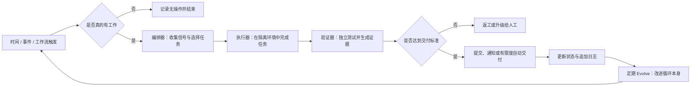
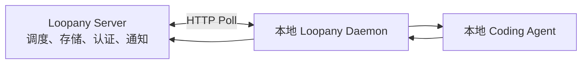

# 可靠智能体循环的构建与实践

[← 返回总览](../README.md) · [按日期浏览](../by-date/index.md)

来源：`omnisun://digest/1784023083677` · 创建：2026-07-14  
评级：**A**（83 分） · 类别：AI Agent 开发 / 软件工程自动化 / 商业流程自动化  
标签：`智能体循环` `验证器` `循环契约` `状态管理` `任务编排`

**切换：** [正文](#tab-body) · [摘要（1）](#tab-1) · [结构化（3）](#tab-2) · [口播总结（2）](#tab-3) · [深度解读（2）](#tab-4) · [默认总结（2）](#tab-5)

> **一句话点评**：框架完整且可直接试用，但成效证据主要来自作者自述，且多来源内容存在明显重复。
>
> **摘要**：文章结合开源工具、配置技能与一个月实践，提出由循环契约、状态日志、触发器、执行器和验证器组成的可靠智能体循环，并用文档维护、错误扫描、客服及CRM案例说明安全边界、证据验证和持续演进方法。

## 分析要点

- **核心高价值点**：可靠循环的关键不是定时唤醒代理，而是用明确边界、跨运行状态和独立验证证据，规定代理何时可自主交付、何时必须交由人工。
- **留存建议**：精读并长期保留，优先沉淀循环契约、验证机制和触发器设计（提供了可直接复用的智能体循环框架、契约模板、检查清单及多个工程与商业案例。）

**知识要点**

- 循环契约应明确目标、边界与SOP，尤其要精确定义自主交付和人工升级之间的界线。
- 状态保存当前假设、待办与跟进项，日志按运行追加；二者结合可避免重复调查并积累长期经验。
- 复杂高风险循环可拆为编排器、隔离执行器和独立验证器，并用截图、视频或指标变化形成可审核证据。

**行动项**

- 先选择文档维护等低风险任务，建立包含目标、边界、SOP、状态和日志的单层循环。
- 为工程循环配置一键开发环境、隔离工作树、Playwright驱动及截图或视频证据上传流程。
- 为循环增加事件门控或轻量脚本，只在存在真实任务时唤醒代理，并定期根据运行历史执行演进复盘。

<a id="tab-body"></a>

## 正文

### superdesigndev/loopany-platform: Run your company in loops, Loop Anything

https://github.com/superdesigndev/loopany-platform

[Open in github.dev](https://github.dev/) [Open in a new github.dev tab](https://github.dev/) Open in codespace

Name Name

Last commit message

Last commit date

housekeeper: remove dead getScheduler accessor ([#136](https://github.com/superdesigndev/loopany-platform/pull/136))

752755d ·

156 Commits

.github/ workflows

.github/ workflows

fix(db): session-mode-ready pool options + restore manual-only prod d…

docs

docs

docs: ship English-only Multica-style README and prune stale docs ([#113](https://github.com/superdesigndev/loopany-platform/pull/113))

packages

packages

housekeeper: remove dead getScheduler accessor ([#136](https://github.com/superdesigndev/loopany-platform/pull/136))

scripts

scripts

housekeeper: stop tracking python bytecode cache ([#121](https://github.com/superdesigndev/loopany-platform/pull/121))

.dockerignore

.dockerignore

LoopAny: multi-user scheduled agent loops (BYOA)

.env.example

.env.example

fix(server): gate machine enrollment and rate-limit machine routes ([#128](https://github.com/superdesigndev/loopany-platform/pull/128)

.gitignore

.gitignore

housekeeper: stop tracking python bytecode cache ([#121](https://github.com/superdesigndev/loopany-platform/pull/121))

AGENTS.md

AGENTS.md

fix(server): gate machine enrollment and rate-limit machine routes ([#128](https://github.com/superdesigndev/loopany-platform/pull/128)

CLAUDE.md

CLAUDE.md

Generate route tree before typecheck so fresh checkouts pass

CONTRIBUTING.md

CONTRIBUTING.md

docs: ship English-only Multica-style README and prune stale docs ([#113](https://github.com/superdesigndev/loopany-platform/pull/113))

Loopany

#### Loopany

**Scheduled agent loops. Keep the system under control.**

Describe a recurring task once. Loopany runs it on a schedule with **your own machine's coding agent**, and surfaces every result on a shared dashboard and your team's notification channel.

[Website](https://loopany.ai) · [npm](https://www.npmjs.com/package/@crewlet/loopany) · Contributing · Architecture

Loopany is infrastructure for **recurring agent work**. You describe a loop - a daily health check, a weekly research digest, a closed goal like "follow up until it's fixed". A small daemon on a machine you control runs it on schedule using your local coding agent.

Loopany dashboard

The server only schedules, stores, authenticates, and notifies. **It never runs an LLM and never executes your code.** Execution is BYOA: [`@crewlet/loopany`](https://www.npmjs.com/package/@crewlet/loopany) on *your* machine, with *your* credentials, files, and tools. Artifacts you choose to sync come back as durable content; the rest never leaves the box.

A loop can stay **open** (a monitor or digest that runs indefinitely) or **closed** (a finish line: the loop completes itself when the goal is met).

Most coding agents can already run on a cron or loop a task themselves. That is the easy 5% - the timer. The real work is the structure that lets you trust it and run reliably. A bare agent loop does not give you:

- **Durable structure across runs** - state and logs so it never re-does work and gets smarter over time; a verifier so there is evidence, not vibes; a contract and boundary that decide whether you can safely walk away. A raw cron loop has none of this by default.
- **Self-improving (evolve)** - a periodic pass that rewrites the loop itself (tighter contract, cheaper trigger, mechanical steps folded into scripts), so it gets sharper and cheaper the longer it runs. A DIY loop stays as dumb as day one.
- **A team surface, not a terminal** - a shared dashboard, per-team notification channels, and failure alerts. Results show up where your team can see them, instead of scrolling a local terminal.
- **BYOA + vendor-neutral** - runs on *your* machine with *your* agent and credentials; not locked to one vendor's agent. Switch agents without rebuilding.
- **A safe, cheap control plane** - the server runs zero LLM and executes zero code; it only schedules, stores, authenticates, and notifies. You are not handing your code or secrets to a SaaS just to get scheduling.

#### Features

- **Scheduled agent loops** - cron or one-shot; open monitors or closed goals that finish themselves when met.
- **BYOA execution** - runs on your machine via `@crewlet/loopany`; the server is zero-LLM and zero code-exec. Credentials and tools stay local.
- **Self-improving loops** - evolve passes review run history, sharpen the brief, distill state, and refine the generative dashboard.
- **Deterministic pre-stage** - optional workflow body for cheap mechanical work before the agent; failures fall back to the agent with context.
- **Teams + notifications** - multi-user dashboard, per-team push channels (Telegram, Feishu, and more), failure alerts.
- **Synced artifact home** - loop folder in, dashboard out; front-matter products (reports, kanban cards, calendars) render as generative UI.
- **Templates** - React Doctor, Market Research, Follow-up Tracker, Docs Sweep, Housekeeper, Dependency Triage, Error Sweep.
- **Self-hostable** - one process, embedded pglite by default for local, Postgres + object store for production; Docker image included.

**Hosted app:** sign in at **[https://loopany.ai](https://loopany.ai)** (or use your own self-hosted instance). You will also, for now, need at least one machine you control to run loops.

1. **Sign in** to the Loopany web app at [loopany.ai](https://loopany.ai) (or your self-hosted instance).
2. **Create a loop.** The *New loop* dialog hands you a short **connect snippet** with a server URL and a one-time connect-key.
3. **Connect your machine.** Paste the whole snippet into your local coding agent - it connects the machine and builds the loop with you.

##### Daemon cheatsheet

`npx @crewlet/loopany --help` for everything:

Command What it does

`up` / `up --foreground` connect &amp; start the poll loop (detached / foreground)

`status` / `down` is the daemon running + connection state / stop it

`log` survey a loop's recent runs (`--transcript` for full text)

`new` / `edit` create or patch a loop (JSON config)

`@latest update` upgrade the daemon in place

---

Loopany is one server process plus one daemon per machine. The server never runs an LLM and never executes your code - it only schedules, stores artifacts, authenticates, and notifies. Execution happens on **your** machine via the [`@crewlet/loopany`](https://www.npmjs.com/package/@crewlet/loopany) daemon, talking to your local coding agent.

mermaid diagram

Source

```
flowchart LR
  Server["Loopany server<br/>schedules · stores · auth · notifies<br/>zero LLM · zero code-exec"]
  Daemon["@crewlet/loopany<br/>on your machine"]
  Agent["Local coding agent"]
  Server <-->|"HTTP poll"| Daemon
  Daemon -->|"runs / reports"| Agent
```

> **Early-stage note.** Loopany is still an early-stage project. The daemon runs with fairly high permissions on your machine - it executes your coding agent with your credentials - and we are continuously hardening security.

A scheduler tick creates a *pending run*; your bound machine's next poll claims it, runs the agent, and reports the result (which can post to the loop's push channel). Because the agent runs on your machine, your credentials, files, and tools never leave it - the server only stores the bytes your loop chooses to sync back.

---

##### Prerequisites

- Node.js &gt;= 22
- pnpm 8.15 (pinned via the root `packageManager` field; `corepack enable` picks it up automatically)

##### Local development

```
git clone https://github.com/superdesigndev/loopany-platform
cd loopany-platform
pnpm install
pnpm dev            # http://127.0.0.1:3000
```

That is a fully working server out of the box: auth is off (the app runs open), the database is an embedded, file-backed **pglite** Postgres at `~/.loopany/pgdata` (zero external DB - it migrates itself at boot), and artifact bytes are held in memory. Use the Quickstart above against `http://127.0.0.1:3000` to connect a machine.

All configuration is env-based. For **local development only**, copy `.env.example` to `packages/server/.env` and uncomment what you need - vite loads that file for `pnpm dev`. **`pnpm start` and Docker do NOT read `.env`**: in production pass real environment variables instead (Fly secrets, `docker -e` / `--env-file`, or a systemd `Environment=`), never a committed `.env`.

```
pnpm install
pnpm build          # nitro build → packages/server/.output
pnpm start          # applies pending DB migrations, then serves on $PORT
```

For a real deployment, set at minimum:

- **Database** - either point `DATABASE_URL` at a Postgres (e.g. Supabase; set it to the transaction pooler `:6543`, plus `DIRECT_DATABASE_URL` at the direct `:5432` URL for migrations), or leave both unset and set **`LOOPANY_DB=pglite`** plus a persistent `LOOPANY_DATA_DIR` - the embedded pglite database lives at `<dir>/pgdata`. The built server treats a missing `DATABASE_URL` as a config error unless `LOOPANY_DB=pglite` explicitly opts into the embedded tier (so a lost database secret fails the deploy loudly instead of silently booting an empty ephemeral DB); only `pnpm dev` runs pglite without the opt-in. `pnpm start` applies pending migrations before serving (over the direct URL for the hosted tier; in-process for the pglite tier).
- `GITHUB_CLIENT_ID` / `GITHUB_CLIENT_SECRET` + `LOOPANY_AUTH_SECRET` (a long random value) + `LOOPANY_BASE_URL` + `LOOPANY_ALLOWED_LOGINS` - gate sign-in behind GitHub. Leaving these unset runs the app **open, with no auth** - fine locally, not on the public internet.
- `LOOPANY_R2_*` - an S3-compatible object store (e.g. Cloudflare R2) for artifact bytes. Unset, artifacts are stored in memory and lost on restart.

> **Exposing a server publicly? Set the auth vars.** With `GITHUB_CLIENT_ID` / `GITHUB_CLIENT_SECRET` / `LOOPANY_AUTH_SECRET` / `LOOPANY_BASE_URL` / `LOOPANY_ALLOWED_LOGINS` unset the app runs **open, with no sign-in** - anyone who can reach it is in. This applies equally to a bare Node host and the Docker image below.

> **Run exactly one server process.** The in-process scheduler owns the cron loop; two processes against the same DB would double-fire every run.

> **Backing up the embedded pglite tier.**`<LOOPANY_DATA_DIR>/pgdata` is a LIVE Postgres data directory. Stop the server before copying it - a hot copy of a running data dir is not crash-consistent. If you need real, online backups, run the hosted tier instead (`DATABASE_URL` /Supabase gives you point-in-time backups).

##### Docker

The included `Dockerfile` builds the server. For the embedded pglite database, opt in with `LOOPANY_DB=pglite` and persist `/data` on a volume; with a `DATABASE_URL` (Supabase/any Postgres) the container is stateless and needs no volume. (The opt-in is deliberate: without it a container that LOST its `DATABASE_URL` would silently boot an empty ephemeral database - instead it refuses to start.)

```
docker build -t loopany .
# Embedded pglite (opt in + persist the DB on a volume):
docker run -p 3000:3000 -e LOOPANY_DB=pglite -v loopany-data:/data loopany
# Or against Postgres (stateless):
docker run -p 3000:3000 -e DATABASE_URL=... -e DIRECT_DATABASE_URL=... loopany
```

Pass configuration with `-e KEY=value` or `--env-file` (same variables as `.env.example`).

---

#### Development

```
pnpm dev            # server on http://127.0.0.1:3000
pnpm -r test        # all tests
pnpm -r typecheck   # both packages
```

See `CONTRIBUTING.md` for the contributor guide (migrations, releases, PR flow) and `AGENTS.md` for architecture notes.

#### License

MIT - every package is MIT:

- The machine-side daemon `@crewlet/loopany` is MIT.
- The platform server `@loopany/server` is MIT.

© 2026 Superdesign. Contributions are accepted under the MIT license (inbound=outbound) - no CLA, no sign-off required.

#### Releases

14 tags

#### Deployments 35

- production

\+ 34 deployments

#### Packages

No packages published

#### Languages

- TypeScript 96.5%
- JavaScript 1.3%
- CSS 1.3%
- Other 0.9%

---

### skills/skills/verifier-setup/SKILL.md at main · AI-Builder-Club/skills

https://github.com/AI-Builder-Club/skills/blob/main/skills/verifier-setup/SKILL.md

[Open in github.dev](https://github.dev/) [Open in a new github.dev tab](https://github.dev/) Open in codespace

and

feat: add verifier-setup skill; retire pr and ship-change

3cf5efa ·

name verifier-setup

description Set a repo up to prove engineering-task work actually works before it ships. Investigates the repo, ensures a one-command dev stack (\`dev-local\`) exists, asks whether verification runs locally or in a sandbox (crabbox), confirms/installs the driver (the \`playwright-cli\` skill for web by default). Outputs three artifacts: a committed \`/verify\` skill (per-task verification SOP — spawn a verifier sub-agent → drive the app → screenshot/video proof → open a PR with the proof embedded), the \`/dev-local\` skill + script, and the installed driver skill. Use when someone says "set up verification", "make this repo verifiable", "scaffold a verify skill", "set up the verifier".

user\_invocable true

Goal: leave the repo able to *prove an engineering task works before it ships* — run once, and it wires up everything the per-task `/verify` loop needs.

You are **setting up** — not verifying anything yourself right now. The `/verify` template lives at `assets/verify.template.md` (next to this skill). Parallels `dev-local-setup` (which generates a script + its skill doc): a setup skill that leaves behind reusable, repo-specific artifacts.

Running `verifier-setup` end-to-end leaves the repo with:

1. **A `/verify` skill** — `.claude/skills/verify/SKILL.md`, the repo-tailored per-task verification SOP (spawn a verifier sub-agent → drive the app → screenshot/video proof → open a PR with the proof embedded). Generated in Step 5.
2. **A `/dev-local` skill + its script** — `scripts/dev-local.sh` **and**`.claude/skills/dev-local/SKILL.md`, via `dev-local-setup` (Step 2) if not already present. The one-command stack `/verify` depends on.
3. **The driver skill installed** — the `playwright-cli` skill for web apps (Step 2); for non-web, the concrete exercise tool confirmed present.

Before creating anything, take stock — the repo may already have some of this, under whatever name or layout its team chose. Look for the **capability**, not a specific filename; the paths below are only examples. For each, decide **reuse as-is / adapt-extend / create fresh** — never blindly overwrite working setup:

- **A way to start the app** — a one-command dev launcher, a `Makefile` / `Procfile` target, `docker-compose`, package scripts (e.g. `scripts/dev-local.sh`, but any form counts).
- **A prior verification SOP/skill** — from an earlier run of this skill or the team's own convention.
- **A driver for the app's interface** — a browser automation tool already available (e.g. the `playwright-cli` skill), or the relevant API/CLI client.
- **An existing test/e2e suite or checks** — however organized.
- **Sandbox/cloud-box config** — anything giving isolated per-agent stacks.
- **An evidence/artifact convention** — where proof lands and how a reviewable link gets published (a release, bucket, CI artifacts, etc.).

Every later step is conditional on this inventory: if a capability exists and works,**reuse and adapt it** (fill gaps, don't regenerate); only create what's missing.

Discover the real facts the generated skill will hardcode:

1. **How the app is exercised** — is it a **web app** (has a browser UI + a dev server on a port), an **API/service** (HTTP endpoints, no UI), a **CLI**, or a desktop/mobile app? This picks the driver.
2. **Stack launcher** — is there already a way to start the app (any form — see Step 0)? Note the up-command and the app URL/port. If none, Step 2 handles it.
3. **Auth** — is the primary flow login-gated? Is there a session/auth helper the verifier can mint a session with (see `e2e-setup`)? Record it, or "n/a".
4. **Regression checks** — the repo's fast codified checks (type-check, lint, unit, existing e2e commands) from `package.json` / `Makefile` / `turbo.json` /etc.
5. **Proof upload** — how a reviewable video URL is produced (a `pr-evidence` GitHub prerelease via `gh release upload` is the default; a bucket/CI artifact works too).

For each, act on what Step 0 found — reuse if present, adapt if partial, create only if missing. Each check is idempotent; a no-op on what's already there:

- **Dev stack.** If any working way to start the app already exists (a launcher script, Make/Procfile target, compose, package scripts), **reuse it** — read it for the up-command/port/services and move on (extend only if a needed service is missing). If there's none, scaffold one via **`dev-local-setup`** (don't hand-roll a launcher here). The generated `/verify` just needs a reliable one-command up.
- **Driver skill.**
  - **Web** → install/confirm the **`playwright-cli` skill** (it documents + wraps the browser driver). Ensure its binary is callable too (`npx --yes @playwright/cli --version`; install it + the `chrome` channel if missing). This closes the usual local gap where the browser driver was assumed but never installed.
  - **Non-web** → confirm the concrete exercise tool exists (an HTTP client for an API, the built binary for a CLI). No browser skill needed.
- **Evidence dir.** Ensure `evidence/` is gitignored (proof output lands there).

Present the choice (default and recommend **local** — it's simpler to stand up):

- **Local** — one dev stack on the machine (`scripts/dev-local.sh up`). Best for a single task at a time. Recommend this unless they need parallelism.
- **Sandbox (crabbox)** — an isolated cloud box per agent, for **concurrent** loops or a fixed-port/single-instance stack. If chosen and not yet set up, scaffold via **`crabbox-setup`**; the generated skill drives the app in-box via `cbx.sh pw`.

Record the pick as the generated skill's default `RUN_MODE` (the other stays a documented fallback).

State the detected driver and confirm with the user (default **`playwright-cli`** for web apps). For non-web, name the concrete tool (e.g. `curl` /an HTTP script, the built CLI). This becomes `DRIVER` in the generated skill.

If a prior verification skill/SOP already exists (Step 0), **update it in place** — refresh the repo-specifics/placeholders, preserve any hand-edits the team added; don't clobber. Otherwise copy `assets/verify.template.md` → the repo's skills dir (`.claude/skills/verify/` or the repo's convention) and fill every `{{...}}` placeholder from Steps 1–4:`STACK_UP`, `APP_URL`, `RUN_MODE` (+ `RUN_MODE_NOTE`), `DRIVER` (+ `DRIVER_INSTRUCTION`),`AUTH_HELPER` (+ `AUTH_INSTRUCTION`), `EXERCISE`, `REGRESSION_CMDS`, `EVIDENCE_UPLOAD`,`DATE`. Delete branches that don't apply (e.g. drop the browser/video language for a non-web repo). Keep it to one screen — it's an SOP the agent follows, not an essay.

Commit the generated skill (+ any `.gitignore` /dev-local changes). Tell the user:

- how to run it — " `/verify` before opening a PR (or when asked to verify), on a branch with changes committed";
- the run mode chosen and how to switch;
- any prerequisite they must install/start once (e.g. Docker for infra, `gh` auth for evidence upload).

#### Principles

- **Check before you create; adapt, never clobber.** Every artifact — dev-local, the driver skill, e2e, evidence gitignore, the verify skill itself — is inventoried first (Step 0) and **reused/extended** when it already exists. Only create what's genuinely missing; preserve working setup and team hand-edits.
- **Discover, don't assume.** Stack command, port, auth, and checks come from the repo — the generated skill hardcodes real facts, not conventions.
- **Provision before you generate.** The driver, launcher, and `evidence/` exist before the `/verify` skill ships, so it never fails on a missing tool.
- **Right-sized.** A web monorepo gets the full browser+video SOP; a CLI tool gets a stdout-assertion SOP. Match the template to the repo; cut what doesn't apply.
- **The output is a skill, not a run.** verifier-setup scaffolds; `/verify` runs.

---

### 在运行循环一个月之后我学到了什么？？？

https://x.com/jasonzhou1993/status/2075179471951614381

**Jason Zhou**

### 在运行循环一个月之后我学到了什么？？？

上周我写了关于循环工程的内容：这是一种从提示代理完成任务，向设计系统转变的过程，在这些系统中，代理能够决定处理什么工作，执行、验证并随时间改进。

但很多人会说：好的，我被说服了，但是我到底该如何实际构建一个呢？ 更重要的是，我该如何构建一个真正能工作的？

因为任何人都可以用 while true 把一个代理（agent）包起来，称之为循环。这只是简单的 5%。真正的工作是那些护栏，它们让你能够抽身离开。

我们一直在进行一个实验，运行

[@SuperDesignDev](https://x.com/@SuperDesignDev) 通过上个月设置了很多很多循环，在这里我们想分享一些真正实用的经验。

#### 一个好循环的结构

我们运行的每个循环都有相同的四个部分。


#### 循环契约

一个 Markdown 文件，每次运行触发时注入到代理中。这是循环的章程。它包含四样东西：

- 目标 （胜利的定义，以及是否存在终点线）
- 的 边界 (它可以自由做什么、绝对不能做什么，以及它可以自行交付的内容与需要人类参与的内容之间的界限)
- 标准操作程序 （ 每次运行所遵循的步骤）

人们在边界部分投资不足，而正是这个部分决定了你是否能够抽身。以我们的一个循环“Error Sweep”为例：每天早上它会读取我们的生产错误跟踪器，挑选最严重的新漏洞，并发布修复程序。这是它的契约中真正的边界部分：

```text
- Fix only when the root cause is clear AND the fix is low-risk.
  Anything risky or large: open a PR and flag a human. Do not merge it yourself.
- Make the smallest fix that works. One PR per fix.
- Never open a new PR while a previous Error Sweep PR is still unmerged.
- Never copy credentials, tokens, or user data into a report or a PR.
```

那都不是关于如何修复 bug 的。这是四句话，用来画一道界限。在界限之内，代理可以自行完成部署。在界限之外，则由人类决定。你需要为代理清晰定义：何时它可以自行部署，以及何时你应该停止并询问。

我们通常将合约、状态、日志放入一个 md 文件中，如下所示

```markdown
# <loop name> — contract

## Goal
What winning looks like. Is there a finish line, or does this run forever as a monitor?

## Boundaries
- Free to do: ...
- Never do: ...
- Ship on its own vs ask a human: <the exact line>

## SOP (each run)
1. Read state + logs.
2. Gather what changed. Pick the single most worthwhile thing to do.
3. Do it (or hand it to an executor).
4. Verify. Record what happened. Report.

## Current understanding
...Current state of the loop run

## Logs
...Logs of past runs
```

#### 2\. 状态 + 日志

一个在每次运行之间忘记所有内容的循环是一个带有额外步骤的 cron 任务。它需要内存，分为两部分：

- 状态是持久的图景：待办事项、当前假设、已发布且需要跟进的实验。每次运行时在顶部查看，刻意保持简洁。
- 日志是发生的事情的只追加记录，逐次运行。

最明显的例子是我们的错误扫描循环维持的状态，以便不会浪费一次运行来重新调查它已经理解的内容：

```text
## Skip these fingerprints (known noise or upstream, not ours)
- ResizeObserver loop limit exceeded
- Stripe.js network blip on /checkout

## Fixed, still watching
- null-team-on-login (019edc8a) — fixed in #1027, confirm it stops firing in prod
```

没有那个块，每天早上循环都会重新发现同样的嘈杂错误，浪费一次运行来追踪它，并让你感到烦恼。有了它，循环会跳过已经判断过的内容，并将注意力放在新的内容上。状态是循环停止自我重复的地方。

该循环还包含其通过运行学到的内容：一个关于谁会转化的可行假设，以及它从犯错中习得的习惯。我们的 CRM 循环包含类似以下的内容：

```text
- users who hit the credit wall in their first week reply about 3x
  more than everyone else. Draft those first.
- Before drafting, check what the user actually built, not the label on their
  profile. One account tagged "SaaS dashboard" was really a print brochure.
```

那一切都不是来自原始合同。这个循环是通过逐次运行积累起来的，现在每次运行都比之前更智能一步。这就是为什么一个好的循环在第三个月比第一个月更有价值：它的状态已经吸收了它所看到的一切。


我们的内部工具，用于管理循环，在此开源（Loopany）：

[https://github.com/superdesigndev/loopany-platform](https://github.com/superdesigndev/loopany-platform)

#### 3\. /验证

这是任何执行高风险工作的流程的前提条件（例如实际生产环境中的代码变更、与真实客户沟通）。基本上，你需要确保验证过程简单，并生成人类能够轻松审核的证据。

通常这意味着

- 设置环境以确保验证 token 高效且可靠
- 一种包含核实证据的方式

对于工程任务，那意味着：

1. [dev-local.sh](http://dev-local.sh/) 脚本，轻松启动本地开发 + 远程沙箱环境以测试（类似 crabbox）
2. 允许代理像真实用户一样自主操作应用的工具（例如 Playwright-CLI）
3. /验证包含用于测试的 SOP 的技能
4. 用于上传截图和视频证据以附加到 PR 的位置（我们上传到 GitHub 发布资产）

虽然其他非工程类工作可能更棘手，但并非不可能。例如，在 CRM 循环中，我们有一个验证代理来审核按照特定防疏漏规则起草的消息；

[https://github.com/AI-Builder-Club/skills](https://github.com/AI-Builder-Club/skills)

结果是，来自循环的 PR 不会以“相信我，它能工作”的形式出现，而是附带一个展示该功能正常运行的视频。我可以在几秒钟内批准，因为我看到的是实际效果，而不是阅读差异并寄希望于它能工作。这也是为什么验证者是判断一个循环是否真的是个好主意的决定因素。


#### 4\. 触发器

什么唤醒了循环？有三种形状，选择正确的形状是成本模型的一半：

- 持续的 for 循环。这是 ralph-loop 或/目标类型触发器。代理在 for 循环中运行，直到条件满足。这是自主研究代理背后的模式。适合有界推送（持续运行直到测试套件通过），作为永久固定装置则过于浪费。当存在即时反馈循环和明确规范时，这种方式主要有用。（类似于大多数修复 bug 的工程工作）
- 基于时间的。 计划触发循环：每小时，每天早上 6 点。我们的 Error Sweep、React Doctor、文档维护者和 CRM 循环都在 cron 上运行。
- 基于工作流/事件。 新邮件到达、事件开启、PR 合并。循环仅在有可运行的内容时才执行。它甚至可以与基于时间的机制结合——例如，基于时间的定时任务每小时运行一次脚本以检查新的支持工单，如有工单则触发坐席；若无，则记录并静默处理。这是管理循环成本的良好方法；您可以在“演进”部分查看其工作原理。

#### 编排器 + 执行器 + 验证器

一旦循环涉及任何非平凡的内容，我们开始将其拆分为三个角色：


> Orchestrator 找到工作。Executor 在隔离的沙箱中执行工作。验证器证明该工作并附上证据。

1. 编排器/优先级排序器。 按计划唤醒的代理。它的任务不是执行任务，而是查找任务：收集信号、查看变更内容、选择本次运行中最有价值的单个事项，并进行交接。
2. 执行者。 在隔离空间中执行实际工作（针对代码，一个全新的脱离主分支的 git worktree，因此它永远不会污染你的工作区或其他循环的运行）。
3. 验证者。 独立确认执行者的工作并生成可供人类查看的证据。

但不是所有循环都需要这三个。三层结构正是复杂的、负责代码交付的循环发展的结果。很多好的循环其实就是编排器自己完成整个流程。让我给你看看这两个方面。

#### 演进循环 - 构建抗脆弱循环

在纳西姆·尼古拉斯·塔勒布的《反脆弱》中，他将系统分为三类：脆弱系统惧怕波动性，一次意外就意味着巨大损失；强健系统能在波动性中存活并恢复到原有状态；反脆弱系统则从中获益，每次冲击都会让它们变得更强。玻璃杯是脆弱的，石头是强健的，你的免疫系统是反脆弱的：每一次小感染都会训练它。

当聚焦于循环时，问题就变得具体了： 当运行失败时，教训会去向何方？ 在我们的实践中，一个教训有三个去向，按抽象程度递增的顺序：


每个人都有日志，而且日志只会越来越长。正是将经验提炼为规则，才让循环具备反脆弱性。问题是：谁来做提炼？

所以在 Loopany（我们为这些循环构建了内部应用）中，这成为了一个独立的运行角色： 演进 。代理会话会读取该循环最近十几次运行的日志、结果和成本，并询问：我们在哪里重复犯错？哪些运行是浪费的？哪些边界太松，哪些太紧？它的输出不是产品代码，而是对循环本身的修改：

- 循环合同，国家公约
- 触发机制
- 用于重复和确定性代理步骤的脚本
- 技能
- 人们查看的仪表盘

这是一个用于改进循环本身的循环。

### 真实循环运行 Superdesign

我们一直在运行循环来自动化 Superdesign 的大部分功能，有些成功了，有些没成功（经验教训将在后续单独的博客中分享）。以下是我们日常运行的几个真实示例，这些示例相对容易复制和设置

#### 文档维护循环


我们最简单也最有用的循环之一。每周一次，它会确保项目文档保持准确；

这个循环是单层的。编排器读取差异，检查文档，如果有内容漂移则打开一个 PR，完成。没有单独的执行器，也没有单独的验证器，因为任务简单且爆炸半径小，足以让一个代理在其认知范围内处理。

你可以添加多个层、一个对文档中每个声明进行事实核查的验证器，以及一个标记它发现的技术债务的检查过程。你不应该这么做，直到这个简单版本让你碰壁为止。先构建1层版本，体会具体的痛点，然后添加恰好能解决该问题的那一层。

这是我会让你先构建的循环，所以这是一个模板：

```markdown
# doc-maintainer — contract

## Goal
The README, setup guides, and examples always match what the code
actually ships. Zero drift found = a successful run, not a wasted one.

## Boundaries
- Ship on its own: open ONE pull request with the fixes. That's it.
- Never: rewrite accurate docs to look busy, touch anything outside
  the docs, stack a 2nd PR while last week's is still open.

## SOP (each run)
1. Read the diff: every commit + PR since the last sweep (cursor is
   in state).
2. Compare README, setup guides, examples, runbooks against what the
   code ships NOW.
3. Verify for real: run the commands, check the links, try the
   examples. Never trust memory.
4. Drift found → smallest fix, fresh worktree, one PR explaining what
   drifted and why. Nothing stale → clean stop.
5. Move the cursor, log the run.

## State
- last-sweep cursor (commit hash)
- open PR, if any

## Logs
- one dated line per run: drift count + PR link, zero included
```

#### 漏洞猎人循环


有些循环会向真实客户部署实际代码，而在这一过程中出现的错误代价高昂。这时，所有三个层级都能各尽其责。

我们的 Error Sweep 循环每天早上运行：

1. (编排器) 它从我们的错误跟踪系统中拉取过去 24 小时的生产错误（我们编写的一个特殊脚本从 posthog/LLM 日志/服务器日志中收集数据），按出现次数×用户数对其进行排序，跳过其状态中已知的“噪声”指纹，并选择最具影响力的单个新异常。它拉取反压缩的栈跟踪并找出根本原因。
2. (执行器) 如果原因明确且风险低，它会在一个新的工作树中修复问题并提交 PR。如果风险高或规模大，则停止并通知人工处理。边界处的那个分支每次运行都会进行实际工作。
3. (验证器) 修复在生效前得到验证，循环在后续运行中持续观察该指纹，以确认错误确实停止触发。一个未改变实际数值的修复不是真正的修复。

React Doctor 采用同样的方式，专注于提升代码健康而非解决运行时错误：每天早上它会使用 npx react-doctor 扫描应用，挑选出最严重的单个问题，在隔离工作树中修复，验证后打开一个拉取请求。它会以每日指标的形式报告健康评分，让你可以观察指标变化。并且它有一个小护栏，确保使用体验良好：

> 如果之前的 React Doctor PR 仍然处于打开状态且未合并，不要今天再打开另一个。刷新已打开 PR 的状态并仍然报告分数。

这条规则是一个有帮助的循环和一个让你淹没在 30 个你永远不会审阅的 PR 中的循环之间的区别。一个循环必须考虑到你的审阅带宽，而不仅仅是它自身的吞吐量。

#### 支持分类循环


每小时针对我们的 Intercom 收件箱运行。其指导原则是：每个支持工单都是了解产品缺口的免费窗口。写来的用户正在免费向你提交一份 bug 报告、一个转化障碍或一个困惑信号。大多数支持系统只是回复消息然后丢弃这个窗口，这个循环让这种情况持续下去。

每次运行执行四个步骤：

1. 拖动窗口。 自上次运行以来的所有内容，以及今天到期的任何跟进事项。窗口在静默时段会自动扩大，因此错过的触发永远不会丢失工单。按最后发言者分类：客户 = 需要回复，机器人 = 待审核，队友 = 已处理。
2. 回复前先调查。 这是关键区别。对于每个工单，先基于真实数据确定根本原因：检查用户的账户、实际会话、错误日志和账单记录。切勿盲目回复。很多时候，用户描述的问题并非真正的问题。
3. 分支到三个输出。每个工单最多可以生成三件东西：一个回复能够立即解决用户的问题，在该对话中； 一个提交到知识库的信号：工单背后的产品差距，记录一次，以便后续增长循环和工程循环能够基于该模式采取行动； 并且当根本原因是真正的漏洞时，它会在一个新的工作树中生成一个修复代理，包含验证器和证据，使用与漏洞猎手循环相同的机制。
4. 回复并休息。 设置跟进日期，记录运行，等待下一个 tick。

使这一系统能够安全地对真实客户运行的边界是：回复采用分层机制。常规的、事实性的回答会自动发出。任何敏感内容、退款相关、愤怒的用户、非英文内容且我无法审核语气的情况，只有在人工审核通过后才会发出。

设置它和其他任何循环的方法相同：一个合同文件加上一个每小时的 cron 任务。这是支持合同，精简为你可以拿去用的模板：

```markdown
# support-triage — contract

## Goal
Every inbound ticket gets a correct, investigated response within an hour,
and every product gap behind a ticket becomes a signal the team can act on.
No finish line: this is a monitor.

## Boundaries
- Ship on its own: replies to routine, factual questions (how-to, billing
  lookups, known issues with a documented fix).
- Ask a human first: refunds, angry or churn-risk users, anything legal,
  any reply in a language the team can't review.
- Never: promise features or timelines, share another user's data, close
  a ticket without a root cause written down.

## SOP (each run)
1. Pull conversations since the last run timestamp + follow-ups due today.
   Bucket by last speaker (customer / bot / teammate).
2. Per ticket: investigate root cause against the product DB, error logs,
   and billing BEFORE drafting anything. Never answer blind.
3. Reply per the boundary tiers. Draft-only where approval is required.
4. If the root cause is a bug: spawn a fix agent in a fresh worktree,
   require verification evidence, open a PR flagged to the team.
5. File a signal for any recurring or conversion-relevant gap (dedupe
   against existing signals first).
6. Set follow-up dates. Log the run.

## State
- open follow-ups (ticket id -> due date)
- recurring-theme tally (feeds signal creation)
- standing lessons (e.g. "duplicate messages = retry artifacts, not spam")

## Logs
- one dated line per run: tickets handled / replies sent / signals filed
```

然后在 cron 前面设置一个简单的门控机制，这样代理程序只有在窗口中有内容时才会激活（之前提到的 Evolve 操作），然后让它运行。这种做法的好处不仅仅是更快的回复，还有信号：当五个人询问如何导出某个内容时，这就是一个已记录的转化缺口，正等待进入增长循环，而不是某个可能在季度回顾中才会注意到的模式。

#### CRM 生命周期闭环


循环不是工程玩具。我们一些最有价值的循环从未涉及一行代码。这个循环负责我们的客户拓展工作，是面向人而非代码的三层结构的最充分体现。

每天早上：

1. 脚本先拉取数据。 过去 24 小时内活跃的用户、新的商务邮箱注册以及任何收到的回复。确定性的前期阶段，数据拉取过程中不使用 LLM。回复的用户完全退出循环：实时对话属于人类。
2. 编排器提出细分群体，不是一次性选择。值得今日触达的高意向用户群体：本周遇到信用墙的用户、新注册企业、高触达建设者。这些只是示例，而非固定列表；每次运行时都会根据数据重新生成细分群体，哪些会转化取决于当前状态。
3. 每个部分都会生成一个执行器子代理按用户逐个处理：查看他们实际构建的内容，查阅与他们的每一次过往交流，然后起草一封个人电子邮件。切勿盲目起草。一个标注为“SaaS 仪表盘”的资料标签可能实际上是一本印刷手册；执行器检查的是实际成果，而非标签。
4. 验证人员会检查每一份草稿在草稿可以流转之前：需要根据数据对邮件中的每一个声明进行事实核查（以你的名义发出的内容不能有任何虚假信息），然后遵循语音和防疏漏规则。这又是 SEO 相关场景中提到的“品味”问题，但在这里是可解决的，因为“该声明是否符合用户项目的实际情况”有一个可核查的答案。
5. 发送按风险分级。我们最初只允许草稿：每封邮件都需要人工处理。随着各细分群体证明其回复率，低风险的群体获得了在内部权限范围内自主发送的权利。高互动性的群体仍然以草稿形式存在，需人工审批。自主权是按细分群体获得的，而非自动赋予整个流程。
6. 摩擦成为信号。 当研究发现用户在某个环节遇到困难时，这不仅仅是邮件内容，它会生成一个供其他流程读取的信号，而真正的漏洞会催生一个修复代理，其机制与漏洞猎手相同。

你在第 1 部分看到的机制掌控了一切：7 天抑制期，最多一次无回复跟进，一旦回复则由人工接管。系统会进行复合处理：按段记录发送和回复情况，保留转化的内容，丢弃未转化的内容。循环在选择发送对象时的给谁发邮件效果每周都有显著提升，因为它是根据回复率而非直觉来校准的。

```markdown
# crm-lifecycle — contract

## Goal
Turn high-intent product activity into conversations. Success = reply rate
and upgrades per segment, not emails sent. No finish line: this is a monitor.

## Boundaries
- Ship on its own: sends to segments that have EARNED it (see state:
  approved_segments). Everything else: drafts only, a human sends.
- Ask a human first: any new segment's first batch, anyone who ever
  replied, any claim the verifier couldn't confirm.
- Never: email anyone contacted in the last 7 days, send a 2nd follow-up
  without a reply, invent facts about what a user built.

## SOP (each run)
1. Scripts have already pulled actives, signups, and replies. Read the
   output. Users who replied exit to a human.
2. Score users, then propose SEGMENTS (groups, not one-off picks).
   Check state for which segments converted before proposing more.
3. Per segment: spawn an executor sub-agent. Per user: read what they
   actually built + every past exchange, then draft. Never draft blind.
4. Every draft passes the verifier: fact-check each claim against the
   data, then voice + anti-slop rules. Nothing false goes out.
5. Route by risk: approved segments send; the rest queue for review.
6. Friction found during research → file a signal; real bug → spawn a
   fix agent.

## State
- approved_segments (earned autonomy + the reply rate that earned it)
- per-segment performance (sends → replies → upgrades)
- suppression list · standing lessons (e.g. "verify from their real
  work, not their profile label")

## Logs
- one dated line per run: segments proposed / drafts / sends / replies
```

#### 良好循环检查清单

- \[ \] 循环合约文件：目标，SOP，输出规则，每次运行时读取
- \[ \] 边界和约束：它独立运行的内容与需要人工介入的内容；空操作是一种有效运行
- \[ \] 状态 + 日志: 跨运行的内存，因此它不会重复执行工作
- \[ \] 廉价验证器 : 带证据证明；若无证据，则保留人工介入
- \[ \] 隔离执行 : 每次运行时的全新工作树或独立沙箱
- \[ \] 经济高效的触发器 : 门脚本或事件，空运行不产生成本
- \[ \] 循环进化周期 : 查看运行历史，将机械性工作融入脚本/技能
- \[ \] 小范围 : 拆分循环直到“只需运行”感觉舒适为止

#### Loopany - 我们内部的循环管理工具（开源）

[](https://x.com/jasonzhou1993/status/2075179471951614381)[](https://x.com/jasonzhou1993/status/2075179471951614381)

我们一直使用一个名为 Loopany 的内部工具来协调公司内部所有的循环，它对我们非常有用，所以我们决定将其开源

这是一个循环管理环境，与您团队自己的本地代理连接。

- 循环模板 &amp; 内置自动日志/状态跟踪
- 可编程触发器 + 自动重试 &amp; 恢复
- 进化周期
- 每个循环的小程序
- 团队工作区，以避免循环冲突

欢迎随时试用并告知我们您的反馈：

[https://github.com/superdesigndev/loopany-platform](https://github.com/superdesigndev/loopany-platform)

<a id="tab-1"></a>

## 摘要（1）

### 2026-07-14 09:58:04

#### 一、综合总结

##### 核心结论

这四份内容共同表达了一个核心观点：

> **真正有效的 Agent 循环，不是给 Agent 外面套一层 `while true`，而是建立一套能够持续发现工作、安全执行、独立验证、保留经验并逐步改进的控制系统。**

可以把一个可靠循环概括为：

```text
可靠 Agent 循环
= 循环契约
+ 跨运行状态与日志
+ 合适且低成本的触发器
+ 隔离执行
+ 可审计的验证证据
+ 人工升级边界
+ 定期演进机制
+ 团队可见的管理界面
```

其中：

- **内容 3、4**讲的是运行这些循环一个月后得到的方法论和真实案例；
- **内容 2**把其中最关键的“验证机制”落实成了一套仓库级搭建流程；
- **内容 1**则是承载这些循环的开源基础设施 **Loopany**。

---

##### 四份内容之间的关系

| 内容 | 主要作用 | 解决的问题 |
|---|---|---|
| Loopany 平台 | 循环的控制平面和团队工作台 | 如何调度、记录、通知和管理大量循环 |
| `verifier-setup` 技能 | 为代码仓库建立可复用验证环境 | 如何让 Agent 在交付前证明“真的能用” |
| 一个月循环实践文章 | 方法论、经验与业务案例 | 什么样的循环才值得长期运行 |
| YouTube 视频 | 对文章内容的演示和口头讲解 | 如何直观理解循环结构与实际运行方式 |

需要注意：内容 3 和内容 4 基本是同一套实践的图文版与视频版，因此它们不是两组相互独立的验证材料，而是来自同一团队的经验总结。

---

##### 一个好循环的完整结构



循环之外还有一份始终有效的“宪法”：

- 目标是什么；
- 什么可以自主做；
- 什么必须找人；
- 每次运行遵循什么步骤；
- 什么算完成；
- 什么证据足以证明完成。

---

#### 二、关键内容归纳

##### 1. 循环契约：规定“能做什么”，更要规定“不能做什么”

循环契约通常是一份 Markdown 文件，每次运行时注入给 Agent。它至少应包含：

###### 目标

定义“胜利”是什么，并说明循环类型：

- **开放循环**：没有终点，例如每天检查生产错误；
- **封闭循环**：达到目标后自行结束，例如持续修复直到测试通过。

###### 边界

这是最重要、也最容易被低估的部分。

好的边界不是泛泛地说“谨慎操作”，而是明确写出决策线：

```markdown
- 只有根因明确且修改风险低时，才能自行修复。
- 高风险或大范围改动只允许创建 PR，并通知人工。
- 每次只处理一个问题。
- 上一个 PR 未合并时，不再创建第二个 PR。
- 不得将凭证、令牌或用户数据写入报告。
```

这些规则不负责教 Agent 如何修 Bug，而是决定：

> **在哪条线以内，Agent 可以自主行动；越过哪条线，必须把决定权交给人。**

###### SOP

规定每次运行的标准步骤，例如：

1. 读取状态和历史日志；
2. 收集本轮新增信号；
3. 选择最有价值的一个任务；
4. 在隔离环境中执行；
5. 独立验证；
6. 记录结果并通知相关人员。

---

##### 2. 状态与日志：让循环不再每天“重新失忆”

仅仅定时重新调用 Agent，并不等于有持续智能。

一个可靠循环需要两种记忆：

| 类型 | 作用 | 特征 |
|---|---|---|
| 状态 `State` | 当前真实情况、假设、待办、观察项 | 精简、可更新 |
| 日志 `Logs` | 每次运行发生了什么 | 只追加、不重写 |

例如错误扫描循环可能保存：

```markdown
## 已知噪声，后续跳过
- ResizeObserver loop limit exceeded
- Stripe.js 偶发网络错误

## 已修复，继续观察
- null-team-on-login：已在 PR #1027 修复，等待确认生产错误归零
```

没有这段状态，Agent 每天都会重新研究同一个噪声错误；有了它，Agent 才能把注意力放到新问题上。

###### 状态不仅是“记住做过什么”

更高价值的状态还会积累经验，例如：

- 哪一类用户回复率更高；
- 哪种错误通常来自上游服务；
- 哪个修复策略曾经失败；
- 哪些细分客户已经获得自动发送权限；
- 哪些步骤应该改写为确定性脚本。

因此，循环长期价值的来源不是“多运行几次”，而是：

> **每次运行后都把有效经验沉淀成下一次可直接使用的知识。**

---

##### 3. 验证：从“相信我能用”变成“这里有证据”

对于生产代码、真实客户沟通、退款、账务等高风险任务，Agent 自己声称完成并不够。

一个完整的工程验证体系通常包括：

- 一条命令启动完整开发环境；
- 浏览器、API 或 CLI 驱动工具；
- 独立的验证 SOP；
- 截图、视频、测试结果等证据；
- 可附加到 PR 的证据链接；
- 本地或独立沙箱执行环境。

###### `verifier-setup` 做了什么

内容 2 中的 `verifier-setup` 不是直接验证某个任务，而是**一次性把仓库改造成可验证状态**。

它主要产生三类资产：

1. **`/verify` 技能**
   - 每个任务完成后如何验证；
   - 如何启动独立验证子代理；
   - 如何操作应用；
   - 如何录制截图或视频；
   - 如何把证据放入 PR。

2. **`/dev-local` 技能和启动脚本**
   - 提供一条命令启动所需服务；
   - 避免每次验证都重新猜测启动方式。

3. **界面驱动工具**
   - Web 项目默认使用 `playwright-cli`；
   - API 项目使用 HTTP 客户端；
   - CLI 项目直接运行构建产物并断言输出。

###### 它最重要的原则

> **先盘点已有能力，再补缺口；不要不加判断地覆盖仓库现有方案。**

搭建前需要检查：

- 是否已有启动脚本；
- 是否已有 E2E 测试；
- 是否已有验证 SOP；
- 是否已有浏览器自动化工具；
- 是否已有沙箱配置；
- 证据应该上传到哪里；
- 登录态如何生成；
- 回归测试命令是什么。

验证方案必须来自仓库中的真实事实，而不是套用固定模板。

---

##### 4. 触发器：决定成本、响应速度和任务形态

不同循环应该使用不同触发方式。

| 触发方式 | 适用场景 | 优点 | 风险 |
|---|---|---|---|
| 持续循环 | 修复直到测试通过、完成明确目标 | 反馈快，适合有终点的任务 | 长期运行成本高 |
| 定时触发 | 每日错误扫描、每周文档检查 | 简单、可预测 | 空运行也可能消耗资源 |
| 事件触发 | 新邮件、告警、PR 合并 | 响应及时，没事件不运行 | 需要 Webhook 或守护进程 |
| 工作流组合 | 定时先运行脚本，有工作才唤醒 Agent | 成本最低，容易批处理 | 需要编写前置门控脚本 |

其中最值得推广的是“组合式触发”：

```text
定时器
  → 确定性脚本检查是否有新任务
  → 没有：安静退出
  → 有：整理结构化数据，再唤醒 Agent
```

例如支持工单循环不应每 30 分钟都调用大模型，而应先用普通脚本查询 Intercom：

- 有新工单才唤醒 Agent；
- 没有新工单只记录检查结果；
- 可以把多个工单批量交给一次运行。

这体现了一个重要原则：

> **能用脚本确定完成的工作，不要交给大模型推理。**

---

##### 5. 编排器、执行器、验证器：按风险拆分角色

复杂循环通常会分成三个角色：

###### 编排器 Orchestrator

负责：

- 收集信号；
- 排除已知噪声；
- 判断优先级；
- 选择本轮最有价值的一件事；
- 把任务交给执行器。

###### 执行器 Executor

负责：

- 在独立工作树或沙箱中执行任务；
- 不污染主工作区；
- 做最小必要修改；
- 提交结果供验证。

###### 验证器 Verifier

负责：

- 独立于执行器检查结果；
- 实际操作应用，而不是只阅读代码；
- 运行回归检查；
- 生成截图、视频、日志或指标证据。

但并不是所有循环都需要三层结构。

| 任务 | 推荐结构 |
|---|---|
| 文档同步 | 单 Agent 即可 |
| 简单数据汇总 | 编排器兼执行器 |
| 低风险代码维护 | 编排器 + 执行器 +基础检查 |
| 生产 Bug 修复 | 编排器 + 隔离执行器 + 独立验证器 |
| 对真实客户自动发信 | 分层执行 + 事实核查验证 + 人工升级 |

正确做法不是一开始就搭建复杂多 Agent 系统，而是：

> **从一层开始，只有当具体痛点出现时，才增加恰好能解决这个痛点的一层。**

---

##### 6. Evolve：让循环改进自己，而不只是重复自己

日志积累不等于系统会自动变聪明。真正的改进来自把日志中的经验提炼为规则。

因此，实践中增加了一个独立的 **Evolve 演进运行**。它每隔若干次普通运行后执行，分析：

- 哪些错误反复发生；
- 哪些运行没有价值；
- 哪些边界过松或过紧；
- 哪些步骤适合改成脚本；
- 哪些状态已经过期；
- 哪种触发器更节省成本；
- 仪表盘还缺什么指标。

它可以修改：

- 循环契约；
- 状态结构；
- 触发方式；
- 前置脚本；
- Agent 技能；
- 团队仪表盘。

这使循环从“稳定重复”升级为“从失败和浪费中学习”。

不过，循环自我修改也需要治理。尤其是以下变化，不宜完全自动生效：

- 扩大自主操作权限；
- 放宽安全边界；
- 改变数据访问范围；
- 开启自动合并或自动发送；
- 修改涉及生产环境的执行脚本。

---

#### 三、Loopany 在这套体系中的位置

##### 它不是 Agent 本身，而是循环控制平面

Loopany 的架构是：



服务器负责：

- 创建和调度运行；
- 保存状态、日志和选定的产物；
- 用户及团队认证；
- 推送通知；
- 展示共享仪表盘。

本地守护进程负责：

- 领取待执行任务；
- 调用本机的 Coding Agent；
- 使用本机文件、凭证和工具；
- 将选择同步的结果上传回服务器。

###### 核心特点

- **BYOA：Bring Your Own Agent**
  - 可以使用自己的本地 Agent；
  - 不绑定单一模型或 Agent 厂商。

- **服务器零 LLM、零代码执行**
  - 服务端只做控制平面；
  - 不直接执行用户代码。

- **支持开放与封闭循环**
  - 长期监控；
  - 达成目标后自动结束。

- **支持演进运行**
  - 定期改进契约、状态、触发器和仪表盘。

- **支持团队协作**
  - 共享工作区；
  - Telegram、飞书等通知渠道；
  - 失败告警和运行记录。

- **支持产物同步**
  - 报告、看板、日历等内容可同步到仪表盘。

---

##### 部署和安全上的重要注意事项

Loopany 仍处于早期阶段，不能因为服务器“不运行 LLM”就认为整套系统没有风险。

###### 主要风险在本地守护进程

守护进程会以较高权限调用本地 Agent，并可能接触：

- 源代码；
- 开发凭证；
- GitHub 权限；
- 生产日志；
- 数据库访问方式；
- 本地工具链。

因此需要：

- 使用专用机器、容器或沙箱；
- 遵循最小权限原则；
- 限制可访问目录和凭证；
- 对外部输入考虑提示注入风险；
- 高风险操作保留人工审批；
- 明确哪些产物允许同步回服务器。

###### 自托管注意事项

根据仓库说明：

- 本地开发默认可使用嵌入式 PGlite；
- 公开部署必须开启认证；
- 生产环境应配置持久数据库和对象存储；
- 未配置对象存储时，产物可能只保存在内存中，重启后丢失；
- 同一数据库应只运行一个服务器进程，否则内置调度器可能重复触发任务；
- PGlite 数据目录备份前应停止服务器，不能直接热复制。

---

#### 四、几个典型循环及其设计逻辑

##### 1. 文档维护循环

###### 工作内容

- 定期读取上次扫描以来的代码变化；
- 对照 README、安装指南、示例和运行手册；
- 实际运行文档中的命令；
- 有漂移则创建一个最小 PR；
- 无漂移则正常结束。

###### 关键护栏

- 不得为了“显得有事做”而改写本来正确的文档；
- 只能修改文档；
- 上一个文档 PR 未合并时，不再创建新 PR；
- 零漂移是一次成功运行，而不是浪费。

这是最适合新手搭建的第一个循环，因为：

- 任务范围小；
- 爆炸半径低；
- 验证相对容易；
- 即使判断错误，也通常只是一个待审核 PR。

---

##### 2. Error Sweep / React Doctor

###### 工作流程

1. 拉取过去一段时间的错误或代码健康问题；
2. 按影响用户数、出现次数或严重性排序；
3. 跳过状态中已知的噪声；
4. 每次只选一个最高价值问题；
5. 在新工作树中修复；
6. 运行验证并附证据；
7. 提交 PR；
8. 后续继续观察生产指标是否真正下降。

###### 最关键的规则

- 根因不清楚则不自动修；
- 高风险修改只提交 PR；
- 每次只处理一个问题；
- 上一个 PR 没合并就不继续堆积；
- 代码变了但生产指标没改善，不算真正修复。

它优化的不是 Agent 吞吐量，而是团队能够审阅和吸收的有效产出。

---

##### 3. 支持工单分类循环

###### 每次运行

- 拉取新增工单和到期跟进事项；
- 先查账户、会话、错误日志和账单；
- 再起草回复；
- 识别可复用的产品信号；
- 如果是真实 Bug，则启动修复循环；
- 设置后续跟进日期。

###### 风险分层

可自动发送：

- 常规操作说明；
- 可核实的账务查询；
- 已知问题及已有解决方案。

必须人工审核：

- 退款；
- 愤怒或可能流失的用户；
- 法律问题；
- 无法审核语气的语言；
- 任何高敏感承诺。

这个案例说明：一个循环可以同时产生三类输出：

1. 立即回复用户；
2. 形成产品改进信号；
3. 触发工程修复流程。

---

##### 4. CRM 生命周期循环

这个循环不写代码，但同样采用三层结构：

- 编排器提出值得联系的用户群体；
- 执行器逐一研究用户真实使用情况并起草邮件；
- 验证器核实邮件中的每项事实和表达；
- 最后按风险决定自动发送还是人工审批。

###### 核心指标

不是发了多少邮件，而是：

- 各细分群体的回复率；
- 升级率；
- 哪类触达值得继续；
- 哪类细分群体已经“赢得”自动发送权限。

###### 重要原则

> **自主权不是一次性授予整个循环，而是由低风险场景通过历史表现逐步赢得。**

例如：

- 新细分群体的第一批邮件必须审核；
- 稳定且低风险的细分群体可逐步自动发送；
- 任何曾经回复过的用户立即退出自动循环，转交人工；
- 7 天内联系过的用户不得再次触达；
- 不得根据用户标签编造其真实使用场景。

---

#### 五、深入浅出解读

##### 1. Agent 循环本质上是一个“反馈控制系统”

可以用自动驾驶来理解：

| Agent 循环组成 | 控制系统类比 |
|---|---|
| 触发器 | 启动信号 |
| 数据收集 | 传感器 |
| 循环契约 | 控制规则与安全规则 |
| 编排器 | 决策控制器 |
| 执行器 | 执行机构 |
| 验证器 | 反馈检测 |
| 状态 | 当前系统状态 |
| 日志 | 历史轨迹 |
| Evolve | 控制参数优化 |
| 人工升级 | 安全员接管 |

`while true` 只有“不断踩油门”，却没有：

- 道路边界；
- 刹车条件；
- 仪表盘；
- 事故检测；
- 历史路线；
- 人类接管机制。

所以真正困难的从来不是“让 Agent 再运行一次”，而是让它知道：

- 现在是否值得运行；
- 应该做哪一件事；
- 什么情况下不能继续；
- 如何证明结果正确；
- 哪些经验应该带到下一轮。

---

##### 2. “无操作”必须被视为成功

Agent 容易产生一种行为偏差：既然被唤醒，就一定要做点什么。

但成熟循环必须允许：

```text
检查完成
→ 没有发现值得处理的问题
→ 更新游标和日志
→ 安静结束
```

否则会出现：

- 为了制造产出而修改正确文档；
- 创建大量低价值 PR；
- 对用户进行不必要触达；
- 重复研究已知噪声；
- 消耗大量 Token 和审阅时间。

因此，好的成功标准应包含：

> **“没有必要的动作”也是有效结果。**

---

##### 3. 人类审阅带宽是系统约束的一部分

如果一个 Agent 每天创建 20 个 PR，但团队只能审核 2 个，那么它不是高效，而是在制造积压。

因此应加入类似规则：

- 每次只交付一个最有价值事项；
- 上一个同类 PR 未合并时不继续创建；
- 把多个低优先级事项汇总为报告；
- 自动交付只开放给低风险、已验证的类别。

循环的目标不是最大化产出数量，而是最大化：

```text
被团队接受并产生实际效果的有效结果
÷
计算成本 + 验证成本 + 人工审阅成本
```

---

##### 4. 验证证据的价值不只是提高正确率

截图、视频和回归结果还有一个重要作用：**降低人的审核成本**。

一个 PR 如果只写“已修复”，审核者需要：

1. 阅读代码；
2. 启动项目；
3. 构造测试场景；
4. 判断修改是否生效。

如果 PR 附有：

- 测试命令结果；
- 操作视频；
- 修改前后截图；
- 生产指标变化；
- 明确的验证步骤；

审核者可能几秒钟就能决定是否批准。

所以验证系统不仅是质量系统，也是团队吞吐量系统。

---

##### 5. “自我改进”不等于让 Agent 自由重写自己

Evolve 的正确方向是：

- 从日志中识别重复浪费；
- 将机械步骤改成脚本；
- 收紧模糊的边界；
- 清理过期状态；
- 优化触发成本；
- 改进观察指标。

不应默认允许它：

- 自行扩大权限；
- 删除人工审核要求；
- 改写安全红线；
- 获得更多生产凭证；
- 从“只能开 PR”升级为“可以直接合并”。

真正可靠的自我改进，是**在治理范围内优化流程**，而不是无限制增加自治。

---

#### 六、推荐的落地顺序

##### 第一步：从一个低风险、小范围循环开始

优先选择：

- 文档漂移检查；
- 依赖更新分类；
- 代码健康扫描；
- 测试失败汇总；
- 重复错误去噪。

不要一开始就做：

- 自动生产部署；
- 自动退款；
- 无审核客户触达；
- 大范围代码重构；
- 直接修改生产数据库。

---

##### 第二步：写一页循环契约

可使用这个精简模板：

```markdown
# <loop-name> — contract

## Goal
成功是什么？这是长期监控，还是达到目标后结束？

## Boundaries
- 可以自主做：
- 必须先问人工：
- 永远不能做：
- 允许直接交付的条件：
- 必须只提交 PR/草稿的条件：

## SOP
1. 读取状态和日志。
2. 收集上次运行后的新增信号。
3. 选择一个最有价值的事项。
4. 在隔离环境中执行。
5. 独立验证并生成证据。
6. 交付或升级给人工。
7. 更新状态，追加日志。

## State
- 上次处理游标：
- 当前开放事项：
- 已知噪声：
- 已交付、待观察事项：
- 长期经验：

## Logs
- YYYY-MM-DD：本轮输入 / 动作 / 结果 / 证据 / 成本
```

---

##### 第三步：先让环境可验证

工程项目至少应具备：

- 一条命令启动开发环境；
- 明确的应用地址和端口；
- 明确的登录方式；
- 浏览器、API 或 CLI 驱动；
- 快速回归命令；
- `evidence/` 目录；
- 证据上传和 PR 引用方式。

这正是 `verifier-setup` 所解决的问题。

---

##### 第四步：加入隔离执行

代码任务优先使用：

- 独立 Git worktree；
- 容器；
- 独立云沙箱；
- 每个任务独立分支。

避免多个循环共享同一工作区，否则容易出现：

- 文件互相覆盖；
- 未提交修改被带入其他任务；
- 测试环境串扰；
- 凭证和端口冲突；
- 无法判断修改归属。

---

##### 第五步：选择最便宜的触发方式

先问两个问题：

1. 是否必须立即响应？
2. 能否先用脚本判断有没有工作？

如果可以，优先采用：

```text
定时或事件
→ 确定性门控脚本
→ 有工作才唤醒 Agent
```

---

##### 第六步：记录结果指标，而不只记录活动量

建议关注：

###### 通用指标

- 有效运行率；
- 空操作率；
- 每次有效产出的成本；
- 重复处理率；
- 人工升级率；
- 验证失败率；
- 平均审核时间；
- 循环创建但未处理的积压量。

###### 工程循环

- PR 合并率；
- 回滚率；
- 生产错误是否真实下降；
- 修复后复发率；
- 测试通过率。

###### 客户相关循环

- 回复率；
- 解决率；
- 误发率；
- 升级率；
- 客诉率；
- 需要人工修正的比例。

---

##### 第七步：运行一段时间后再加入 Evolve

当积累 5～10 次运行后，检查：

- 是否重复做相同调查；
- 是否经常空跑；
- 是否产生太多待审核内容；
- 哪些规则经常被误解；
- 哪些步骤可以脚本化；
- 哪些验证证据不够直观；
- 哪些权限可以基于数据逐步开放。

---

#### 七、整体评价与局限

##### 值得肯定的地方

这套方法最大的价值，是把 Agent 自动化从“提示词技巧”提升为“系统工程”：

- 有明确规则，而不是依赖模型临场判断；
- 有跨运行记忆，而不是每次从零开始；
- 有证据，而不是只相信 Agent 自述；
- 有隔离和升级机制，能控制爆炸半径；
- 有成本意识，不会无意义地频繁唤醒模型；
- 有持续改进过程，不会永远停留在第一版。

##### 仍需谨慎看待的地方

这些材料主要来自同一团队一个月左右的实践，仍属于早期经验：

- 长期稳定性尚需更长周期验证；
- 验证器和执行器可能共享相同盲点；
- 截图或视频证明的是特定路径，不代表不存在其他问题；
- 本地 Agent 的高权限仍是主要安全风险；
- 外部工单、邮件和日志可能携带提示注入内容；
- Evolve 修改契约和触发器时可能引入权限漂移；
- 自动化产出过多时，仍可能把成本转移给审核者。

因此，最稳妥的策略不是一步到位追求“全自动公司”，而是：

> **从小范围、低风险、可验证的任务开始，让每一级自主权都通过历史结果逐步赢得。**

---

#### 八、最终提炼

这几份内容可以浓缩成八条原则：

1. **循环不是计时器，而是一套反馈控制系统。**
2. **边界比任务提示更重要，它决定人能否放心离开。**
3. **状态负责记住当前事实，日志负责保留完整历史。**
4. **高风险工作必须由独立验证和可审核证据支撑。**
5. **执行环境要隔离，避免任务之间相互污染。**
6. **触发器要匹配任务形态，并尽量用脚本过滤空运行。**
7. **自主权应该按风险和历史表现逐步获得。**
8. **真正的自我改进，是把经验固化为规则、脚本和更好的流程。**

一句话概括：

> **优秀的 Agent 循环，不是“让 AI 一直工作”，而是让它在明确边界内选择值得做的事，可靠地完成，用证据证明，并把每次经验转化为下一次更好的运行。**

<a id="tab-2"></a>

## 结构化（3）

### 2026-07-22 09:28:05

#### 可靠智能体循环的构建与实践

真正可靠的智能体循环，不是简单地用 `while true` 或定时任务反复调用 Agent；定时器只占“容易的 5%”。核心在于建立清晰边界、跨运行记忆、可审查验证、合理触发和持续进化机制，使系统能长期、安全、低成本地自主工作。

##### 1. Loopany：面向持续性智能体工作的基础设施

Loopany 用于管理周期性智能体任务：用户只需描述一次任务，由自己机器上的 Agent 按计划持续执行，并将结果同步到团队仪表盘和通知渠道。

- **支持两类循环**
  - **开放循环**：长期运行，如监控、日报、研究摘要。
  - **封闭循环**：有明确终点，如“持续跟进，直到问题修复”。

- **BYOA（Bring Your Own Agent）**
  - Agent、凭据、代码、文件和工具均运行在用户自己的机器上。
  - 服务端只负责**调度、存储、认证和通知**，不运行 LLM，也不执行代码。
  - 只有用户主动选择同步的产物会上传，其余内容留在本地。
  - 可更换不同厂商的 Agent，无需重建整套系统。

- **基本架构**
  1. 服务端调度器创建待运行任务。
  2. 本地 `@crewlet/loopany` 守护进程通过 HTTP 轮询并领取任务。
  3. 守护进程调用本地编码 Agent 执行。
  4. 结果、日志和选定产物回传到服务端，并可推送至 Telegram、飞书等渠道。

- **主要能力**
  - cron 或一次性任务。
  - 自动完成的封闭目标与长期监控。
  - 自我改进的 `evolve` 运行。
  - Agent 执行前的确定性脚本阶段，减少 LLM 成本。
  - 多用户团队仪表盘、失败提醒和产物展示。
  - 内置 React Doctor、市场研究、文档检查、依赖整理、错误扫描等模板。
  - 可自托管：本地默认使用嵌入式 pglite，生产环境可接 PostgreSQL 和对象存储。

> **安全提醒：**Loopany 仍处于早期阶段，本地守护进程会使用较高权限调用 Agent 和本地凭据，因此需要谨慎控制机器权限、循环边界与可执行工具。

---

##### 2. 可靠循环的四个核心组成部分

###### 2.1 循环契约：定义目标、边界和 SOP

每个循环都应有一份 Markdown 契约，并在每次运行时注入 Agent。它相当于循环的“宪法”，主要包含：

1. **目标**：怎样算成功，是否存在终点。
2. **边界**：哪些事情可以自主完成，哪些禁止执行，何时必须找人。
3. **标准操作流程（SOP）**：每次运行必须遵循的步骤。
4. **状态与日志**：当前认识及历次执行记录。

其中最容易被忽视、但最重要的是**边界**。例如 Error Sweep 的规则包括：

- 只有根因明确且修复风险低时，才能自行修复。
- 高风险或大规模改动只能开 PR 并提醒人工，不能自行合并。
- 每次只做最小修复，一个问题一个 PR。
- 上一个 Error Sweep PR 未合并前，不得再开新 PR。
- 不得将凭据、Token 或用户数据写入报告和 PR。

这些规则并不告诉 Agent“怎样修 Bug”，而是明确它能自主走多远，从而让人可以放心离开。

---

###### 2.2 状态与日志：避免每天从零开始

一个每次运行都遗忘过去的循环，本质上只是成本更高的 cron。循环记忆应分为两部分：

- **状态（State）**：简洁、持续更新的当前图景，例如待办事项、假设、已发布实验和待跟进结果。
- **日志（Logs）**：只追加、不覆写的逐次运行记录。

例如 Error Sweep 会保存：

- 已确认是噪声或上游问题的错误指纹，如 `ResizeObserver loop limit exceeded`。
- 已修复但仍需观察的错误及对应 PR。
- 当前尚未关闭的任务。

这样它不会每天重新调查相同噪声，而会把资源集中在新问题上。

状态还会积累经验。例如 CRM 循环发现：

- **首周触及额度墙的用户，回复率约为其他用户的 3 倍**，应优先起草消息。
- 起草前必须检查用户真正创建的内容，不能只信资料标签；一个标记为“SaaS 仪表盘”的项目，实际可能是印刷手册。

因此，好的循环会随着运行逐步变聪明，第三个月通常比第一个月更有价值。

---

###### 2.3 验证：用证据代替“相信我”

凡是会修改生产代码、联系真实客户等高风险工作，都必须建立低成本、可复核的验证流程。工程任务通常需要：

- 一条命令启动完整开发环境，如 `scripts/dev-local.sh`。
- 必要时使用 Crabbox 一类隔离沙箱，支持多个 Agent 并行验证。
- 使用 Playwright CLI，让 Agent 像真实用户一样操作应用。
- 提供 `/verify` SOP。
- 生成截图或视频，并上传到 GitHub Release、CI 产物或对象存储。
- 在 PR 中直接附上验证证据。

这样 PR 不再只是“代码看起来没问题”，而是附带功能实际运行的视频，人类可以在几秒内完成初步审核。

非工程任务同样可验证。例如 CRM 循环使用独立验证者检查：

- 邮件中的每项事实是否与用户真实数据一致。
- 文案是否符合语气和防疏漏规则。
- 是否触碰退款、敏感内容或其他需要人工审批的边界。

如果无法生成可信证据，就不应扩大自动化权限，而应保留人工介入。

---

###### 2.4 触发器：决定响应速度与成本

触发机制是循环成本模型的重要部分，主要有四种：

| 类型 | 工作方式 | 适用场景 |
|---|---|---|
| 持续循环 | 一直运行，直到目标满足、达到轮数或预算上限 | 规范明确、反馈即时的有界任务，如修 Bug、让测试通过 |
| 定时触发 | 每小时、每天或每周运行 | 错误扫描、文档维护、CRM、代码健康检查 |
| 事件触发 | 收到邮件、出现事故、PR 合并时立即唤醒 | 需要及时处理的事件 |
| 组合/工作流触发 | 定时先运行廉价脚本，有真实工作才调用 Agent | 支持工单、日志检查等，成本效率最高 |

例如支持循环每 30 分钟或每小时先用脚本检查 Intercom 是否有更新：

- 有新工单时才唤醒 Agent。
- 没有内容时直接记录并结束。
- 静默期间自动扩大查询窗口，避免漏掉工单。

这种“脚本门控 + Agent”方式可以批量处理任务，显著减少无效 Token 消耗。

---

##### 3. 复杂任务拆分为三个角色

当任务复杂或风险较高时，可将循环拆成三层：

1. **编排器（Orchestrator）**
   - 收集信号、判断变化。
   - 排序并选择本轮最有价值的一个事项。
   - 负责交接，而不是亲自完成所有工作。

2. **执行器（Executor）**
   - 在隔离环境中执行任务。
   - 代码任务通常使用从主分支新建的 Git worktree，避免污染用户工作区或其他循环。

3. **验证器（Verifier）**
   - 独立检查执行结果。
   - 生成截图、视频、测试输出等证据。
   - 证明工作确实有效，而不只是代码发生了变化。

但并非所有循环都需要三层。简单、低风险任务应先从单 Agent 开始，只有遇到明确瓶颈时再增加角色，避免过度设计。

---

##### 4. `verifier-setup`：让代码库具备可验证能力

`verifier-setup` 的目标不是立即验证某个任务，而是一次性为仓库搭好后续 `/verify` 所需的基础设施。

运行前先盘点已有能力，而不是直接覆盖：

- 是否已有一键启动开发环境。
- 是否已有测试或验证 SOP。
- 是否已安装 Playwright、HTTP 客户端或 CLI 驱动。
- 是否有 E2E 测试、沙箱配置和证据上传规范。
- 是否已有 `evidence/` 等产物目录。

最终通常生成或补齐三类产物：

1. `.claude/skills/verify/SKILL.md`
   - 针对仓库定制的验证流程。
   - 包括启动环境、操作应用、生成证据和开 PR。

2. `scripts/dev-local.sh` 与 `/dev-local` skill
   - 提供可靠的一键开发栈。

3. 驱动工具
   - Web 应用默认使用 Playwright CLI。
   - API、CLI 或桌面应用则采用对应的实际操作工具。

原则是：**先发现真实配置，再生成 SOP；复用已有能力，只补缺口，不覆盖团队手工修改。**

---

##### 5. 通过“演进循环”持续改进系统

日志本身只会越来越长；真正让循环具备“反脆弱性”的，是将反复出现的经验提炼成规则。

Loopany 会在最近若干次运行后启动独立的 `evolve` 会话。实践中可每 **5～10 次运行**触发一次，让 Agent 阅读近期日志、结果、成本和原始会话，然后回答：

- 哪些错误在重复发生？
- 哪些运行没有价值？
- 哪些边界太松或太紧？
- 哪些步骤可以从 LLM 工作改成确定性脚本？
- 哪些状态已经过时？
- 仪表盘还缺少哪些关键指标？

演进的输出不是业务代码，而是对循环本身的修改，包括：

- 收紧循环契约和边界。
- 精简、提炼状态。
- 优化触发器。
- 将机械步骤折叠为脚本或技能。
- 改进验证流程与结果仪表盘。

支持工单循环中的“先用脚本检查是否有新内容，再决定是否唤醒 Agent”，就是一次演进运行产生的优化。

---

##### 6. 真实循环案例

###### 6.1 文档维护循环：从最简单的一层开始

该循环每周或每天检查代码变化是否导致文档漂移：

1. 读取上次扫描以来的提交与 PR。
2. 对比 README、安装指南、示例和运行手册。
3. 真正执行命令、检查链接，而不是依赖记忆。
4. 有漂移时做最小修复并只开一个 PR。
5. 没有漂移时正常结束——**空操作也是一次成功运行**。
6. 更新扫描游标和日志。

重要边界包括：

- 不得为了显得“有产出”而改写本来正确的文档。
- 不得修改文档范围之外的内容。
- 上一个文档 PR 未处理时，不再堆叠新 PR。

由于风险和爆炸半径较小，它只需要一个 Agent，不必强行加入执行器和验证器。

---

###### 6.2 Error Sweep：每天修复最重要的生产错误

每天早上运行一次：

- **编排器**
  - 拉取过去 **24 小时**的 PostHog、LLM 和服务器日志。
  - 按“出现次数 × 受影响用户数”排序。
  - 跳过状态中已知的噪声指纹。
  - 只选择影响最大的一个新异常并分析根因。

- **执行器**
  - 根因明确且风险低时，在新 worktree 中完成最小修复并提交 PR。
  - 高风险或大范围问题停止自动处理，交给人工。

- **验证器**
  - 在修复生效前验证功能。
  - 后续运行继续观察错误指纹是否真正停止出现。

核心判断是：如果生产环境中的实际错误数量没有下降，就不能称为修复成功。

---

###### 6.3 React Doctor：持续改善代码健康

该循环每天运行 `npx react-doctor`：

1. 扫描应用并记录健康分数。
2. 每次只选择最严重的一个问题。
3. 在隔离 worktree 中修复。
4. 验证后创建 PR。
5. 在仪表盘持续报告分数趋势。

关键护栏是：**如果前一天的 React Doctor PR 尚未合并，当天不再新开 PR，只刷新状态并报告分数。**

这避免系统产生 30 个无人审核的 PR。可靠循环不仅要考虑自身吞吐量，也要考虑团队的审核带宽。

---

###### 6.4 支持工单分类循环：回复之外还要沉淀产品信号

该循环每小时检查 Intercom，处理四类工作：

1. **拉取窗口**
   - 获取上次运行以来的新内容及当天到期的跟进项。
   - 按最后发言者分类：客户需要回复、机器人结果待审核、队友已处理。

2. **回复前调查**
   - 查看用户账户、真实会话、错误日志和账单记录。
   - 不根据用户表面描述盲目回答。

3. **产生最多三种输出**
   - 给用户的即时回复。
   - 写入知识库的产品缺口信号。
   - 若确认为 Bug，则启动独立修复 Agent，并要求验证证据。

4. **设置后续跟进**
   - 记录日期、状态和运行日志，等待下一次触发。

回复按风险分层：

- 常规、事实明确的问题可以自动发送。
- 退款、法律问题、愤怒或可能流失的用户、团队无法审核语气的非英文回复，必须人工批准。
- 不得承诺功能或时间表，不得泄露其他用户数据，也不得在未记录根因时关闭工单。

其价值不仅是加快回复，还能把重复问题转化为产品信号。例如，当五名用户询问同一导出功能时，它会成为可被增长或工程循环消费的明确需求，而不是被遗忘在收件箱里。

---

###### 6.5 CRM 生命周期循环：自主权按效果逐步获得

该循环不修改代码，而是每天寻找值得联系的高意向用户：

1. **确定性脚本先取数**
   - 拉取过去 24 小时的活跃用户、新企业邮箱注册和回复。
   - 数据获取阶段不使用 LLM。
   - 一旦用户回复，立即退出自动循环，由人工接管。

2. **编排器动态划分人群**
   - 如首周遇到额度墙的用户、新注册企业、高活跃建设者。
   - 细分不是固定名单，而是根据当天数据重新提出。

3. **执行器逐个研究**
   - 查看用户真正创建的内容及所有历史交流。
   - 再起草个性化邮件，禁止仅根据资料标签盲写。

4. **验证器逐项核实**
   - 检查邮件中的每个事实。
   - 执行语气和防疏漏规则。

5. **按风险决定发送方式**
   - 新细分群体最初只生成草稿，由人工发送。
   - 当某个细分群体证明有稳定回复率后，才获得有限自动发送权限。
   - 自主权按细分群体逐步获得，而不是一次性开放整个流程。

6. **将摩擦转化为信号**
   - 产品使用困难进入信号库。
   - 真实 Bug 则启动代码修复循环。

主要护栏包括：

- **7 天抑制期**：近期联系过的用户不再重复发送。
- 无回复时最多跟进一次。
- 用户一旦回复，自动流程立即停止。
- 成功指标是各细分群体的**回复率和升级数**，而不是发送邮件数量。

---

##### 7. Loopany 的部署与运维注意事项

- 开发环境要求：
  - Node.js `>= 22`
  - pnpm `8.15`
  - `pnpm dev` 默认在 `http://127.0.0.1:3000` 启动。
  - 本地默认使用文件持久化的 pglite，数据位于 `~/.loopany/pgdata`。

- 生产部署必须注意：
  - 未配置 GitHub OAuth 和认证密钥时，应用处于**完全开放、无登录保护**状态，只适合本地环境。
  - 未配置对象存储时，产物字节保存在内存中，服务重启后会丢失。
  - 只运行**一个服务端进程**；因为调度器在进程内运行，多个进程连接同一数据库会导致任务重复触发。
  - 使用嵌入式 pglite 时必须设置持久化目录；备份前应停止服务，直接热复制运行中的 PostgreSQL 数据目录并不可靠。
  - 需要在线备份或时间点恢复时，应使用外部 PostgreSQL。
  - Docker 使用 pglite 时必须显式设置 `LOOPANY_DB=pglite` 并挂载 `/data`；这样可避免数据库配置意外丢失时静默启动一个空数据库。

---

##### 8. 构建可靠循环的检查清单

- [ ] 有循环契约：目标、边界、SOP 和输出规则。
- [ ] 清楚区分自主执行与人工审批范围。
- [ ] 将“无事可做”视为有效结果，不要求 Agent 强行产出。
- [ ] 有精简状态和只追加日志，避免重复调查。
- [ ] 高风险工作有独立验证器，并生成可审查证据。
- [ ] 每次执行使用新 worktree 或独立沙箱。
- [ ] 使用事件或脚本门控，避免空运行消耗 Token。
- [ ] 限制每轮只做一个最有价值的事项。
- [ ] 考虑团队审核能力，避免大量堆积 PR 或草稿。
- [ ] 每 5～10 次运行进行演进，将经验提炼为契约、脚本和技能。
- [ ] 从小范围、单层循环开始，仅在出现实际痛点时增加复杂度。

**最终原则：可靠循环追求的不是“Agent 一直在忙”，而是它知道何时行动、何时停止、如何证明结果、何时找人，并能从每次运行中持续变得更安全、更准确、更便宜。**

### 2026-07-23 10:03:48

#### 《可靠智能体循环的构建与实践》精炼总结

可靠的智能体循环，不是简单地用 `while true` 或定时任务反复调用 Agent；定时器只占约 **5%**，真正关键的是建立契约、边界、跨轮次记忆、验证机制和持续改进能力，使系统能够在较少人工盯守的情况下安全运行。文章结合 Superdesign 一个月的实践、验证工具和开源平台 Loopany，给出了完整的设计方法与真实案例。

##### 1. 为什么普通 Agent 循环不可靠

裸 `cron` 或无限循环虽然能定时执行任务，但通常缺少以下能力：

- **跨运行的持久状态**：不知道以前做过什么，容易重复调查和重复提交。
- **明确的权限边界**：无法判断什么可以自主执行、什么必须交给人类。
- **可审核的验证证据**：只能说“应该能用”，不能证明实际有效。
- **团队协作界面**：结果散落在本地终端，缺少统一仪表盘和失败通知。
- **自我改进机制**：运行一个月后仍与第一天一样低效。
- **安全执行环境**：代码、凭据和工具可能被不必要地交给云端服务。

因此，可靠循环的目标不是“让 Agent 一直跑”，而是让它能够**选择工作、执行、验证、记录经验，并逐步改进自身**。

---

##### 2. 一个可靠循环的四个核心组成

###### 2.1 循环契约：定义目标、边界和 SOP

循环契约通常是一个每次运行都会注入 Agent 的 Markdown 文件，相当于循环的“章程”，主要包括：

1. **目标**：怎样才算成功，任务是否有明确终点。
2. **边界**：允许自主完成什么、绝对不能做什么、何时必须找人。
3. **SOP**：每次运行都应遵循的固定步骤。
4. **输出规则**：如何提交结果、报告失败和保留证据。

其中最重要、也最容易被忽视的是**边界**。例如 Error Sweep 错误修复循环规定：

- 只有在根因明确且修复风险低时才能自行修复。
- 风险高或改动大时，只能开 PR 并通知人工，不得自行合并。
- 每次只做最小修复，一个问题对应一个 PR。
- 上一个 Error Sweep PR 未合并前，不得继续创建新 PR。
- 不得把凭据、Token 或用户数据写入报告和 PR。

这些规则不负责教 Agent 如何修 Bug，而是明确它可以自主行动的安全范围。一个好的循环还必须承认：**没有发现值得做的事情，也是一次有效运行**，不能为了显得忙碌而制造改动。

---

###### 2.2 状态与日志：让循环跨轮次积累经验

没有记忆的循环，本质上只是“多了一些步骤的定时任务”。文章将记忆分为两类：

- **状态 State**：当前待办、假设、已发布但需要观察的实验、已知噪声等，应保持简洁。
- **日志 Logs**：每次运行发生了什么，只追加、不覆盖。

例如 Error Sweep 会保存：

```text
已知噪声：
- ResizeObserver loop limit exceeded
- Stripe.js 在 /checkout 的网络波动

已修复、继续观察：
- null-team-on-login（019edc8a）
  已在 #1027 修复，继续确认生产环境是否停止触发
```

这样，它就不会每天重新分析相同噪声，而是把注意力放到新问题上。

状态也可以沉淀业务经验。例如 CRM 循环经过多轮运行后发现：

- 首周触及额度限制的用户，回复率约为其他用户的 **3 倍**，应优先联系。
- 起草邮件前必须查看用户实际创建的内容，不能只相信账户标签。

循环的长期价值来自这种经验积累：运行到第三个月时，它应当比第一个月更聪明。

---

###### 2.3 验证机制：用证据代替“相信我”

凡是涉及生产代码、真实客户或其他高风险动作的循环，都必须有低成本、可重复的验证过程。

工程任务通常需要：

- 一条命令启动开发环境，如 `scripts/dev-local.sh up`。
- 隔离的本地环境或远程沙箱，如 Crabbox。
- 能模拟真实用户操作的工具，如 Playwright CLI。
- 仓库专用的 `/verify` 验证 SOP。
- 截图、视频等证据，并上传到 GitHub Release、CI 制品或对象存储。
- PR 中直接附上证据，方便人类快速审核。

理想结果不是 PR 写着“测试通过”，而是附带一段展示功能真实运行的视频，使审核者几秒内就能判断结果。

对于非工程任务同样需要验证。例如 CRM 循环会让独立验证器核查：

- 邮件中的每个事实是否与用户真实数据一致。
- 是否符合语气和防模板化规则。
- 是否涉及退款、法律、敏感情绪或无法审核的语言。

如果不能生成可靠证据，就应保留人工审批，而不是扩大 Agent 的自主权。

---

###### 2.4 触发器：选择正确的成本模型

文章总结了四类触发方式：

| 类型 | 适用场景 | 特点 |
|---|---|---|
| 持续循环 | 修 Bug、实现明确规格、直到测试通过 | 即时反馈强，但长期运行成本高 |
| 定时触发 | 每小时、每天或每周巡检 | 适合 Error Sweep、React Doctor、文档维护和 CRM |
| 事件触发 | 新邮件、故障告警、PR 合并 | 响应及时，但通常需要 Webhook 或本地守护进程 |
| 工作流组合 | 定时先运行廉价脚本，有任务才唤醒 Agent | 最节省 Token 和成本 |

例如支持工单循环每小时运行，但不会直接调用 LLM，而是先用 JavaScript 查询过去 30 分钟的 Intercom 更新：

- 有新工单：唤醒 Agent 处理。
- 没有新内容：记录后静默结束。

这种“确定性预处理 + 条件唤醒”能避免大量空运行，也是降低循环成本的重要方法。

---

##### 3. 复杂循环的三角色架构

当任务复杂或风险较高时，可以拆成三个角色：

1. **编排器 Orchestrator**
   - 收集信号和变化。
   - 排序优先级。
   - 每轮只选择最值得处理的一件事。

2. **执行器 Executor**
   - 在隔离环境中完成实际工作。
   - 工程任务通常使用全新的 Git worktree，避免污染主工作区或与其他循环冲突。

3. **验证器 Verifier**
   - 独立测试执行结果。
   - 生成截图、视频、日志或指标等证据。
   - 证明确实解决了问题，而不仅是代码表面上发生了变化。

并非所有循环都需要三层结构。原则是：**先构建单层版本，遇到明确问题后再增加对应层级**，避免为了架构完整而过度设计。

---

##### 4. “演进循环”：让系统从失败中变强

普通日志只会越来越长；真正让循环具备“反脆弱性”的，是把日志中的经验提炼成新规则。

Loopany 设置了独立的 **Evolve 演进角色**。通常每运行 **5～10 次**，演进 Agent 会读取近期日志、结果、成本和原始会话，分析：

- 哪些错误在反复出现？
- 哪些运行没有产生价值？
- 哪些边界过松或过紧？
- 哪些重复动作可以改成确定性脚本？
- 哪些状态已经过时？
- 仪表盘是否真正展示了团队关心的指标？

它修改的不是产品代码，而是循环本身，包括：

- 循环契约与状态。
- 触发方式和门控脚本。
- 重复步骤所需的脚本或技能。
- 验证流程。
- 团队查看的仪表盘。

例如，支持循环原本按时直接唤醒 Agent，后来通过演进加入程序化门控，改为只有检测到新工单时才调用 Agent，从而降低了成本。

---

##### 5. 四类真实循环案例

###### 5.1 文档维护循环：从最简单的单层循环开始

文档维护循环每周检查代码与文档是否发生漂移：

1. 读取上次巡检以来的提交和 PR。
2. 比较 README、安装指南、示例和运行手册与实际代码。
3. 真实执行命令、检查链接，不能凭记忆判断。
4. 有漂移时做最小修改，并只开一个 PR。
5. 没有漂移则正常结束，并更新游标和日志。

关键边界包括：

- 只能修改文档。
- 不得为了显得有产出而重写正确内容。
- 上一个文档 PR 未关闭前，不能叠加第二个 PR。

该任务风险和爆炸半径较小，因此不必一开始就配置独立执行器和验证器。

---

###### 5.2 Error Sweep 与 React Doctor：安全修复生产问题

Error Sweep 每天早上执行：

1. 拉取过去 **24 小时**的 PostHog、LLM 和服务器错误日志。
2. 按“**出现次数 × 受影响用户数**”排序。
3. 跳过状态中已记录的已知噪声。
4. 选择影响最大的一个新异常并分析根因。
5. 根因明确、风险低时，在新 worktree 中修复并开 PR。
6. 风险高或改动大时停止，转交人工。
7. 后续继续观察该错误指纹，确认生产指标确实下降。

React Doctor 使用类似流程，每天运行 `npx react-doctor`，挑选最严重的一个代码健康问题进行修复，并持续报告健康分数。

它还有一个关键护栏：如果昨天的 React Doctor PR 仍未合并，今天不再创建新 PR，只刷新状态和报告分数。这体现了一个重要原则：**循环不仅要考虑自身吞吐量，也必须尊重人类的审核带宽。**

---

###### 5.3 支持分类循环：回复之外还要沉淀产品信号

该循环每小时检查 Intercom 收件箱，流程为：

1. 拉取上次运行后的新内容和当天到期的跟进项。
2. 按最后发言者分类：客户、机器人或团队成员。
3. 回复前检查用户账户、真实会话、错误日志和账单，不能盲目作答。
4. 每个工单最多产生三类输出：
   - 直接回复用户。
   - 记录产品缺口或转化障碍信号。
   - 若根因是真实 Bug，则生成隔离的修复任务和验证证据。
5. 设置后续跟进日期并记录运行。

回复权限按风险分级：

- 常规、事实明确的问题可以自动回复。
- 退款、愤怒或可能流失的用户、法律问题、无法审核语气的外语内容，必须先由人工审批。
- 不得承诺未经确认的功能和时间表，不得泄露其他用户信息。

这一循环的价值不仅是更快回复，还能发现趋势。例如，当 **5 个用户**都询问如何导出内容时，这不再是零散工单，而是一个可交给产品或增长循环处理的转化缺口。

---

###### 5.4 CRM 生命周期循环：自主权应逐步赢得

CRM 循环每天运行，但数据拉取阶段完全由确定性脚本完成，不使用 LLM。它会读取过去 **24 小时**的活跃用户、新企业邮箱注册和回复数据。

随后：

1. 已回复用户立即退出自动循环，由人类接管。
2. 编排器按当日数据生成高意向细分群体，而不是只挑零散用户。
3. 每个细分群体由执行器逐个研究用户实际创建的内容和历史交流。
4. 验证器核对邮件中的每个声明。
5. 按风险决定自动发送还是仅生成草稿。
6. 研究中发现的摩擦转化为产品信号；真实 Bug 则生成修复任务。

主要护栏包括：

- 联系后进入 **7 天抑制期**。
- 未收到回复时，最多跟进一次。
- 一旦用户回复，立即由人类接管。
- 新细分群体的第一批邮件必须人工审核。
- 不能根据资料标签虚构用户实际创建的内容。

自主权不是一次性授予整个 CRM，而是由各细分群体依据真实回复率逐步“赢得”。衡量成功的指标也不是发送量，而是**各细分群体的回复率和升级转化率**。

---

##### 6. `verifier-setup`：让仓库具备可验证能力

`verifier-setup` 的目标不是立即验证某项改动，而是一次性为仓库搭好可重复使用的验证基础设施，最终留下三类产物：

- `.claude/skills/verify/SKILL.md`：仓库专用的 `/verify` SOP。
- `scripts/dev-local.sh` 与对应 `/dev-local` 技能：一条命令启动开发栈。
- 驱动工具：Web 项目默认使用 Playwright CLI，非 Web 项目使用对应 HTTP 或 CLI 工具。

其核心原则是：

1. **先盘点、后创建**：检查现有启动脚本、测试套件、验证流程、沙箱和证据目录。
2. **复用或扩展，不覆盖**：保留团队已有配置和人工修改。
3. **从仓库发现事实**：真实识别启动命令、端口、认证方式和回归测试，而不是套用模板。
4. **先准备依赖，再生成 SOP**：保证 `/verify` 不会因为缺驱动、环境或证据目录而失败。
5. **按项目类型控制规模**：Web 项目使用浏览器和视频；CLI 项目只需命令输出和断言。

默认推荐本地单栈模式；需要多个 Agent 并发或固定端口隔离时，再使用 Crabbox 沙箱。

---

##### 7. Loopany 的定位与架构

Loopany 是用于管理定时智能体循环的开源平台，采用 **BYOA（Bring Your Own Agent）** 模式：

```text
Loopany 服务器
  ├─ 调度
  ├─ 存储
  ├─ 身份认证
  └─ 团队通知
       ↕ HTTP 轮询
本机 @crewlet/loopany 守护进程
       ↓
本地 Coding Agent
```

核心安全设计：

- 服务器运行 **0 个 LLM**，执行 **0 行用户代码**。
- Agent、凭据、文件和工具均保留在用户机器上。
- 只有循环主动选择同步的制品才上传服务器。
- 可以更换不同 Agent，不绑定单一供应商。
- 支持开放式监控循环和达到目标后自行结束的封闭式循环。

主要功能包括：

- Cron、单次任务、开放监控和封闭目标。
- 自动状态、日志、重试和恢复。
- 演进运行。
- 确定性预处理阶段。
- 多用户仪表盘及 Telegram、飞书等通知。
- 报告、看板和日历等同步制品界面。
- React Doctor、市场研究、文档巡检、依赖分诊等模板。
- 自托管支持：本地默认使用嵌入式 pglite，生产环境可使用 Postgres 与对象存储。

使用时需要注意：

- 守护进程以较高权限调用本地 Agent，项目仍处于早期阶段，应谨慎授权。
- 生产环境必须开启认证；否则任何能访问服务器的人都可进入。
- 同一数据库只能运行一个服务器进程，否则内置调度器可能重复触发任务。
- 使用 pglite 时必须持久化数据目录，复制备份前应停止服务。
- 开发要求 **Node.js ≥ 22**、`pnpm 8.15`。
- 项目以 TypeScript 为主，占代码量约 **96.5%**，整体采用 MIT 许可证。

---

##### 8. 构建可靠循环的最终检查清单

- [ ] 有循环契约：明确目标、SOP 和输出规则。
- [ ] 有清晰边界：区分自主执行与人工介入；允许无操作结束。
- [ ] 有状态和只追加日志：避免重复劳动并积累经验。
- [ ] 有低成本验证器：用截图、视频、日志或指标提供证据。
- [ ] 有隔离执行环境：使用新 worktree 或独立沙箱。
- [ ] 有经济高效的触发器：优先通过事件或门控脚本避免空调用。
- [ ] 有演进周期：定期从历史运行中提炼规则和脚本。
- [ ] 控制任务范围：每次只处理最值得做的一件事。
- [ ] 尊重人类审核带宽：不要无限堆积 PR、草稿或告警。
- [ ] 高风险动作逐步授权：自主权应由稳定表现和可验证指标赢得。

> 核心结论：一个好循环的衡量标准，不是它能连续运行多久，而是它能否在明确边界内完成有价值的工作、提供可信证据、避免重复犯错，并随着运行次数增加而变得更安全、更便宜、更聪明。

### 2026-07-31 09:38:23

#### 可靠智能体循环的构建与实践

真正可靠的智能体循环，不是给 Agent 套一层 `while true` 或定时器，而是建立一套包含**契约、跨运行记忆、验证、触发与持续演进**的系统。定时执行只是容易的“5%”，剩下的关键在于：让它能够长期、安全、低成本地工作，并在必要时主动交还给人类。

##### 一、Loopany：把一次性 Agent 任务变成长期循环

Loopany 是一套开源的智能体循环管理平台，用于运行每日检查、每周研究摘要、持续跟进等重复任务。

- 循环可以是：
  - **开放式循环**：长期运行，如监控、日报、错误扫描。
  - **封闭式循环**：有明确终点，目标完成后自动结束。
- 采用 **BYOA（Bring Your Own Agent）**：
  - Agent、凭据、文件和工具均运行在用户自己的机器上。
  - 服务端只负责**调度、存储、认证和通知**。
  - 服务端**不运行 LLM，也不执行用户代码**，仅接收用户选择同步的产物。
- 支持团队仪表盘、Telegram/飞书等通知渠道、失败告警、产物展示、循环模板及自托管。

其核心架构是：

```text
Loopany 服务端
  ↓ HTTP 轮询
本机 @crewlet/loopany 守护进程
  ↓ 调用
本地 Coding Agent
```

调度器创建待执行任务，本机守护进程轮询并领取任务，再由本地 Agent 执行并回传结果。

---

##### 二、可靠循环的四个基本组成部分

###### 1. 循环契约：先规定什么能做、什么不能做

循环契约通常是每次运行都会注入 Agent 的 Markdown 文件，相当于循环的“宪法”，主要包括：

1. **目标**：怎样算成功，是否存在终点。
2. **边界**：哪些事情可以自主完成，哪些必须停止并请求人工介入。
3. **SOP**：每次运行都要遵循的固定步骤。

其中最容易被忽略、却最决定安全性的，是**边界**。

例如 Error Sweep 每天检查生产错误，但契约明确规定：

- 只有在根因清晰、修复风险低时才能直接处理。
- 高风险或大规模改动只能提交 PR，并提醒人工审查。
- 每次只做最小修复，一个问题对应一个 PR。
- 上一个 Error Sweep PR 未合并前，不得再创建新 PR。
- 不得把凭据、令牌或用户数据写入报告和 PR。

这些规则不是教 Agent 如何修 Bug，而是在划分**自主权与人工决策的界线**。

一个简化的契约结构如下：

```markdown
# <循环名称> — contract

## Goal
成功标准，以及循环是长期运行还是有明确终点。

## Boundaries
- 可以自主执行：……
- 永远不能执行：……
- 可以自行交付与必须请求人工的明确分界：……

## SOP
1. 读取状态与日志。
2. 收集变化，选择本次最值得做的一件事。
3. 执行任务。
4. 验证结果、更新状态并报告。

## Current understanding
当前状态、假设和待跟进事项。

## Logs
历次运行记录。
```

---

###### 2. 状态与日志：避免每次都从零开始

没有跨运行记忆的循环，本质上只是“多了几个步骤的 cron”。

记忆通常分为两部分：

- **状态（State）**：当前的持久认知，如待办事项、假设、已发布但需观察的实验。应保持简短。
- **日志（Logs）**：只追加、不覆盖的历次运行记录。

例如 Error Sweep 会保存：

```text
已知噪声或上游问题：
- ResizeObserver loop limit exceeded
- Stripe.js 在 /checkout 的短暂网络异常

已修复、仍在观察：
- null-team-on-login（019edc8a）
  已在 #1027 修复，等待确认生产环境不再触发
```

这样下一次运行就不会重复调查同一批噪声，而会把精力放在新问题上。

状态还会积累运行中学到的规律。例如 CRM 循环发现：

- 第一周触及额度墙的用户，回复率约为其他用户的 **3 倍**，应优先起草。
- 不能只相信资料标签，必须查看用户实际创建的内容；一个标记为“SaaS 仪表盘”的项目，实际可能只是印刷宣传册。

因此，好的循环在运行第三个月时，通常比第一个月更有价值，因为它已经吸收了历史经验。

---

###### 3. 验证：用证据证明，而不是让 Agent 说“已经完成”

任何会修改生产代码、联系真实客户或执行高风险操作的循环，都必须有低成本、可重复的验证机制。

工程任务通常需要：

- 一条命令即可启动开发环境，如 `scripts/dev-local.sh`。
- 隔离的本地或远程沙箱环境，如 Crabbox。
- 能像真实用户一样操作应用的工具，如 Playwright CLI。
- 一套 `/verify` 验证 SOP。
- 可附加到 PR 的截图、视频或测试结果，例如上传到 GitHub Release 资产。

最终，循环提交的 PR 不再只是“相信我，它能运行”，而是附带实际操作视频或截图。审阅者可以在几秒内确认效果，而不必仅靠阅读代码差异猜测结果。

非工程任务也可以验证。例如 CRM 循环会让独立验证器：

- 核对邮件中的每项陈述是否与真实用户数据一致。
- 检查语气和防疏漏规则。
- 无法确认的内容一律不允许自动发送。

---

###### 4. 触发器：选择正确方式，决定成本上限

常见触发方式包括三种基础类型，以及一种组合方式。

###### 持续循环

Agent 持续运行，直到条件满足、达到轮次上限或耗尽 Token 预算。

适合：

- 测试不通过就继续修复。
- 规范明确的软件实现。
- 有即时反馈的有限任务。

不适合长期常驻，否则成本过高。

###### 定时触发

按小时、每天或每周运行。

例如：

- Error Sweep：每天检查生产错误。
- React Doctor：每天检查代码健康。
- 文档维护：每周检查文档漂移。
- CRM 生命周期：每天分析用户并生成触达方案。

###### 事件触发

在新邮件、事故、PR 合并等事件出现时运行，适合需要及时响应的任务。通常需要本地守护进程暴露接口来接收 Webhook。

###### 定时检查 + 程序化门控

定时任务先运行廉价脚本，确认有工作后才唤醒 Agent。

例如支持分类循环每隔一段时间检查 Intercom：

- 有新工单：调用 Agent 处理。
- 没有新内容：记录后静默结束，不消耗 LLM 成本。

这是降低成本最有效的方式之一：**机械判断交给脚本，只有真正需要推理时才唤醒模型。**

---

##### 三、复杂任务应拆成三个角色

当循环开始承担非平凡或高风险工作时，可以拆为：

###### 编排器 Orchestrator

负责寻找和选择工作：

- 收集信号。
- 分析变化。
- 按影响力排序。
- 每次只选最有价值的一项任务。
- 将任务交给执行器。

###### 执行器 Executor

负责实际完成任务，并在隔离环境中运行。

对于代码任务，通常使用全新的 Git worktree 或沙箱，避免污染主工作区，也防止多个循环相互冲突。

###### 验证器 Verifier

独立确认结果，并生成供人类审阅的证据。

但并非所有循环都需要三层。低风险、范围小的任务可以由单个 Agent 完成。正确原则是：

> 先构建最简单的一层版本，遇到具体问题后，再增加恰好能解决该问题的一层。

---

##### 四、演进循环：让循环从失败中变强

日志只会积累历史，真正让循环变得“反脆弱”的，是把经验提炼为规则。

Loopany 引入了独立的 **Evolve（演进）运行**。它会定期读取最近约十几次运行的日志、结果、成本和原始对话，并分析：

- 哪些错误在重复发生？
- 哪些运行没有实际价值？
- 哪些边界过松或过紧？
- 哪些重复步骤可以改成脚本？
- 哪些触发方式可以更便宜？
- 哪些状态已经过期？

其输出不是业务代码，而是对循环本身的修改，例如：

- 收紧或完善循环契约。
- 清理、压缩状态。
- 优化触发器。
- 将确定性步骤沉淀为脚本或技能。
- 改进验证流程和仪表盘。

实践中，可以每运行 **5～10 次**安排一次演进，让循环逐渐变得更准确、更安全、更便宜。

---

##### 五、几个真实循环案例

###### 1. 文档维护循环：最适合入门

每周检查 README、安装指南、示例和运维文档是否与当前代码一致。

运行步骤：

1. 读取上次检查以来的提交和 PR。
2. 对比代码现状与文档描述。
3. 真实运行命令、访问链接、测试示例，不能凭记忆判断。
4. 有漂移时进行最小修改，并只打开一个 PR。
5. 没有漂移则正常结束——**空操作也是成功运行**。

关键边界：

- 不得为了“显得有工作”而重写本来就正确的文档。
- 不得修改文档范围外的文件。
- 上一个文档 PR 未处理前，不创建第二个。

该任务风险低、爆炸半径小，因此单层 Agent 已经足够。

---

###### 2. Error Sweep：自动发现并修复生产错误

Error Sweep 每天早上执行：

1. 拉取过去 **24 小时**的 PostHog、LLM 日志和服务器日志。
2. 按“出现次数 × 受影响用户数”排序。
3. 跳过状态中已知的噪声指纹。
4. 选择影响最大的一个新异常。
5. 分析完整堆栈，确认根因。
6. 根因明确且风险低时，在新 worktree 中修复并提交 PR。
7. 风险高或改动大时停止，交给人工。
8. 后续持续观察该错误指纹，确认生产数据确实下降。

这里的核心标准是：**代码改了不等于问题解决，真实指标停止异常才算修复完成。**

---

###### 3. React Doctor：持续改善代码健康

每天运行 `npx react-doctor`：

- 扫描代码库。
- 选择最严重的一个问题。
- 在隔离 worktree 中修复。
- 验证后提交 PR。
- 持续报告每日健康评分。

重要护栏：

> 如果上一个 React Doctor PR 尚未合并，则当天不再创建新 PR，只刷新状态并报告评分。

该规则避免 Agent 只追求产量，最终堆出几十个没人有时间审阅的 PR。可靠循环不仅要考虑自身吞吐量，也要考虑团队的审阅带宽。

---

###### 4. 支持分类循环：回复工单，同时提取产品信号

该循环每小时检查 Intercom 收件箱，主要执行：

1. 拉取上次运行以来的新会话，以及当天到期的跟进项。
2. 按最后发言者分类：
   - 客户：需要回复。
   - 机器人：待审核。
   - 队友：已处理。
3. 回复前先检查账户、会话、错误日志和账单记录，不能盲目回答。
4. 每张工单最多生成三类结果：
   - 给用户的回复。
   - 产品缺口或转化障碍信号。
   - 若确认是 Bug，则启动修复 Agent、验证器并提交 PR。
5. 设置后续跟进日期，等待下一次触发。

回复按风险分层：

- 常规、事实明确的问题可自动回复。
- 退款、愤怒或流失风险用户、法律问题、团队无法审核语气的语言，必须人工确认。
- 不得承诺功能和时间表，不得泄露其他用户数据，也不能在没有根因记录的情况下关闭工单。

当多个用户询问同一问题时，系统会将其沉淀为产品信号，而不是让模式埋没在客服记录中。

---

###### 5. CRM 生命周期循环：以转化结果而非邮件数量为目标

每天早上运行，流程为：

1. 脚本先获取过去 **24 小时**的活跃用户、新商务邮箱注册和回复，数据拉取阶段不使用 LLM。
2. 已回复用户立即退出自动循环，由人工接管。
3. 编排器根据当前数据动态提出高意向用户群体，而非使用固定名单。
4. 每个细分群体分配执行器，逐个查看用户实际创建的内容和历史交流，再起草个性化邮件。
5. 验证器核对邮件中的每项事实和语气。
6. 根据风险决定自动发送还是排队审核。

关键规则包括：

- **7 天抑制期**：最近 7 天联系过的用户不再触达。
- 最多进行一次无回复跟进。
- 用户一旦回复，后续对话全部由人工处理。
- 不得根据资料标签虚构用户实际创建的内容。
- 新细分群体首批邮件必须人工审核。
- 自动发送权限按细分群体逐步获得，而不是一次性赋予整个流程。

循环会按细分群体记录“发送 → 回复 → 升级”数据，保留高转化策略，淘汰低转化策略。

---

##### 六、`verifier-setup`：为仓库搭建可复用验证能力

`verifier-setup` 的职责不是直接验证某项功能，而是让代码仓库以后可以通过 `/verify` 自主验证任务。

它最终生成或完善三类产物：

1. **`/verify` 技能**
   - 路径通常为 `.claude/skills/verify/SKILL.md`。
   - 包含启动应用、操作应用、生成截图/视频、运行回归检查、上传证据和创建 PR 的 SOP。

2. **`/dev-local` 技能与脚本**
   - 如 `scripts/dev-local.sh`。
   - 提供一条命令启动完整开发环境。

3. **界面驱动工具**
   - Web 项目默认使用 Playwright CLI。
   - API、CLI 或其他项目则使用对应的 HTTP 客户端或可执行程序。

其核心原则是：

- 先盘点现有能力，再决定复用、扩展或新建。
- 不按固定文件名判断，而是寻找实际能力。
- 不盲目覆盖已有脚本和团队手工修改。
- 从仓库中发现真实的端口、认证方式、检查命令和证据发布方式，不能靠猜测。
- 本地模式更简单，默认推荐；需要并行或固定端口隔离时再使用 Crabbox。
- `evidence/` 等临时证据目录应加入 `.gitignore`。

生成后的推荐流程是：在分支上提交修改后、打开 PR 前运行 `/verify`。

---

##### 七、Loopany 的运行与部署注意事项

###### 本地开发

主要要求：

- Node.js `>= 22`
- pnpm `8.15`

基本启动方式：

```bash
git clone https://github.com/superdesigndev/loopany-platform
cd loopany-platform
pnpm install
pnpm dev
```

默认访问地址：

```text
http://127.0.0.1:3000
```

本地开发默认使用文件持久化的 pglite Postgres，路径为：

```text
~/.loopany/pgdata
```

###### 生产环境

- 可使用外部 Postgres，也可显式设置 `LOOPANY_DB=pglite`。
- 对象存储未配置时，产物只保存在内存中，重启后会丢失。
- 公网部署必须配置 GitHub 登录及认证变量，否则任何能访问服务的人都可以进入。
- 同一数据库只能运行**一个服务端进程**，因为调度器在进程内运行；启动多个进程会造成任务重复触发。
- 备份 pglite 数据目录前必须停止服务；直接热复制运行中的数据库目录无法保证一致性。
- 容器使用 pglite 时必须挂载持久卷；使用外部 Postgres 时服务端可保持无状态。

此外，项目仍处于早期阶段。本机守护进程会以较高权限调用 Coding Agent，并使用本地凭据和工具，因此应谨慎设置边界，持续关注安全加固。

---

##### 八、构建可靠循环的最终检查清单

- [ ] 有清晰的循环契约：目标、边界、SOP、输出规则。
- [ ] 明确自主执行与人工介入的分界。
- [ ] 接受“没有工作、正常停止”也是成功运行。
- [ ] 有跨运行的状态与只追加日志，避免重复劳动。
- [ ] 高风险工作必须经过独立验证，并附带可审核证据。
- [ ] 执行发生在全新 worktree 或隔离沙箱中。
- [ ] 使用事件或门控脚本，避免无任务时浪费 Token。
- [ ] 定期运行 Evolve，将经验沉淀为契约、脚本和技能。
- [ ] 每次只选择最值得处理的一件事。
- [ ] 控制 PR 和消息数量，尊重人类审阅带宽。
- [ ] 从一层、低风险、小范围循环开始，遇到真实瓶颈后再增加复杂度。

**核心结论：可靠循环的价值不在于“Agent 可以一直运行”，而在于它能记住过去、证明结果、遵守边界，并把每次失败转化为下一次运行的改进。**

<a id="tab-3"></a>

## 口播总结（2）

### 2026-08-03 00:35:46

#### 可靠智能体循环的构建与实践

这份材料讲的是：怎样把一个只会重复执行任务的 AI 智能体，变成能够长期、安全、可靠运行，并且持续改进的工作循环。你将了解一个好循环的基本结构、验证和触发机制、真实业务案例，以及 Loopany 这类管理平台的实现思路。

##### 一、真正困难的不是循环，而是让人敢于放手

首先，核心结论是：给智能体套上一个定时器，只完成了最简单的百分之五。真正的工作，是建立足够清晰的护栏，让它长期运行时不会失控。

这里的“智能体”，指的是能够调用工具、读取资料并执行任务的 AI 程序。“循环”则是让它按条件反复工作，例如每天检查生产错误、每周维护文档，或者持续跟进一个目标，直到问题解决。

普通的定时任务，也就是常说的 cron，只负责在固定时间启动程序。它默认没有跨轮次记忆，不知道以前做过什么，也没有独立验证，更不会判断什么时候应该停止并找人。因此，一个可靠循环至少需要四个基础部分：循环契约、状态与日志、验证机制，以及合适的触发器。

循环还可以分成两类。开放循环没有固定终点，例如长期监控错误或生成研究摘要。封闭循环有明确终点，例如持续修复，直到测试全部通过。两者都不能只依赖一句提示词，而要依赖一套持续运行的制度。

##### 二、循环契约决定了它能做什么，也决定了人能否放心离开

接下来，核心结论是：每个循环都需要一份明确的“契约”。它相当于循环的章程，通常可以写在一个 Markdown 文件里，并在每次运行时交给智能体阅读。

契约至少要说明三件事。

第一是目标。也就是怎样才算成功，以及任务有没有终点。比如，文档维护循环的成功，不一定是提交修改。如果文档本来就准确，那么确认“没有漂移”并正常结束，同样是一次成功运行。

第二是边界。边界要清楚说明，智能体可以自由做什么，绝对不能做什么，哪些结果可以自行交付，哪些情况必须由人类决定。实践中，人们往往在这里投入不足，但它恰恰是安全性的关键。

例如，错误扫描循环每天读取生产环境中的新错误。它的边界包括：只有根本原因明确、修改风险较低时才能自行修复；风险较高或改动较大时，只能创建拉取请求并提醒人工；每个修复单独提交；上一个错误修复请求没有合并时，不能继续堆积新的请求；任何凭证、令牌和用户数据，都不能进入报告或代码评审内容。

这些规则并不告诉智能体怎样写代码，而是在规定它什么时候可以行动，什么时候必须停下来询问。

第三是标准操作程序，也就是 SOP。它描述每次运行都要遵循的步骤。一个通用流程是：先读取状态和日志，再收集变化，挑选本轮最值得处理的一件事，然后执行、验证、记录并汇报。

这里还有一个重要原则：无事可做也是有效结果。不能为了显得忙碌，就重写本来准确的文档，或者制造没有价值的修改。

##### 三、状态和日志让循环不会每天从零开始

更重要的是，核心结论是：可靠循环必须拥有跨轮次记忆。否则，它只是一个带着额外步骤的定时任务。

这种记忆分成两部分。

状态，是对当前局面的简洁描述。它可以包括待办事项、现有假设、已经发布但仍需观察的实验、未合并的拉取请求，以及应当跳过的已知问题。状态应该刻意保持简短，因为它需要在每次运行开始时快速读取。

日志，则是按时间追加的历史记录。每次运行做了什么、得到了什么结果、花费如何、哪里失败，都记录下来。日志不随意重写，而是不断累积。

以错误扫描循环为例，它会记录哪些错误指纹只是已知噪声，哪些来自第三方服务，哪些问题已经修复但仍需观察。这样，第二天运行时就不会再次调查同一个无关警告，而会把注意力放到真正的新问题上。

CRM，也就是客户关系管理循环，也会把经验写入状态。比如，实践发现第一周遇到额度限制的用户，回复概率大约是其他人的三倍，那么下一轮就可以优先研究这类用户。它还学到，写邮件前必须查看用户实际做了什么，不能只看资料标签。曾经有一个账号被标为“SaaS 仪表盘”，实际作品却是印刷宣传册。

这意味着，一个好循环到第三个月时，通常会比第一个月更有价值。不是因为底层模型突然变了，而是因为它已经积累了判断、教训和上下文。

##### 四、验证不是附加功能，而是高风险循环的前提

接下来，核心结论是：只要循环会修改生产代码、联系真实客户，或者执行其他高风险工作，就必须先建立验证系统。

验证的目标不是让智能体说“已经完成”，而是让它提供人类能够快速审核的证据。对于工程任务，这通常包括一个命令就能启动的开发环境、可隔离运行的测试空间、操作真实界面的工具，以及截图或视频等证明材料。

例如，Playwright 是一种浏览器自动化工具，可以让智能体像真实用户一样点击页面、填写表单并检查结果。Crabbox 一类沙箱，则提供相互隔离的运行环境，避免多个任务争抢同一个端口或污染本地工作区。

一个完整的工程验证流程通常是：执行者完成修改后，独立的验证智能体启动应用，按真实用户路径操作，运行类型检查、单元测试或端到端测试，再生成截图或视频。证据可以作为发布资产上传，并附在拉取请求中。这样，评审者看到的不再是“相信我，它能工作”，而是实际运行效果。

材料中介绍的验证配置方法强调“先盘点，再创建”。先检查仓库里是否已有启动脚本、测试套件、浏览器驱动、沙箱配置和证据存放惯例。能复用就复用，缺什么才补什么，不能盲目覆盖团队已有设置。

配置完成后，通常会留下三类可复用产物：一套按任务执行的验证流程；一个可以单命令启动开发环境的脚本和说明；以及适合当前应用的操作工具。需要注意，配置验证环境和真正执行验证是两件事。前者负责搭脚手架，后者才是在每次任务完成后运行。

非工程任务同样可以验证。比如 CRM 循环可以让验证智能体逐条核对邮件中的事实，并检查语气和防疏漏规则。只要没有可靠证据，自主权就应该保留在人类手中。

##### 五、触发方式决定了循环是否及时，也决定了它是否浪费成本

下面说触发器。核心结论是：不同任务要选择不同的唤醒方式，而正确的触发机制往往能显著减少计算和令牌成本。

第一种是持续循环。智能体不断执行下一步，直到目标完成、达到轮次上限，或者用完预算。这适合有明确规范和即时反馈的任务，例如持续修复代码，直到测试通过。但如果把它当成永久监控方式，成本通常太高。

第二种是基于时间的触发。比如每小时一次，或者每天早上六点运行。错误扫描、React 代码健康检查、文档维护和 CRM 循环，都适合这种方式。

第三种是事件触发。新邮件到达、生产事故出现，或者拉取请求合并时，立即唤醒智能体。这适合需要快速响应的工作，但通常要借助 webhook，也就是外部事件向指定地址发送通知的机制，以及一段常驻本地的守护程序。

第四种是时间和程序门控相结合。定时器先启动一个低成本脚本，脚本只检查有没有真实工作。如果发现新的支持工单，再唤醒智能体；如果没有，就安静结束。支持分类循环会先查询最近一段时间的收件箱更新，只有存在内容时才调用模型。

这种组合方式尤其重要。机械、确定性的工作先交给脚本，只有需要理解和判断的部分才交给智能体。这样既可以把任务批量处理，也能避免大量空运行。

##### 六、复杂任务要拆成编排器、执行器和验证器

接下来，核心结论是：简单任务可以由一个智能体完成，但复杂和高风险任务最好拆成三个角色。

第一个角色是编排器。它负责寻找工作，而不是急着执行。它会收集信号、查看变化、判断优先级，并选出本轮最有价值的一件事。

第二个角色是执行器。它在隔离环境中完成具体任务。对于代码工作，常用全新的 Git worktree，也就是独立工作目录。这样，每次修改都与主工作区和其他循环隔离，不会互相污染。

第三个角色是验证器。它独立检查执行结果，并生成可供人类审核的证据。验证器不应该只是重复执行者的结论，而要真正运行应用、检查数据或核对事实。

并不是所有循环都要一开始就使用三层结构。文档维护这类低风险任务，一个智能体就可以读取变化、核对文档并提交一个小型拉取请求。只有当简单版本遇到明确问题时，才增加新的角色或层级。否则，系统复杂度本身也会变成负担。

##### 七、演进循环让系统从失败中变得更强

更重要的是，核心结论是：日志本身不会带来改进。只有把历史经验提炼成规则、脚本和边界，循环才会真正进化。

材料借用了“反脆弱”的概念。脆弱系统遇到意外会受损，强健系统能够恢复，而反脆弱系统会从波动和错误中学习，下一次表现得更好。放到智能体循环里，关键问题就是：一次失败之后，教训到底去了哪里？

为此，可以设置一个专门的“演进运行”。它不是处理业务任务，而是每隔若干轮读取最近的日志、结果、成本和原始会话，寻找重复错误和浪费。

材料给出的实践节奏，是大约每五到十次普通运行后进行一次演进，或者集中查看最近十几次运行。演进智能体会追问：哪些边界太松或太紧？哪些空运行浪费了成本？哪些步骤已经足够机械，可以改写成脚本？哪些状态已经过期？

它最终修改的，不一定是产品代码，而可能是循环契约、状态结构、触发方式、重复步骤脚本、可复用技能，或者团队查看结果的仪表盘。

支持循环中的门控脚本，就是在演进过程中产生的。系统发现自己经常被唤醒，却没有新工单，于是把“先用脚本检查，再决定是否调用智能体”写进了触发机制。这个改动让循环更便宜，也更有效率。

##### 八、最适合起步的案例，是文档维护循环

首先看一个简单案例。核心结论是：第一次构建循环，应该从范围小、风险低、容易验证的任务开始。

文档维护循环每周运行一次。它读取上次检查以来的提交和拉取请求，然后把当前代码行为与项目说明、安装指南、示例和运维手册进行比较。

如果发现文档已经偏离真实实现，它会实际运行命令、检查示例，再做最小修改，并创建一个拉取请求。如果没有发现漂移，它就正常结束，并推进检查游标。这里的游标，可以理解为“上次检查到哪个提交”的记号。

它的边界也很简单：只允许修改文档；一次最多打开一个拉取请求；上一次请求没有处理完时不继续堆积；不能为了显得有产出而重写准确内容。

这个案例说明，好的循环不需要一开始就复杂。单层结构已经能解决问题，就不要急着增加执行器和验证器。

##### 九、错误扫描和 React Doctor 展示了高风险工程循环的做法

接下来是代码场景。核心结论是：当循环会交付真实代码时，优先级、隔离、风险边界和上线后观察缺一不可。

错误扫描循环每天早上收集过去二十四小时的生产错误，并按“出现次数乘以受影响用户数”排序。它先跳过状态中记录的已知噪声，再选择影响最大的一个新异常，分析完整调用栈并寻找根本原因。

如果原因清楚、改动小、风险低，执行器就在新的工作树中修复，并提交拉取请求。风险较高或范围较大时，循环停止自动处理，转交人工。验证器不仅要确认测试通过，还要在后续运行中持续观察同一个错误指纹是否真正停止出现。因为一个没有改变生产数据的修复，不能算真正解决问题。

React Doctor 循环采用类似结构。React Doctor 是一个扫描 React 应用代码健康状况的工具。循环每天选择最严重的一个问题进行修复，并持续报告健康分数。

其中一条看似简单的规则非常关键：如果上一个 React Doctor 拉取请求仍未合并，今天就不能再创建新的请求，只刷新状态并继续报告分数。这条规则是在提醒我们，循环必须考虑人的评审能力，而不能只追求自己的吞吐量。否则，它很快就会制造几十个没人有时间处理的请求。

##### 十、支持分类循环把每张工单变成产品信号

下面看客户支持。核心结论是：好的支持循环不能只回复消息，还应该先调查根因，并把工单转化为产品改进信号。

这个循环每小时检查一次客服收件箱。它会读取上次运行以来的对话，以及当天到期的跟进事项。如果某次触发被错过，时间窗口会自动扩大，避免遗漏工单。

接着，它根据最后发言者进行分类。客户最后发言，通常意味着需要回复；机器人最后发言，意味着等待审核；队友最后发言，则可能已经处理。

最关键的一步，是回复前先调查。循环需要查看用户账户、实际会话、错误日志和账单记录，确认真正原因，而不是照着用户表面的描述直接回答。

每张工单最多产生三类输出：一是立即解决问题的回复；二是记录到知识库中的产品缺口信号；三是如果根因确实是漏洞，就启动一个隔离的修复流程，并要求验证和证据。

回复权限按风险分层。常规、事实明确的问题可以自动发送。退款、法律问题、愤怒或可能流失的用户，以及团队无法审核语气的语言，都必须先由人类确认。系统也不能承诺未经确认的功能和时间，更不能泄露其他用户的数据。

这套流程的价值不只是回复更快。当五名用户都询问怎样导出某类内容时，它不再是散落在收件箱里的偶发现象，而是一个已经被记录、可以交给增长或工程循环处理的产品缺口。

##### 十一、CRM 循环证明了循环不只是工程工具

接下来是 CRM 生命周期循环。核心结论是：非代码工作同样适合使用编排、执行和验证三层结构，但自主权必须根据实际效果逐步获得。

每天早上，脚本先读取过去二十四小时的活跃用户、新注册的商务邮箱用户，以及收到的回复。这个确定性的数据收集阶段不使用大语言模型。已经回复的人会立即退出自动流程，因为实时交流应当由人类接管。

随后，编排器根据当天的数据提出值得联系的用户群体。例如，本周遇到额度限制的人、新注册企业，或者高度活跃但尚未升级的人。它选择的是群体，而不是随意挑几个个人，因为系统需要按群体统计效果并持续校准。

执行器会逐个查看用户实际创建的内容和过去所有交流，再起草个性化邮件。验证器则核对邮件中的每个事实，并检查语气和防疏漏规则。任何无法确认的说法都不能发送。

发送权限按风险分级。新群体最初只生成草稿，由人类审核。只有当某个群体用真实回复率证明效果稳定后，才可能获得有限的自动发送权限。高互动或高风险群体仍然保留人工审批。自主权是一个群体一个群体挣来的，而不是一次性授予整个流程。

状态中还会记录七天抑制期、最多一次无回复跟进，以及每个群体从发送、回复到升级的表现。系统最终优化的不是“发了多少封邮件”，而是回复率和升级结果。

##### 十二、Loopany 提供的是控制面，而不是云端执行环境

最后说实现平台。核心结论是：Loopany 把循环的调度、状态、团队协作和通知集中起来，但真正的智能体和代码仍然运行在用户自己的机器上。

这种模式被称为 BYOA，也就是“自带智能体”。用户可以使用自己的编码智能体、凭证、文件和工具，不被某一家模型供应商锁定。更换智能体时，也不必重新构建整个循环系统。

Loopany 由一个服务器和每台执行机器上的一个守护程序组成。服务器只负责调度、存储、身份认证和通知。它不运行大语言模型，也不执行用户代码。守护程序定期通过网络查询服务器，领取待处理任务，再调用本地编码智能体执行，最后汇报结果。

因此，凭证、文件和工具默认留在本机。只有循环明确选择同步的产物，才会返回服务器并显示在共享仪表盘中。团队还可以把结果和失败提醒发送到 Telegram、飞书等通知渠道。

平台支持定时任务、一次性任务、长期监控和有终点的目标，也能进行演进运行。对于廉价而机械的步骤，还可以先执行确定性脚本；如果脚本失败，再把上下文交给智能体处理。

部署时有几个安全要点。第一，项目仍处在早期阶段，本地守护程序会以较高权限调用编码智能体，因此必须谨慎管理机器和凭证。第二，公开部署必须启用身份认证；本地开发可以不开认证，但不能把开放实例直接暴露到互联网。第三，生产环境的文件产物需要持久化对象存储，否则重启后可能丢失。第四，只运行一个服务器进程，因为调度器在进程内部工作，多个进程连接同一个数据库可能造成任务重复触发。

本地开发可以使用内嵌的轻量 Postgres 数据库，生产环境则可以接入正式的 Postgres 和对象存储。无论采用哪种方式，核心设计都不变：平台负责控制，机器负责执行。

##### 十三、最后回顾：构建可靠循环最值得记住的五点

最后，回顾五个最重要的结论。

第一，定时器只是最简单的部分。真正可靠的循环，靠的是契约、边界、状态、验证和触发机制。

第二，边界要比提示词更具体。必须明确什么时候可以自行交付，什么时候要停下来找人；没有工作可做，也应该被视为正常结果。

第三，状态让循环避免重复，日志让系统拥有可分析的历史，而演进机制负责把历史提炼成更好的规则、脚本和触发器。

第四，高风险工作必须独立验证，并提供截图、视频、测试结果或事实核查等证据。没有可靠证据，就不要扩大自主权。

第五，从小范围开始。先做一个单层、低风险、容易验证的循环。等真实痛点出现后，再增加执行器、验证器、沙箱和更复杂的自动化。一个好循环追求的不是做得最多，而是在人的审阅能力和风险边界内，长期稳定地产生可信结果。

### 2026-09-20 00:27:21

真正可靠的智能体循环，不是给代理套上一层无限循环，也不是加一个定时器就算完成。定时唤醒只占最简单的百分之五。真正困难的，是建立一套护栏，让代理能够持续工作，而人类可以放心离开。

这里说的智能体循环，是一种反复运行的代理系统。它会自己发现任务，执行任务，验证结果，记录经验，并在以后变得更好。一个好循环通常由四个核心部分组成：契约、状态与日志、触发机制，以及验证体系。

先说循环契约。契约可以是一份每次运行都会交给代理的文档，相当于循环的章程。它需要讲清三件事：目标是什么，边界在哪里，以及每次运行遵循什么流程。

目标不只是“做点有用的事”，而要定义什么叫成功。还要说明这个循环有没有终点。比如，修复一组测试，属于有明确终点的任务。每天检查生产错误，则是长期运行的监控任务。

更重要的是边界。边界决定了代理能否安全地自主行动。

以生产错误扫描为例。这个循环每天读取错误追踪系统，挑选影响最大的新问题。它的边界可以这样规定：只有在根本原因明确，而且修复风险很低时，代理才能自行处理。风险较高或改动较大时，只能创建一个拉取请求，并通知人工审核。每次只做最小修复。上一个拉取请求还没合并，就不能再开新的。任何凭证、令牌和用户数据，都不能进入报告或代码评审材料。

这些规则没有教代理怎么修复漏洞。它们真正做的，是划出自主权的边界。边界以内，代理可以行动。边界以外，代理必须停下并询问人类。

还有一条常被忽视的原则：什么都不做，也可以是一次成功运行。文档没有过期，就不必为了显得忙碌而改写文档。没有安全、明确的修复，就应该干净地停止。循环的目标是产生价值，不是制造动作。

契约之后，是状态和日志。一个每次醒来都失忆的代理，本质上只是更昂贵的定时任务。

状态记录当前仍然有效的认识，比如待办事项、正在观察的实验、已经处理但需要继续跟踪的问题。状态应该简洁，因为代理每次运行都要先读取它。

日志则是按时间追加的运行记录。它回答的是：哪一天发生了什么，代理做了什么，结果如何。

生产错误扫描循环就可以在状态里记录两类信息。一类是已知噪声，例如某些浏览器警告或第三方网络波动。另一类是已经修复、仍在观察的问题，例如某个登录错误已经通过一个拉取请求修复，现在需要确认它是否还会在生产环境出现。

没有这些状态，代理每天都会重新调查相同的噪声。拥有状态后，它才能跳过旧问题，把注意力放到新问题上。

状态还能积累经验。比如，客户关系管理循环可能发现，第一周就碰到额度限制的用户，回复概率大约是其他用户的三倍。它也可能学到，联系用户之前必须查看用户实际创建的内容，不能只相信资料标签。这些认识不是最初写进契约的，而是循环在真实运行中逐渐学到的。一个成熟循环之所以越来越有价值，关键就在这里。

接下来是触发机制。选择什么方式唤醒代理，会直接决定成本和响应速度。

持续运行适合目标明确、反馈及时的任务。比如不断修改代码，直到测试全部通过。但它不适合长期监控，因为会持续消耗资源。

定时触发适合每天或每周检查一次的工作，例如生产错误扫描、代码健康检查和文档维护。

事件触发则适合需要快速响应的场景。新邮件到达、服务发生事故，或者拉取请求被合并，都可以立即唤醒循环。

实践中很有效的一种方式，是把定时触发和程序化门控结合起来。系统可以每小时运行一个便宜的脚本，先检查有没有新工单。只有确实存在待处理内容时，才唤醒大模型代理。没有任务，就记录一次空运行并结束。这样既不会漏掉工作，也不会为无事可做的运行支付高昂成本。

任务复杂或风险较高时，还要把循环拆成三个角色：编排器、执行器和验证器。

编排器负责发现工作。它收集信号，比较优先级，并挑选本次最值得处理的一件事。执行器在隔离环境中完成任务。对于代码工作，可以使用一个全新的代码工作区，避免污染主工作区，也避免多个循环互相干扰。验证器则独立检查结果，并生成便于人类审核的证据。

对工程任务来说，验证不能只是代理说一句“测试通过”。更可靠的做法，是准备一个命令就能启动的开发环境，再使用浏览器自动化工具，像真实用户一样操作应用。验证器可以保存截图或视频，并把证据附在拉取请求里。这样，人类看到的不只是代码差异，还有功能实际运行的结果。

验证体系应该先检查仓库已有的能力。已有启动脚本、测试工具或证据规范，就尽量复用和补全，而不是盲目覆盖。网页应用可以使用浏览器自动化。接口服务可以使用请求工具。命令行程序则应直接检查输出。验证方式必须与产品形态匹配。

不过，并不是每个循环都需要三层架构。文档维护就是一个适合从单层开始的例子。代理每周查看最近的代码变化，再核对说明文档、安装指南和示例。如果发现偏差，就实际运行命令、检查链接，然后提交最小修改。如果没有偏差，就结束。这类任务风险低、范围小，没有必要一开始就堆叠多个代理。

生产错误扫描则适合完整的三层结构。编排器收集过去一天的错误，按照出现次数和受影响用户数排序，再跳过已知噪声。执行器只在原因明确、风险较低时修复。验证器确认修复真的有效，并在后续运行中继续观察相关错误是否停止出现。因为一个只改了代码、却没有改变生产指标的修复，不能算真正解决问题。

循环还需要控制自己的产出速度。比如代码健康检查每天只处理一个最严重的问题。如果前一天的拉取请求还没有合并，今天就不再创建新的。这条规则看似简单，却能避免团队被几十个无人审核的请求淹没。可靠循环不仅要考虑自己的吞吐量，也要考虑人类的审核带宽。

最后，是让循环进化。日志只会越来越长，但堆积日志并不等于学习。真正的学习，是把重复出现的经验提炼成规则。

一种做法是，每运行五到十次，就启动一次专门的“演进”过程。它不处理业务任务，而是检查近期的日志、结果、成本和失败记录。它会追问：哪些错误反复发生？哪些运行纯属浪费？哪些边界太宽，哪些又太紧？哪些重复步骤可以写成确定性的脚本？

演进的结果，可能是修改循环契约，压缩过时状态，增加更便宜的触发门控，把机械步骤写进脚本，或者改进团队查看结果的仪表盘。这样，失败带来的教训才不会留在一次性的对话里，而会进入系统本身。

Loopany就是为这类循环提供管理能力的开源工具。它把服务器和本地执行分开。服务器只负责调度、存储、认证和通知，不运行大模型，也不执行用户代码。真正的代理运行在用户控制的机器上，使用本地的凭证、文件和工具。只有明确选择同步的产物才会传回服务器。

这种架构减少了把代码和秘密交给云端服务的需要，也方便更换不同的代理。不过，它仍是早期项目。本地守护程序需要较高权限，因为它会调用代理并使用本机凭证，所以安全边界和部署方式仍然需要谨慎设计。

最值得记住的是三点。可靠循环的核心不是定时器，而是清楚的契约和自主权边界。循环必须拥有跨运行的状态，并用独立证据证明工作真的完成。最后，不要一开始就追求复杂架构。先做一个范围小、风险低、能够安全停止的单层循环，再根据真实痛点增加执行器、验证器和演进机制。

<a id="tab-4"></a>

## 深度解读（2）

### 2026-09-18 00:31:51

#### 智能体循环真正稀缺的不是调度，而是“可放心委托”

这组内容最有价值的地方，不是又提供了一个定时运行 Agent 的工具，而是把长期自治任务重新定义成了一个**带状态、权限和验收机制的控制系统**。`while true` 或 cron 只解决了“再次执行”，真正决定系统能否脱离人工盯守的，是它会不会重复犯错、越权行动，以及产出是否容易验证。

##### 边界比提示词更决定自治程度

Error Sweep 的关键规则不是“如何修复 Bug”，而是：只有根因明确且改动低风险时才能自行修复；高风险改动只开 PR；前一个 PR 未处理时不再制造新 PR；不得泄露凭证和用户数据。

这说明，可靠自治依赖的不是更长的任务说明，而是**明确的决策边界**：什么条件下可以执行、何时必须停下、哪些结果需要审批。它同时约束风险和吞吐量。React Doctor“不堆叠第二个未审 PR”的规则尤其重要——Agent 的产能如果超过人的审核能力，只是在制造新的队列。

更值得迁移的是“逐步赚取自治权”。CRM 循环先只生成草稿，某个用户分群经过事实核验并证明回复率后，才获得自动发送权限。自治不应按整个 Agent 一次性开放，而应按任务类型、风险等级和历史表现分别授予。

##### 验证的目标，是降低人的确认成本

文章把编排器、执行器和验证器拆开：前者选任务，后者在隔离环境中执行，验证器再操作真实界面并提供截图或视频证据。这比让同一个 Agent 自称“测试通过”可靠，也让人工从阅读代码和推理正确性，转向检查可见结果。

但证据不能被等同于正确性。视频能证明某条路径可用，却未必覆盖权限、数据一致性和生产环境差异；使用相同模型与上下文的验证器也可能继承执行器的盲点。因此，高风险场景仍需组合确定性测试、独立数据源、部署后指标和人工审批。**验证器的价值不是消灭人，而是把人的注意力集中到机器难以判定的部分。**

##### 状态让循环积累经验，演进机制则需要被约束

文章区分了简洁的“状态”和只追加的“日志”：状态保存当前假设、已知噪声和待跟进事项，日志保留每次运行的事实。前者避免 Agent 每天重新调查同一个错误，后者为复盘提供原始材料。定期的 evolve 任务再从日志中提炼规则，把重复步骤改成脚本，并调整触发条件。

这是一个有潜力的学习闭环，但自我修改也会带来策略漂移。合同、触发器和权限规则的变化应当版本化、可回滚，涉及边界放宽时尤其需要人工批准。

Loopany 所代表的机会也因此很清楚：Agent 基础设施的竞争点可能不在“再包一层模型”，而在**权限策略、状态管理、隔离执行、证据链、审批与成本控制**。其本地执行架构减少了代码和凭证上传 SaaS 的需求，却没有消除风险——高权限守护进程本身就是新的攻击面。这个项目目前更像一套来自一个月实践的可检验方法，而非已经充分验证的平台；最合理的起点，是从低风险、结果可核验、允许空跑的单层循环开始。

### 2026-09-18 10:12:35

#### 智能体循环真正的门槛，不是自动执行，而是可托付

这组材料最有价值的地方，不是提出了“定时运行 Agent”——cron、Webhook 和无限循环早已存在——而是把长期自主运行重新定义为一个**控制系统问题**：任务能否持续执行，取决于契约、记忆、验证、触发与升级机制，而不只是模型能力。

##### 自主权来自边界，而不是更强的模型

文中最关键的实践，是在循环契约里明确三条线：可以自行完成什么、绝对不能做什么、什么情况必须交给人。比如修复生产错误时，只有“根因明确且改动低风险”才能自动推进；高风险改动只开 PR；上一个 PR 未处理时，不再制造新任务。

这揭示了一个常被忽略的变量：**自动化上限往往由组织的审核能力决定，而不是 Agent 的产出速度决定。**一个每天生成 30 个无人审阅 PR 的系统，吞吐量很高，却没有创造实际价值。限制并发、只选一个最重要事项、允许“本轮无事可做”，反而是可靠系统的标志。

因此，Agent 产品不应只提供权限开关，更需要按任务风险、对象和历史表现授予自主权。文中的 CRM 循环就是一个好例子：不是让整个流程一次性获得自动发送权，而是让经过回复率验证的用户分群逐步获得权限。

##### 验证证据是自主权的“结算层”

执行者说“已经完成”并不构成完成。工程任务需要真实启动应用、操作界面并附上截图或视频；生产错误修复后，还要继续观察相关错误指纹是否消失。验证的意义不只是减少缺陷，更是把人工审核从“重新理解全部过程”压缩为“检查关键证据”。

这可能是 Agent 基础设施里比调度器更重要的机会：为不同任务定义可重复的验收协议，并生成低成本、可审阅的证据。不过，截图和视频只能证明可见路径，无法覆盖性能退化、数据损坏或低频边界问题。高风险场景仍需组合自动测试、线上指标、灰度与回滚机制；“有证据”不能被误解为“已证明安全”。

##### 记忆只有经过提炼才会产生复利

材料区分了状态与日志：日志保存每次发生了什么，状态只保留当前假设、待跟进事项和已知噪声。这个区分很重要。无限增长的日志只是存档，经过压缩的状态才会阻止 Agent 每天重新调查同一个问题。

所谓“演进循环”，则进一步从近期运行中寻找重复失败，把教训写回契约、触发器或确定性脚本。方向是合理的，但“自我改进”仍是作者基于一个月实践提出的主张，而不是已经充分验证的结论。若缺少明确结果指标，系统也可能把偶然经验固化为错误规则。因此，演进应修改可版本化的配置，并保留评估、回滚和人工审批。

Loopany 展示出的真正产品方向，不是“公司自动运行”，而是 **Agent Ops**：本地执行、集中调度、持久状态、证据链与权限治理。其 BYOA 架构能减少代码和凭证上传，但本地守护进程拥有较高权限，又引入了供应链、越权与审计风险。最稳妥的起点不是生产修复或客户沟通，而是文档漂移这类低爆炸半径、结果易验证、空运行也合理的任务。先证明一个循环长期可靠，再逐步扩大它的权限，比先追求全自动更接近真正的可托付。

<a id="tab-5"></a>

## 默认总结（2）

### 2026-09-18 01:45:45

##### 一句话看懂

可靠的 AI 智能体循环不只是“定时重复执行任务”，而是一套由**明确契约、跨次记忆、可审核验证、合适触发器和安全边界**组成的长期运行系统。

##### 关键内容

- 每个循环应明确目标、标准流程和权限边界，尤其要写清哪些事可自动完成，哪些必须交给人；“无事可做”也应算正常结果。
- 用精简的“状态”记录待办、假设和跟进项，用只追加的“日志”保存历次执行，避免代理反复调查同一问题，并积累经验。
- 高风险任务可拆成编排器、执行器、验证器：分别选择任务、隔离执行、独立验证，并用截图或视频等证据帮助人工快速审核。
- 触发方式应匹配任务：持续循环适合有明确终点的工作，定时触发适合巡检，事件或脚本门控可避免没任务时仍消耗模型费用。

##### 通俗解读

关键不是让代理“勤快”，而是让它**知道何时停手，并证明自己做对了**。例如修复线上错误时，只有根因明确且风险低才自动处理，否则只开 PR 等待人工。作者还开源了 Loopany 来管理这些循环，但项目仍处早期，且本地守护进程权限较高，安全性需谨慎评估。

**是否值得细读：**值得，尤其适合准备把智能体用于代码维护、客服或运营自动化的人；但文中效果主要来自作者团队约一个月的实践，并非独立验证结论。

### 2026-09-18 10:10:57

##### 一句话看懂

可靠的 AI 智能体循环不只是“定时反复执行任务”，而是靠明确边界、跨轮次记忆、可审查验证和合适触发机制，才能长期安全运行并逐步改进。

##### 关键内容

- **先写清“循环契约”**：定义目标、每次运行的步骤，以及最关键的权限边界——哪些可自动完成，哪些必须交给人。例如只自动提交原因明确、风险低的修复，高风险改动仅开 PR。
- **用状态和日志避免重复劳动**：状态保存待办、已知噪声和待观察结果；日志逐次记录发生过什么。作者认为，这让智能体不会每天重新调查同一问题，并能积累经验。
- **高风险任务必须独立验证**：复杂流程可拆成“编排器找任务—执行器隔离处理—验证器测试并提供截图或视频证据”。验证工具负责搭建可复用流程，并不等于当场完成验证。
- **触发方式决定成本**：持续循环适合目标明确的短期任务；定时或事件触发适合监控；更经济的做法是先用脚本判断是否真有新工作，再唤醒智能体。Loopany 将这些能力集中管理，任务仍在用户自己的机器上执行。

##### 通俗解读

重点不是让 AI “更勤快”，而是让它像受制度约束的员工：知道能做什么、记得以前做过什么、交付时拿出证据，越界就找人。作者展示了文档维护、错误修复、客服和 CRM 等实践，但这些主要是团队经验，并非普遍效果保证。Loopany 仍属早期项目，本地守护进程权限较高，安全性需谨慎评估。

**是否值得细读：**如果你正搭建长期运行的 Agent、自动修复或运营流程，值得细读其中的契约模板和检查清单；若只想做一次性自动化，阅读本摘要即可。

<details>
<summary>自动分类评分结果 · 2026-07-21 23:50:26</summary>

##### 自动分类评分结果

**标题**: 可靠智能体循环设计与实践

**评级**: A (83分)  |  **深度阅读**: 是  |  **建议操作**: 精读

**主类别**: AI Agent 开发
**次类别**: 软件工程自动化, 商业流程自动化
**标签**: #智能体循环 #验证器 #循环契约 #状态管理 #任务编排

###### 评分明细
| 维度 | 分数 | 权重 |
|------|------|------|
| 信息密度 | 7 | 10% |
| 新颖性 | 7 | 10% |
| 相关性 | 10 | 20% |
| 可操作性 | 9 | 15% |
| 方法论价值 | 9 | 15% |
| 可迁移性 | 8 | 10% |
| 证据质量 | 6 | 10% |
| 长期杠杆 | 8 | 10% |

**一句话点评**: 框架完整且可直接试用，但成效证据主要来自作者自述，且多来源内容存在明显重复。
**核心高价值点**: 可靠循环的关键不是定时唤醒代理，而是用明确边界、跨运行状态和独立验证证据，规定代理何时可自主交付、何时必须交由人工。

###### 摘要
文章结合开源工具、配置技能与一个月实践，提出由循环契约、状态日志、触发器、执行器和验证器组成的可靠智能体循环，并用文档维护、错误扫描、客服及CRM案例说明安全边界、证据验证和持续演进方法。

###### 知识要点
- 循环契约应明确目标、边界与SOP，尤其要精确定义自主交付和人工升级之间的界线。
- 状态保存当前假设、待办与跟进项，日志按运行追加；二者结合可避免重复调查并积累长期经验。
- 复杂高风险循环可拆为编排器、隔离执行器和独立验证器，并用截图、视频或指标变化形成可审核证据。

###### 行动项
- 先选择文档维护等低风险任务，建立包含目标、边界、SOP、状态和日志的单层循环。
- 为工程循环配置一键开发环境、隔离工作树、Playwright驱动及截图或视频证据上传流程。
- 为循环增加事件门控或轻量脚本，只在存在真实任务时唤醒代理，并定期根据运行历史执行演进复盘。

###### 存档判定
归档: 是 — 原因: 提供了可直接复用的智能体循环框架、契约模板、检查清单及多个工程与商业案例。
删除: 否
留存决策: 精读并长期保留，优先沉淀循环契约、验证机制和触发器设计

</details>

<details>
<summary>元信息</summary>

| 字段 | 值 |
|---|---|
| 会话 ID | 1784023083678\_nipkzdyb |
| 创建时间 | 2026-07-14 09:58:03 UTC |
| 更新时间 | 2026-09-20 00:27:21 UTC |
| 评分维度 | 可操作性 9 · 证据质量 6 · 信息密度 7 · 长期杠杆 8 · 方法论价值 9 · 新颖性 7 · 相关性 10 · 可迁移性 8 |
| 建议操作 | 精读 |
| 来源类型 | 其他 |
| 深度阅读 | 是 |
| 建议归档 | 是 |
| 建议删除 | 否 |
| 会话类型 | digest |
| 来源链接 | https://github.com/superdesigndev/loopany-platform, https://github.com/AI-Builder-Club/skills/blob/main/skills/verifier-setup/SKILL.md, https://x.com/jasonzhou1993/status/2075179471951614381, https://… |

</details>
