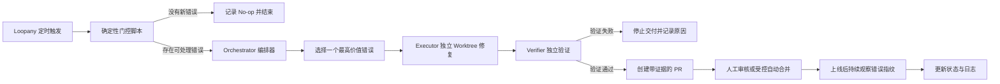

# 生产错误扫描修复循环实践

[← 返回总览](../README.md) · [按日期浏览](../by-date/index.md)

来源：`omnisun://digest/1784023592360` · 创建：2026-07-14  
评级：**A**（83 分） · 类别：AI Agent开发 / 工程自动化 / 产品与商业系统  
标签：`智能体循环` `验证机制` `循环契约` `任务编排` `安全边界`

**切换：** [正文](#tab-body) · [摘要（1）](#tab-1) · [结构化（3）](#tab-2) · [口播总结（2）](#tab-3) · [深度解读（2）](#tab-4) · [默认总结（2）](#tab-5)

> **一句话点评**：框架完整且可直接用于Agent系统设计，但成效证据主要来自作者自述，且多来源内容重复明显。
>
> **摘要**：文章结合开源工具与一个月运行经验，提出生产级智能体循环应包含契约、状态与日志、验证、触发器及演进机制，并以错误修复、文档维护、客服和CRM循环展示具体边界、流程与模板。

## 分析要点

- **核心高价值点**：将自主权明确写成可审计的边界：仅在根因清晰、风险较低且验证证据充分时自动交付，其余情况必须升级给人工。
- **留存建议**：精读并长期存档，可作为构建生产级智能体循环的设计参考（包含可复用的循环契约、状态日志、验证、触发器、角色拆分和演进机制，并提供多个可直接改造的模板与案例。）

**知识要点**

- 可靠循环的基础结构是目标与边界明确的契约、跨运行的精简状态、只追加日志以及每次运行固定执行的SOP。
- 复杂高风险任务可拆为编排器、隔离执行器和独立验证器，验证器应提供截图、视频或指标变化等可审核证据。
- 触发器应按任务选择持续、定时、事件或门控工作流模式，并通过周期性演进将重复确定性步骤沉淀为脚本或技能。

**行动项**

- 选择一个低风险任务，建立包含Goal、Boundaries、SOP、State和Logs的循环契约文件。
- 为工程循环配置一键开发环境、隔离工作树、Playwright等操作驱动及可附加到PR的验证证据。
- 运行5至10次后复盘日志、失败和成本，收紧边界并将重复步骤改造成门控脚本或可复用技能。

<a id="tab-body"></a>

## 正文

### superdesigndev/loopany-platform: Run your company in loops, Loop Anything

https://github.com/superdesigndev/loopany-platform

[Open in github.dev](https://github.dev/) [Open in a new github.dev tab](https://github.dev/) Open in codespace

Name Name

Last commit message

Last commit date

housekeeper: remove dead getScheduler accessor ([#136](https://github.com/superdesigndev/loopany-platform/pull/136))

752755d ·

156 Commits

.github/ workflows

.github/ workflows

fix(db): session-mode-ready pool options + restore manual-only prod d…

docs

docs

docs: ship English-only Multica-style README and prune stale docs ([#113](https://github.com/superdesigndev/loopany-platform/pull/113))

packages

packages

housekeeper: remove dead getScheduler accessor ([#136](https://github.com/superdesigndev/loopany-platform/pull/136))

scripts

scripts

housekeeper: stop tracking python bytecode cache ([#121](https://github.com/superdesigndev/loopany-platform/pull/121))

.dockerignore

.dockerignore

LoopAny: multi-user scheduled agent loops (BYOA)

.env.example

.env.example

fix(server): gate machine enrollment and rate-limit machine routes ([#128](https://github.com/superdesigndev/loopany-platform/pull/128)

.gitignore

.gitignore

housekeeper: stop tracking python bytecode cache ([#121](https://github.com/superdesigndev/loopany-platform/pull/121))

AGENTS.md

AGENTS.md

fix(server): gate machine enrollment and rate-limit machine routes ([#128](https://github.com/superdesigndev/loopany-platform/pull/128)

CLAUDE.md

CLAUDE.md

Generate route tree before typecheck so fresh checkouts pass

CONTRIBUTING.md

CONTRIBUTING.md

docs: ship English-only Multica-style README and prune stale docs ([#113](https://github.com/superdesigndev/loopany-platform/pull/113))

Loopany

#### Loopany

**Scheduled agent loops. Keep the system under control.**

Describe a recurring task once. Loopany runs it on a schedule with **your own machine's coding agent**, and surfaces every result on a shared dashboard and your team's notification channel.

[Website](https://loopany.ai) · [npm](https://www.npmjs.com/package/@crewlet/loopany) · Contributing · Architecture

Loopany is infrastructure for **recurring agent work**. You describe a loop - a daily health check, a weekly research digest, a closed goal like "follow up until it's fixed". A small daemon on a machine you control runs it on schedule using your local coding agent.

Loopany dashboard

The server only schedules, stores, authenticates, and notifies. **It never runs an LLM and never executes your code.** Execution is BYOA: [`@crewlet/loopany`](https://www.npmjs.com/package/@crewlet/loopany) on *your* machine, with *your* credentials, files, and tools. Artifacts you choose to sync come back as durable content; the rest never leaves the box.

A loop can stay **open** (a monitor or digest that runs indefinitely) or **closed** (a finish line: the loop completes itself when the goal is met).

Most coding agents can already run on a cron or loop a task themselves. That is the easy 5% - the timer. The real work is the structure that lets you trust it and run reliably. A bare agent loop does not give you:

- **Durable structure across runs** - state and logs so it never re-does work and gets smarter over time; a verifier so there is evidence, not vibes; a contract and boundary that decide whether you can safely walk away. A raw cron loop has none of this by default.
- **Self-improving (evolve)** - a periodic pass that rewrites the loop itself (tighter contract, cheaper trigger, mechanical steps folded into scripts), so it gets sharper and cheaper the longer it runs. A DIY loop stays as dumb as day one.
- **A team surface, not a terminal** - a shared dashboard, per-team notification channels, and failure alerts. Results show up where your team can see them, instead of scrolling a local terminal.
- **BYOA + vendor-neutral** - runs on *your* machine with *your* agent and credentials; not locked to one vendor's agent. Switch agents without rebuilding.
- **A safe, cheap control plane** - the server runs zero LLM and executes zero code; it only schedules, stores, authenticates, and notifies. You are not handing your code or secrets to a SaaS just to get scheduling.

#### Features

- **Scheduled agent loops** - cron or one-shot; open monitors or closed goals that finish themselves when met.
- **BYOA execution** - runs on your machine via `@crewlet/loopany`; the server is zero-LLM and zero code-exec. Credentials and tools stay local.
- **Self-improving loops** - evolve passes review run history, sharpen the brief, distill state, and refine the generative dashboard.
- **Deterministic pre-stage** - optional workflow body for cheap mechanical work before the agent; failures fall back to the agent with context.
- **Teams + notifications** - multi-user dashboard, per-team push channels (Telegram, Feishu, and more), failure alerts.
- **Synced artifact home** - loop folder in, dashboard out; front-matter products (reports, kanban cards, calendars) render as generative UI.
- **Templates** - React Doctor, Market Research, Follow-up Tracker, Docs Sweep, Housekeeper, Dependency Triage, Error Sweep.
- **Self-hostable** - one process, embedded pglite by default for local, Postgres + object store for production; Docker image included.

**Hosted app:** sign in at **[https://loopany.ai](https://loopany.ai)** (or use your own self-hosted instance). You will also, for now, need at least one machine you control to run loops.

1. **Sign in** to the Loopany web app at [loopany.ai](https://loopany.ai) (or your self-hosted instance).
2. **Create a loop.** The *New loop* dialog hands you a short **connect snippet** with a server URL and a one-time connect-key.
3. **Connect your machine.** Paste the whole snippet into your local coding agent - it connects the machine and builds the loop with you.

##### Daemon cheatsheet

`npx @crewlet/loopany --help` for everything:

Command What it does

`up` / `up --foreground` connect &amp; start the poll loop (detached / foreground)

`status` / `down` is the daemon running + connection state / stop it

`log` survey a loop's recent runs (`--transcript` for full text)

`new` / `edit` create or patch a loop (JSON config)

`@latest update` upgrade the daemon in place

---

Loopany is one server process plus one daemon per machine. The server never runs an LLM and never executes your code - it only schedules, stores artifacts, authenticates, and notifies. Execution happens on **your** machine via the [`@crewlet/loopany`](https://www.npmjs.com/package/@crewlet/loopany) daemon, talking to your local coding agent.

mermaid diagram

Source

```
flowchart LR
  Server["Loopany server<br/>schedules · stores · auth · notifies<br/>zero LLM · zero code-exec"]
  Daemon["@crewlet/loopany<br/>on your machine"]
  Agent["Local coding agent"]
  Server <-->|"HTTP poll"| Daemon
  Daemon -->|"runs / reports"| Agent
```

> **Early-stage note.** Loopany is still an early-stage project. The daemon runs with fairly high permissions on your machine - it executes your coding agent with your credentials - and we are continuously hardening security.

A scheduler tick creates a *pending run*; your bound machine's next poll claims it, runs the agent, and reports the result (which can post to the loop's push channel). Because the agent runs on your machine, your credentials, files, and tools never leave it - the server only stores the bytes your loop chooses to sync back.

---

##### Prerequisites

- Node.js &gt;= 22
- pnpm 8.15 (pinned via the root `packageManager` field; `corepack enable` picks it up automatically)

##### Local development

```
git clone https://github.com/superdesigndev/loopany-platform
cd loopany-platform
pnpm install
pnpm dev            # http://127.0.0.1:3000
```

That is a fully working server out of the box: auth is off (the app runs open), the database is an embedded, file-backed **pglite** Postgres at `~/.loopany/pgdata` (zero external DB - it migrates itself at boot), and artifact bytes are held in memory. Use the Quickstart above against `http://127.0.0.1:3000` to connect a machine.

All configuration is env-based. For **local development only**, copy `.env.example` to `packages/server/.env` and uncomment what you need - vite loads that file for `pnpm dev`. **`pnpm start` and Docker do NOT read `.env`**: in production pass real environment variables instead (Fly secrets, `docker -e` / `--env-file`, or a systemd `Environment=`), never a committed `.env`.

```
pnpm install
pnpm build          # nitro build → packages/server/.output
pnpm start          # applies pending DB migrations, then serves on $PORT
```

For a real deployment, set at minimum:

- **Database** - either point `DATABASE_URL` at a Postgres (e.g. Supabase; set it to the transaction pooler `:6543`, plus `DIRECT_DATABASE_URL` at the direct `:5432` URL for migrations), or leave both unset and set **`LOOPANY_DB=pglite`** plus a persistent `LOOPANY_DATA_DIR` - the embedded pglite database lives at `<dir>/pgdata`. The built server treats a missing `DATABASE_URL` as a config error unless `LOOPANY_DB=pglite` explicitly opts into the embedded tier (so a lost database secret fails the deploy loudly instead of silently booting an empty ephemeral DB); only `pnpm dev` runs pglite without the opt-in. `pnpm start` applies pending migrations before serving (over the direct URL for the hosted tier; in-process for the pglite tier).
- `GITHUB_CLIENT_ID` / `GITHUB_CLIENT_SECRET` + `LOOPANY_AUTH_SECRET` (a long random value) + `LOOPANY_BASE_URL` + `LOOPANY_ALLOWED_LOGINS` - gate sign-in behind GitHub. Leaving these unset runs the app **open, with no auth** - fine locally, not on the public internet.
- `LOOPANY_R2_*` - an S3-compatible object store (e.g. Cloudflare R2) for artifact bytes. Unset, artifacts are stored in memory and lost on restart.

> **Exposing a server publicly? Set the auth vars.** With `GITHUB_CLIENT_ID` / `GITHUB_CLIENT_SECRET` / `LOOPANY_AUTH_SECRET` / `LOOPANY_BASE_URL` / `LOOPANY_ALLOWED_LOGINS` unset the app runs **open, with no sign-in** - anyone who can reach it is in. This applies equally to a bare Node host and the Docker image below.

> **Run exactly one server process.** The in-process scheduler owns the cron loop; two processes against the same DB would double-fire every run.

> **Backing up the embedded pglite tier.**`<LOOPANY_DATA_DIR>/pgdata` is a LIVE Postgres data directory. Stop the server before copying it - a hot copy of a running data dir is not crash-consistent. If you need real, online backups, run the hosted tier instead (`DATABASE_URL` /Supabase gives you point-in-time backups).

##### Docker

The included `Dockerfile` builds the server. For the embedded pglite database, opt in with `LOOPANY_DB=pglite` and persist `/data` on a volume; with a `DATABASE_URL` (Supabase/any Postgres) the container is stateless and needs no volume. (The opt-in is deliberate: without it a container that LOST its `DATABASE_URL` would silently boot an empty ephemeral database - instead it refuses to start.)

```
docker build -t loopany .
# Embedded pglite (opt in + persist the DB on a volume):
docker run -p 3000:3000 -e LOOPANY_DB=pglite -v loopany-data:/data loopany
# Or against Postgres (stateless):
docker run -p 3000:3000 -e DATABASE_URL=... -e DIRECT_DATABASE_URL=... loopany
```

Pass configuration with `-e KEY=value` or `--env-file` (same variables as `.env.example`).

---

#### Development

```
pnpm dev            # server on http://127.0.0.1:3000
pnpm -r test        # all tests
pnpm -r typecheck   # both packages
```

See `CONTRIBUTING.md` for the contributor guide (migrations, releases, PR flow) and `AGENTS.md` for architecture notes.

#### License

MIT - every package is MIT:

- The machine-side daemon `@crewlet/loopany` is MIT.
- The platform server `@loopany/server` is MIT.

© 2026 Superdesign. Contributions are accepted under the MIT license (inbound=outbound) - no CLA, no sign-off required.

#### Releases

14 tags

#### Deployments 35

- production

\+ 34 deployments

#### Packages

No packages published

#### Languages

- TypeScript 96.5%
- JavaScript 1.3%
- CSS 1.3%
- Other 0.9%

---

### skills/skills/verifier-setup/SKILL.md at main · AI-Builder-Club/skills

https://github.com/AI-Builder-Club/skills/blob/main/skills/verifier-setup/SKILL.md

[Open in github.dev](https://github.dev/) [Open in a new github.dev tab](https://github.dev/) Open in codespace

and

feat: add verifier-setup skill; retire pr and ship-change

3cf5efa ·

name verifier-setup

description Set a repo up to prove engineering-task work actually works before it ships. Investigates the repo, ensures a one-command dev stack (\`dev-local\`) exists, asks whether verification runs locally or in a sandbox (crabbox), confirms/installs the driver (the \`playwright-cli\` skill for web by default). Outputs three artifacts: a committed \`/verify\` skill (per-task verification SOP — spawn a verifier sub-agent → drive the app → screenshot/video proof → open a PR with the proof embedded), the \`/dev-local\` skill + script, and the installed driver skill. Use when someone says "set up verification", "make this repo verifiable", "scaffold a verify skill", "set up the verifier".

user\_invocable true

Goal: leave the repo able to *prove an engineering task works before it ships* — run once, and it wires up everything the per-task `/verify` loop needs.

You are **setting up** — not verifying anything yourself right now. The `/verify` template lives at `assets/verify.template.md` (next to this skill). Parallels `dev-local-setup` (which generates a script + its skill doc): a setup skill that leaves behind reusable, repo-specific artifacts.

Running `verifier-setup` end-to-end leaves the repo with:

1. **A `/verify` skill** — `.claude/skills/verify/SKILL.md`, the repo-tailored per-task verification SOP (spawn a verifier sub-agent → drive the app → screenshot/video proof → open a PR with the proof embedded). Generated in Step 5.
2. **A `/dev-local` skill + its script** — `scripts/dev-local.sh` **and**`.claude/skills/dev-local/SKILL.md`, via `dev-local-setup` (Step 2) if not already present. The one-command stack `/verify` depends on.
3. **The driver skill installed** — the `playwright-cli` skill for web apps (Step 2); for non-web, the concrete exercise tool confirmed present.

Before creating anything, take stock — the repo may already have some of this, under whatever name or layout its team chose. Look for the **capability**, not a specific filename; the paths below are only examples. For each, decide **reuse as-is / adapt-extend / create fresh** — never blindly overwrite working setup:

- **A way to start the app** — a one-command dev launcher, a `Makefile` / `Procfile` target, `docker-compose`, package scripts (e.g. `scripts/dev-local.sh`, but any form counts).
- **A prior verification SOP/skill** — from an earlier run of this skill or the team's own convention.
- **A driver for the app's interface** — a browser automation tool already available (e.g. the `playwright-cli` skill), or the relevant API/CLI client.
- **An existing test/e2e suite or checks** — however organized.
- **Sandbox/cloud-box config** — anything giving isolated per-agent stacks.
- **An evidence/artifact convention** — where proof lands and how a reviewable link gets published (a release, bucket, CI artifacts, etc.).

Every later step is conditional on this inventory: if a capability exists and works,**reuse and adapt it** (fill gaps, don't regenerate); only create what's missing.

Discover the real facts the generated skill will hardcode:

1. **How the app is exercised** — is it a **web app** (has a browser UI + a dev server on a port), an **API/service** (HTTP endpoints, no UI), a **CLI**, or a desktop/mobile app? This picks the driver.
2. **Stack launcher** — is there already a way to start the app (any form — see Step 0)? Note the up-command and the app URL/port. If none, Step 2 handles it.
3. **Auth** — is the primary flow login-gated? Is there a session/auth helper the verifier can mint a session with (see `e2e-setup`)? Record it, or "n/a".
4. **Regression checks** — the repo's fast codified checks (type-check, lint, unit, existing e2e commands) from `package.json` / `Makefile` / `turbo.json` /etc.
5. **Proof upload** — how a reviewable video URL is produced (a `pr-evidence` GitHub prerelease via `gh release upload` is the default; a bucket/CI artifact works too).

For each, act on what Step 0 found — reuse if present, adapt if partial, create only if missing. Each check is idempotent; a no-op on what's already there:

- **Dev stack.** If any working way to start the app already exists (a launcher script, Make/Procfile target, compose, package scripts), **reuse it** — read it for the up-command/port/services and move on (extend only if a needed service is missing). If there's none, scaffold one via **`dev-local-setup`** (don't hand-roll a launcher here). The generated `/verify` just needs a reliable one-command up.
- **Driver skill.**
  - **Web** → install/confirm the **`playwright-cli` skill** (it documents + wraps the browser driver). Ensure its binary is callable too (`npx --yes @playwright/cli --version`; install it + the `chrome` channel if missing). This closes the usual local gap where the browser driver was assumed but never installed.
  - **Non-web** → confirm the concrete exercise tool exists (an HTTP client for an API, the built binary for a CLI). No browser skill needed.
- **Evidence dir.** Ensure `evidence/` is gitignored (proof output lands there).

Present the choice (default and recommend **local** — it's simpler to stand up):

- **Local** — one dev stack on the machine (`scripts/dev-local.sh up`). Best for a single task at a time. Recommend this unless they need parallelism.
- **Sandbox (crabbox)** — an isolated cloud box per agent, for **concurrent** loops or a fixed-port/single-instance stack. If chosen and not yet set up, scaffold via **`crabbox-setup`**; the generated skill drives the app in-box via `cbx.sh pw`.

Record the pick as the generated skill's default `RUN_MODE` (the other stays a documented fallback).

State the detected driver and confirm with the user (default **`playwright-cli`** for web apps). For non-web, name the concrete tool (e.g. `curl` /an HTTP script, the built CLI). This becomes `DRIVER` in the generated skill.

If a prior verification skill/SOP already exists (Step 0), **update it in place** — refresh the repo-specifics/placeholders, preserve any hand-edits the team added; don't clobber. Otherwise copy `assets/verify.template.md` → the repo's skills dir (`.claude/skills/verify/` or the repo's convention) and fill every `{{...}}` placeholder from Steps 1–4:`STACK_UP`, `APP_URL`, `RUN_MODE` (+ `RUN_MODE_NOTE`), `DRIVER` (+ `DRIVER_INSTRUCTION`),`AUTH_HELPER` (+ `AUTH_INSTRUCTION`), `EXERCISE`, `REGRESSION_CMDS`, `EVIDENCE_UPLOAD`,`DATE`. Delete branches that don't apply (e.g. drop the browser/video language for a non-web repo). Keep it to one screen — it's an SOP the agent follows, not an essay.

Commit the generated skill (+ any `.gitignore` /dev-local changes). Tell the user:

- how to run it — " `/verify` before opening a PR (or when asked to verify), on a branch with changes committed";
- the run mode chosen and how to switch;
- any prerequisite they must install/start once (e.g. Docker for infra, `gh` auth for evidence upload).

#### Principles

- **Check before you create; adapt, never clobber.** Every artifact — dev-local, the driver skill, e2e, evidence gitignore, the verify skill itself — is inventoried first (Step 0) and **reused/extended** when it already exists. Only create what's genuinely missing; preserve working setup and team hand-edits.
- **Discover, don't assume.** Stack command, port, auth, and checks come from the repo — the generated skill hardcodes real facts, not conventions.
- **Provision before you generate.** The driver, launcher, and `evidence/` exist before the `/verify` skill ships, so it never fails on a missing tool.
- **Right-sized.** A web monorepo gets the full browser+video SOP; a CLI tool gets a stdout-assertion SOP. Match the template to the repo; cut what doesn't apply.
- **The output is a skill, not a run.** verifier-setup scaffolds; `/verify` runs.

---

### 在运行循环一个月之后我学到了什么？？？

https://x.com/jasonzhou1993/status/2075179471951614381

**Jason Zhou**

### 在运行循环一个月之后我学到了什么？？？

上周我写了关于循环工程的内容：这是一种从提示代理完成任务，向设计系统转变的过程，在这些系统中，代理能够决定处理什么工作，执行、验证并随时间改进。

但很多人会说：好的，我被说服了，但是我到底该如何实际构建一个呢？ 更重要的是，我该如何构建一个真正能工作的？

因为任何人都可以用 while true 把一个代理（agent）包起来，称之为循环。这只是简单的 5%。真正的工作是那些护栏，它们让你能够抽身离开。

我们一直在进行一个实验，运行

[@SuperDesignDev](https://x.com/@SuperDesignDev) 通过上个月设置了很多很多循环，在这里我们想分享一些真正实用的经验。

#### 一个好循环的结构

我们运行的每个循环都有相同的四个部分。


#### 循环契约

一个 Markdown 文件，每次运行触发时注入到代理中。这是循环的章程。它包含四样东西：

- 目标 （胜利的定义，以及是否存在终点线）
- 的 边界 (它可以自由做什么、绝对不能做什么，以及它可以自行交付的内容与需要人类参与的内容之间的界限)
- 标准操作程序 （ 每次运行所遵循的步骤）

人们在边界部分投资不足，而正是这个部分决定了你是否能够抽身。以我们的一个循环“Error Sweep”为例：每天早上它会读取我们的生产错误跟踪器，挑选最严重的新漏洞，并发布修复程序。这是它的契约中真正的边界部分：

```text
- Fix only when the root cause is clear AND the fix is low-risk.
  Anything risky or large: open a PR and flag a human. Do not merge it yourself.
- Make the smallest fix that works. One PR per fix.
- Never open a new PR while a previous Error Sweep PR is still unmerged.
- Never copy credentials, tokens, or user data into a report or a PR.
```

那都不是关于如何修复 bug 的。这是四句话，用来画一道界限。在界限之内，代理可以自行完成部署。在界限之外，则由人类决定。你需要为代理清晰定义：何时它可以自行部署，以及何时你应该停止并询问。

我们通常将合约、状态、日志放入一个 md 文件中，如下所示

```markdown
# <loop name> — contract

## Goal
What winning looks like. Is there a finish line, or does this run forever as a monitor?

## Boundaries
- Free to do: ...
- Never do: ...
- Ship on its own vs ask a human: <the exact line>

## SOP (each run)
1. Read state + logs.
2. Gather what changed. Pick the single most worthwhile thing to do.
3. Do it (or hand it to an executor).
4. Verify. Record what happened. Report.

## Current understanding
...Current state of the loop run

## Logs
...Logs of past runs
```

#### 2\. 状态 + 日志

一个在每次运行之间忘记所有内容的循环是一个带有额外步骤的 cron 任务。它需要内存，分为两部分：

- 状态是持久的图景：待办事项、当前假设、已发布且需要跟进的实验。每次运行时在顶部查看，刻意保持简洁。
- 日志是发生的事情的只追加记录，逐次运行。

最明显的例子是我们的错误扫描循环维持的状态，以便不会浪费一次运行来重新调查它已经理解的内容：

```text
## Skip these fingerprints (known noise or upstream, not ours)
- ResizeObserver loop limit exceeded
- Stripe.js network blip on /checkout

## Fixed, still watching
- null-team-on-login (019edc8a) — fixed in #1027, confirm it stops firing in prod
```

没有那个块，每天早上循环都会重新发现同样的嘈杂错误，浪费一次运行来追踪它，并让你感到烦恼。有了它，循环会跳过已经判断过的内容，并将注意力放在新的内容上。状态是循环停止自我重复的地方。

该循环还包含其通过运行学到的内容：一个关于谁会转化的可行假设，以及它从犯错中习得的习惯。我们的 CRM 循环包含类似以下的内容：

```text
- users who hit the credit wall in their first week reply about 3x
  more than everyone else. Draft those first.
- Before drafting, check what the user actually built, not the label on their
  profile. One account tagged "SaaS dashboard" was really a print brochure.
```

那一切都不是来自原始合同。这个循环是通过逐次运行积累起来的，现在每次运行都比之前更智能一步。这就是为什么一个好的循环在第三个月比第一个月更有价值：它的状态已经吸收了它所看到的一切。


我们的内部工具，用于管理循环，在此开源（Loopany）：

[https://github.com/superdesigndev/loopany-platform](https://github.com/superdesigndev/loopany-platform)

#### 3\. /验证

这是任何执行高风险工作的流程的前提条件（例如实际生产环境中的代码变更、与真实客户沟通）。基本上，你需要确保验证过程简单，并生成人类能够轻松审核的证据。

通常这意味着

- 设置环境以确保验证 token 高效且可靠
- 一种包含核实证据的方式

对于工程任务，那意味着：

1. [dev-local.sh](http://dev-local.sh/) 脚本，轻松启动本地开发 + 远程沙箱环境以测试（类似 crabbox）
2. 允许代理像真实用户一样自主操作应用的工具（例如 Playwright-CLI）
3. /验证包含用于测试的 SOP 的技能
4. 用于上传截图和视频证据以附加到 PR 的位置（我们上传到 GitHub 发布资产）

虽然其他非工程类工作可能更棘手，但并非不可能。例如，在 CRM 循环中，我们有一个验证代理来审核按照特定防疏漏规则起草的消息；

[https://github.com/AI-Builder-Club/skills](https://github.com/AI-Builder-Club/skills)

结果是，来自循环的 PR 不会以“相信我，它能工作”的形式出现，而是附带一个展示该功能正常运行的视频。我可以在几秒钟内批准，因为我看到的是实际效果，而不是阅读差异并寄希望于它能工作。这也是为什么验证者是判断一个循环是否真的是个好主意的决定因素。


#### 4\. 触发器

什么唤醒了循环？有三种形状，选择正确的形状是成本模型的一半：

- 持续的 for 循环。这是 ralph-loop 或/目标类型触发器。代理在 for 循环中运行，直到条件满足。这是自主研究代理背后的模式。适合有界推送（持续运行直到测试套件通过），作为永久固定装置则过于浪费。当存在即时反馈循环和明确规范时，这种方式主要有用。（类似于大多数修复 bug 的工程工作）
- 基于时间的。 计划触发循环：每小时，每天早上 6 点。我们的 Error Sweep、React Doctor、文档维护者和 CRM 循环都在 cron 上运行。
- 基于工作流/事件。 新邮件到达、事件开启、PR 合并。循环仅在有可运行的内容时才执行。它甚至可以与基于时间的机制结合——例如，基于时间的定时任务每小时运行一次脚本以检查新的支持工单，如有工单则触发坐席；若无，则记录并静默处理。这是管理循环成本的良好方法；您可以在“演进”部分查看其工作原理。

#### 编排器 + 执行器 + 验证器

一旦循环涉及任何非平凡的内容，我们开始将其拆分为三个角色：


> Orchestrator 找到工作。Executor 在隔离的沙箱中执行工作。验证器证明该工作并附上证据。

1. 编排器/优先级排序器。 按计划唤醒的代理。它的任务不是执行任务，而是查找任务：收集信号、查看变更内容、选择本次运行中最有价值的单个事项，并进行交接。
2. 执行者。 在隔离空间中执行实际工作（针对代码，一个全新的脱离主分支的 git worktree，因此它永远不会污染你的工作区或其他循环的运行）。
3. 验证者。 独立确认执行者的工作并生成可供人类查看的证据。

但不是所有循环都需要这三个。三层结构正是复杂的、负责代码交付的循环发展的结果。很多好的循环其实就是编排器自己完成整个流程。让我给你看看这两个方面。

#### 演进循环 - 构建抗脆弱循环

在纳西姆·尼古拉斯·塔勒布的《反脆弱》中，他将系统分为三类：脆弱系统惧怕波动性，一次意外就意味着巨大损失；强健系统能在波动性中存活并恢复到原有状态；反脆弱系统则从中获益，每次冲击都会让它们变得更强。玻璃杯是脆弱的，石头是强健的，你的免疫系统是反脆弱的：每一次小感染都会训练它。

当聚焦于循环时，问题就变得具体了： 当运行失败时，教训会去向何方？ 在我们的实践中，一个教训有三个去向，按抽象程度递增的顺序：


每个人都有日志，而且日志只会越来越长。正是将经验提炼为规则，才让循环具备反脆弱性。问题是：谁来做提炼？

所以在 Loopany（我们为这些循环构建了内部应用）中，这成为了一个独立的运行角色： 演进 。代理会话会读取该循环最近十几次运行的日志、结果和成本，并询问：我们在哪里重复犯错？哪些运行是浪费的？哪些边界太松，哪些太紧？它的输出不是产品代码，而是对循环本身的修改：

- 循环合同，国家公约
- 触发机制
- 用于重复和确定性代理步骤的脚本
- 技能
- 人们查看的仪表盘

这是一个用于改进循环本身的循环。

### 真实循环运行 Superdesign

我们一直在运行循环来自动化 Superdesign 的大部分功能，有些成功了，有些没成功（经验教训将在后续单独的博客中分享）。以下是我们日常运行的几个真实示例，这些示例相对容易复制和设置

#### 文档维护循环


我们最简单也最有用的循环之一。每周一次，它会确保项目文档保持准确；

这个循环是单层的。编排器读取差异，检查文档，如果有内容漂移则打开一个 PR，完成。没有单独的执行器，也没有单独的验证器，因为任务简单且爆炸半径小，足以让一个代理在其认知范围内处理。

你可以添加多个层、一个对文档中每个声明进行事实核查的验证器，以及一个标记它发现的技术债务的检查过程。你不应该这么做，直到这个简单版本让你碰壁为止。先构建1层版本，体会具体的痛点，然后添加恰好能解决该问题的那一层。

这是我会让你先构建的循环，所以这是一个模板：

```markdown
# doc-maintainer — contract

## Goal
The README, setup guides, and examples always match what the code
actually ships. Zero drift found = a successful run, not a wasted one.

## Boundaries
- Ship on its own: open ONE pull request with the fixes. That's it.
- Never: rewrite accurate docs to look busy, touch anything outside
  the docs, stack a 2nd PR while last week's is still open.

## SOP (each run)
1. Read the diff: every commit + PR since the last sweep (cursor is
   in state).
2. Compare README, setup guides, examples, runbooks against what the
   code ships NOW.
3. Verify for real: run the commands, check the links, try the
   examples. Never trust memory.
4. Drift found → smallest fix, fresh worktree, one PR explaining what
   drifted and why. Nothing stale → clean stop.
5. Move the cursor, log the run.

## State
- last-sweep cursor (commit hash)
- open PR, if any

## Logs
- one dated line per run: drift count + PR link, zero included
```

#### 漏洞猎人循环


有些循环会向真实客户部署实际代码，而在这一过程中出现的错误代价高昂。这时，所有三个层级都能各尽其责。

我们的 Error Sweep 循环每天早上运行：

1. (编排器) 它从我们的错误跟踪系统中拉取过去 24 小时的生产错误（我们编写的一个特殊脚本从 posthog/LLM 日志/服务器日志中收集数据），按出现次数×用户数对其进行排序，跳过其状态中已知的“噪声”指纹，并选择最具影响力的单个新异常。它拉取反压缩的栈跟踪并找出根本原因。
2. (执行器) 如果原因明确且风险低，它会在一个新的工作树中修复问题并提交 PR。如果风险高或规模大，则停止并通知人工处理。边界处的那个分支每次运行都会进行实际工作。
3. (验证器) 修复在生效前得到验证，循环在后续运行中持续观察该指纹，以确认错误确实停止触发。一个未改变实际数值的修复不是真正的修复。

React Doctor 采用同样的方式，专注于提升代码健康而非解决运行时错误：每天早上它会使用 npx react-doctor 扫描应用，挑选出最严重的单个问题，在隔离工作树中修复，验证后打开一个拉取请求。它会以每日指标的形式报告健康评分，让你可以观察指标变化。并且它有一个小护栏，确保使用体验良好：

> 如果之前的 React Doctor PR 仍然处于打开状态且未合并，不要今天再打开另一个。刷新已打开 PR 的状态并仍然报告分数。

这条规则是一个有帮助的循环和一个让你淹没在 30 个你永远不会审阅的 PR 中的循环之间的区别。一个循环必须考虑到你的审阅带宽，而不仅仅是它自身的吞吐量。

#### 支持分类循环


每小时针对我们的 Intercom 收件箱运行。其指导原则是：每个支持工单都是了解产品缺口的免费窗口。写来的用户正在免费向你提交一份 bug 报告、一个转化障碍或一个困惑信号。大多数支持系统只是回复消息然后丢弃这个窗口，这个循环让这种情况持续下去。

每次运行执行四个步骤：

1. 拖动窗口。 自上次运行以来的所有内容，以及今天到期的任何跟进事项。窗口在静默时段会自动扩大，因此错过的触发永远不会丢失工单。按最后发言者分类：客户 = 需要回复，机器人 = 待审核，队友 = 已处理。
2. 回复前先调查。 这是关键区别。对于每个工单，先基于真实数据确定根本原因：检查用户的账户、实际会话、错误日志和账单记录。切勿盲目回复。很多时候，用户描述的问题并非真正的问题。
3. 分支到三个输出。每个工单最多可以生成三件东西：一个回复能够立即解决用户的问题，在该对话中； 一个提交到知识库的信号：工单背后的产品差距，记录一次，以便后续增长循环和工程循环能够基于该模式采取行动； 并且当根本原因是真正的漏洞时，它会在一个新的工作树中生成一个修复代理，包含验证器和证据，使用与漏洞猎手循环相同的机制。
4. 回复并休息。 设置跟进日期，记录运行，等待下一个 tick。

使这一系统能够安全地对真实客户运行的边界是：回复采用分层机制。常规的、事实性的回答会自动发出。任何敏感内容、退款相关、愤怒的用户、非英文内容且我无法审核语气的情况，只有在人工审核通过后才会发出。

设置它和其他任何循环的方法相同：一个合同文件加上一个每小时的 cron 任务。这是支持合同，精简为你可以拿去用的模板：

```markdown
# support-triage — contract

## Goal
Every inbound ticket gets a correct, investigated response within an hour,
and every product gap behind a ticket becomes a signal the team can act on.
No finish line: this is a monitor.

## Boundaries
- Ship on its own: replies to routine, factual questions (how-to, billing
  lookups, known issues with a documented fix).
- Ask a human first: refunds, angry or churn-risk users, anything legal,
  any reply in a language the team can't review.
- Never: promise features or timelines, share another user's data, close
  a ticket without a root cause written down.

## SOP (each run)
1. Pull conversations since the last run timestamp + follow-ups due today.
   Bucket by last speaker (customer / bot / teammate).
2. Per ticket: investigate root cause against the product DB, error logs,
   and billing BEFORE drafting anything. Never answer blind.
3. Reply per the boundary tiers. Draft-only where approval is required.
4. If the root cause is a bug: spawn a fix agent in a fresh worktree,
   require verification evidence, open a PR flagged to the team.
5. File a signal for any recurring or conversion-relevant gap (dedupe
   against existing signals first).
6. Set follow-up dates. Log the run.

## State
- open follow-ups (ticket id -> due date)
- recurring-theme tally (feeds signal creation)
- standing lessons (e.g. "duplicate messages = retry artifacts, not spam")

## Logs
- one dated line per run: tickets handled / replies sent / signals filed
```

然后在 cron 前面设置一个简单的门控机制，这样代理程序只有在窗口中有内容时才会激活（之前提到的 Evolve 操作），然后让它运行。这种做法的好处不仅仅是更快的回复，还有信号：当五个人询问如何导出某个内容时，这就是一个已记录的转化缺口，正等待进入增长循环，而不是某个可能在季度回顾中才会注意到的模式。

#### CRM 生命周期闭环


循环不是工程玩具。我们一些最有价值的循环从未涉及一行代码。这个循环负责我们的客户拓展工作，是面向人而非代码的三层结构的最充分体现。

每天早上：

1. 脚本先拉取数据。 过去 24 小时内活跃的用户、新的商务邮箱注册以及任何收到的回复。确定性的前期阶段，数据拉取过程中不使用 LLM。回复的用户完全退出循环：实时对话属于人类。
2. 编排器提出细分群体，不是一次性选择。值得今日触达的高意向用户群体：本周遇到信用墙的用户、新注册企业、高触达建设者。这些只是示例，而非固定列表；每次运行时都会根据数据重新生成细分群体，哪些会转化取决于当前状态。
3. 每个部分都会生成一个执行器子代理按用户逐个处理：查看他们实际构建的内容，查阅与他们的每一次过往交流，然后起草一封个人电子邮件。切勿盲目起草。一个标注为“SaaS 仪表盘”的资料标签可能实际上是一本印刷手册；执行器检查的是实际成果，而非标签。
4. 验证人员会检查每一份草稿在草稿可以流转之前：需要根据数据对邮件中的每一个声明进行事实核查（以你的名义发出的内容不能有任何虚假信息），然后遵循语音和防疏漏规则。这又是 SEO 相关场景中提到的“品味”问题，但在这里是可解决的，因为“该声明是否符合用户项目的实际情况”有一个可核查的答案。
5. 发送按风险分级。我们最初只允许草稿：每封邮件都需要人工处理。随着各细分群体证明其回复率，低风险的群体获得了在内部权限范围内自主发送的权利。高互动性的群体仍然以草稿形式存在，需人工审批。自主权是按细分群体获得的，而非自动赋予整个流程。
6. 摩擦成为信号。 当研究发现用户在某个环节遇到困难时，这不仅仅是邮件内容，它会生成一个供其他流程读取的信号，而真正的漏洞会催生一个修复代理，其机制与漏洞猎手相同。

你在第 1 部分看到的机制掌控了一切：7 天抑制期，最多一次无回复跟进，一旦回复则由人工接管。系统会进行复合处理：按段记录发送和回复情况，保留转化的内容，丢弃未转化的内容。循环在选择发送对象时的给谁发邮件效果每周都有显著提升，因为它是根据回复率而非直觉来校准的。

```markdown
# crm-lifecycle — contract

## Goal
Turn high-intent product activity into conversations. Success = reply rate
and upgrades per segment, not emails sent. No finish line: this is a monitor.

## Boundaries
- Ship on its own: sends to segments that have EARNED it (see state:
  approved_segments). Everything else: drafts only, a human sends.
- Ask a human first: any new segment's first batch, anyone who ever
  replied, any claim the verifier couldn't confirm.
- Never: email anyone contacted in the last 7 days, send a 2nd follow-up
  without a reply, invent facts about what a user built.

## SOP (each run)
1. Scripts have already pulled actives, signups, and replies. Read the
   output. Users who replied exit to a human.
2. Score users, then propose SEGMENTS (groups, not one-off picks).
   Check state for which segments converted before proposing more.
3. Per segment: spawn an executor sub-agent. Per user: read what they
   actually built + every past exchange, then draft. Never draft blind.
4. Every draft passes the verifier: fact-check each claim against the
   data, then voice + anti-slop rules. Nothing false goes out.
5. Route by risk: approved segments send; the rest queue for review.
6. Friction found during research → file a signal; real bug → spawn a
   fix agent.

## State
- approved_segments (earned autonomy + the reply rate that earned it)
- per-segment performance (sends → replies → upgrades)
- suppression list · standing lessons (e.g. "verify from their real
  work, not their profile label")

## Logs
- one dated line per run: segments proposed / drafts / sends / replies
```

#### 良好循环检查清单

- \[ \] 循环合约文件：目标，SOP，输出规则，每次运行时读取
- \[ \] 边界和约束：它独立运行的内容与需要人工介入的内容；空操作是一种有效运行
- \[ \] 状态 + 日志: 跨运行的内存，因此它不会重复执行工作
- \[ \] 廉价验证器 : 带证据证明；若无证据，则保留人工介入
- \[ \] 隔离执行 : 每次运行时的全新工作树或独立沙箱
- \[ \] 经济高效的触发器 : 门脚本或事件，空运行不产生成本
- \[ \] 循环进化周期 : 查看运行历史，将机械性工作融入脚本/技能
- \[ \] 小范围 : 拆分循环直到“只需运行”感觉舒适为止

#### Loopany - 我们内部的循环管理工具（开源）

[](https://x.com/jasonzhou1993/status/2075179471951614381)[](https://x.com/jasonzhou1993/status/2075179471951614381)

我们一直使用一个名为 Loopany 的内部工具来协调公司内部所有的循环，它对我们非常有用，所以我们决定将其开源

这是一个循环管理环境，与您团队自己的本地代理连接。

- 循环模板 &amp; 内置自动日志/状态跟踪
- 可编程触发器 + 自动重试 &amp; 恢复
- 进化周期
- 每个循环的小程序
- 团队工作区，以避免循环冲突

欢迎随时试用并告知我们您的反馈：

[https://github.com/superdesigndev/loopany-platform](https://github.com/superdesigndev/loopany-platform)

<a id="tab-1"></a>

## 摘要（1）

### 2026-07-14 10:06:32

#### 实例：构建一个可长期运行的「生产错误扫描与修复循环」

下面以一个具体场景说明如何把普通的定时 Agent，设计成一个可以安全运行、持续学习并产生可审核结果的工程循环。

##### 一、实例背景

假设团队维护一个 SaaS 产品：

- 前端：React
- 后端：Node.js
- 代码托管：GitHub
- 错误来源：PostHog、Sentry 或服务器日志
- 循环调度：Loopany
- 执行环境：团队控制的专用机器
- 验证工具：
  - `scripts/dev-local.sh`
  - Playwright CLI
  - `/verify` Skill
- 目标：每天处理一个影响最大的生产错误

这个循环不是“每天让 Agent 看看有没有 Bug”，而是：

> 每天从过去 24 小时的生产错误中，选出一个最值得解决的新问题；仅在根因明确、风险可控且能够验证时创建修复 PR，并提供可供人工快速审核的证据。

---

##### 二、推荐架构



Loopany 在这里主要负责：

- 调度
- 存储状态和同步产物
- 身份认证
- 团队通知

Agent 和代码实际运行在团队自己的机器上。服务端不执行代码，也不运行 LLM。

---

#### 三、循环契约

建议在仓库中创建：

```text
loops/error-sweep/README.md
```

以下是一个可以直接改造的契约模板。

```markdown
# production-error-sweep — contract

## Goal

每天检查过去 24 小时的生产错误，选择一个影响最大的、此前未处理的新错误。

成功不等于“每天必须提交代码”。

以下结果都属于成功运行：

1. 找到低风险且可验证的问题，并创建一个修复 PR；
2. 找到高风险问题，完成调查并升级给人工；
3. 没有新的可操作错误，记录 No-op 后正常结束；
4. 已有 Error Sweep PR 未合并，因此不创建新的 PR。

本循环没有固定终点，是一个长期运行的监控循环。

## Boundaries

### Free to do

- 以只读方式读取生产错误、日志和调用链；
- 对错误进行聚类、去重和影响排序；
- 在独立 Git worktree 中修改代码；
- 运行本地测试、类型检查和端到端测试；
- 为低风险、根因明确的问题创建一个 PR；
- 更新本循环的状态和追加日志。

### Ask a human first

出现以下任一情况时，只调查、记录和通知，不自行合并：

- 根因不明确；
- 无法稳定复现；
- 修改涉及数据库迁移；
- 修改涉及认证、权限、支付或账单；
- 修改涉及用户数据删除或批量更新；
- 修改涉及基础设施、密钥或生产配置；
- 需要大规模重构；
- 需要升级主要依赖版本；
- 验证结果不完整；
- 预计影响多个业务模块；
- 需要改变本循环的安全边界。

### Never do

- 不将 Token、密钥、Cookie 或用户数据写入日志、PR 或验证证据；
- 不直接修改主分支；
- 不在共享工作区直接执行修复；
- 不为了“产生结果”而修改无关代码；
- 不同时为多个错误创建 PR；
- 上一个 Error Sweep PR 未关闭时，不创建第二个 PR；
- 不把“测试通过”当成生产问题已经解决的最终证据；
- 不自动放宽本契约中的权限边界。

### Shipping policy

初始阶段：

- 可以自主创建 PR；
- 所有生产代码变更均需人工批准；
- 不允许自动合并。

只有满足以下条件后，团队才可以为特定变更类别授予自动合并权限：

- 该类别已经连续成功运行至少 20 次；
- 没有回滚或生产事故；
- 验证过程稳定；
- 变更范围有明确白名单；
- GitHub 分支保护和必需检查全部生效。

自主权按“变更类别”授予，不对整个循环一次性开放。

## SOP — each run

1. 读取本契约、State 和最近的 Logs。
2. 检查是否存在尚未合并的 Error Sweep PR。
   - 如果存在，刷新 PR 状态并结束本轮；
   - 不创建新的 PR。
3. 运行确定性错误采集脚本，读取过去 24 小时的数据。
4. 按错误指纹聚类，并跳过 State 中记录的已知噪声。
5. 根据影响分数排序：
   - 受影响用户数；
   - 出现次数；
   - 严重级别；
   - 是否阻断核心流程。
6. 只选择一个最值得处理的新错误。
7. 拉取完整调用链、相关提交和上下文，判断根因。
8. 如果根因不明确或风险过高：
   - 生成调查报告；
   - 通知人工；
   - 更新 State 和 Logs；
   - 结束运行。
9. 如果根因明确且风险较低：
   - 创建全新的 Git worktree；
   - 先构造能够复现问题的测试或步骤；
   - 实施最小修复；
   - 每个修复只解决一个根因。
10. 调用独立 Verifier：
    - 证明修复前问题可以复现；
    - 证明修复后问题不能复现；
    - 运行回归检查；
    - 生成日志、截图或视频证据。
11. 验证通过后创建一个 PR，并在 PR 中附上：
    - 根因；
    - 修改范围；
    - 修复前证据；
    - 修复后证据；
    - 回归命令和结果；
    - 风险与回滚方式。
12. 更新 State。
13. 向 Logs 追加本轮结果。
14. PR 合并上线后，将错误指纹加入观察列表，在后续运行中确认其是否停止出现。

## State

### Cursor

- last_checked_at: 2026-07-12T06:00:00Z
- last_error_event_id: evt_123456

### Open PR

- none

### Skip fingerprints

- `ResizeObserver loop limit exceeded`
  - 浏览器已知噪声；
  - 不属于当前产品代码根因。

- `Stripe.js network blip on /checkout`
  - 上游瞬时网络错误；
  - 仅在失败率超过阈值时重新调查。

### Fixed, still watching

- `null-team-on-login`
  - 修复 PR：#1027
  - 首次修复时间：2026-07-10
  - 观察截止时间：2026-07-17
  - 成功标准：生产环境连续 72 小时不再出现。

### Standing lessons

- 必须从真实调用链确认根因，不能只根据错误消息猜测。
- 修复登录错误时必须测试无团队、新团队和已有团队三种账户状态。
- 浏览器控制台没有报错，不代表服务端错误已经消失。
- 对第三方服务错误优先增加降级与观测，不盲目重试。

### Approved autonomous categories

- none

## Logs

- 2026-07-11：发现 3 个指纹，2 个为已知噪声；调查 login 500，
  根因不明确，已升级人工，无代码修改。
- 2026-07-12：修复 null-team-on-login，创建 PR #1027；
  单元测试、类型检查和 Playwright 登录流程通过，等待人工审核。
- 2026-07-13：PR #1027 尚未合并，本轮未创建新 PR；刷新错误指标后结束。
```

---

#### 四、触发器最佳实践：先门控，再唤醒 Agent

不建议每 30 分钟无条件启动一次 LLM。更好的方式是先运行便宜、确定性的脚本。

例如：

```text
scripts/error-sweep-gate.ts
```

其职责仅包括：

1. 拉取过去一段时间的错误；
2. 根据指纹去重；
3. 排除已知噪声；
4. 检查是否有未合并 PR；
5. 判断是否存在值得调查的新错误；
6. 只有存在工作时才启动 Agent。

伪代码如下：

```ts
const openPr = await findOpenErrorSweepPr();

if (openPr) {
  await writeGateResult({
    shouldWakeAgent: false,
    reason: `Existing PR still open: ${openPr.url}`,
  });
  process.exit(0);
}

const events = await fetchProductionErrors({ since: lastCursor });
const grouped = groupByFingerprint(events);
const actionable = removeKnownNoise(grouped, state.skipFingerprints);

if (actionable.length === 0) {
  await writeGateResult({
    shouldWakeAgent: false,
    reason: "No new actionable production errors",
  });
  process.exit(0);
}

await writeGateResult({
  shouldWakeAgent: true,
  candidates: rankByImpact(actionable),
});
```

##### 为什么这是最佳实践

- 空运行不消耗 Agent Token；
- 数据拉取和排序可以重复执行；
- 避免 LLM 每次重新理解相同日志；
- 错误候选集可审计；
- 触发失败时更容易恢复；
- 可以把时间触发和事件触发结合起来。

推荐触发策略：

```text
每 30 分钟运行门控脚本
        ↓
有高严重级别错误：立即启动循环
无高严重级别错误：每天 06:00 批量启动一次
没有可处理内容：静默结束
```

---

#### 五、验证系统的落地方式

高风险循环能否上线，关键不在于 Agent 会不会写代码，而在于它能否证明代码有效。

##### 1. 先盘点，不要盲目生成

执行 `verifier-setup` 前，应先检查仓库是否已经具备：

- 一条命令启动完整开发环境的方式；
- 现有 E2E 或测试套件；
- Playwright、Cypress 或其他浏览器驱动；
- API 测试脚本；
- 沙箱或独立环境；
- 现有的验证 SOP；
- 证据上传位置。

处理原则：

| 现状 | 处理方式 |
|---|---|
| 已存在且可用 | 直接复用 |
| 已存在但能力不足 | 扩展并保留团队原有约定 |
| 完全缺失 | 创建新的能力 |
| 文件名不同但功能一致 | 按能力识别，不重复创建 |

不要因为仓库中没有 `scripts/dev-local.sh`，就断定不存在一键启动方式。`Makefile`、`docker compose`、`Procfile` 或 `package.json` 脚本都可能已经提供相同能力。

##### 2. 推荐产物

最终仓库至少具备：

```text
scripts/dev-local.sh
.claude/skills/dev-local/SKILL.md
.claude/skills/verify/SKILL.md
evidence/                         # 加入 .gitignore
```

其中：

- `verifier-setup`：用于搭建验证能力；
- `/verify`：用于对每一个具体任务执行验证；
- 二者不能混为一谈。

##### 3. `/verify` 的标准流程

```markdown
1. 在变更已经提交的独立分支上启动验证。
2. 使用一条命令启动完整开发环境。
3. 在修复前的版本上复现生产错误。
4. 保存修复前的错误日志、响应或视频。
5. 切换到修复版本。
6. 执行快速回归检查：
   - typecheck
   - lint
   - unit tests
   - relevant integration tests
7. 使用真实接口验证：
   - Web 流程使用 Playwright；
   - API 问题使用 curl 或 HTTP 测试脚本；
   - 后台任务使用可重复执行的任务脚本。
8. 保存修复后的日志、截图或视频。
9. 由独立 Verifier 判断是否满足验收标准。
10. 将证据上传，并在 PR 中嵌入可访问链接。
```

##### 4. 证据要求

PR 不能只写：

> 已测试，可以正常工作。

而应包含：

```markdown
## Root cause

用户没有 Team 时，登录处理逻辑仍然直接访问 `team.id`，
导致 `/api/session` 返回 500。

## Before

- 复现账户：无 Team 的测试账户
- 请求：`GET /api/session`
- 结果：HTTP 500
- 错误：`Cannot read properties of null`
- 证据：<修复前日志或视频链接>

## After

- 同一账户、同一路径重新验证
- 结果：HTTP 200
- UI 正常进入 Team 创建流程
- 证据：<修复后视频链接>

## Regression checks

- `pnpm typecheck`：通过
- `pnpm test session`：通过
- `pnpm test:e2e login`：通过

## Risk

只修改无 Team 账户的空值分支，不影响已有 Team 的登录路径。

## Rollback

回滚当前 PR 即可，不涉及数据库迁移。
```

对于服务端错误，截图并不是最强证据。优先级应为：

1. 可重复执行的失败测试；
2. 修复前后的 HTTP 响应或任务结果；
3. 结构化日志；
4. 浏览器视频；
5. 文字说明。

---

#### 六、这个实例上的核心最佳实践

##### 1. 每次只处理一个问题

一次运行只选一个最高价值错误，并且一个修复只创建一个 PR。

这样可以：

- 降低爆炸半径；
- 简化验证；
- 简化回滚；
- 让根因与修改保持一一对应；
- 避免人工审核队列失控。

---

##### 2. “没有工作”是有效结果

Agent 容易为了表现出有产出而修改无关内容。因此契约中必须明确：

> 没有发现文档漂移、错误已被处理、没有新问题，都属于成功运行。

不能用“PR 数量”衡量循环是否成功。

---

##### 3. 状态和日志必须分开

| 类型 | 作用 | 维护方式 |
|---|---|---|
| State | 当前仍然有效的认知 | 保持简洁，可更新、可删除 |
| Logs | 每次运行发生了什么 | 只追加，不覆盖 |

日志会越来越长，但不能直接把长日志当作记忆。应定期把日志中的稳定结论提炼到 State。

---

##### 4. 明确“何时停止并找人”

边界不能只写“谨慎操作”，而应写成可执行条件：

```markdown
如果涉及数据库迁移，则停止。
如果不能稳定复现，则不提交修复。
如果修改超过一个业务模块，则升级人工。
如果验证证据不完整，则不得合并。
```

越明确的边界，越能让团队放心离开终端。

---

##### 5. 编排器、执行器和验证器相互独立

在这个错误修复实例中，建议使用三层角色：

| 角色 | 职责 | 不应该做什么 |
|---|---|---|
| Orchestrator | 收集信号、排序、选择一个问题 | 不直接大规模改代码 |
| Executor | 在隔离环境中实施最小修复 | 不自行宣布验证通过 |
| Verifier | 独立复现和验证，生成证据 | 不依赖 Executor 的自述 |

独立验证可以减少“自己写、自己测、自己宣布成功”的确认偏差。

---

##### 6. 每次执行都要隔离

代码修复应在以下任一种环境中进行：

- 新的 Git worktree；
- 独立容器；
- Crabbox 等远程沙箱；
- 一次性开发环境。

不要让多个循环共享同一个有未提交修改的工作目录。

---

##### 7. 不把“测试通过”当成最终闭环

生产错误的最终验收标准不是测试变绿，而是：

> 修复上线后，目标错误指纹在预定观察窗口内停止出现，且没有引入新的异常。

因此 State 中需要维护：

```markdown
## Fixed, still watching

- fingerprint
- PR
- deploy time
- observation deadline
- expected production metric
```

---

##### 8. 自主权应该逐步获得

推荐分阶段上线：

###### 阶段 1：影子模式

- 只读取错误；
- 只输出调查报告；
- 不修改代码；
- 观察其错误分类和优先级是否可靠。

###### 阶段 2：PR-only 模式

- 可以创建分支和 PR；
- 必须经过独立验证；
- 所有 PR 由人工合并。

###### 阶段 3：类别白名单

仅对经过证明的低风险类别开放自动合并，例如：

- 明确的空值防护；
- 不改变业务逻辑的日志修复；
- 已有回归测试覆盖的边界条件修复。

即便如此，也必须满足：

- 变更路径不涉及敏感模块；
- 必需检查全部通过；
- 验证证据完整；
- 没有未合并的前序 PR；
- 支持快速回滚。

###### 阶段 4：持续校准

根据：

- 回滚率；
- 误判率；
- 人工驳回率；
- 生产复发率；

决定扩大、维持或收回权限。

---

#### 七、增加一个“演进循环”

每运行 5～10 次，可以启动一次独立的 Evolve Session。

它不修改产品代码，而是审查循环本身：

```markdown
1. 最近哪些运行是空耗？
2. 哪些错误被重复调查？
3. 哪些步骤是确定性的，可以改成脚本？
4. 哪些边界太宽或太窄？
5. 哪些验证经常失败？
6. 哪些 State 已经过期？
7. 哪些日志结论应该提炼为长期规则？
8. 是否需要调整触发频率？
9. Dashboard 是否能直接显示人工关注项？
```

Evolve 可以修改：

- 循环契约；
- State；
- 触发门控脚本；
- 验证 Skill；
- 确定性的预处理脚本；
- Dashboard 展示方式。

但有一项限制：

> Evolve 不得自行放宽生产权限和安全边界。任何权限扩大都必须由人工批准。

---

#### 八、建议监控的指标

不要只统计“创建了多少 PR”，建议至少监控以下指标。

| 指标 | 含义 |
|---|---|
| 新错误发现数 | 每轮发现的新指纹数量 |
| 可操作错误比例 | 新错误中真正属于产品根因的比例 |
| 已知噪声命中率 | State 帮助跳过了多少重复调查 |
| PR 接受率 | 循环创建的 PR 中被接受的比例 |
| 人工驳回率 | 根因、风险或修复方式被人工否决的比例 |
| 验证失败率 | Executor 完成后未通过独立验证的比例 |
| 生产复发率 | 修复后相同指纹再次出现的比例 |
| 回滚率 | 合并后需要回滚的比例 |
| 平均审核时间 | 人工审核一个循环 PR 所需时间 |
| 每个有效修复成本 | Agent、沙箱和验证成本 |
| 空唤醒比例 | Agent 启动后发现没有工作的比例 |
| 待审核 PR 数量 | 是否超出团队审核带宽 |

其中，空唤醒比例过高，通常意味着门控脚本需要改进；待审核 PR 持续增长，则意味着循环吞吐量已经超过团队审核能力。

---

#### 九、Loopany 部署与安全注意事项

由于机器端 Daemon 会调用本地 Agent，并可能拥有较高权限，建议：

1. 使用专用机器、专用系统用户或隔离容器；
2. 只提供任务所需的最小权限；
3. 生产日志凭据尽量只读；
4. 不让 Agent 直接持有不必要的生产写权限；
5. 只同步必要的产物和证据；
6. 对所有同步内容执行脱敏；
7. 公网部署 Loopany 时必须启用认证；
8. 生产环境使用持久化数据库和对象存储；
9. 同一数据库只运行一个调度器进程，避免重复触发；
10. 使用嵌入式 PGlite 时，应持久化数据目录，并在停止服务后再备份；
11. 为通知渠道设置失败告警；
12. 保留 GitHub 分支保护作为循环之外的最后一道防线。

---

#### 十、上线前检查清单

##### 循环设计

- [ ] 有明确的目标和成功定义；
- [ ] 明确“没有问题”也是成功运行；
- [ ] 明确自主执行与人工介入的边界；
- [ ] 每次最多处理一个问题；
- [ ] 上一个 PR 未关闭时不创建新 PR；
- [ ] State 与 Logs 分离；
- [ ] 已知噪声可以跨运行跳过。

##### 执行与验证

- [ ] 使用独立 worktree 或沙箱；
- [ ] 开发环境可以一条命令启动；
- [ ] 修复前能够复现问题；
- [ ] 修复后能够证明问题消失；
- [ ] Verifier 独立于 Executor；
- [ ] PR 包含日志、截图、视频或测试证据；
- [ ] `evidence/` 已加入 `.gitignore`；
- [ ] 验证失败时不会继续交付。

##### 触发与成本

- [ ] Agent 启动前有确定性门控；
- [ ] 没有工作时不会启动 LLM；
- [ ] 触发失败不会丢失游标；
- [ ] 可以观察每轮成本和空运行率；
- [ ] 有重试上限和 Token 预算。

##### 生产安全

- [ ] 默认只创建 PR，不自动合并；
- [ ] 敏感模块有明确禁区；
- [ ] 凭据和用户数据不会进入证据；
- [ ] 生产凭据遵循最小权限原则；
- [ ] 修复上线后继续观察错误指纹；
- [ ] 有明确回滚方式；
- [ ] 权限扩大必须人工批准。

##### 持续改进

- [ ] 每 5～10 次运行执行一次 Evolve；
- [ ] 重复步骤会逐步转成脚本；
- [ ] 日志经验会被提炼为 State 或规则；
- [ ] 过期 State 会被清理；
- [ ] 不会由 Evolve 自动放宽安全边界。

---

#### 最终原则

这个实例最重要的实践可以概括为：

> **让脚本负责确定性的工作，让编排器选择一个最有价值的问题，让执行器在隔离环境中做最小修改，让独立验证器提供证据，让人工只处理真正需要判断的边界。**

一个可长期运行的循环，不是 `while true + Agent`，而是由以下能力共同构成：

1. 明确的契约；
2. 精确的安全边界；
3. 跨运行的状态；
4. 可审计的日志；
5. 经济高效的触发器；
6. 隔离执行；
7. 独立验证；
8. 证据化交付；
9. 生产反馈闭环；
10. 受控的持续演进。

这样构建出来的生产错误循环，才有可能从“偶尔帮忙写代码的 Agent”，逐步演变成一个团队真正敢于长期运行的工程系统。

<a id="tab-2"></a>

## 结构化（3）

### 2026-07-22 09:28:10

#### 生产错误扫描修复循环实践总结

文章强调：真正可靠的 AI 循环不只是“定时唤醒 Agent”，而是由**契约、跨运行记忆、验证机制、合适触发器及持续演进能力**组成的自动化系统。以生产错误扫描为例，系统可以每天发现高影响问题、隔离修复并提供验证证据，但必须用清晰边界控制风险。

##### 1. AI 循环的难点不是定时器，而是可信运行

把 Agent 放进 `while true` 或 cron 任务，只完成了最简单的 **5%**。真正困难的是建立一套护栏，使循环能够：

- 跨多次运行保存状态，不重复调查同一问题；
- 明确什么可以自主完成，什么必须交给人工；
- 用可审核证据证明结果，而不是只说“应该能用”；
- 在隔离环境中执行，避免污染主工作区；
- 根据历史结果不断改进自身；
- 将结果展示在团队仪表盘和通知渠道，而不是埋在本地终端里。

循环可以分为两类：

- **开放循环**：长期运行的监控、错误扫描、日报等，没有终点；
- **闭合循环**：有明确完成条件，例如“持续修复，直到测试全部通过”。

---

##### 2. 一个可靠循环的四个核心部分

###### 2.1 循环契约：明确目标、边界和 SOP

循环契约通常是每次运行时注入 Agent 的 Markdown 文件，相当于循环的“宪法”，主要包括：

1. **目标**：怎样算成功，是否存在终点；
2. **边界**：可以自主做什么、禁止做什么、何时必须找人；
3. **SOP**：每次运行必须遵循的步骤。

其中最重要、也最容易被忽视的是**边界**。生产错误扫描循环 `Error Sweep` 的典型规则包括：

- 只有在**根因明确且修复风险低**时才能直接修复；
- 风险高或改动较大时，只创建 PR 并提醒人工，不得自行合并；
- 采用能解决问题的最小改动，**一个修复对应一个 PR**；
- 上一个 Error Sweep PR 尚未合并时，不再创建新 PR；
- 不得把凭证、Token 或用户数据复制到报告和 PR 中。

这些规则不负责教 Agent 如何修 Bug，而是规定它的自主权限范围。只有这条线足够清楚，人类才敢真正“放手”。

一个简化的契约结构如下：

```markdown
# <loop name> — contract

## Goal
成功标准以及是否存在终点。

## Boundaries
- 可以自主完成：……
- 绝对禁止：……
- 可以自行交付与必须人工确认的分界线：……

## SOP
1. 读取状态和日志；
2. 收集变化，选择最值得处理的一件事；
3. 执行或交给执行器；
4. 验证、记录并报告。

## Current understanding
当前状态、假设和待跟进事项。

## Logs
每次运行的追加记录。
```

---

###### 2.2 状态与日志：让循环拥有跨运行记忆

如果 Agent 每次醒来都忘记过去，它只是“多了几个步骤的 cron”。可靠循环需要两类记忆：

- **状态 State**：当前待办、假设、已修复但仍需观察的问题等，应保持精简；
- **日志 Logs**：每次运行发生了什么，只追加、不覆盖。

例如，Error Sweep 会保存以下状态：

```markdown
## Skip these fingerprints
- ResizeObserver loop limit exceeded
- Stripe.js network blip on /checkout

## Fixed, still watching
- null-team-on-login (019edc8a)
  — fixed in #1027, confirm it stops firing in prod
```

这样，下一次运行就不会重新调查已确认的噪声，而会把算力用于新的异常；已修复的问题也会继续观察，确认生产环境中的错误数量确实下降。

状态还会积累业务经验。例如 CRM 循环发现：

- 首周触达信用额度上限的用户，回复率约为其他用户的 **3 倍**；
- 起草消息前应检查用户实际创建的内容，而不是只看资料标签。

因此，一个成熟循环在第三个月通常比第一个月更有价值，因为状态已经吸收了多次运行中的经验。

---

###### 2.3 验证：高风险自动化的前提

涉及生产代码、真实客户或资金操作时，循环必须提供容易审核的证据。工程任务的验证体系通常包括：

- 一个命令即可启动开发环境，例如 `scripts/dev-local.sh up`；
- 本地或远程隔离沙箱，例如 Crabbox；
- 可像真实用户一样操作应用的工具，例如 Playwright CLI；
- 仓库专用的 `/verify` SOP；
- 截图、视频等证据的上传位置，例如 GitHub Release 资产；
- 类型检查、Lint、单元测试和已有 E2E 测试。

理想的 PR 不再是“相信我，这能工作”，而是附带：

- 实际操作截图或视频；
- 执行过的测试及结果；
- 可复现的验证步骤；
- 生产指标或错误指纹的后续变化。

这样人类可以在几秒内确认效果，而不必只靠阅读代码差异来猜测。

---

###### 2.4 触发器：决定成本与响应速度

文章总结了四种常见触发方式。

###### ① 持续循环

Agent 不断执行，直到目标满足、达到最大轮数或耗尽 Token 预算。

适合：

- 测试持续失败时反复修复；
- 规格清楚、能立即得到反馈的工程任务；
- 有明确终点的研究或开发任务。

不适合作为永久服务，因为持续运行成本较高。

###### ② 定时触发

按小时、每天或每周运行。Error Sweep、React Doctor、文档维护和 CRM 循环都适合 cron。

例如：

- 每天早晨扫描过去 **24 小时**的生产错误；
- 每周检查文档是否与代码一致；
- 每小时处理一次支持工单。

###### ③ 事件触发

由新邮件、告警、PR 合并或服务器事故等事件唤醒，适合需要立即响应的任务。

这类触发通常需要本地 Daemon 暴露接口来接收 Webhook。

###### ④ 工作流组合触发

先按固定周期运行廉价脚本，只有确认存在新工作时才唤醒 Agent。

例如支持循环每 30 分钟或每小时执行脚本：

1. 从 Intercom 拉取新消息；
2. 有新工单才启动 Agent；
3. 没有内容则记录后静默结束。

这种方式能批量处理任务，并避免无意义的 LLM 调用，是控制 Token 和运行成本的有效方法。

---

##### 3. 复杂循环应拆成三个角色

高风险或复杂任务可以拆分为：

###### 编排器 Orchestrator

负责发现和选择工作：

- 收集信号；
- 查看新增变化；
- 排定优先级；
- 每次只选择最有价值的一件事；
- 将任务交给执行器。

###### 执行器 Executor

负责实际操作：

- 在新的 Git worktree 或独立沙箱中工作；
- 完成代码修复或业务处理；
- 不污染主分支和其他循环的运行环境。

###### 验证器 Verifier

独立检查结果：

- 操作应用确认功能；
- 运行测试；
- 生成截图或视频；
- 把证据附加到 PR；
- 不直接相信执行器对结果的描述。

并非所有循环都需要三层。低风险、简单任务可由一个 Agent 完成全流程；只有遇到实际瓶颈时才增加角色，避免过度设计。

---

##### 4. 生产错误扫描与修复循环：完整实践

Error Sweep 是文章中最典型的生产工程循环，每天早晨运行一次。

###### 第一步：收集并排序错误

编排器拉取过去 **24 小时**的生产错误，来源可以包括：

- PostHog；
- LLM 日志；
- 服务器日志；
- 其他错误追踪系统。

错误按以下影响指标排序：

> **出现次数 × 受影响用户数**

然后跳过状态中已标记为已知噪声、上游问题或正在观察的问题，每次只挑选**一个影响最大的新异常**。

###### 第二步：定位根因并判断风险

Agent 拉取完整、反压缩后的堆栈信息，分析根因，然后依据契约分支：

- **根因明确、风险低**：进入自动修复；
- **根因不清、改动较大或风险高**：停止自动处理，创建 PR 或报告并通知人工。

###### 第三步：隔离修复

执行器在全新的 Git worktree 中：

1. 实现最小修复；
2. 运行相关检查；
3. 保持一个问题对应一个 PR；
4. 避免影响开发者和其他循环的工作区。

如果之前的 Error Sweep PR 仍未合并，本轮不继续制造新 PR，以尊重团队的审核带宽。

###### 第四步：独立验证并提供证据

验证器确认修复是否真的有效，包括：

- 运行自动化测试；
- 使用 Playwright 模拟真实用户行为；
- 附上截图或视频；
- 把证据嵌入 PR；
- 后续继续监控该错误指纹。

关键原则是：

> 代码改了并不等于问题修好了；只有生产错误指标实际停止或显著下降，才算真正修复。

---

##### 5. React Doctor：代码健康扫描循环

React Doctor 与 Error Sweep 结构相似，但目标是改善代码质量，而非处理生产异常。

每天运行时：

1. 执行 `npx react-doctor` 扫描应用；
2. 记录当前健康评分；
3. 选择最严重的**一个**问题；
4. 在隔离 worktree 中修复；
5. 验证后创建 PR；
6. 按天展示健康评分变化。

它有一条重要护栏：

> 如果昨天的 React Doctor PR 仍未合并，今天不要再创建新 PR，只刷新其状态并继续报告评分。

该规则避免 Agent 追求自身吞吐量，却让团队积压几十个无人审核的 PR。

---

##### 6. 其他真实循环案例

###### 6.1 文档维护循环

这是最简单、适合作为入门的循环。它每周或每天：

1. 读取上次扫描之后的代码提交和 PR；
2. 比较 README、安装指南、示例和运行手册；
3. 实际运行命令、检查链接，不凭记忆判断；
4. 若发现文档漂移，进行最小修改并创建一个 PR；
5. 若没有漂移，则正常结束。

其边界包括：

- 只能修改文档；
- 不得为了显得“有产出”而重写正确内容；
- 上一个文档 PR 未关闭时，不再创建第二个；
- “未发现问题”也是一次成功运行。

由于风险和影响范围较小，它可以由单个 Agent 完成，无须强行拆成三层。

---

###### 6.2 支持工单分类循环

该循环每小时检查 Intercom 收件箱，把每张工单视为产品问题信号。

每次运行包括：

1. 拉取上次运行后的消息和当天到期的跟进；
2. 按最后发言者分类：
   - 客户：需要回复；
   - 机器人：待审核；
   - 队友：已处理；
3. 回复前检查账户、真实会话、错误日志和账单，不能盲目回复；
4. 对每张工单最多产生三种结果：
   - 回复用户；
   - 记录产品缺口信号；
   - 若确认是 Bug，则生成修复 Agent 和验证流程；
5. 设置跟进时间并记录运行。

回复按风险分级：

- 常规、事实性问题可自动发送；
- 退款、法律、愤怒或有流失风险的用户、团队无法审核语言语气的内容，必须人工确认；
- 绝不承诺未确定的功能和时间表；
- 绝不泄露其他用户的数据；
- 未记录根因前不得关闭工单。

前置门控脚本确保只有出现新工单时才启动 Agent，降低空运行成本。

---

###### 6.3 CRM 生命周期循环

该循环不涉及代码，说明循环工程也适用于销售与客户运营。

每天早晨：

1. 用确定性脚本拉取过去 **24 小时**的活跃用户、新企业邮箱注册和用户回复；
2. 已回复的用户立即退出自动循环，由人类接管；
3. 编排器根据当前数据提出高意向用户群体；
4. 执行器逐一检查用户真正创建的内容和历史交流，再起草个性化邮件；
5. 验证器核查邮件中的每一项事实及语言风格；
6. 根据风险和历史效果决定自动发送还是进入人工审核。

关键护栏包括：

- 最近 **7 天**内已联系的用户不得再次发送；
- 没有回复时最多跟进一次；
- 新用户群体的第一批邮件必须人工审核；
- 任何无法核实的说法都不能发送；
- 自动权限按“用户群体”逐步获得，而不是一次性授权整个流程。

循环根据每个群体的“发送数 → 回复数 → 升级数”持续校准；回复率高的群体可以逐步获得低风险自主发送权。

---

##### 7. 演进循环：让系统从失败中变强

日志只是原始记录，只有把经验提炼成规则，循环才会变得“反脆弱”。

文章建议每运行 **5～10 次**，触发一次专门的 `evolve` 会话。它读取：

- 最近十几次运行日志；
- 原始对话和结果；
- 成本与失败情况；
- 当前契约、状态和触发方式。

然后回答：

- 哪些错误在重复发生？
- 哪些运行没有价值？
- 哪些边界太松或太紧？
- 哪些步骤可以改成确定性脚本？
- 仪表盘是否缺少重要指标？

演进循环的输出不是业务代码，而是对循环本身的改进，例如：

- 收紧或放宽契约边界；
- 清理、提炼状态；
- 调整触发策略；
- 把重复操作固化为脚本或技能；
- 改善验证 SOP；
- 更新团队仪表盘。

例如，支持循环“有工单才唤醒 Agent”的门控脚本，就是在演进过程中被加入的。

---

##### 8. `verifier-setup`：让仓库具备可证明的验证能力

`verifier-setup` 是一个初始化技能，职责是搭建验证体系，而不是亲自验证某个任务。运行后主要留下三类资产：

1. `.claude/skills/verify/SKILL.md`：仓库专用的 `/verify` 流程；
2. `scripts/dev-local.sh` 与对应的 `/dev-local` 技能；
3. Web 项目使用的 Playwright CLI，或非 Web 项目的实际操作工具。

搭建时遵循以下顺序：

1. 先盘点已有启动脚本、测试、验证流程和证据规范；
2. 能复用就复用，只补缺口，不盲目覆盖；
3. 确认应用类型、启动命令、端口、认证方式和回归检查；
4. 决定本地运行还是 Crabbox 沙箱；
5. 确保 `evidence/` 已被 Git 忽略；
6. 生成仓库专用、简洁的一屏式 `/verify` SOP；
7. 提交相关文件，并说明使用方式和前置条件。

基本原则是：**先把启动器、驱动和证据目录准备好，再生成验证技能**，避免 `/verify` 实际执行时才发现工具缺失。

---

##### 9. Loopany 的定位与架构

Loopany 是开源的循环管理平台，用于统一管理：

- 循环契约、状态和日志；
- 定时、一次性和组合触发器；
- 自动重试与恢复；
- 团队仪表盘及通知；
- Telegram、飞书等推送渠道；
- 同步报告、看板、日历等产物；
- `evolve` 自我改进流程。

其架构强调 **BYOA（Bring Your Own Agent）**：

```text
Loopany Server
  负责：调度、存储、认证、通知
  不运行 LLM，也不执行代码
          ↕ HTTP Poll
本机 @crewlet/loopany Daemon
          ↓
本地 Coding Agent
```

因此：

- Agent、凭证、文件和工具留在用户自己的机器；
- 服务器只保存循环主动同步的内容；
- 可以切换不同 Agent 厂商，无须重建整个系统；
- 每台执行机器运行一个 Daemon。

但项目仍处于早期阶段，Daemon 会使用较高本机权限并调用本地 Agent，因此仍需谨慎评估安全风险。

---

##### 10. 部署和安全注意事项

Loopany 本地开发要求：

- Node.js **≥ 22**；
- pnpm **8.15**；
- 默认使用文件持久化的 pglite，位置为 `~/.loopany/pgdata`；
- 开发服务器默认地址为 `http://127.0.0.1:3000`。

生产部署的关键要求：

- 可使用外部 Postgres，或明确设置 `LOOPANY_DB=pglite` 并持久化数据目录；
- 公网部署必须设置 GitHub 登录及相关认证变量；
- 未配置认证时应用是完全开放的，只适合本地环境；
- 未配置对象存储时，产物只保存在内存中，重启后丢失；
- **同一个数据库只能运行一个服务器进程**，否则进程内调度器可能重复触发任务；
- 复制 pglite 数据目录前必须停止服务，运行中热复制可能不一致；
- Docker 使用 pglite 时应将 `/data` 挂载到持久卷。

Loopany 的服务器和机器侧 Daemon 均采用 MIT 许可证；仓库语言以 TypeScript 为主，占 **96.5%**。

---

##### 11. 建设可靠循环的最终检查清单

- [ ] 有循环契约：目标、边界、SOP 和输出规则；
- [ ] 清楚定义自主执行与人工介入的分界线；
- [ ] 把“无事可做”视为合法且成功的运行；
- [ ] 有跨运行的状态和只追加日志；
- [ ] 验证成本足够低，并能提供截图、视频或指标证据；
- [ ] 不能验证的高风险任务默认交给人工；
- [ ] 每次执行使用新 worktree 或独立沙箱；
- [ ] 使用事件或门控脚本避免昂贵的空运行；
- [ ] 定期运行演进流程，把经验提炼为契约、脚本和技能；
- [ ] 每次只处理一个最有价值的问题；
- [ ] 控制 PR 数量，尊重人类审核带宽；
- [ ] 从单层小循环开始，遇到明确痛点后再增加执行器和验证器。

##### 结论

生产错误扫描循环的核心不是“自动发现并改代码”，而是建立一条可控链路：**收集信号 → 选择单个高价值问题 → 按风险边界处理 → 隔离执行 → 独立验证 → 持续观察生产指标 → 将经验写回状态并演进系统**。只有同时具备边界、记忆、证据和成本控制，Agent 循环才可能从简单定时任务变成可以长期托付的生产系统。

### 2026-07-23 10:03:34

#### 生产错误扫描修复循环实践：精炼总结

真正可靠的 AI 循环，不是简单地用 `while true` 或定时器反复调用代理，而是建立一套包含**契约、状态、验证、触发器和持续改进机制**的系统。核心目标是让代理能长期、安全地自主工作，同时在高风险边界外及时交给人类。

##### 1. AI 循环的难点不在“定时”，而在“可放心托管”

把 Agent 放进定时任务只完成了约 **5%** 的工作，剩下的关键是建立护栏，解决以下问题：

- 如何让多次运行保持连续记忆，避免反复调查同一问题。
- 如何明确哪些工作可以自主完成，哪些必须由人工审批。
- 如何证明修改真的有效，而不是只给出“应该能工作”的结论。
- 如何控制成本，只在真正有任务时唤醒 Agent。
- 如何让循环根据历史运行经验不断优化自身。

一个成熟循环通常既可以是：

- **开放型循环**：长期运行，如生产错误监控、文档维护、客户支持。
- **封闭型循环**：达到明确目标后结束，如持续修复直到测试全部通过。

---

##### 2. 循环的基础结构：契约、状态与日志

每个循环通常维护一个 Markdown 文件，作为持续更新的“运行章程”，主要包括以下内容。

###### 2.1 循环契约

契约需要明确三件事：

1. **目标**：什么算成功，是否有终点。
2. **边界**：允许自主做什么、禁止做什么、何时必须找人。
3. **SOP**：每次运行都要遵循的标准流程。

通用结构如下：

```markdown
# <loop name> — contract

## Goal
成功标准，以及是否长期运行。

## Boundaries
- 可以自主执行：...
- 永远不能执行：...
- 可自行交付与必须找人的明确分界：...

## SOP
1. 读取状态和日志。
2. 收集变化，选择本次最有价值的一件事。
3. 执行或交给执行器。
4. 验证、记录并报告。

## Current understanding
当前状态、假设和待办。

## Logs
按时间追加每次运行结果。
```

其中，**边界是最容易被忽视、但最决定系统安全性的部分**。

###### 2.2 Error Sweep 的关键边界

生产错误扫描循环设置了四条重要规则：

- 只有在**根因明确且修复风险低**时才能自主修复。
- 风险高或改动较大时，只能创建 PR 并通知人工，不能自行合并。
- 每次只做最小可行修复，且**一个修复对应一个 PR**。
- 上一个 Error Sweep PR 尚未合并时，不再创建新 PR。
- 不得把凭证、Token 或用户数据复制到报告和 PR 中。

这些规则并不教 Agent 如何修 Bug，而是明确它在什么范围内可以自主行动。

---

##### 3. 状态与日志：让循环不再重复犯错

一个每次运行都会“失忆”的循环，本质上只是更昂贵的 cron 任务。

###### 状态

状态保存当前有效的信息，例如：

- 已知噪声和无需处理的错误指纹。
- 已修复但仍需继续观察的问题。
- 当前假设、待办事项和未关闭的 PR。
- 从历史运行中提炼出的长期经验。

例如，Error Sweep 会保存：

```markdown
## Skip these fingerprints
- ResizeObserver loop limit exceeded
- Stripe.js network blip on /checkout

## Fixed, still watching
- null-team-on-login (019edc8a)
  — fixed in #1027, confirm it stops firing in prod
```

这样，循环不会每天重复调查相同噪声，而会把资源放到新的高价值异常上。

###### 日志

日志是按运行逐次追加的记录，包括：

- 本次发现了什么。
- 做了什么修改。
- 验证结果如何。
- 产生了哪些 PR、报告或后续任务。
- 本次运行的成本和失败原因。

状态应保持简洁，日志则保留完整历史。真正有价值的做法，是定期把日志中的经验提炼为新的规则和状态。

---

##### 4. 生产错误扫描与修复流程

Error Sweep 是文章中最典型的三层高风险循环，每天早上扫描过去 **24 小时**的生产错误。

###### 4.1 编排器：发现并选择最重要的问题

编排器负责：

1. 从 PostHog、LLM 日志和服务器日志等来源收集生产错误。
2. 按“**出现次数 × 受影响用户数**”排序。
3. 跳过状态中已知的噪声指纹。
4. 每次只选择影响最大的一个新异常。
5. 获取完整堆栈并分析根因。

它的重点不是立即写代码，而是确保选择了最值得修复的问题。

###### 4.2 执行器：在隔离环境中完成最小修复

如果根因清晰且风险低：

- 创建一个全新的 Git worktree。
- 完成最小范围修改。
- 运行必要检查。
- 每个问题只创建一个 PR。

如果风险较高、范围较大或根因不明确：

- 停止自主交付。
- 创建或整理调查材料。
- 通知人工接管。

隔离 worktree 可避免污染主工作区，也能降低不同循环并发运行时相互干扰的风险。

###### 4.3 验证器：用证据证明修复有效

验证器独立检查执行器的工作，通常包括：

- 启动真实开发环境。
- 使用 Playwright CLI 模拟真实用户操作。
- 运行类型检查、单元测试和现有 E2E 测试。
- 生成截图或视频。
- 将证据上传并附在 PR 中。
- 在后续生产运行中持续观察错误指纹是否停止出现。

核心原则是：

> 代码改了不代表问题解决了；只有生产错误指标实际停止或显著下降，才算真正修复。

---

##### 5. 验证体系是高风险循环的前提

对于生产代码、客户沟通等高风险任务，验证不能只依赖 Agent 自述，而要生成便于人工快速审核的证据。

文章推荐的工程验证体系包括：

- 一条命令启动开发环境的 `dev-local` 脚本。
- 本地环境或 Crabbox 独立沙箱。
- Playwright CLI 等真实界面操作工具。
- 仓库专属的 `/verify` SOP。
- 截图、视频及 PR 证据上传机制，默认可使用 GitHub Release 资产。

这样，PR 不再只是“相信我，它能运行”，而是附有实际操作视频。审核者可以在几秒钟内看到结果，而不是只读代码差异并猜测效果。

###### `verifier-setup` 的产物

`verifier-setup` 用于搭建验证能力，而不是直接验证某项任务。它最终会准备三类产物：

1. `.claude/skills/verify/SKILL.md`：仓库专属的 `/verify` 流程。
2. `scripts/dev-local.sh` 与 `/dev-local` Skill：一键启动开发栈。
3. 驱动工具：Web 项目默认使用 Playwright CLI，非 Web 项目使用对应 API 或 CLI 工具。

其原则是：

- 先盘点已有启动脚本、测试、验证流程、沙箱和证据规范。
- 能复用就复用，部分可用则补齐。
- 不盲目覆盖团队已有配置。
- 默认推荐本地运行；需要并发和隔离时再使用 Crabbox。
- 将 `evidence/` 加入 `.gitignore`，避免证据文件污染仓库。

---

##### 6. 触发器设计决定运行成本

不同任务应选择不同触发方式。

###### 6.1 持续循环

Agent 持续执行，直到目标满足、达到最大轮数或耗尽预算。

适用于：

- 测试失败后的连续修复。
- 规范明确的软件实现。
- 有即时反馈的有界任务。

不适合作为长期常驻机制，否则成本过高。

###### 6.2 定时触发

按小时、每天早上或每周运行。

适用于：

- Error Sweep。
- React Doctor。
- 文档维护。
- CRM 生命周期运营。

###### 6.3 事件触发

由新邮件、生产事故、PR 合并等事件唤醒。

适用于需要及时处理的任务，但通常需要本地守护进程和 Webhook 接口。

###### 6.4 定时检查 + 条件唤醒

这是最节省成本的组合方式：

1. 定时运行一个便宜的确定性脚本。
2. 脚本检查是否存在新工单、异常或其他工作。
3. 有任务才唤醒 Agent。
4. 没有任务则记录并安静退出。

例如，支持循环每 30 分钟或每小时从 Intercom 拉取更新；只有存在真实新内容时，才调用 LLM 处理。这能减少空运行和 Token 消耗，并支持批量处理。

---

##### 7. 复杂任务采用“编排器—执行器—验证器”

对于高风险或复杂工作，文章建议拆分为三个角色：

| 角色 | 职责 |
|---|---|
| 编排器 | 收集信号、判断优先级、选择本次最有价值的一件事 |
| 执行器 | 在隔离环境中完成具体工作 |
| 验证器 | 独立测试结果并生成证据 |

但并非所有循环都需要三层架构：

- 文档维护等低风险任务，一个 Agent 即可完成。
- 生产代码修改、客户沟通等高风险任务，更适合拆为三层。
- 应从最简单的一层版本开始，只有遇到实际问题后再增加层级。

---

##### 8. 演进循环：让系统从失败中变强

循环运行久了会暴露出重复失败、成本浪费、边界不合理等问题。因此，Loopany 增加了专门的 **Evolve 演进运行**。

通常每运行 **5～10 次**，触发一次演进会话，分析：

- 最近十几次运行的日志和结果。
- 原始会话记录。
- 运行成本与失败模式。
- 哪些错误反复发生。
- 哪些运行没有产生价值。
- 哪些边界太松或太紧。

演进循环可以修改：

- 循环契约和状态。
- 触发机制。
- 可确定执行的脚本。
- Skill 和验证流程。
- 团队查看的仪表盘。

例如，支持循环最初每次定时都直接唤醒 Agent；经过演进后，改成先用脚本检查 Intercom 是否有新工单，只有存在工作时才启动 Agent，从而显著降低成本。

---

##### 9. 其他真实循环案例

###### 9.1 文档维护循环

按日或每周检查代码变化与文档是否一致：

1. 读取上次扫描后的提交和 PR。
2. 比较 README、安装指南、示例和运行手册。
3. 实际执行命令、检查链接，而不是依赖记忆。
4. 有漂移则做最小修改并创建一个 PR。
5. 没有漂移则正常结束。

重要边界：

- 不得为了显得忙碌而改写本来正确的文档。
- 不得修改文档范围之外的内容。
- 上一个文档 PR 未处理前，不得堆叠第二个 PR。
- “没有发现问题”也是一次有效运行。

###### 9.2 React Doctor 循环

每天运行：

```bash
npx react-doctor
```

然后：

- 选择最严重的一个问题。
- 在隔离 worktree 中修复。
- 验证后创建 PR。
- 持续报告代码健康分数。

关键护栏是：如果前一个 React Doctor PR 仍未合并，就不再创建新 PR，只刷新状态并报告分数。循环必须考虑团队的**审核带宽**，而不能只追求自身吞吐量。

###### 9.3 支持工单分类循环

每小时处理 Intercom 工单：

1. 拉取上次运行后的新对话和当天到期的跟进。
2. 按最后发言者分类：客户、机器人或队友。
3. 回复前检查账户、会话、错误日志和账单，不能盲目作答。
4. 根据调查结果生成最多三类输出：
   - 给客户的回复；
   - 产品缺口信号；
   - Bug 修复任务和 PR。
5. 设置后续跟进日期并记录运行。

风险分级：

- 常规、事实明确的问题可以自动回复。
- 退款、法律问题、愤怒或流失风险用户必须人工审核。
- 团队无法审核语气的外语回复也必须先交给人工。
- 不能承诺未经确认的功能和时间表，也不能泄露其他用户数据。

###### 9.4 CRM 生命周期循环

每天先由确定性脚本拉取过去 **24 小时**的活跃用户、新企业注册和回复数据，拉取阶段不使用 LLM。

随后：

- 编排器动态提出高意向用户群，而不是机械选择单个用户。
- 每个用户由执行器检查其实际使用和历史交流，再起草个性化邮件。
- 验证器核实邮件中的每项事实。
- 新用户群首次发送只生成草稿。
- 只有已通过回复率证明有效的低风险用户群，才逐步获得自动发送权限。
- 已回复用户立即退出自动循环，交给人工。
- 设置 **7 天抑制期**，不重复联系。
- 无回复时最多跟进一次。
- 成功标准是各用户群的回复率和升级数，而不是发送数量。

实践中还发现：第一周触达额度墙的用户，回复率约是其他用户的 **3 倍**。这类经验会被写入状态，使后续运行越来越精准。

---

##### 10. Loopany 的作用与架构

Loopany 是开源的循环管理平台，用于集中管理：

- 循环模板、契约、状态和日志。
- 定时、一次性和条件触发器。
- 自动重试与恢复。
- 演进运行。
- 团队仪表盘和通知渠道。
- 报告、看板、日历等同步产物。

其架构是：

```text
Loopany Server
  └─ 调度、存储、认证、通知
       ↕ HTTP Poll
本机 @crewlet/loopany Daemon
  └─ 调用本地 Coding Agent 执行
```

关键安全设计：

- 服务端运行 **零 LLM、零代码执行**。
- Agent、代码、凭证、文件和工具都保留在用户机器上。
- 只同步循环明确选择上传的产物。
- 支持更换不同厂商的本地 Agent，不锁定供应商。
- 每台执行机器运行一个守护进程。

调度器生成待执行任务后，本机守护进程通过轮询领取任务，调用本地 Agent 执行，再将结果和选定产物返回服务器。

###### 部署注意事项

- Node.js 要求 `>= 22`，pnpm 固定为 `8.15`。
- 本地开发默认使用嵌入式 pglite，数据库位于 `~/.loopany/pgdata`。
- 生产环境可使用 Postgres，并配置对象存储保存产物。
- 未配置对象存储时，产物只保存在内存中，重启后会丢失。
- 公网部署必须配置 GitHub 登录和认证变量；否则任何能访问服务的人都可以进入。
- 同一数据库只能运行**一个服务进程**，否则内置调度器可能让任务重复触发。
- pglite 数据目录备份前必须停止服务器，不能直接热复制。
- 项目仍处于早期阶段；本机守护进程会以较高权限运行 Agent，因此需要谨慎控制凭证、工具和可执行范围。

---

##### 11. 实践结论与检查清单

一个值得长期托管的循环，应满足以下条件：

- [ ] 有明确的循环契约：目标、边界、SOP 和输出规则。
- [ ] 清楚划分自主执行与人工审批的范围。
- [ ] 允许“没有需要处理的内容”作为有效结果。
- [ ] 有跨运行的状态和只追加日志。
- [ ] 高风险工作必须经过独立验证并提供证据。
- [ ] 每次执行使用全新 worktree 或隔离沙箱。
- [ ] 触发器尽量先用低成本脚本判断是否存在工作。
- [ ] 每次只处理最有价值的一件事，控制改动和 PR 数量。
- [ ] 定期运行演进流程，把重复步骤沉淀为脚本和 Skill。
- [ ] 从单层、小范围循环开始，遇到实际瓶颈后再增加复杂度。
- [ ] 循环吞吐量不能超过团队的审核和处理能力。

最终，可靠循环的价值不只是“自动完成任务”，而是形成一个能够**记住过去、证明结果、控制风险并持续进化**的工作系统。

### 2026-07-31 09:38:39

#### 生产错误扫描修复循环实践——内容总结

文章的核心观点是：**“循环工程”不是简单地用 `while true` 包住一个 Agent，而是为 Agent 配置契约、状态、验证、隔离执行和持续改进机制，使其能够长期、低风险地自主工作。** 作者通过运行一个月的工程、客服和 CRM 循环，总结了如何让循环真正可靠，并介绍了开源管理工具 Loopany。

##### 一、循环工程的本质：从“提示 Agent”转向“设计系统”

- 传统方式是人给 Agent 下达一次性任务。
- 循环工程则让系统自行完成：
  1. 找到值得处理的工作；
  2. 执行任务；
  3. 验证结果；
  4. 记录经验；
  5. 随时间改进自身。
- 用 `while true` 或定时任务启动 Agent，只解决了“什么时候运行”的问题，作者认为这只是整体工作的约 **5%**。
- 真正困难的是设计护栏，让人可以在一定程度上“抽身离开”，同时避免 Agent：
  - 重复调查同一个问题；
  - 进行高风险操作；
  - 产出无法验证的结果；
  - 制造大量没人审阅的 PR；
  - 消耗不必要的 Token 和模型费用。

---

##### 二、一个好循环的四个基础组成部分

作者实践中的每个循环，通常都由以下四部分组成：

###### 1. 循环契约：明确目标、边界和流程

循环契约一般保存在一个 Markdown 文件中，相当于循环的“宪法”，包括：

- **目标（Goal）**
  - 什么结果算成功；
  - 循环是否有明确终点；
  - 是一次性完成任务，还是长期运行的监控器。
- **边界（Boundaries）**
  - Agent 可以自主完成什么；
  - 哪些事情绝对不能做；
  - 哪些操作可以自动交付；
  - 哪些情况必须交给人类。
- **标准操作流程（SOP）**
  - 每次运行都要遵循的具体步骤。

作者特别强调，很多人只关注“如何完成任务”，却忽视边界。实际上，边界决定了人能否放心离开。

###### 2. 状态与日志：让循环拥有跨运行记忆

循环需要区分“状态”和“日志”：

- **状态（State）**
  - 当前待办事项；
  - 当前假设；
  - 已经发布但仍需跟进的实验或 PR；
  - 已知噪声和需要跳过的问题。
  - 应保持简洁，代表循环当前的“持久化认知”。
- **日志（Logs）**
  - 按时间追加记录每次运行发生了什么；
  - 包括处理内容、结果、错误、成本和后续动作；
  - 不应反复修改历史记录。

例如，Error Sweep 循环会记录：

- 已知噪声：
  - `ResizeObserver loop limit exceeded`
  - Stripe.js 在结账流程中的网络抖动
- 已修复但仍需观察：
  - `null-team-on-login`，已在 PR #1027 修复，需要继续确认生产环境是否不再出现。

没有这些状态记录，循环每天都会重新发现同样的问题，浪费运行次数和 Token。状态的作用就是让循环“停止自我重复”。

###### 3. 验证：用证据证明结果有效

对于生产代码变更或真实客户沟通等高风险工作，验证是循环能够上线的前提。

可靠的验证体系应包括：

- 可快速启动的本地或沙箱环境；
- Agent 能像真实用户一样操作应用的工具，例如 Playwright CLI；
- 专门的 `/verify` 验证流程；
- 截图、视频或测试结果等可供人审阅的证据；
- 证据能够附加到 PR，方便快速审核。

工程任务通常采用以下流程：

1. Agent 在隔离环境中完成修改；
2. 验证器运行测试或操作应用；
3. 生成截图、视频或其他结果证明；
4. 将证据附加到 PR；
5. 人类审核实际效果，而不是仅凭代码差异猜测功能是否正常。

文章介绍的 `verifier-setup` skill 会为仓库准备：

- `.claude/skills/verify/SKILL.md`
- `scripts/dev-local.sh`
- `.claude/skills/dev-local/SKILL.md`
- Playwright CLI 等驱动工具；
- `evidence/` 证据目录；
- 本地或 Crabbox 沙箱运行模式。

它强调：**verifier-setup 负责搭建验证能力，不负责立即验证任务；真正执行验证的是 `/verify`。**

###### 4. 触发器：选择合适的唤醒方式

触发方式直接影响成本和响应速度，主要有四类：

###### 持续循环

- 类似 `for` 或 `while` 循环；
- 只要目标尚未完成，Agent 就持续运行；
- 适合有明确反馈和终点的任务，例如：
  - 持续修复 Bug，直到测试通过；
  - 实现一个规格明确的复杂功能。
- 不适合作为永久运行的监控器，否则成本较高。

###### 定时触发

- 例如每小时、每天早上 6 点运行；
- 适合：
  - 每日错误扫描；
  - React Doctor 健康检查；
  - 文档维护；
  - CRM 用户运营。

###### 事件触发

- 当特定事件发生时立即运行，例如：
  - 新邮件到达；
  - 新支持工单产生；
  - 生产事故发生；
  - PR 合并。
- 如果工具不原生支持，可以通过本地 daemon 暴露 URL，接收 Webhook。

###### 工作流或门控触发

- 定时器只负责运行一个廉价脚本；
- 脚本先检查是否存在真正需要处理的新工作；
- 只有有新内容时才唤醒 Agent。

例如支持工单循环每 30 分钟检查 Intercom：

- 有真实更新：唤醒 Agent；
- 没有新内容：记录并跳过本次运行。

这种方式能显著减少无效运行，并降低 Token 和模型成本。作者认为，“定时器 + 程序化门控”是管理循环成本最有效的方式之一。

---

##### 三、复杂循环应拆分为编排器、执行器和验证器

当任务较复杂或风险较高时，可以将循环拆为三个角色：

###### 1. 编排器（Orchestrator）

负责：

- 收集信号；
- 查看变化；
- 分析优先级；
- 选择本次最值得处理的一个任务；
- 将任务交给执行器。

它的重点不是亲自完成所有工作，而是找到“最有价值的下一件事”。

###### 2. 执行器（Executor）

负责：

- 在隔离环境中完成具体任务；
- 对代码任务使用新的 Git worktree；
- 避免污染主分支或其他循环；
- 可以并行运行多个独立任务。

###### 3. 验证器（Verifier）

负责：

- 独立检查执行结果；
- 运行测试或模拟真实用户操作；
- 判断修复是否真正生效；
- 生成截图、视频和其他审核证据。

不过，并不是所有循环都需要三层结构：

- 简单、低风险的文档维护，可以由一个 Agent 完成编排、执行和检查；
- 生产代码、真实客户沟通等高风险场景，则更适合拆成三层。

作者建议：**先从一层循环开始，遇到实际痛点后，再增加恰好解决该问题的角色或护栏。**

---

##### 四、让循环具备“反脆弱性”：通过演进循环持续改进

普通循环失败后，往往只是把错误写进越来越长的日志，并不会真正变聪明。

作者借鉴《反脆弱》的思想，设计了独立的 **Evolve（演进）循环**，定期分析：

- 最近十几次运行的日志和结果；
- 运行成本；
- 重复出现的错误；
- 哪些运行是浪费；
- 哪些边界过于宽松或严格；
- 哪些步骤适合程序化处理。

然后修改循环自身，例如：

- 收紧或重写循环契约；
- 更新状态；
- 优化触发机制；
- 将重复、确定性的 Agent 步骤改成脚本；
- 调整技能和 SOP；
- 优化监控仪表盘。

通常可以每 **5～10 次运行**触发一次演进会话。

例如支持循环最初每隔一段时间都直接唤醒 Agent，后来通过演进机制增加了程序化检查脚本，只在有新工单时才启动 Agent，从而降低成本。

一个成熟的循环之所以在第三个月比第一个月更有价值，是因为它的状态和规则已经吸收了大量实际经验。

---

##### 五、真实案例一：文档维护循环

###### 目标

每周检查：

- README；
- 安装指南；
- 示例；
- 运行手册；

确保它们与当前代码真实提供的能力保持一致。

###### 工作流程

1. 读取上次扫描以来的提交和 PR；
2. 对比代码实际行为与文档内容；
3. 运行命令、检查链接、尝试示例；
4. 如果发现文档漂移，进行最小修改；
5. 在新的 worktree 中创建一个 PR；
6. 更新状态和日志。

###### 边界

- 每次最多打开一个 PR；
- 上一个 PR 未合并时，不再创建第二个 PR；
- 不能修改准确的文档来“制造工作量”；
- 不能触碰文档范围之外的代码。

这里的关键护栏是：**“没有发现漂移也是一次成功运行。”**

该循环任务简单、爆炸半径小，因此不需要单独的执行器和验证器。作者建议先从这种一层循环开始，而不是一开始就加入复杂的事实核查和多级代理。

---

##### 六、真实案例二：Error Sweep 生产错误扫描修复循环

这是文章标题对应的核心案例。

###### 运行方式

每天早上运行一次，从以下来源收集过去 **24 小时**的生产错误：

- PostHog；
- LLM 日志；
- 服务器日志；
- 错误跟踪系统。

###### 编排器的工作

1. 按“出现次数 × 受影响用户数”排序；
2. 跳过状态中已知的噪声错误；
3. 选择影响最大的一个新异常；
4. 拉取未压缩的堆栈信息；
5. 分析并确认根本原因。

每次只处理一个最值得解决的问题，避免循环同时打开大量低价值任务。

###### 执行器的边界

只有在以下条件同时满足时，Agent 才能自动修复：

- 根本原因清晰；
- 修复风险较低；
- 可以用最小改动解决问题。

如果问题规模较大或风险较高：

- 只能创建 PR；
- 必须标记人工处理；
- 不允许自行合并。

具体护栏包括：

- 只在根因明确且低风险时修复；
- 每个问题只创建一个 PR；
- 上一个 Error Sweep PR 未合并时，不得创建新的 PR；
- 不得将凭据、Token 或用户数据复制到报告或 PR 中；
- 修复必须是“能工作的最小修复”。

###### 验证器的工作

- 在修复生效前验证代码；
- 在后续运行中继续观察原错误指纹；
- 如果错误数值没有真正下降，就不能算修复成功。

也就是说，“代码看起来改对了”不等于真正解决问题，必须观察生产指标是否改善。

---

##### 七、真实案例三：React Doctor 循环

React Doctor 循环每天运行 `npx react-doctor`：

1. 扫描代码库；
2. 获取健康评分；
3. 选择最严重的一个问题；
4. 在隔离 worktree 中修复；
5. 经过验证后打开 PR；
6. 持续报告每日健康分数。

关键护栏是：

> 如果之前的 React Doctor PR 仍处于打开且未合并状态，今天不再创建新的 PR，只刷新状态并报告当前分数。

这条规则避免循环一次性制造几十个无人审阅的 PR。循环不仅要追求处理吞吐量，还必须考虑团队的审阅带宽。

---

##### 八、真实案例四：支持工单分类循环

该循环每小时处理 Intercom 收件箱，把每个工单视为一个产品信号窗口。

###### 每次运行的步骤

1. 获取上次运行以来的新消息，以及当天到期的跟进事项；
2. 按最后发言者分类：
   - 客户：需要回复；
   - 机器人：等待审核；
   - 队友：通常已处理。
3. 回复前调查真实原因：
   - 用户账户；
   - 实际会话；
   - 错误日志；
   - 账单记录。
4. 根据结果产生最多三类输出：
   - 直接回复客户；
   - 记录产品缺口信号；
   - 如果确认是 Bug，则启动隔离的修复 Agent。
5. 设置跟进日期并记录日志。

###### 自动回复边界

允许自动发送：

- 常规事实性问题；
- 使用方法说明；
- 账单查询；
- 已有明确解决方案的已知问题。

必须人工审核：

- 退款；
- 愤怒或有流失风险的用户；
- 法律相关内容；
- 团队无法审核语气的语言；
- 任何无法被事实确认的内容。

禁止：

- 承诺尚未确定的功能或时间表；
- 泄露其他用户信息；
- 没有记录根因就关闭工单。

###### 价值

支持循环不只是“回复用户”，还会把重复出现的问题转化为产品信号。例如，连续有 **5 个用户**询问如何导出某类内容，这可能说明存在明确的转化或产品体验缺口，应被后续增长和工程循环处理。

---

##### 九、真实案例五：CRM 生命周期循环

该循环不涉及代码，但同样采用编排、执行和验证三层结构。

###### 运行流程

每天早上：

1. 用脚本拉取数据：
   - 过去 24 小时活跃用户；
   - 新注册的商务邮箱；
   - 用户回复。
2. 已经回复的用户退出自动循环，转交人工实时处理。
3. 编排器根据当前数据生成高意向用户群体，例如：
   - 本周遇到信用墙的用户；
   - 新注册企业；
   - 高活跃但尚未升级的用户；
   - 有影响力、可能适合合作推广的用户。
4. 为每个细分群体启动执行器；
5. 执行器逐个查看用户实际构建的内容和历史交流，再起草个性化邮件；
6. 验证器逐条核实邮件中的事实，并检查语气和防止套话；
7. 根据群体风险决定自动发送还是等待人工审批。

###### 自主发送机制

自动权限不是一次性授予整个 CRM 流程，而是按细分群体逐步获得：

- 新群体的第一批邮件必须人工审核；
- 已证明回复率较高、风险较低的群体，可以自动发送；
- 高互动或高风险群体仍保持草稿模式；
- 用户一旦回复，就交回人工。

###### 关键约束

- 同一用户 **7 天内不得重复联系**；
- 没有回复时最多跟进一次；
- 不得编造用户实际构建内容；
- 用户资料标签不能作为唯一依据。

例如，一个用户被标记为“SaaS 仪表盘”，但实际可能只是制作了一份印刷宣传册，因此执行器必须检查真实项目，而不能盲信标签。

循环还会统计各细分群体的：

- 发送数；
- 回复数；
- 升级数；
- 转化率。

之后依据真实回复率调整下一周的目标人群，而不是凭直觉选择客户。

---

##### 十、Loopany：用于管理循环的开源平台

作者团队将内部循环管理工具开源为 **Loopany**：

- GitHub：`superdesigndev/loopany-platform`
- MIT 许可证；
- 支持多用户、定时 Agent 循环和团队工作区；
- 提供共享仪表盘、日志、状态和通知。

###### 核心架构

Loopany 由两部分组成：

```text
Loopany Server
  负责：调度、存储、认证、通知
  特点：零 LLM、零代码执行

本地 Daemon
  运行在用户控制的机器上
  负责：调用本地 coding agent 执行任务
```

执行流程：

1. 服务端调度生成待执行任务；
2. 本地 daemon 通过 HTTP 轮询领取任务；
3. daemon 在用户自己的机器上调用本地 Agent；
4. Agent 使用本地凭据、文件和工具执行；
5. 选择性地把产物同步回服务器；
6. 服务端展示结果并发送团队通知。

###### BYOA 与安全模型

Loopany 采用 BYOA（Bring Your Own Agent）模式：

- Agent 和凭据保留在用户自己的机器上；
- 可以切换不同厂商的 Agent；
- 服务器不运行 LLM；
- 服务器不执行用户代码；
- 只有用户选择同步的产物才会离开本地环境。

不过项目仍处于早期阶段，daemon 在本机上拥有较高权限，安全机制仍在持续强化，使用时需要谨慎隔离权限和凭据。

###### 主要能力

- 定时任务或一次性任务；
- 长期运行的开放式监控；
- 达成目标后自动结束的闭环任务；
- 自动重试和恢复；
- 可编程触发器；
- 确定性预处理脚本；
- 自我演进循环；
- 团队通知，包括 Telegram、飞书等；
- 将报告、看板、日历等 Markdown 前置内容渲染为仪表盘；
- 内置模板：
  - React Doctor；
  - Market Research；
  - Follow-up Tracker；
  - Docs Sweep；
  - Housekeeper；
  - Dependency Triage；
  - Error Sweep。

###### 部署要点

- 需要 Node.js **>= 22**；
- pnpm **8.15**；
- 本地开发可直接运行：
  ```bash
  pnpm install
  pnpm dev
  ```
- 默认使用文件型 PGlite 数据库；
- 生产环境可使用 Postgres；
- 生产部署必须配置认证，否则服务会以开放模式运行，任何能访问服务器的人都可以进入；
- 只能运行一个服务进程，因为进程内调度器负责 cron，多个进程会导致任务重复触发；
- 使用嵌入式数据库时，必须持久化数据目录；
- Docker 环境应配置 `LOOPANY_DB=pglite` 并挂载 `/data`，或使用外部 Postgres。

---

##### 十一、构建可靠循环的检查清单

一个值得长期运行的循环，至少应具备：

- [ ] 循环契约：目标、SOP、边界和输出规则；
- [ ] 明确哪些工作可以自动完成，哪些必须人工介入；
- [ ] 允许“无事可做”作为一次有效运行；
- [ ] 持久化状态和追加式日志；
- [ ] 能跳过已知噪声，避免重复劳动；
- [ ] 廉价且可审阅的验证器；
- [ ] 无证据时默认保留人工审核；
- [ ] 每次执行使用独立 worktree 或沙箱；
- [ ] 通过门控脚本或事件触发减少空运行；
- [ ] 定期分析历史运行，改进契约、脚本和触发器；
- [ ] 控制循环范围，先从小任务和一层结构开始；
- [ ] 考虑人类的 PR 审阅能力，不要只追求 Agent 吞吐量。

##### 总结

可靠的 Agent 循环不是“自动运行的提示词”，而是一个拥有**契约、记忆、边界、验证、隔离、触发和演进机制**的工作系统。实践上应先从低风险、范围明确的循环开始，例如文档维护；再根据真实失败经验逐步增加执行器、验证器、门控脚本和演进循环，最终让系统在可控范围内持续产生可审核、可交付的结果。

<a id="tab-3"></a>

## 口播总结（2）

### 2026-08-03 00:35:50

#### 生产错误扫描修复循环实践

这份材料的核心观点是：真正可靠的智能代理循环，不是简单地让代理反复运行，而是建立一套包含契约、记忆、验证、触发和持续改进的完整系统。接下来，你会了解 Loopany 的运行方式、生产错误扫描循环的设计，以及文档维护、客服和客户运营等真实案例。

##### 首先，Loopany 解决的不是定时，而是可信运行

Loopany 是一套管理重复性智能代理工作的基础设施。这里的“智能代理”，是指能够读取资料、使用工具并完成任务的人工智能程序。

你只需要描述一次任务，比如每天检查系统健康、每周生成研究摘要，或者持续跟进某个问题直到解决。之后，Loopany 会按计划唤醒代理，记录每次结果，并把信息展示在团队仪表盘和通知渠道中。

循环可以分成两类。第一类是开放循环，例如长期监控错误或维护文档，没有固定终点。第二类是封闭循环，例如“持续修复，直到测试全部通过”，达到目标后就自动结束。

材料强调，设置一个定时器，只占整个问题最简单的百分之五。真正困难的是让循环不会重复劳动，能提供证据，知道什么时候可以自主行动，又知道什么时候必须停下来找人。

Loopany 的架构因此刻意分成两部分。服务器只负责调度、存储、身份认证和通知，既不运行大语言模型，也不执行代码。真正的工作由安装在用户机器上的守护进程完成。守护进程会调用本地编码代理，使用本机的凭据、文件和工具。只有用户主动选择同步的结果，才会传回服务器。

这种方式叫“自带代理执行”，也就是用户可以选择自己的代理和模型，不必绑定某一家供应商。与此同时，代码和凭据仍留在本机。

不过，这也带来一个重要提醒。Loopany 仍处于早期阶段，本地守护进程权限较高，因为它需要代表用户调用编码代理。因此，安全边界和机器权限必须认真设置，不能因为服务器不执行代码，就忽略本地风险。

##### 接下来，验证系统必须先于高风险循环建立

核心结论是：任何会修改生产代码、联系真实客户，或者执行其他高风险操作的循环，都必须先具备独立、低成本的验证能力。

这里的验证，不是让执行代理说一句“已经测试过了”，而是让另一个代理真正操作应用，并生成截图、视频或可复查的测试结果。这样，提交变更时附带的是证据，而不是一句“相信我，它能工作”。

材料介绍的验证设置流程，首先会盘点仓库里已经存在的能力。比如，是否已经有一条命令能启动完整开发环境，是否已有端到端测试，是否有浏览器自动化工具，是否有独立沙箱，以及团队通常把验证证据放在哪里。原则是优先复用和补齐，而不是覆盖原有方案。

设置完成后，仓库通常会获得三样东西。

第一，是一套“验证”标准操作程序。它规定如何启动验证代理、操作应用、保存证据，并把证据附到代码审查请求中。

第二，是一套一键启动本地开发环境的能力。这样代理不用每次重新猜测应该启动哪些服务、使用哪个端口。

第三，是与产品形态匹配的操作工具。网页应用通常使用 Playwright，也就是能够模拟真实用户点击、输入和浏览的自动化工具。应用程序接口或命令行项目，则使用相应的网络请求工具或可执行程序，不必强行安装浏览器工具。

默认推荐本地运行，因为搭建简单，适合一次处理一个任务。如果需要多个代理并行工作，或者应用只能占用固定端口，就可以使用独立云端沙箱。

需要特别注意的是，这套设置本身只负责搭好验证能力，并不负责验证某个具体任务。真正的验证，要在代码变更已经提交到分支后，再单独运行。

##### 第一项基础：用循环契约明确目标和边界

一个可靠循环首先需要“循环契约”。它通常是一个 Markdown 文件，每次循环启动时都会注入代理上下文，相当于循环的章程。

契约至少包含三个部分。

首先是目标，也就是怎样才算成功，以及任务有没有终点。

接下来是边界，也就是代理可以自由做什么、绝对不能做什么，以及哪些结果可以自行交付，哪些必须由人审核。

最后是标准操作程序，也就是每次运行都要遵守的固定步骤。

其中最容易被低估，也最重要的是边界。以生产错误扫描，也就是 Error Sweep 循环为例，它每天早上读取生产错误，选择影响最大的新问题，并尝试修复。它的关键边界包括：

只有在根本原因明确，而且修复风险低时，才能自行处理。风险高或改动较大时，只能打开代码审查请求并通知人工，不能自行合并。

修复必须尽可能小，一个问题对应一个代码审查请求。

如果上一次 Error Sweep 的请求还没有合并，就不能继续创建新的请求。

任何报告或代码审查内容中，都不能复制凭据、令牌或用户数据。

这些规则并没有告诉代理怎样写代码。它们真正解决的是，在哪条线以内代理可以自主行动，越过哪条线就必须停下来。只有这条线足够清楚，人才能放心离开。

##### 第二项基础：状态和日志让循环不再反复失忆

核心结论是：没有跨运行记忆的循环，只是一个步骤更多的定时任务。

这种记忆分为状态和日志。状态是当前情况的简洁快照，包括待办事项、正在验证的假设、已发布但还需要观察的修复，以及已知问题。日志则是只追加、不覆盖的运行记录，用来保存每次发生了什么。

生产错误扫描循环会在状态中保存两类信息。一类是已知噪声，例如浏览器产生的无害报错，或者第三方支付服务的短暂网络波动。另一类是已经修复、但仍在观察的问题，比如某个登录空值错误已经通过一个代码变更修复，现在要继续确认它是否还会在生产环境触发。

没有这段状态，代理每天都会重新调查同样的噪声。保留状态后，它就能跳过已判断的问题，把时间用在真正的新异常上。

状态还会积累经验。客户运营循环曾发现，在注册第一周触及额度限制的用户，回复概率大约是其他用户的三倍。它还学到，写信之前必须查看用户真正创建了什么，不能只看个人资料标签。因为一个标注为“软件仪表盘”的账户，实际做的可能是印刷宣传册。

这意味着，一个好循环运行到第三个月，通常会比第一个月更有价值。原因不是模型突然变强了，而是状态已经吸收了此前运行中的真实经验。

##### 第三项基础：选择合适的触发方式

触发器决定循环什么时候醒来，也决定了很大一部分运行成本。

第一种是持续触发。代理反复执行，直到目标完成、达到最大轮数，或者用完预设预算。这种方式适合反馈即时、目标明确的任务，例如持续修复，直到测试全部通过。但如果把它当成永久监控机制，成本会很高。

第二种是定时触发，也就是通常所说的 Cron 定时任务。它可以每小时或每天固定时间运行。生产错误扫描、代码健康检查、文档维护和客户运营循环，通常都适合这种方式。

第三种是事件触发。新邮件到达、系统事故发生或代码合并时，立即唤醒代理。这适合必须及时处理的工作，但通常需要额外的本地服务来接收事件通知。

第四种是定时加门控。系统按固定时间先运行一个便宜的普通脚本，检查有没有新工作。只有发现真实任务时，才启动大语言模型。如果没有任务，就记录一次正常空运行，然后安静结束。

客服循环就是典型案例。它每小时检查一次收件箱，但不会每次都唤醒代理。脚本先查看最近有没有新增或更新的工单，只有确实有内容时才进入智能处理。这样既不会漏掉工作，也能显著减少无意义的模型调用。

##### 更重要的是，复杂循环要拆分成三个角色

当任务复杂或风险较高时，最好把循环拆成编排器、执行器和验证器。

编排器负责寻找工作。它收集信号，查看发生了哪些变化，并挑选本轮最有价值的一件事。

执行器负责实际完成工作。对于代码任务，它应在全新的 Git 工作树或独立沙箱中操作。工作树可以理解为一份与主开发目录隔离的代码副本，这样一个循环不会污染另一个循环的环境。

验证器则独立确认结果是否真的有效，并生成便于人工审核的证据。

以生产错误扫描为例，编排器会拉取过去二十四小时的生产错误，综合出现次数和受影响用户数进行排序。它会跳过状态中记录的已知噪声，只选择影响最大的一个新异常，并分析完整调用栈，寻找根本原因。

如果原因清楚、风险较低，执行器就在新工作树中完成最小修复并提交代码审查请求。遇到高风险或大规模改动，则停止自动处理并通知人类。

最后，验证器确认修复是否生效。循环还会在后续运行中继续观察同一错误指纹。因为代码已经改变，并不等于生产错误真的减少。只有实际指标停止触发，才算真正修好。

不过，并非每个循环都需要三层。简单、低风险的任务可以由一个代理完成全部流程。原则不是层级越多越好，而是先做最简单的版本，只有遇到具体问题时，才增加刚好能解决问题的那一层。

##### 然后，让循环通过“演进”改进自己

一个循环刚建立时通常并不完美。关键问题是：每次失败之后，教训最终去了哪里？

仅仅保存越来越长的日志，并不会自动带来改进。真正让循环变得更强的，是把重复出现的经验提炼成规则、脚本和更准确的边界。

Loopany 因此增加了“演进”运行。通常每经过五到十次普通运行，就启动一次专门的复盘会话。代理会阅读最近的日志、运行结果、成本和原始对话，然后回答几个问题：哪些错误在反复发生？哪些运行没有价值？边界是太松还是太紧？哪些重复步骤可以变成确定性脚本？

演进运行修改的不是产品代码，而是循环本身。它可能收紧契约，清理过时状态，改变触发方式，把重复步骤写成脚本，完善工具技能，或者调整团队查看的仪表盘。

客服循环前面的门控脚本，就是在一次演进运行中形成的。它让系统先用便宜脚本确认是否有新工单，再决定是否启动代理，从而降低了长期成本。

##### 实际案例一：文档维护循环

文档维护是最适合入门的循环之一。它结构简单、风险较低，而且价值明确。

这个循环每周检查代码和文档是否发生偏离。它读取上次扫描以来的提交和代码审查记录，再对照说明文件、安装指南、示例和操作手册。每一条可能过期的内容都要实际验证，比如真正运行命令、检查链接和尝试示例，不能凭记忆判断。

如果发现偏差，就进行最小修改并打开一个代码审查请求。如果没有偏差，就正常结束。空操作也是一次成功运行，不需要为了显得忙碌而重写原本准确的文档。

它还有两个重要限制：不能修改文档之外的内容；如果上一次文档修复请求仍然打开，就不能再叠加第二个。

这个案例说明，小循环不需要一开始就加入独立执行器和验证器。先做单层版本，只有当事实核查或审阅成本成为真实瓶颈时，再增加层级。

##### 实际案例二：代码健康和错误修复

React Doctor 循环与生产错误扫描结构相似，但目标不是处理线上故障，而是改善代码健康。

React Doctor 是一个自动扫描 React 应用问题的工具。循环每天运行扫描，只选择最严重的一个问题，在隔离工作树中完成修复，验证后打开代码审查请求，同时记录每日健康评分。

它最关键的一条护栏是：如果前一天的代码审查请求还没有合并，当天就不再创建新的请求，只刷新原请求状态并继续报告分数。

这条简单规则非常重要。一个循环不能只考虑自己每天能产出多少，还必须考虑团队有多少审阅能力。否则，所谓自动化很快就会变成几十个没人查看的待处理请求。

##### 实际案例三：客服分类循环

客服循环每小时检查一次收件箱。它的目标不仅是更快回复，还要把每一张工单变成产品改进信号。

首先，它拉取上次运行以来的新内容和当天到期的跟进事项。为了避免漏单，静默时间越长，下次检查窗口就会自动扩大。

接下来，它不会立刻回复，而是先调查根本原因。它会检查用户账户、真实使用会话、错误日志和账单记录。因为用户描述的表面问题，不一定是真正的问题。

调查完成后，一张工单最多产生三种结果。第一，直接回复并解决用户问题。第二，把背后的产品缺口记录为知识信号，供增长或工程循环继续处理。第三，如果确认是真实漏洞，就启动独立修复代理，并要求验证和证据。

对外回复按照风险分级。常规、事实明确的问题可以自动发送。退款、法律问题、愤怒或可能流失的用户，以及团队无法审核语气的语言，都必须先由人工批准。

这样做的额外价值是发现趋势。如果五个人都在询问如何导出内容，这就不再是五个孤立问题，而是一个已经被记录的产品或转化缺口。

##### 实际案例四：客户运营生命周期循环

客户关系管理，也就是 CRM 循环，说明这种方法并不局限于工程任务。

每天早上，普通脚本先拉取过去二十四小时的活跃用户、新商务邮箱注册和回复情况。这一步不用大语言模型。已经回复的用户会完全退出自动循环，由人类接管实时沟通。

然后，编排器根据当天数据提出值得联系的用户群体，例如本周触及额度限制的人、新注册企业，或者活跃但尚未升级的用户。分组不是固定不变的，而是根据实际转化效果持续调整。

每个用户都由执行器单独研究。它会查看用户真正创建的内容，以及过去的全部沟通，再起草个性化邮件。验证器随后核对邮件中的每一项事实，并检查表达方式和防疏漏规则。

发送权限也不是一次性全开。新用户群体最初只能生成草稿，由人工发送。只有某类群体通过实际回复率证明低风险、有效，才会获得一定范围的自动发送权限。

循环还设置了明确限制：七天内联系过的人不能再次触达；用户没有回复时，最多只能跟进一次；一旦用户回复，立即转交人工。成功标准也不是发送了多少邮件，而是每个群体的回复率和升级情况。

##### 最后，Loopany 如何承载这些循环

Loopany 把契约、状态、日志、触发器、运行结果和团队通知集中在一起。每台执行机器安装一个本地守护进程，服务器创建待运行任务后，守护进程通过网络轮询领取任务，再调用本地代理并报告结果。

它支持定时和一次性任务、开放监控和封闭目标，也支持在代理启动前先运行便宜的确定性脚本。团队可以通过共享仪表盘查看结果，并接收飞书、Telegram 等渠道的通知。选择同步的报告、看板或日历等产物，也可以在仪表盘中长期保存。

系统可以自托管。本地开发默认使用嵌入式数据库，不需要额外数据库服务；正式部署可以使用独立的 Postgres 数据库和对象存储。

部署时有几个关键注意事项。公开服务器必须开启身份认证，否则任何能访问服务器的人都可以进入。未配置对象存储时，产物只保存在内存中，重启后会丢失。调度器只能运行一个服务器进程，否则两个进程连接同一数据库，可能让每个任务重复触发。使用嵌入式数据库时，也不能直接热复制正在运行的数据目录，备份前应停止服务器。

##### 结尾回顾

最后，最值得记住的是五点。

第一，可靠循环的核心不是反复运行，而是清楚的目标、边界和标准操作程序。尤其要明确，哪些事情代理可以自主完成，哪些必须交给人。

第二，状态和日志是循环的长期记忆。状态防止重复调查，日志保留每次运行发生的事实，两者共同让循环越跑越聪明。

第三，高风险工作必须独立验证，并附上截图、视频或实际指标等证据。没有证据，就不要轻易扩大自动权限。

第四，触发方式要与任务匹配。能先用普通脚本判断有没有工作，就不要直接唤醒大语言模型。空运行是正常结果，不需要为了显得有产出而制造工作。

第五，循环必须尊重人的审核带宽，并定期改进自己。每次只处理最有价值的一件事，避免堆积无人查看的请求，再通过演进运行，把重复经验沉淀成更好的规则、脚本和工具。

### 2026-09-20 00:26:34

真正可靠的生产错误修复循环，不是给代理套上一层定时任务，让它反复扫描和改代码。计时器只是最简单的百分之五。真正困难的是建立一套护栏，让代理能持续工作，却不会制造失控的修复、重复调查和堆积如山的拉取请求。

一个可长期运行的循环，核心由四部分组成：循环契约、跨运行记忆、可审核的验证，以及合适的触发方式。

先看循环契约。它相当于代理的章程，需要写清目标、边界和标准操作流程。

其中最重要的不是教代理怎么修漏洞，而是划出自主权的界线。以生产错误扫描，也就是 Error Sweep 为例，它的关键规则是：只有在根本原因明确，而且修改风险较低时，代理才能自行修复。风险较高或改动较大的问题，必须停下来通知人工。每次只做最小的有效修改，一个问题对应一个拉取请求。如果上一次 Error Sweep 提交的请求还没合并，就不能继续创建新的请求。凭证、令牌和用户数据，也绝不能进入报告或代码评审记录。

这些规则解决的是一个根本问题：代理什么时候可以继续，什么时候必须停下。边界越含糊，人就越不可能真正放手。

第二部分是跨运行记忆，也就是状态和日志。

状态记录当前仍然有效的认识，例如待办事项、正在观察的修复、已知噪声和现有假设。状态要短，并且每次运行开始时都要读取。日志则是只追加的历史记录，说明每次运行发现了什么、做了什么、结果怎样。

生产错误扫描尤其需要这种记忆。比如，系统已经确认某个浏览器报错只是常见噪声，或者某次支付失败只是第三方服务的短暂网络波动，就应该把对应的错误指纹写入跳过名单。某个登录问题已经通过一个拉取请求修复，则应记录为“已修复，继续观察”。

没有这些状态，代理每天都会重新调查同一批噪声。它看似一直在工作，实际上只是在重复消耗时间和费用。状态的价值，就是让循环停止重复自己。

一次典型的错误扫描可以这样运行。每天早上，编排代理拉取过去二十四小时的生产错误，将出现次数和受影响用户数结合起来排序。它先跳过状态中已知的噪声，再选择影响最大的一个新异常。注意，是一个，而不是尽可能多地处理。

随后，编排代理读取完整的堆栈信息，判断根本原因。如果原因清楚，而且修复风险低，就把任务交给执行代理。执行代理在全新的代码工作树或隔离沙箱中完成修改，避免污染主工作区，也避免不同循环互相干扰。如果根本原因不明确，或者修改范围过大，循环就停止自动处理并请求人工介入。

接下来是最关键的验证。对于生产代码变更，“代码看起来合理”不算证据。验证代理要启动真实的开发环境，像用户一样操作应用，执行回归检查，并生成截图或视频等可审核材料。修复提交到拉取请求时，证据也应一起附上。这样，人工审核时看到的不是一句“相信我，已经修好”，而是应用实际运行的结果。

验证还不能止于合并之前。后续几次扫描要继续观察同一个错误指纹。如果错误数量没有真实下降，就不能把这次修改视为成功。换句话说，代码发生了变化，不等于生产问题已经解决。

为了让验证稳定运行，代码仓库最好提前具备一条命令启动开发环境的能力，并准备好浏览器自动化或其他操作工具。网页应用可以使用 Playwright 一类的浏览器驱动。验证流程本身也应写成固定的标准操作程序，包括如何启动环境、如何测试、如何保存证据，以及如何把证据交给评审者。

第三个关键点，是选择正确的触发方式。

目标明确、反馈即时的任务，可以让代理持续运行，直到测试通过或预算耗尽。日常生产错误扫描则更适合定时触发，例如每天早上运行一次。邮件、事故告警和新工单，可以使用事件触发。

更节省成本的做法，是在代理前面增加一个确定性的门控脚本。脚本先检查有没有新的错误或待处理事项。只有确实存在工作时，才唤醒大模型代理。如果没有新内容，就记录一次正常的空运行并结束。空运行不是失败。相反，允许什么都不做，是可靠循环的重要特征。

循环运行一段时间后，还需要定期改进自身。可以每隔五到十次运行，启动一次“演进”检查。它读取近期日志、结果和成本，寻找重复犯下的错误、无效运行和不合理边界。它修改的不是产品代码，而是循环本身，例如收紧契约、清理过期状态、把重复操作改写成脚本，或者将昂贵的定时触发改成先检查再唤醒。

这让循环不只是积累越来越长的日志，而是把经验提炼成规则。一个好循环到了第三个月，应该比第一个月更准确、更便宜，也更容易审核。

最值得记住的是，生产错误修复循环的质量，不取决于代理能写多少代码，而取决于三件事：边界是否清楚，记忆是否持久，验证是否有证据。再加上一条现实约束：循环必须尊重人的审核带宽。每次只处理最有价值的一件事，旧请求未合并就不要继续堆积。只有做到这些，定时运行的代理才会从一个自动重复任务，变成真正可以长期托付的工作系统。

<a id="tab-4"></a>

## 深度解读（2）

### 2026-09-18 00:31:20

#### 从生产错误扫描看 Agent 循环：自治上限由验证与审核带宽决定

最值得关注的不是“让 Agent 每天自动修 Bug”，而是生产错误扫描被设计成了一套受约束的控制系统：拉取过去 24 小时的错误，按出现次数与受影响用户数排序，排除已知噪声，只选择一个新问题；仅当根因明确且改动低风险时修复，否则交给人；修复后还要持续观察同一错误指纹是否消失。

这比常见的“定时运行一个 Prompt”多出的部分，恰恰决定了系统能否长期运行。

##### Agent 自治首先是权限设计，而非能力展示

文章最有价值的判断是：**循环契约中最重要的不是教 Agent 怎么做，而是明确它什么时候必须停下来。**

例如，“前一个 PR 未合并时不得再开新 PR”看似只是流程细节，实际是在承认一个经常被忽略的约束：自动化吞吐量不能超过团队的审核能力。否则 Agent 生成越快，积压、冲突和注意力债务越严重。好的循环优化的不是“完成了多少任务”，而是“产生了多少可被安全吸收的结果”。

同理，“没有发现文档漂移也算成功运行”是在纠正 Agent 倾向于为了表现而制造改动的问题。对这类系统而言，**空操作必须是合法结果，升级人工必须是正常分支**，否则模型总会受到隐性的完成压力，逐渐越过边界。

这对产品设计的启发很直接：自治程度不应按整个 Agent 一次性授予，而应按任务类型、风险等级甚至用户分群逐步获得。文中 CRM 循环让已证明有效的低风险客群自动发送，新客群仍只生成草稿，就是一种可操作的“分级授权”。

##### 验证不是末尾的 QA，而是自治成立的前提

作者把流程拆成编排器、执行器和验证器，真正重要的不是多 Agent 形式，而是职责分离：找什么问题、如何修改、如何证明修改有效，不应混成一次自我陈述。

生产修复不能止于“测试通过”，还要观察线上错误是否停止；界面修改附带截图或视频，让人几秒内判断实际效果。**验证证据的作用，是压缩人类审核成本，而不仅是提高机器置信度。** 如果验证一次改动仍需工程师重新搭环境、手动复现，那么自动生成 PR 并没有真正提升系统吞吐量。

这也给出了判断任务是否适合循环化的标准：能否低成本获得相对独立、可复查的反馈。测试明确的代码修复、文档命令可运行性适合；品牌语气、复杂退款、法律判断则不适合直接自动交付。视频可以证明界面能操作，却不能证明安全性和完整回归，因此“有证据”也不能被误解成“风险已清零”。

##### 真正可积累的是状态，而不是越来越长的上下文

状态与日志的区分同样关键。日志记录发生过什么，状态只保留下一次运行真正需要的判断：已知噪声、待观察修复、未完成跟进和当前假设。这样，循环才不会每天重新调查同一个 `ResizeObserver` 报错。

所谓“演进循环”进一步把历史中的重复失败提炼为契约、脚本或触发条件。例如先用确定性脚本检查是否有新工单，只有存在工作时才唤醒模型。这说明循环变便宜、变可靠，往往不是因为 Prompt 越写越复杂，而是因为**逐步把确定性的部分从模型中剥离出来**。

不过，文章的证据主要来自一个月的内部实践，没有给出错误率、成本和节省工时等对照数据；“自我改进”也存在规则漂移风险。安全边界不应由循环自行改写，契约变更需要版本记录、回滚能力和人工审批。

Loopany 所代表的机会因此不是“又一个 Agent”，而是 Agent 的控制平面：调度、状态、证据、权限、通知和本地执行。它是否真正成立，应验证的不是创建了多少循环，而是能否持续降低重复劳动、单次有效结果成本与人工审核时间，同时不提高事故率。

### 2026-09-18 10:12:45

#### Agent 循环的真正门槛：不是自动执行，而是可审计地放手

最值得保留的并不是 Loopany 这个工具，而是一套来自真实运行的判断：**把 Agent 接上定时器只完成了自动化，只有当系统知道何时行动、何时停止、如何证明结果时，才形成可托管的自治。**

生产错误扫描循环很好地说明了这一点。它每天汇总过去 24 小时的错误，按“出现次数 × 受影响用户数”排序，跳过已确认的噪声，每次只处理一个最重要的问题。更关键的是它的授权边界：仅当根因明确且修复风险低时才自行交付；高风险改动只开 PR 并通知人工；前一个 PR 未合并时不再制造新 PR；修复后继续观察生产指标。这里真正控制风险的不是更聪明的模型，而是**明确的升级条件、在制品上限和结果反馈**。

这也修正了一个常见误解：Agent 的自治程度不应按“能力”一次性授予，而应按任务类型和历史表现逐步获得。CRM 循环同样先只生成草稿，某个用户分群经过回复率和事实准确性验证后，才获得自动发送权限。自治因此更像信用额度：按风险单元授予，可以扩张，也可以撤回。

##### 状态与验证，才会产生复利

文章把“状态”和“日志”分开很有价值。日志是逐次发生了什么，状态则是从历史中提炼出的当前认识，例如哪些错误是已知噪声、哪些修复仍待观察、哪些用户特征更可能转化。没有状态，循环只是每天重新失忆的 cron；只有日志而不提炼，系统也只会积累越来越昂贵的上下文。

验证则把“Agent 说做完了”变成可审核证据：启动真实环境，用 Playwright 操作产品，附上截图或视频，并在上线后检查错误是否真正消失。对团队而言，这可能比提升生成代码的能力更重要，因为瓶颈往往不是产出，而是审阅。文章那条“前一个 PR 未合并就不开下一个”的规则尤其现实：**一个循环必须适配人的判断带宽，而不只是最大化自己的吞吐量。**

不过，验证者若使用相同模型、相同假设，也可能复制执行者的盲点。高风险流程仍需优先依赖确定性测试、权限隔离和生产结果，而不是把“另一个 Agent 看过了”当作独立证明。

##### 产品机会是自治控制面，而非又一个 Agent 壳

Loopany 的产品判断也值得关注：服务端只负责调度、状态、认证和通知，代码执行与凭证保留在用户机器上。这回应了企业采用 Agent 时的隐私、供应商锁定和工具接入问题；但高权限 daemon 也把风险转移到了终端，安全加固仍是前提。

更大的机会可能不是“让 Agent 永远运行”，而是提供一套自治控制面：任务契约、持久状态、风险分级、证据链、审批队列、成本门控和运行复盘。它的替代品是 cron、CI、工作流工具与团队自建脚本的组合，因此真正需要验证的不是大家是否喜欢“循环”概念，而是这套控制面能否持续减少故障、重复劳动和审核时间。

作者的依据主要是一个月的内部实践，尚不足以证明所谓“反脆弱”或普遍有效。更可信的下一步，是持续记录每类循环的误操作率、人工介入率、单次有效结果成本和审核耗时。**循环是否变聪明，不应看它改写了多少提示词，而应看同等风险下，人类是否真的能少盯一点。**

<a id="tab-5"></a>

## 默认总结（2）

### 2026-09-18 01:46:03

##### 一句话看懂

真正可靠的生产错误修复循环，不是让 AI 定时反复跑，而是用明确边界、跨次状态、独立验证和合适触发器，让它只处理可证明、低风险的问题。

##### 关键内容

- 作者团队的 **Error Sweep** 每天汇总过去 24 小时的生产错误，按“出现次数 × 受影响用户数”排序，跳过已知噪声，每次只选一个影响最大的新异常。
- 只有根因明确且改动风险低时，代理才在隔离工作区完成最小修复并提交 PR；高风险或大型修改交给人工，且上一条 PR 未合并时不再新增，避免淹没审核者。
- 循环通过“状态 + 日志”记住已排除、已修复和待观察的问题；验证器提供截图、视频或测试证据，后续还要观察生产指标，确认错误确实停止。
- 开源工具 Loopany 负责调度、存储和通知，模型与代码均在自有机器运行；但项目仍处早期，本地守护进程权限较高。

##### 通俗解读

关键不是 AI 会不会修 Bug，而是它何时必须停手。就像给维修员授权：小故障可直接处理，涉及主体结构则必须报批；没有这条界线，自动化越强，风险反而越大。

##### 是否值得细读

**值得。** 尤其适合准备把编码代理接入生产流程的人；原文提供了合同模板、验证方案和真实边界规则，但实践效果主要来自作者自述，不能视为普遍结论。

### 2026-09-18 10:10:39

##### 一句话看懂

真正可靠的 AI 任务循环不只是“定时唤醒代理”，而要靠明确边界、跨次状态、独立验证和合理触发，让代理能长期、安全地发现问题、执行修复并持续改进。

##### 关键内容

- **先写“循环契约”**：明确目标、标准流程，以及代理可自行处理和必须交给人工的界线。以生产错误扫描为例，只有根因清楚且风险低时才修复；高风险改动只开 PR，不自行合并。
- **保留状态与日志**：记录已知噪声、已修复但待观察的问题和历次运行结果，避免每天重复调查同一错误，也让后续运行吸收经验。
- **高风险工作必须验证**：执行器在隔离工作区修改代码，验证器实际运行应用并提供截图、视频等证据；修复上线后还要观察错误是否停止，不能只凭代码差异判断成功。
- **控制成本和工作量**：按需选择持续、定时或事件触发；可先用脚本检查是否有新任务，再唤醒代理。每次只处理最重要的一项，旧 PR 未合并时不开新 PR，避免淹没人工审核。

##### 通俗解读

作者的核心提醒是：`while true` 或 cron 只是闹钟，真正决定系统能否无人看守的是“何时能做、何时停手、如何证明做对了”。文中还介绍了开源管理工具 Loopany 和验证脚手架，但 Loopany 仍处早期阶段，本地守护进程权限较高，不能把“代码和凭据留在本机”等同于绝对安全。

**是否值得细读：值得。** 尤其适合准备自动修复生产错误、维护文档或处理客服任务的人；文中有可直接改写的契约模板和实战边界规则。

<details>
<summary>自动分类评分结果 · 2026-07-21 23:49:56</summary>

##### 自动分类评分结果

**标题**: 可验证智能体循环的设计实践

**评级**: A (83分)  |  **深度阅读**: 是  |  **建议操作**: 精读

**主类别**: AI Agent开发
**次类别**: 工程自动化, 产品与商业系统
**标签**: #智能体循环 #验证机制 #循环契约 #任务编排 #安全边界

###### 评分明细
| 维度 | 分数 | 权重 |
|------|------|------|
| 信息密度 | 6 | 10% |
| 新颖性 | 7 | 10% |
| 相关性 | 10 | 20% |
| 可操作性 | 9 | 15% |
| 方法论价值 | 9 | 15% |
| 可迁移性 | 8 | 10% |
| 证据质量 | 6 | 10% |
| 长期杠杆 | 9 | 10% |

**一句话点评**: 框架完整且可直接用于Agent系统设计，但成效证据主要来自作者自述，且多来源内容重复明显。
**核心高价值点**: 将自主权明确写成可审计的边界：仅在根因清晰、风险较低且验证证据充分时自动交付，其余情况必须升级给人工。

###### 摘要
文章结合开源工具与一个月运行经验，提出生产级智能体循环应包含契约、状态与日志、验证、触发器及演进机制，并以错误修复、文档维护、客服和CRM循环展示具体边界、流程与模板。

###### 知识要点
- 可靠循环的基础结构是目标与边界明确的契约、跨运行的精简状态、只追加日志以及每次运行固定执行的SOP。
- 复杂高风险任务可拆为编排器、隔离执行器和独立验证器，验证器应提供截图、视频或指标变化等可审核证据。
- 触发器应按任务选择持续、定时、事件或门控工作流模式，并通过周期性演进将重复确定性步骤沉淀为脚本或技能。

###### 行动项
- 选择一个低风险任务，建立包含Goal、Boundaries、SOP、State和Logs的循环契约文件。
- 为工程循环配置一键开发环境、隔离工作树、Playwright等操作驱动及可附加到PR的验证证据。
- 运行5至10次后复盘日志、失败和成本，收紧边界并将重复步骤改造成门控脚本或可复用技能。

###### 存档判定
归档: 是 — 原因: 包含可复用的循环契约、状态日志、验证、触发器、角色拆分和演进机制，并提供多个可直接改造的模板与案例。
删除: 否
留存决策: 精读并长期存档，可作为构建生产级智能体循环的设计参考

</details>

<details>
<summary>元信息</summary>

| 字段 | 值 |
|---|---|
| 会话 ID | 1784023592360\_v1negty3 |
| 创建时间 | 2026-07-14 10:06:32 UTC |
| 更新时间 | 2026-09-20 00:26:34 UTC |
| 评分维度 | 可操作性 9 · 证据质量 6 · 信息密度 6 · 长期杠杆 9 · 方法论价值 9 · 新颖性 7 · 相关性 10 · 可迁移性 8 |
| 建议操作 | 精读 |
| 来源类型 | 其他 |
| 深度阅读 | 是 |
| 建议归档 | 是 |
| 建议删除 | 否 |
| 会话类型 | digest |
| 来源链接 | https://github.com/superdesigndev/loopany-platform, https://github.com/AI-Builder-Club/skills/blob/main/skills/verifier-setup/SKILL.md, https://x.com/jasonzhou1993/status/2075179471951614381, https://… |

</details>
